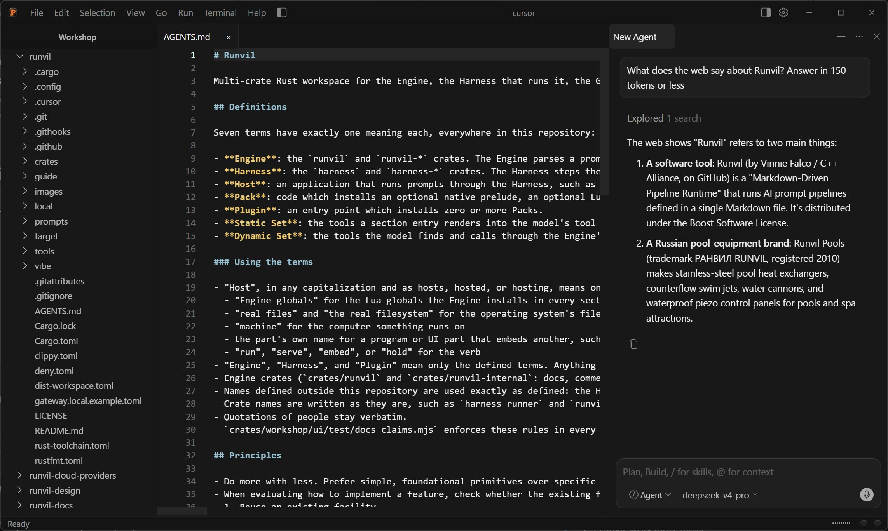

[](https://github.com/cppalliance/runvil/actions/workflows/ci.yml)
[](LICENSE)

# Runvil

Runvil runs AI prompt pipelines defined in a single Markdown file. The Markdown is the program, and the model is the CPU.

You write the model's instructions as prose and the logic as Lua, side by side in one file. Runvil runs that file with deterministic control flow, sends every model request through one gateway that holds your keys, and records every run.



## Workshop

Workshop is the desktop app. You open your folders in it, edit files, and work with agents in the chat panel beside the editor. Every agent is a Runvil prompt: the built-in chat agent is one, and any prompt you put in your agents folder shows up next to it. Agents can search and read the web, ask you questions, and use the MCP servers you configure, and Workshop records each run in a local log that only ever grows.

Installers for Windows, macOS (Apple Silicon and Intel), and Linux (AppImage and .deb, x86_64 and ARM64) are on the [nightly release](https://github.com/cppalliance/runvil/releases/tag/nightly). Nightly is a prerelease built from the latest code, and it doesn't update itself, so install a newer nightly to upgrade.

Every installer includes the gateway. Workshop connects to a gateway that's already running or starts its own, and the gateway stays in the system tray after you close the window, so your loaded models stay loaded.

## What a prompt looks like

This is [`prompts/greet.md`](prompts/greet.md), one of the sample prompts in this repository:

````markdown
---
name: greet
description: Greet the named input using a Lua-computed value
runvil: 0
models:
  writer: {}
---

# Greet

```lua
models.default("writer")
```

Computes a greeting from the input in Lua, substitutes it into the prose, and
has the model echo it.

## Main

```lua
var.greeting = "Hello, " .. args .. "!"
```

Repeat exactly, with no extra words: {{ var.greeting }}

```lua
return models.infer(prose)
```
````

The frontmatter declares one model role, `writer`, and the Lua under the title makes it the default. Given the input `Ada`, the first block in `## Main` builds `Hello, Ada!`, the placeholder puts it into the prose, and `models.infer(prose)` sends that prose to the model. The model's reply is the run's result. The paragraph under the title never reaches the model, because no Lua reads it, so it works as a comment.

## How it fits together

The Engine and the Harness are Rust libraries. The Engine parses a prompt and steps through it, and whenever the run needs a model reply, a tool result, a timer, or a file, it asks for one and waits. The Harness answers each of those requests and records the run. A Host is any application that runs prompts through the Harness. Workshop is one, and your own program becomes one when it embeds the Harness.

The gateway is the one process that holds model credentials, so no other process ever sees a vendor key. It serves an OpenAI-compatible API and routes each request to a cloud provider or to a model running on your own machine. It also provides web search, speech-to-text, text-to-speech, and a settings page in your browser, and you can run it on its own, on a desktop or a server.

## Documentation

The documentation site, [runvil.org](https://runvil.org), has the [Language guide](https://gh.cppalliance.org/runvil/language/) for writing prompts, the [Gateway guide](https://gh.cppalliance.org/runvil/gateway/) for installing and configuring the gateway, and the API references for embedding the Engine and the Harness in your own program.

## Contributing

Pull requests are welcome, and every change must pass the formatting, lint, and test checks that CI runs. [AGENTS.md](AGENTS.md) explains the project's terms and conventions and how to run those checks locally.

## License

Runvil is distributed under the [Boost Software License 1.0](LICENSE).
