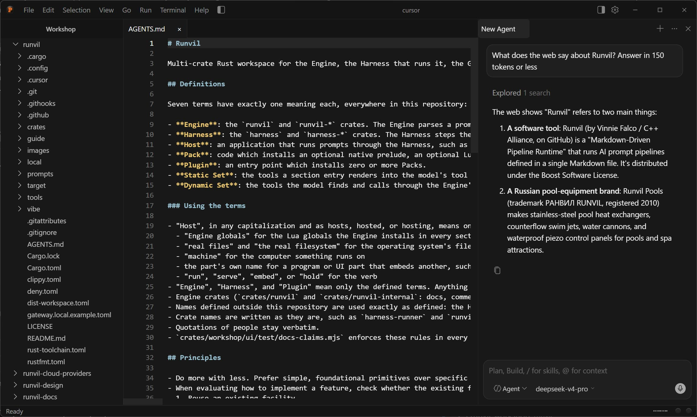

[](https://github.com/cppalliance/runvil/actions/workflows/ci.yml)
[](LICENSE)

# Runvil

Runvil runs AI prompt pipelines defined in a single Markdown file. The Markdown is the program, and the model is the CPU.

You write the model's instructions as prose and the logic as Lua, side by side in one file. Runvil runs that file with deterministic control flow, sends every model request through one gateway that holds your keys, and records every run.



Workshop is the desktop app for writing prompts, running them against local or remote models, and reviewing every run it records. One installer per platform installs it with the gateway:

| Platform | Installer |
|---|---|
| Windows x64 | [Runvil-setup.exe](https://github.com/cppalliance/runvil/releases/download/workshop-latest/Runvil-setup.exe) |
| macOS, Apple silicon | [Runvil-arm64.dmg](https://github.com/cppalliance/runvil/releases/download/workshop-latest/Runvil-arm64.dmg) |
| macOS, Intel | [Runvil-x64.dmg](https://github.com/cppalliance/runvil/releases/download/workshop-latest/Runvil-x64.dmg) |
| Linux x64 (Ubuntu 22.04, Debian 12, or later) | [Runvil-x64.run](https://github.com/cppalliance/runvil/releases/download/workshop-latest/Runvil-x64.run) |
| Linux ARM64 (Ubuntu 24.04, Debian 13, or later) | [Runvil-arm64.run](https://github.com/cppalliance/runvil/releases/download/workshop-latest/Runvil-arm64.run) |

The [latest release](https://github.com/cppalliance/runvil/releases/latest) holds the same installers under versioned names, with a `SHA256SUMS` file that lists them by those names. On Linux, make the `.run` file executable and run it from your desktop session.

The installer offers Workshop, the desktop app, and the Gateway, the local gateway described below, with its tray icon and Settings page. On Windows it also offers Speech to Text, which needs the Gateway. The Gateway downloads its speech runtime and two speech models, about 0.6 GB, the first time it starts with speech configured, so dictation works offline after that. Workshop installed without the Gateway attaches to a gateway already running for you, or else uses the one `~/.runvil/workshop.toml` names. By default, Windows installs into `%LOCALAPPDATA%\Runvil`, macOS into `/Applications/Runvil`, and Linux into `~/Runvil`.

Workshop checks for updates when it starts and offers each new version, which it installs when you accept. The Gateway is its own product with its own releases, at [cppalliance/runvil-gateway](https://github.com/cppalliance/runvil-gateway); each installer holds the Gateway release that Workshop pins.

The installers are not code-signed yet. On Windows, SmartScreen may stop the setup: choose More info, then Run anyway. On macOS, the first open is refused: open System Settings, then Privacy & Security, choose Open Anyway, and open the installer again. Until the apps are signed, the gateway's Launch at Login does not work on macOS.

## Workshop

Workshop is the desktop app. You open your folders in it, edit files, and work with agents in the chat panel beside the editor. Every agent is a Runvil prompt: the built-in chat agent is one, and any prompt you put in your agents folder shows up next to it. Agents can search and read the web, ask you questions, and use the MCP servers you configure, and Workshop records each run in a local log that only ever grows.

Workshop connects to a Gateway that's already running or starts the installed one, and the Gateway stays in the system tray after you close the window, so your loaded models stay loaded.

Workshop is developed in its own repository, [cppalliance/runvil-workshop](https://github.com/cppalliance/runvil-workshop). This repository builds the installers from the Workshop commit that its root `Cargo.toml` pins.

## What a prompt looks like

This is [`prompts/greet.md`](https://github.com/cppalliance/runvil-harness/blob/master/prompts/greet.md), one of the sample prompts in the Engine's repository:

````markdown
---
name: greet
description: Greet a name using a Lua-computed value
runvil: 0
args:
  type: object
  properties:
    name: { type: string, description: The name to greet }
  required: [name]
---

Computes a greeting for its `name` argument in Lua, substitutes it into the prose, and has the model echo it.

## Main

```lua
var.greeting = "Hello, " .. args.name .. "!"
```

Repeat exactly, with no extra words: {{ var.greeting }}

```lua
return models.infer(prose)
```
````

The `args:` key declares the one argument the prompt takes, a required string named `name`. The prompt declares no models, so `models.infer(prose)` runs on the Host's default model. Given the arguments `{"name":"Ada"}`, the first block in `## Main` builds `Hello, Ada!`, the placeholder puts it into the prose, and `models.infer(prose)` sends that prose to the model. The model's reply is the run's result. A prompt can pick another of the five roles (`default`, `strong`, `small`, `fast`, `creative`) with `models.use(role)`, and the Host decides which model fills each role. The paragraph above `## Main` never reaches the model, because text before the first heading with no Lua block in it is a comment.

## How it fits together

The Engine and the Harness are Rust libraries. The Engine parses a prompt and steps through it, and whenever the run needs a model reply, a Pack's render of the tools a section offers, a Pack tool's result, a timer, or a store operation, it asks for one and waits. The Harness answers each of those requests and records the run. A Host is any application that runs prompts through the Harness. Workshop is one, and your own program becomes one when it embeds the Harness. The Engine and the Harness are developed in their own repository, [cppalliance/runvil-harness](https://github.com/cppalliance/runvil-harness).

The Gateway is the one process that holds model credentials, so no other process ever sees a vendor key. It serves an OpenAI-compatible API and routes each request to a cloud provider or to a model running on your own machine. It also provides web search, speech-to-text, text-to-speech, and a settings page in your browser, and you can run it on its own, on a desktop or a server. It is developed and released separately, in [cppalliance/runvil-gateway](https://github.com/cppalliance/runvil-gateway).

## Documentation

The documentation site, [runvil.org](https://runvil.org), has the [Language guide](https://gh.cppalliance.org/runvil/language/) for writing prompts, the [Gateway guide](https://runvil.org/gateway/) for installing and configuring the Gateway, and the API references for embedding the Engine and the Harness in your own program. The Gateway's guide and its API reference live with the Gateway, in [its own repository](https://github.com/cppalliance/runvil-gateway).

## Contributing

Pull requests are welcome, and every change must pass the formatting, lint, and test checks that CI runs. [AGENTS.md](AGENTS.md) explains the project's terms and conventions and how to run those checks locally.

## License

Runvil is distributed under the [Boost Software License 1.0](LICENSE).
