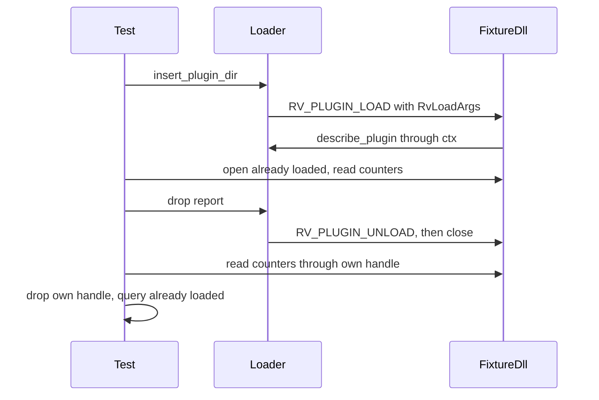

<plan-context>

# Contract 0.2 in the Engine Loader

The engine's plugin loader speaks contract 0.2: it takes the C types from `runvil-plugin-sys` in the `runvil-plugin-api` repository instead of its own `runvil_plugin::abi` copy, reports version 0.2 in `RvHost`, and hands each load an `RvLoadArgs` whose `refuse` and `describe_plugin` take a loader-owned `ctx` that stays valid until the Plugin unloads. The do-nothing test fixture DLL moves to 0.2 and gains three exported counters, so one end-to-end test proves it was loaded, invoked, unloaded exactly once, and closed, on Windows, Linux, and macOS.

## API Surface

### `Cargo.toml`

```toml
# The C Plugin contract, version 0.2, from its own
# repository, pinned by commit. The file may write it
# as an inline table in [workspace.dependencies].
[workspace.dependencies.runvil-plugin-sys]
version = "0.2.0"
git = "https://github.com/cppalliance/runvil-plugin-api"
rev = "63a2403761b925b1f52bcf361c97b4fb04c04d74"
# new
```

### `deny.toml`

```toml
# [sources]: the one git source cargo-deny accepts
# beside `unknown-git = "deny"`.
allow-git = [
    "https://github.com/cppalliance/runvil-plugin-api",
]
# new
```

### `crates/runvil-plugin/src/lib.rs`

```rust
/// The C contract every Plugin entry point follows, as
/// a Rust mirror.
pub mod abi;
// removed
// callers:
// crates/harness-internal/plugin-loader/src/plugin.rs (10)
// crates/harness-internal/plugin-loader/src/load.rs (9)
// crates/harness-internal/plugin-loader/src/host.rs (5)
// and 1 more file (fakes.rs, test only)
```

### `crates/harness-internal/plugin-loader/src/plugin.rs`

```rust
/// Loads a linked Plugin's entry point as a 0.2 Host;
/// its Packs go into `packs`.
pub fn insert_plugin(
    packs: &mut PackRegistry,
    entry: runvil_plugin_sys::PluginEntry,
) -> Result<Arc<Plugin>, Error>;
// changed, was: entry: runvil_plugin::abi::PluginEntry
// callers:
// crates/harness/src/lib.rs (1, re-export)
// crates/harness-internal/plugin-loader/src/plugin-tests.rs
//   (2, test only)
```

### `crates/harness-internal/test-plugin/src/lib.rs`

```rust
/// The fixture's entry point, speaking contract 0.2: it
/// reads `RvLoadArgs` from `call->args` and calls back
/// through its `ctx`.
#[unsafe(no_mangle)]
pub unsafe extern "C" fn runvil_plugin(
    call: *mut RvCall,
) -> RvStatus;
// changed, was: the same signature over the private
// 0.1 `RvCall` and `RvHost`
// callers:
// crates/harness-internal/test-plugin/tests/it/insert.rs
//   (through the loader)
// crates/harness-internal/test-plugin/src/lib-tests.rs
//   (test only)

/// Successful `RV_PLUGIN_LOAD` calls since this copy of
/// the library was opened.
#[unsafe(no_mangle)]
pub extern "C" fn harness_test_plugin_loads() -> u32;
// new

/// `RV_PLUGIN_UNLOAD` calls that freed an instance since
/// this copy of the library was opened.
#[unsafe(no_mangle)]
pub extern "C" fn harness_test_plugin_unloads() -> u32;
// new

/// Instances made and not yet dropped: incremented when
/// an instance is made, decremented in its `Drop`.
#[unsafe(no_mangle)]
pub extern "C" fn harness_test_plugin_live() -> u32;
// new
```

## Design

### Where the contract comes from

- Only `harness-plugin-loader` depends on `runvil-plugin-sys`; `runvil-plugin` loses its `abi` module and gains no dependency. Nothing outside the loader imports `runvil_plugin::abi` (grep of `crates/`).
- The source repository is public. `runvil-plugin-sys` 0.2.0 has no dependencies and sets `links = "runvil_plugin"`, so Cargo allows one contract version per build (`runvil-plugin-api` `crates/runvil-plugin-sys/Cargo.toml`).
- The product matrix skips dependencies that are not workspace members (`crates/build-xtask/src/product.rs` L286-291), and the Engine guard bans only tokio, tokio-util, async-trait, reqwest, getrandom, and fastrand (`crates/build-xtask/src/engine_deps.rs` L38-45), so neither check objects. cargo-deny does object until `allow-git` names the repository: `[sources]` holds `unknown-git = "deny"` and only `allow-registry` (`deny.toml` L69-73), and its comment "no git sources are expected" changes to name this one. `BSL-1.0` is already in `licenses.allow` (`deny.toml` L19-43). The dependency carries `version = "0.2.0"` beside `git` and `rev`, so `bans.wildcards` sees no `*` requirement.
- The `runvil` facade's surface names no Plugin item (`crates/runvil/public-api.txt`), so `xtask api` is unaffected.
- The 0.2 types, verbatim from `runvil-plugin-api` `crates/runvil-plugin-sys/src/lib.rs` L108-218: `RvHost { size: u32, api_major: u32, api_minor: u32, reserved: u32 }` (16 bytes), `RvLoadArgs { size: u32, reserved: u32, ctx: *mut c_void, refuse: unsafe extern "C" fn(ctx: *mut c_void, reason: RvStr) -> RvStatus, describe_plugin: unsafe extern "C" fn(ctx: *mut c_void, info: *const RvPluginInfo) -> RvStatus }` (32 bytes), `RvCall` and `RvPluginInfo` unchanged, `RV_API_MAJOR = 0`, `RV_API_MINOR = 2`.

### Loader behavior at 0.2

- `HOST` becomes the 16-byte `RvHost` with `RV_API_MAJOR` and `RV_API_MINOR` from `runvil-plugin-sys`.
- `send_load` builds an `RvLoadArgs` (`size`, `reserved: 0`, `ctx`, `refuse`, `describe_plugin`) and points `call.args` at it. `send_unload` keeps `args` NULL.
- `ctx` is a loader-owned heap allocation. Today's thread-local session compares the `RvCall` address (`crates/harness-internal/plugin-loader/src/host.rs` L32-49, L163-181); it compares the open load's `ctx` instead. `refuse` and `describe_plugin` read through `ctx` only when it equals the `ctx` of the load open on the calling thread; otherwise they answer `RV_ERR_MISUSE`, and an open load records the misuse `a load function was handed a ctx other than the open RV_PLUGIN_LOAD call's`.
- Lifetime: for a load that succeeds, the allocation becomes a field of the loader's `Instance` (`crates/harness-internal/plugin-loader/src/load.rs` L137-140). `Instance`'s `Drop` sends `RV_PLUGIN_UNLOAD` through `send_unload` (L150-157, `host.rs` L320-347), and its fields drop after that body, so the allocation is freed after `RV_PLUGIN_UNLOAD` returns. `Loaded` drops `_instance` before `_library` (L166-173), so it is also freed before the library closes. A late call through a stashed `ctx` therefore answers `RV_ERR_MISUSE` instead of reaching freed memory. For a rejected load, it is freed when `send_load` returns.
- Unload still runs with no load open on its thread, and every existing check keeps its order and message: refuse twice, describe twice, NULL or misaligned info, short `size`, nonzero `reserved`, and the name and version rules.

### The fixture at 0.2

- It keeps its private mirror and no `[dependencies]`; the mirror moves to the 0.2 layout, and its unit tests pin `RvHost` at 16 bytes (offsets 0, 4, 8, 12) and `RvLoadArgs` at 32 bytes (offsets 0, 4, 8, 16, 24).
- It accepts only a Host table at least 16 bytes long that reports exactly 0.2, and checks the version before reading `args`. NULL `args` answers `RV_ERR_MISUSE`; an `RvLoadArgs` shorter than 32 bytes answers `RV_ERR_UNSUPPORTED`. It still describes itself as `test-plugin` at `0.1.0`, its own version.
- The three counters are process-global atomics in the library. Each test copies the library into its own directory (`crates/harness-internal/test-plugin/tests/it/support.rs` L16-52: `copy_fixture`), so each copy is a separate module with its own statics. The `#[cfg(test)]` thread-local `LIVE_INSTANCES` that the unit tests use stays as it is (`crates/harness-internal/test-plugin/src/lib.rs` L127-139).
- The fixture's `Instance` (`crates/harness-internal/test-plugin/src/lib.rs` L122-125) has a `Drop` compiled only under `#[cfg(test)]` (L144-149). For `harness_test_plugin_live`, that `Drop` becomes unconditional and decrements the atomic in every build, and keeps decrementing `LIVE_INSTANCES` under `#[cfg(test)]`.

### The end-to-end proof



1. `insert_plugin_dir` on the copied fixture reports one Plugin, `test-plugin` `0.1.0`, and no failures (loaded and invoked).
2. While it is loaded, the test opens the same absolute path as an already-loaded library and resolves the three counters: loads 1, unloads 0, live 1.
3. The test drops the report. Its own handle keeps the module mapped, so it reads unloads 1 and live 0: one unload that freed the instance.
4. The test drops its handle, and the already-loaded query on the same path now returns `Err`: the library closed.

- Already-loaded query: on Windows, `libloading::os::windows::Library::open_already_loaded(path)`, which is safe; on Unix, the `unsafe` `libloading::os::unix::Library::open(Some(path), libc::RTLD_NOLOAD | libc::RTLD_LAZY)`. Both return `Err` when the library is not loaded (libloading 0.8.9 `src/os/windows/mod.rs` L118-142, `src/os/unix/mod.rs` L180-208). libc 0.2.189 defines `RTLD_NOLOAD` for Linux and Apple targets. Versions from `Cargo.lock`.
- `harness-test-plugin` gains the dev-dependencies `libloading` and `libc` (Unix targets only), both already in `[workspace.dependencies]`. Its `tests/it` crate takes `#![expect(unsafe_code, reason = ...)]`; the unsafe allowlist exempts the whole crate directory (`crates/build-xtask/src/unsafe_allowlist.rs` L19-26).
- The test uses the path `copy_fixture` returns, made absolute with `std::path::absolute` as the loader does (`crates/harness-internal/plugin-loader/src/load.rs`).

## Notes

- `https://github.com/cppalliance/runvil-plugin-api` holds `master` at `63a2403761b925b1f52bcf361c97b4fb04c04d74`, the commit `rev` pins (`runvil-plugin-api` `.git/refs/remotes/origin/master`), so step 1 can resolve the dependency.
- Commands, with `W` = `--exclude workshop --exclude workshop-server --exclude workshop-server-api` (`AGENTS.md` L45-51, `.github/workflows/ci.yml`):
  - Build: `cargo build`.
  - Package tests: `cargo nextest run --locked -p harness-plugin-loader -p harness-test-plugin -p runvil-plugin`.
  - Full suite: `cargo nextest run --locked --workspace W --all-features`, plus `cargo nextest run --locked -p workshop -p workshop-server -p workshop-server-api`.
  - Lint: `cargo clippy --workspace W --all-targets --all-features` and `cargo clippy -p workshop -p workshop-server -p workshop-server-api --all-targets`, both with `CARGO_BUILD_WARNINGS=deny`.
  - Format: `cargo fmt --all --check`.
  - Docs, with `RUSTDOCFLAGS="-D warnings"`: `cargo doc --workspace --no-deps --all-features W`, `cargo doc -p runvil --no-deps`, and `cargo doc -p harness --no-deps`.
  - Structural checks: `cargo test -p build-xtask`. Supply chain: `cargo deny check`. Wording: `node --test crates/workshop/ui/test/docs-claims.mjs`.
- The test commands use `--locked`, so step 1 commits the updated `Cargo.lock`.
- Docs that name `runvil_plugin::abi` change with it: `crates/runvil-plugin/src/lib.rs` (crate docs), `crates/harness-internal/plugin-loader/Cargo.toml` (comment), and the comments in `crates/harness-internal/test-plugin/src/lib.rs` and `src/lib-tests.rs`.

### Open questions

None

</plan-context>

## Steps

<step-1>

1. [done] **Speak contract 0.2 in the loader and the fixture** (points: 10) - Add the `runvil-plugin-sys` workspace dependency and the `deny.toml` `allow-git` entry, and make `harness-plugin-loader` depend on it. Remove `runvil_plugin::abi`, and point the loader's imports and `insert_plugin`'s `PluginEntry` at `runvil-plugin-sys`. Rebuild `host.rs` for 0.2: the 16-byte `HOST`, an `RvLoadArgs` per load, and a `ctx`-keyed session whose `ctx` allocation lives until `RV_PLUGIN_UNLOAD` returns, or until a rejected load returns. Update `fakes.rs` and the loader tests. Move the fixture's private mirror and its `runvil_plugin` entry point to 0.2, and update the docs that name `abi`. Tests: a late call through a `ctx` stashed during a successful load answers `RV_ERR_MISUSE` after the load returns; a load function called from another thread during the load answers `RV_ERR_MISUSE`; a load function handed another `ctx` during the load fails the load as a misuse with the message `a load function was handed a ctx other than the open RV_PLUGIN_LOAD call's`; the existing loader checks pass at 0.2; the fixture answers `RV_ERR_UNSUPPORTED` to a Host reporting 0.1, `RV_ERR_MISUSE` to NULL `args`, and `RV_ERR_UNSUPPORTED` to a short `RvLoadArgs`; the fixture's layout pins match 16 and 32 bytes; the existing end-to-end tests load `test-plugin` at 0.2.
   - Score: dependency and `allow-git` 1, removing `abi` and repointing imports 0, `insert_plugin` type path 0, `HOST` and `RvLoadArgs` wiring 1, `ctx`-keyed session with ownership until unload 6 (allocation lifetime across load, rejection, and unload 3, per-thread open-load matching 3), fixture mirror and 0.2 checks 1, `fakes.rs` and test updates 1.

</step-1>

<step-2>

2. [done] **Prove the fixture's whole lifecycle end to end** (points: 5) - Add `harness_test_plugin_loads`, `harness_test_plugin_unloads`, and `harness_test_plugin_live` over process-global atomics in the fixture, make the fixture `Instance`'s `Drop` unconditional so it decrements the live count in every build, and add the `libloading` and `libc` dev-dependencies. Add one end-to-end test that loads the copied fixture through `insert_plugin_dir`, reads the counters through its own already-loaded handle before and after dropping the report, then drops its handle and confirms the already-loaded query returns `Err`, on Windows and Unix. Tests: the report names `test-plugin` `0.1.0` with no failures; the counters read loads 1, unloads 0, live 1 while loaded; unloads 1 and live 0 after the report drops; the already-loaded query fails after the test's handle drops.
   - Score: the three counter exports over atomics 1, the lifecycle test with the per-platform already-loaded query 3 (OS reference counting and platform-specific failure handling), dev-dependencies and the `tests/it` unsafe expectation 1.

</step-2>
