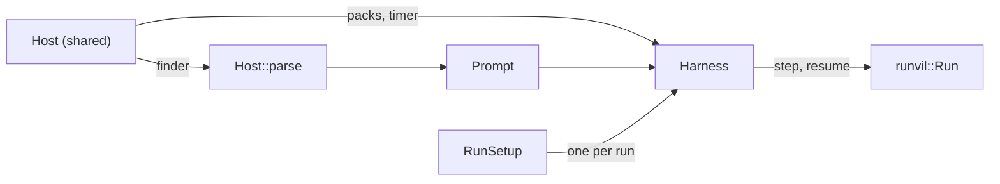

<plan-context>

# Host and RunSetup for the Harness

A Host builds one `Host` at startup and shares it behind an `Arc`. It holds the Host's built Packs, a prompt finder, and its timer. `host.parse(name)` finds a prompt, parses it, and checks its `uses:` list against the Host's Packs. Each run gets a `RunSetup` holding everything specific to that run: its recorder, broker, services, filesystem, model selection, workspace roots, limits, tool-call cap, arguments, and input text. `Harness::new(host, prompt, setup)` then drives one Engine `Run`.

This replaces `HostContext`, `HostSnapshot`, `RunRequest`, and the five-argument `Harness::new`. It also removes the runner's internal repack types `Services`, `Begun`, `Prepared`, and `Performers`, and it drops three values nothing reads: the Engine's `execution` run label, and `RunMeta`'s `name` and `prompt_hash` along with the run log's columns for them. A prompt that fails to parse is the caller's error and leaves no run record.

## How the parts fit



- **`Host` holds what every run of one Host shares.** The Workshop builds one at startup. Tests and the example build one per suite.
- **`RunSetup` holds what one run gets on top of the Host.** The launcher builds one for each run. That is where the Workshop's per-conversation recorder, broker, and input-broker services go (`crates/workshop/server/src/agents.rs:342-355`, `crates/workshop/agents/src/conversation-run.rs:25-49`).
- **The Harness reads each `RunSetup` field once per run.** This matters most for `vfs`: input staging, the run itself, and reading the declared output all use that one filesystem.
- **The Engine's `runvil::Run` stays public.** The runner reaches the Engine only through the `runvil` facade (`crates/harness-internal/runner/Cargo.toml`), and `doc(hidden)` is banned under both facades (`crates/build-xtask/src/doc_hidden.rs:1-7`).

## Decisions

- **A parse failure leaves no run record.**
  - The Workshop never shows parse events: `AgentEvent::from_event` keeps only thinking, replies, tool calls, and tool results (`crates/workshop/server/src/agents/wire.rs:231-302`).
  - Today a parse failure reaches the user as a run-failed error frame carrying the error's located message (`crates/workshop/agents/src/conversation-run.rs:76-98`, `crates/workshop/server/src/agents/socket.rs:140-146`). Step 2 keeps that frame.
  - The only thing that sends that frame is the private `Conversation::report` (`crates/workshop/agents/src/conversation.rs:278`). So `Conversation::run` parses the agent itself and reports a parse failure through it, and the Workshop gains no new public function.
- **`RunMeta.prompt_hash` is dropped.** A parsed `Prompt` keeps no source text (`crates/runvil-internal/prompt/src/prompt.rs:133-179`), and nothing reads the hash back. The run log only writes it (`crates/workshop/run-log/src/append.rs:80`). With it goes the runner's `sha2` dependency (`crates/harness-internal/runner/Cargo.toml`).
- **The Engine's `execution` run label is removed.**
  - The Engine copies it into every event, into `ToolCallOrigin`, and into Lua's `sys.execution`, and never reads it back (`crates/runvil-internal/types/src/event.rs:7-16`, `crates/runvil-internal/engine/src/execute/params.rs:36-38`).
  - Outside the Engine, a single harness test reads it (`crates/harness-internal/runner/tests/it/harness.rs:222-227`). Inside, a single Engine test reads `sys.execution` (`crates/runvil-internal/engine/src/execute/tests/suite/exec_flow/globals.rs:341`).
  - Every record already reaches the recorder under its run's id, so an event doesn't need to name its run.
  - If a run label is ever needed, it comes from where its reader sits, never through the Engine. A tool reads it from `RunSetup.services` under its own key, and a recorder already knows each run by the `RunId` it issued.
- **The run's name is removed.** `RunMeta.name` and the run log's `runs.name` column are read back only by tests (`crates/workshop/run-log/src/read.rs:18-24`). They go with no migration, the same as `prompt_hash`.
- **The run log gets no migration.** Its schema is only `CREATE TABLE IF NOT EXISTS`, with no version (`crates/workshop/run-log/src/schema.rs:21-36`), and `prompt_hash` is `TEXT NOT NULL` with no default. A run-log file written by an older build must therefore be deleted before the new build writes to it.
- **`launch` still checks the agent exists before opening a conversation.** It keeps calling `load_agent` on the blocking pool, so an unknown agent is still refused at launch (`crates/workshop/server/src/agents.rs:292-307`). The parse in `Conversation::run` reads the file a second time.
- **`RunParams::with_provenance_start` stays in the Engine.** The Harness stops calling it. The Engine's own example and test suite still use it (`crates/runvil/examples/greeter.rs:83`, `crates/runvil/tests/suite/event.rs:41`).
- **`PromptFinder` lives in the Engine's prompt crate, and `Prompt::parse` takes it.** `Prompt::parse(finder, name)` finds the source and parses it, so the main prompt and, later, the children `execute()` names resolve the same way. The harness re-exports the trait as `harness::PromptFinder`.
  - Step 1 already breaks `Prompt::parse`'s signature by removing `execution`, so doing this now means one break instead of two.
- **A prompt's name is its identity.** `PromptFinder::find` returns only the source, and `Prompt::parse` uses the name as the prompt's file, so `Prompt::file` and every failure use the name.
  - When `execute()` lands, prompts will refer to each other by these Host names, not by paths relative to the file that names them, so the name also works as the key for spotting duplicates.
  - One cost: the Workshop's errors will name the agent instead of the path `load_agent` read (`crates/workshop/agents/src/discovery.rs:23`).
- **The tool-iteration ceiling is a new `RunLimits` field.** `max_tool_iterations` keeps its current meaning. Today the prompt's declared value replaces the limit outright (`crates/runvil-internal/engine/src/execute/context.rs:328-339`). The ceiling defaults to 1000, the most a prompt may declare (`crates/runvil-internal/prompt/src/frontmatter.rs:85-86`), so default behavior doesn't change.
- **The cap on tool calls in flight moves to `RunSetup`.** It currently lives on `ToolPerformer::max_in_flight` (`crates/harness-internal/runner/src/performers.rs:120`), and only one test overrides it (`crates/harness-internal/runner/tests/it/effect_loop-cap.rs:158`).
- **`effect_loop::drive_run` stays public** as the effect loop's single test entry point. The `prepare` module becomes private, and its test suites go through `Harness::run` instead.
- **Out of scope:** `prompts:` frontmatter, resolving child prompts at parse time, Lua `execute()`, and the `runvil/subagents` tools.

## Notes

- **Repository:** `runvil/` in the workspace, at `c:\Users\Vinnie\cursor\runvil`. Every path in this plan is relative to it.
- **Build:** `cargo build` builds the default members, which are the Engine and its facades. The Workshop builds with `cargo build --locked -p workshop`. Source: `Cargo.toml:10-14`, `.github/workflows/ci.yml`.
- **Package tests:** `cargo nextest run --locked -p <package>`. Source: `AGENTS.md:46-50`.
- **Full suite:** run both of these. Source: `AGENTS.md:46-50`, `.github/workflows/ci.yml`.
  - `cargo nextest run --locked --workspace --exclude workshop --exclude workshop-server --exclude workshop-server-api --all-features`
  - `cargo nextest run --locked -p workshop -p workshop-server -p workshop-server-api`
- **Lint:** run both with `CARGO_BUILD_WARNINGS=deny` set. In PowerShell, set it first with `$env:CARGO_BUILD_WARNINGS='deny'`.
  - `cargo clippy --workspace --exclude workshop --exclude workshop-server --exclude workshop-server-api --all-targets --all-features`
  - `cargo clippy -p workshop -p workshop-server -p workshop-server-api --all-targets`
- **Format:** `cargo fmt --all --check`.
- **Surface checks:**
  - `cargo test -p build-xtask` runs the facade shape check and the `doc(hidden)` ban.
  - `cargo +NIGHTLY xtask api --check`, with `CARGO_BUILD_WARNINGS` unset. NIGHTLY is the toolchain pinned in `crates/build-xtask/src/api/toolchain.rs`.
  - After changing the `runvil` facade's surface, regenerate `crates/runvil/public-api.txt` with `cargo +NIGHTLY xtask api --bless`.
  - Source: `crates/build-xtask/src/api.rs:1-35`, `AGENTS.md:46-50`.
- **Every step's commit leaves the whole workspace building** and the tests of every package it touches passing.
- **Pre-existing doc slip:** `RunReport::output` and `files::report_output` call the `Reason` fact `make_not_completed_error`; the value is `not_completed` (`crates/harness-internal/runner/src/harness.rs`, `files.rs`).
- **Pre-existing race:** the agent socket subscribes to a conversation's failure reports only after `launch` has spawned `drive` (`crates/workshop/server/src/agents/socket.rs:376-423`), so a failure reported first, such as a parse failure, can miss that client.
- **The Workshop's language guide is outside this repository.** Its pages live in `runvil-docs/src/language`, and the guide is switched off in `crates/workshop/server/src/agents/language_guide.rs`. If those pages mention `sys.execution`, they need their own update; this plan doesn't touch them.

## Open questions

None

</plan-context>

## Steps

<step-1>

1. [done] **Host and prompt finder** (points: 10) - Move `HostContext` out of `crates/harness-internal/runner/src/host.rs` into a new `src/packs.rs` as `Packs`. Its `host-tests*.rs` modules move with it as `packs-tests*.rs`. Rename it at every caller and doc mention, including `crates/runvil-plugin/src/registry.rs:28`.
   - In the Engine, add `PromptFinder` and its closure impl in a new `crates/runvil-internal/prompt/src/finder.rs`, and re-export the trait from the `runvil` facade.
   - Change `Prompt::parse` to take the finder and the prompt's name. A finder failure comes back as the parse result, after a `ParseStarted` and a `ParseFailed` event.
   - Callers that parse inline text pass a closure that returns it:
     - the Engine's `parse_ok` and `parse_err` helpers in `crates/runvil-internal/prompt/src/test_support.rs:168-190`;
     - the Workshop's contract route in `crates/workshop/server/src/routes/prompts.rs:202`, which closes over `body.text` and passes `body.name` as the name;
     - the Harness's current preparation in `crates/harness-internal/runner/src/prepare.rs:214`, which until step 2 closes over `RunRequest.source` and passes `RunRequest.file` as the name;
     - every test.
   - In `src/host.rs`, add `Host` and `Host::parse`. `Host::parse` calls `Prompt::parse(&*self.prompts, name)` and logs the parse events through `tracing` at debug level.
   - Add `Packs::refusals` for the `uses:` check. It resolves names the same way a run's Pack pick does: a bare id means `runvil/<id>`.
   - Re-export `Host` and `PromptFinder` from the `harness` facade. Nothing in production builds a `Host` yet.
   - Remove the Engine's `execution` run label:
     - from `Prompt::parse`, `RunParams::new`, `ToolCallOrigin`, every `Event` variant and `Event::execution`, `Emitter::new`, `Emitter::root`, and `Emitter::emit`'s builder, the `Lifecycle` alias, `ChainState::execution`, and Lua's `sys.execution`;
     - from `RunParams`' `name` field and the shared state it feeds;
     - from every caller and doc comment, including `RunRequest.name`'s doc in `crates/harness-internal/runner/src/harness.rs:65`;
     - and the event-label assertion in `crates/harness-internal/runner/tests/it/harness.rs:222-227`.
   - Regenerate `crates/runvil/public-api.txt`.
   - Tests:
     - `Prompt::parse` over a closure finder parses the prompt and names it by its name in `Prompt::file`.
     - A finder error comes back from `Prompt::parse` unchanged, after a `ParseFailed` event.
     - A source that fails to parse returns the parser's error, located in the named prompt.
     - A `uses:` entry naming an uninstalled Pack returns `RequirementsUnmet` naming it, and so does one naming a Pack whose construct failed.
     - A prompt whose declared Packs all built parses.
     - A serialized event and a tool call's origin have no `execution` key.
     - `sys.execution` is nil in a section.
   - Score: `Packs` 0 (rename), `Packs::new` 0 (rename), `Packs::refusals` 1, `PromptFinder` 1, closure impl 1, `Prompt::parse` taking the finder 1, callers' closures 0, `Host` with its `Debug` 1, `Host::parse` 4 (failure handling 3, `uses:` check 1), Engine, runner, and facade module declarations and re-exports 0, `execution` removal across `Prompt::parse`, `RunParams::new`, `ToolCallOrigin`, `Event`, `Emitter::new`, `Emitter::root`, `Emitter::emit`, `Lifecycle`, `ChainState`, and `sys.execution` 1.

`crates/harness-internal/runner/src/packs.rs`

```rust
/// Every Pack a Host built from its registry. Built
/// once and shared by every run of that Host; the
/// Pack objects drop with it.
pub struct Packs {
    // private fields
}
// changed, was: pub struct HostContext in
// src/host.rs
// callers:
// crates/harness-internal/runner/tests/it/prepare.rs (8)
// crates/harness-internal/runner/src/host-tests.rs (7)
// crates/workshop/server/src/agents.rs (6)
// and 20 more files

impl Packs {
    /// Builds every Pack `packs` holds, handing each
    /// `construct` its stored config and the
    /// Host-wide `services`. A failed construct
    /// leaves that Pack unavailable, with the failure
    /// as its reason.
    pub fn new(
        packs: PackRegistry,
        services: HostServices,
    ) -> Packs;
    // changed, was: HostContext::new
    // callers in crates/harness-internal/runner/:
    // tests/it/prepare.rs (3)
    // tests/it/prepare-ready.rs (3)
    // tests/it/harness-stop-timing.rs (2)
    // and 14 more files in harness, runner, workshop

    /// Why each Pack `prompt` declares can serve no
    /// run of this Host: not installed, or its
    /// construct failed. A bare `uses:` id means
    /// `runvil/<id>`. Empty when every one built.
    pub(crate) fn refusals(
        &self,
        prompt: &Prompt,
    ) -> Vec<(PackId, String)>;
    // new
}
```

`crates/harness-internal/runner/src/host.rs`

```rust
/// What every run of one Host shares: its built
/// Packs, how it finds prompts, and its timer. A
/// Host builds one and shares it behind an `Arc`.
pub struct Host {
    pub packs: Packs,
    pub prompts: Arc<dyn PromptFinder>,
    pub timer: Arc<dyn Timer>,
}
// new

impl Host {
    /// Parses the prompt `name` with `Prompt::parse`
    /// over `prompts`, then checks its `uses:` against
    /// `packs`. Returns the parse failure, a finder's
    /// included, as given, or `RequirementsUnmet`
    /// naming each Pack that `Packs::refusals`
    /// reports, with its reason.
    pub fn parse(
        &self,
        name: &str,
    ) -> Result<Prompt, Error>;
    // new
}

/// Shows the Packs; omits the finder and the timer.
impl fmt::Debug for Host;
// new
```

`crates/harness-internal/runner/src/lib.rs`

```rust
mod packs;
// new: HostContext's code moves here
pub use host::Host;
// new
pub use packs::Packs;
// changed, was: pub use host::HostContext
// callers: as for Packs
```

`crates/harness/src/lib.rs`

```rust
pub use harness_runner::Host;
// new
pub use runvil::PromptFinder;
// new

pub mod pack {
    pub use harness_runner::Packs;
    // changed, was: pub use harness_runner::HostContext
    // callers: as for Packs
}
```

`crates/runvil-internal/prompt/src/finder.rs`

```rust
/// Finds a prompt's source by its name, such as
/// `research.md`. The name is the prompt's identity:
/// `Prompt::file` and every failure use it.
pub trait PromptFinder: Send + Sync {
    /// The source of the prompt named `name`, or the
    /// error saying why it cannot be found or read.
    fn find(&self, name: &str) -> Result<String, Error>;
}
// new

/// Any `Fn(&str) -> Result<String, Error>` is a
/// finder, so a test or a one-prompt Host needs no
/// type of its own.
impl<Func> PromptFinder for Func
where
    Func: Fn(&str) -> Result<String, Error>
        + Send
        + Sync;
// new
```

`crates/runvil-internal/prompt/src/lib.rs`

```rust
mod finder;
// new
pub use finder::PromptFinder;
// new
```

`crates/runvil/src/lib.rs`

```rust
pub use runvil_prompt::PromptFinder;
// new
```

`crates/runvil-internal/prompt/src/parse.rs`

```rust
impl Prompt {
    /// Finds the prompt `name` through `finder` and
    /// parses it, returning the events reported while
    /// parsing. A find failure is the parse result.
    /// `name` names the prompt in failures and in
    /// `Prompt::file`.
    pub fn parse(
        finder: &dyn PromptFinder,
        name: &str,
    ) -> (Result<Prompt, Error>, Vec<Event>);
    // changed, was: parse(input, file, execution)
    // callers: 32 files, most with 3 each:
    // tests-chain.rs and h1_fences.rs in the Engine,
    // crates/runvil/tests/suite/prompt.rs,
    // and 29 more files
}
```

`crates/runvil-internal/engine/src/execute/params.rs`

```rust
impl RunParams {
    /// Params for one run with the given `seed` and
    /// `started_at`.
    pub fn new(
        seed: RunSeed,
        started_at: Timestamp,
    ) -> RunParams;
    // changed, was: new(name, seed, started_at)
    // callers: 16 files; most in
    // crates/runvil-internal/engine/src/execute/:
    // context.rs (4)
    // tests/run_inputs.rs (3)
    // and 14 more files with 1 each
}
```

`crates/runvil-internal/types/src/tools/origin.rs`

```rust
pub struct ToolCallOrigin {
    pub execution: String,
    // removed; no Rust code reads it, and its JSON
    // key is asserted only in tests
    // other fields unchanged
}

impl ToolCallOrigin {
    /// The origin of a call made by `caller` in the
    /// section named `section`.
    pub fn new(
        section: impl Into<String>,
        caller: ToolCaller,
    ) -> ToolCallOrigin;
    // changed, was: new(execution, section, caller)
    // callers: 15 files; 2 each in offering.rs,
    // tools-tests.rs, and run/tests.rs in the
    // Engine, and 12 more files
}
```

`crates/runvil-internal/types/src/event.rs`

```rust
pub enum Event {
    // every variant loses execution: String;
    // a serialized event has no execution key
}
// changed, was: every variant held execution
// callers: every Event literal, most in Workshop
// tests: wire-tests.rs (6), transcript-tests.rs (5),
// crates/workshop/agents/src/tee-tests.rs (3);
// the run log keeps old records' key as opaque JSON

impl Event {
    pub fn execution(&self) -> &str;
    // removed
    // callers: 6 files, 1 each
}
```

`crates/runvil-internal/types/src/event_lifecycle.rs`

```rust
/// A payload-free lifecycle boundary: the
/// constructor of one `Event` variant over the
/// section's name and the provenance.
pub type Lifecycle = fn(String, Provenance) -> Event;
// changed, was: fn(String, String, Provenance)
// -> Event; retypes every constant, such as
// PARSE_STARTED
// callers in crates/runvil-internal/types/src/:
// event-tests.rs (2)
// event_lifecycle.rs (1)
// emitter.rs (1)
```

`crates/runvil-internal/types/src/emitter.rs`

```rust
impl Emitter {
    pub fn new(
        sink: EventSink,
        task: TaskId,
        debug: bool,
    ) -> Self;
    // changed, was: new(sink, task, execution, debug)
    // callers: 2 files, 1 each

    pub fn root(sink: EventSink, debug: bool) -> Self;
    // changed, was: root(sink, execution, debug)
    // callers in crates/runvil-internal/lua/src/:
    // tests-recording.rs (3)
    // program.rs (2)
    // and 6 more files with 1 each

    /// Pushes one event that `build` makes from
    /// `section` and this task's next provenance.
    pub fn emit(
        &self,
        section: &str,
        build: impl FnOnce(String, Provenance) -> Event,
    );
    // changed, was: build: impl
    // FnOnce(String, String, Provenance) -> Event
    // callers:
    // crates/runvil-internal/types/src/emitter.rs (11)
    // callers in crates/runvil-internal/engine/src/:
    // execute/scheduler/task_end.rs (2)
    // execute/scheduler/admission.rs (1)
    // execute/turn.rs (1)
}
```

`crates/runvil-internal/engine/src/execute/context.rs`

```rust
impl ChainState {
    pub(super) fn execution(&self) -> &str;
    // removed
    // callers in crates/runvil-internal/engine/src/:
    // execute/scheduler/tool_call.rs (1)
}
```

`crates/runvil-internal/engine/src/execute/section_context.rs`

```lua
-- sys.execution
-- removed: a section's sys table no longer holds
-- the run label
-- readers: one Engine test, at
crates/runvil-internal/engine/src/execute/tests/suite/exec_flow/globals.rs
```

</step-1>

<step-2>

2. [done] **Harness runs a parsed Prompt with a RunSetup** (points: 10) - Add `RunSetup` in a new `src/setup.rs`. Change `Harness::new` to take `Arc<Host>`, the `Prompt`, and the `RunSetup`, and change `Harness::run` to take no request.
   - Preparation no longer parses.
     - `begin` begins the record at `setup.recorder`, with a start time the caller passes. In this step the caller reads it from the system clock, the way `now_timestamp` in `src/prepare.rs` does today.
     - `prepare` resolves the model from `setup.selected_model`, stages the input, picks and snapshots the Packs, and builds the `Run`. It no longer calls `RunParams::with_provenance_start`.
     - The `ui()` snapshot is built from `setup.selected_model` and the first of `setup.workspace_roots`. It keeps its JSON keys, `selected_model` and `workspace_root`, each `null` when absent (`crates/harness-internal/runner/src/environment.rs:30-42`).
     - The Harness reads the declared output path from the `Prompt` before handing it to `prepare`.
     - Until step 3, `Harness::run` builds a `Performers` from `setup.broker`, the run's `RunPacks`, and `host.timer`, and passes `setup.recorder` to `drive`.
   - Rewrite the crate docs that describe the old flow: `crates/harness/src/lib.rs:1-20` and `crates/harness-internal/runner/src/lib.rs:1-38`.
   - Remove `RunRequest`, `HostSnapshot`, `Services`, `Begun`, and `Prepared`, and make the `prepare` and `environment` modules private.
   - Remove `RunMeta.name` and `RunMeta.prompt_hash`, the runner's `prompt_hash` helper, and its `sha2` dependency.
   - Drop the `name` and `prompt_hash` columns from the run log's schema, insert, and select (`crates/workshop/run-log/src/schema.rs:21-36`, `append.rs:73-87`, `read.rs:18-29`), with no migration.
   - Update the tests that assert on the run's name: `crates/workshop/run-log/tests/it/recorder.rs:148,215,219`, `crates/workshop/server/tests/it/agents/lifecycle.rs:229`, `crates/harness-internal/runner/tests/it/harness.rs:191`, `crates/harness-internal/runner/tests/it/recorder.rs:134`, and `crates/workshop/agents/src/tee-tests.rs:161`.
   - Rename `HostRunContext` to `RunPacks`, and rename the private pick result that held that name to `Picked`.
   - Rewrite the `tests/it/prepare*.rs` suites to drive preparation through `Harness::run`.
   - Update the `harness` facade, `crates/harness/examples/run-prompt.rs`, and every caller.
   - In the Workshop:
     - The server's private `Inner.host` becomes an `Arc<Host>` (`crates/workshop/server/src/agents.rs:58-61`). Its finder is a closure over the agents folder that calls `load_agent` (`crates/workshop/agents/src/discovery.rs:23`), returns the source it reads, and maps each `LaunchError` to an `Error` carrying the `LaunchError`'s display text. Its timer is a `TokioTimer`.
     - `launch` keeps its `load_agent` check, and `drive` passes only the agent name on.
     - `drive` builds the run's `RunSetup` from what `harness_for` builds today and fills it through `with_host_state`.
     - `Conversation::run` parses the agent with `host.parse` on the blocking pool. On a parse failure it reports `FailureKind::RunFailed` with the error's located message through its private `report`, and records no run.
   - Tests:
     - A run's record starts with the run's own events and holds no parse event.
     - The `ui()` snapshot reflects `selected_model` and the first workspace root.
     - A staged input and a declared output still round-trip.
     - A run log the new build creates has neither a `name` nor a `prompt_hash` column.
     - A Workshop agent that fails to parse shows the run-failed frame and records no run.
   - Score: `RunSetup` with its `Debug` 1, `RunSetup::new` 1, `Harness::new` 1, `Harness::run` 1, `begin` and `prepare` rewired without the parse 1, `RunRequest` 0, `HostSnapshot` 0, `Services`, `Begun`, and `Prepared` 0, `current_model` 0, `RunMeta` 0, run-log schema 0, `RunPacks` 0, module visibility and re-exports 0, suites rewritten 1, Workshop Host and finder 1, `with_host_state` 0, `Conversation::run` 3 (failure handling).

`crates/harness-internal/runner/src/setup.rs`

```rust
/// Everything one run gets on top of its Host. The
/// launcher builds one per run, and the Harness reads
/// each field once and keeps it for the run.
pub struct RunSetup {
    /// Where the run's history is written.
    pub recorder: Arc<dyn RunRecorder>,
    /// Lists the models and performs model rounds.
    pub broker: Arc<dyn InferenceBroker>,
    /// What each of the run's tool calls is lent.
    pub services: HostServices,
    /// The run's whole filesystem: the input is
    /// staged in it, the run works in it, and the
    /// declared output is read from it.
    pub vfs: VfsRef,
    /// The model id the user selected, if any.
    pub selected_model: Option<String>,
    /// The workspace roots granted; the first is the
    /// `ui()` snapshot's `workspace_root`.
    pub workspace_roots: Vec<PathBuf>,
    /// The run's argument text.
    pub args: String,
    /// Text written to the prompt's `input:` file
    /// before the run starts.
    pub input_text: Option<String>,
}
// new

impl RunSetup {
    /// A setup over `recorder` and `broker`. Every
    /// other field starts empty: no services, a fresh
    /// memory store, no selection, no roots, no args,
    /// and no input.
    pub fn new(
        recorder: Arc<dyn RunRecorder>,
        broker: Arc<dyn InferenceBroker>,
    ) -> RunSetup;
    // new
}

/// Shows every field but the recorder and broker.
impl fmt::Debug for RunSetup;
// new
```

`crates/harness-internal/runner/src/harness.rs`

```rust
impl Harness {
    /// A Harness for one run of `prompt` on `host`,
    /// with `setup` as the run's own inputs.
    pub fn new(
        host: Arc<Host>,
        prompt: Prompt,
        setup: RunSetup,
    ) -> Harness;
    // changed, was: new(recorder, broker, timer,
    // host: Arc<HostContext>, services)
    // callers in crates/harness-internal/runner/:
    // tests/it/harness-stop.rs (6)
    // tests/it/harness-stop-cap.rs (3)
    // tests/it/harness-stop-timing.rs (3)
    // and 13 more files in harness, runner, workshop

    /// Runs the prompt to its end and reports how it
    /// ended; the only error is `RecorderFailed`.
    pub async fn run(self) -> Result<RunReport, Error>;
    // changed, was: run(self, request: RunRequest)
    // callers in crates/harness-internal/runner/:
    // tests/it/harness-errors.rs (8)
    // tests/it/harness.rs (6)
    // tests/it/prepare-ready.rs (3)
    // and 10 more files in harness, runner, workshop
}

pub struct RunRequest;
// removed: source and file come from the finder;
// the rest moves to RunSetup
// callers in crates/harness-internal/runner/:
// tests/it/harness.rs (6)
// tests/it/harness-stop-timing.rs (3)
// tests/it/prepare-ready.rs (3)
// and 12 more files in harness, workshop
```

`crates/harness-internal/runner/src/environment.rs`

```rust
pub struct HostSnapshot;
// removed: its fields move to RunSetup
// callers in crates/harness-internal/runner/:
// src/environment-tests.rs (6)
// src/harness.rs (3)
// tests/it/harness.rs (3)
// and 12 more files in harness, runner, workshop

/// The run's model from `broker`'s list: the one
/// `selected` names, or the first listed when
/// `selected` is `None`.
pub(crate) async fn current_model(
    selected: Option<&str>,
    broker: &dyn InferenceBroker,
) -> Result<Option<ModelInfo>, Error>;
// changed, was: pub, taking host: &HostSnapshot
// callers in crates/harness-internal/runner/:
// src/harness.rs (2)
// src/environment-tests.rs (3)
```

`crates/harness-internal/runner/src/prepare.rs`

```rust
pub struct Services;
// removed
// callers in crates/harness-internal/runner/:
// tests/it/prepare.rs (5)
// src/harness.rs (2)
// tests/it/prepare-input.rs (2)

pub struct Begun;
// removed
// callers: none by name

pub struct Prepared;
// removed
// callers in crates/harness-internal/runner/:
// tests/it/prepare.rs (3)
// tests/it/prepare-files.rs (2)

/// Begins the run at `setup.recorder`: draws its
/// seed from the OS random source, records
/// `started_at`, and returns the run id with params
/// holding the seed and start.
pub(crate) async fn begin(
    setup: &RunSetup,
    started_at: Timestamp,
) -> Result<(RunId, RunParams), Error>;
// changed, was: pub begin(recorder, name, source)
// -> Result<Begun, Error>
// callers in crates/harness-internal/runner/:
// src/harness.rs (2)
// tests/it/prepare.rs (2)

/// Stages `prompt`'s input in `setup.vfs`, snapshots
/// the run's Packs from `host.packs` once each is
/// ready or `cancel` fires, and builds the `Run` over
/// `params`. Ends the run at the recorder with an
/// input failure as its result and returns it.
pub(crate) async fn prepare(
    host: &Host,
    prompt: Prompt,
    setup: &RunSetup,
    run_id: RunId,
    params: RunParams,
    model: Option<ModelInfo>,
    cancel: &CancelHandle,
) -> Result<(Run, RunPacks), Error>;
// changed, was: pub prepare(source, args, begun,
// services) -> Result<Prepared, Error>
// callers in crates/harness-internal/runner/:
// src/harness.rs (2)
// tests/it/prepare.rs (2)
```

`crates/harness-internal/runner/src/recorder.rs`

```rust
/// What the Harness knows about a run when it
/// begins.
pub struct RunMeta {
    pub seed: RunSeed,
    pub flags: u32,
    pub started_at: i64,
}
// changed, was: also held name: String and
// prompt_hash: String
// callers:
// crates/workshop/run-log/src/append.rs (1)
// crates/workshop/run-log/src/read.rs (1)
// crates/harness-internal/runner/src/prepare.rs (1)
// and 12 more files in runner, run-log, workshop
```

`crates/workshop/run-log/src/schema.rs`

```sql
CREATE TABLE IF NOT EXISTS runs (
    -- name, and prompt_hash TEXT NOT NULL,
    -- removed, with no migration: a run-log file an
    -- older build wrote must be deleted first
    -- every other column unchanged
);
-- writers and readers:
-- crates/workshop/run-log/src/append.rs (1)
-- crates/workshop/run-log/src/read.rs (1)
```

`crates/harness-internal/runner/src/packs.rs`

```rust
/// One run's frozen snapshot of its Packs; performs
/// the run's renders and tool calls.
pub(crate) struct RunPacks {
    // private fields
}
// changed, was: pub(crate) struct HostRunContext;
// the pick result that held this name is now the
// private Picked
// callers in crates/harness-internal/runner/:
// src/packs-tests.rs (3)
```

`crates/workshop/agents/src/conversation-run.rs`

```rust
impl Conversation {
    /// Parses the agent `name` on `host` on the
    /// blocking pool, then runs it with `setup`. A
    /// parse failure is reported as a run failure
    /// with its located message; no run is recorded.
    pub async fn run(
        &self,
        host: Arc<Host>,
        name: &str,
        setup: RunSetup,
    );
    // changed, was: run(&self, harness: Harness,
    // request: RunRequest)
    // callers:
    // crates/workshop/server/src/agents.rs (1)
    // crates/workshop/server/src/agents/tests.rs (1)
    // crates/workshop/agents/tests/it/conversation.rs (1)
}
```

`crates/workshop/server/src/agents/bindings.rs`

```rust
/// `setup` with its selected model and workspace
/// roots read from `registry`.
pub(super) fn with_host_state(
    registry: &Registry,
    setup: RunSetup,
) -> RunSetup;
// changed, was: host_snapshot(registry: &Registry)
// -> HostSnapshot
// callers:
// crates/workshop/server/src/agents.rs (1)
```

`crates/harness-internal/runner/src/lib.rs`

```rust
mod environment;
// changed, was: pub mod environment
// callers: crates/harness/src/lib.rs (1)
mod prepare;
// changed, was: pub mod prepare
// callers: the tests/it/prepare*.rs suites this
// step rewrites
mod setup;
// new
pub use setup::RunSetup;
// new
```

`crates/harness/src/lib.rs`

```rust
pub use harness_runner::RunSetup;
// new
pub use harness_runner::RunRequest;
// removed; callers as for RunRequest
pub use harness_runner::environment::HostSnapshot;
// removed; callers as for HostSnapshot
```

</step-2>

<step-3>

3. [done] **Run limits, tool-call cap, and Host clock** (points: 9) - Add `RunLimits::tool_iterations_ceiling`. The Engine's cap for each loop becomes the smaller of the ceiling and the prompt's `max_tool_iterations`, falling back to `limits.max_tool_iterations` when the prompt declares none (`crates/runvil-internal/engine/src/execute/context.rs:328-339`). Regenerate `crates/runvil/public-api.txt`.
   - Add `limits` and `max_tool_calls_in_flight` to `RunSetup`, and pass `limits` to `RunParams::with_limits`.
   - Change `drive_run` and `drive` to take the setup, the timer, and the tool performer. Remove `Performers` and `ToolPerformer::max_in_flight`, and read the cap from the setup.
   - Add `Timer::now`, with a default that reads the system clock (moving `now_timestamp` out of `src/prepare.rs`). The Harness passes `host.timer.now()` to `begin` as the run's start.
   - Replace the crate-private `pick`, `wait_ready`, and `begin_run` on `Packs` with one `Packs::snapshot`, which `prepare` calls.
   - Re-export `RunLimits` and `Timestamp` from the `harness` facade.
   - Tests:
     - A prompt that declares 50 under a ceiling of 10 runs 10 rounds.
     - A prompt that declares nothing, under the default ceiling, still runs 24.
     - A cap of 2 holds a third tool call unstarted until one lands.
     - A `Timer` whose `now` is pinned gives `RunMeta.started_at` that value.
   - Score: `tool_iterations_ceiling` 1, the ceiling applied in the Engine 1, `RunSetup` fields 1, limits wiring 1, `drive_run` 1, `drive` 0, `Performers` 0, `max_in_flight` removal with cap wiring 1, `Timer::now` 1, `started_at` from the timer 1, `Packs::snapshot` 1, `pick`, `wait_ready`, and `begin_run` 0, re-exports 0.

`crates/runvil-internal/engine/src/execute/params.rs`

```rust
pub struct RunLimits {
    /// The most tool iterations any `models.loop`
    /// call may run, whatever the prompt's
    /// `max_tool_iterations` declares; it caps
    /// `max_tool_iterations` too. The default is
    /// 1000, the most a prompt may declare.
    pub tool_iterations_ceiling: NonZeroU32,
    // new
}
```

`crates/harness-internal/runner/src/setup.rs`

```rust
pub struct RunSetup {
    // the fields step 2 adds, unchanged

    /// The run's resource limits.
    pub limits: RunLimits,
    /// The most tool calls in flight at once; the
    /// rest wait and start oldest first.
    pub max_tool_calls_in_flight: NonZeroUsize,
}
// changed, was: no limits or cap; RunSetup::new
// now sets RunLimits::default() and a cap of 10
// callers: the RunSetup::new calls step 2 adds;
// none builds the struct directly
```

`crates/harness-internal/runner/src/effect_loop.rs`

```rust
/// Drives `run` to its end: chat effects go to
/// `setup.broker`, renders and tool calls to `tool`
/// with at most `setup.max_tool_calls_in_flight`
/// calls in flight, and timers to `timer`. Every
/// event, effect, and answer is recorded at
/// `setup.recorder` under `run_id`. `cancel` must be
/// the flag `run` was built with.
pub async fn drive_run(
    run: Run,
    setup: &RunSetup,
    timer: Arc<dyn Timer>,
    tool: Arc<dyn ToolPerformer>,
    run_id: RunId,
    cancel: CancelHandle,
) -> Result<String, Error>;
// changed, was: drive_run(run, performers:
// Performers, recorder, run_id, cancel)
// callers in crates/harness-internal/runner/:
// tests/it/effect_loop.rs (7)
// tests/it/effect_loop-vfs.rs (7)
// tests/it/effect_loop-recorder.rs (6)
// and 4 more files in runner tests

/// As `drive_run`, and drops the effects in flight
/// but stop survivors each time `stop` is raised.
pub(crate) async fn drive(
    run: Run,
    setup: &RunSetup,
    timer: Arc<dyn Timer>,
    tool: Arc<dyn ToolPerformer>,
    run_id: RunId,
    cancel: CancelHandle,
    stop: Arc<StopSignal>,
) -> Result<String, Error>;
// changed, was: drive(run, performers, recorder,
// run_id, cancel, stop)
// callers:
// crates/harness-internal/runner/src/harness.rs (2)
```

`crates/harness-internal/runner/src/performers.rs`

```rust
pub struct Performers;
// removed: drive_run takes the setup, timer, and
// tool performer directly
// callers in crates/harness-internal/runner/:
// src/effect_loop.rs (4)
// tests/it/support.rs (3)
// src/harness.rs, which builds it as of step 2
// and 1 more file

pub trait ToolPerformer {
    fn max_in_flight(&self) -> NonZeroUsize;
    // removed: the cap is RunSetup's
    // max_tool_calls_in_flight
    // callers in crates/harness-internal/runner/:
    // src/effect_loop.rs (1)
    // tests/it/effect_loop-cap.rs (1)
}

pub trait Timer: Send + Sync {
    /// The time now. The Harness stamps each run's
    /// `started_at` with it. The default reads the
    /// system clock.
    fn now(&self) -> Timestamp;
    // new
}
```

`crates/harness-internal/runner/src/packs.rs`

```rust
impl Packs {
    /// Picks the Packs a run of `prompt` holds, waits
    /// until each is ready or `cancel` fires, and
    /// takes the run's snapshot of them, lending
    /// each tool call `services`.
    pub(crate) async fn snapshot(
        &self,
        prompt: &Prompt,
        services: HostServices,
        cancel: &CancelHandle,
    ) -> RunPacks;
    // new

    pub(crate) fn pick(..);
    pub(crate) async fn wait_ready(..);
    pub(crate) fn begin_run(..);
    // changed: private to packs.rs, called only by
    // snapshot and the packs-tests modules
    // callers in crates/harness-internal/runner/:
    // src/prepare.rs (1 each)
    // src/packs-tests-pick.rs (5, 5, 2)
    // src/packs-tests.rs (1, 0, 1)
}
```

`crates/harness/src/lib.rs`

```rust
pub use runvil::RunLimits;
// new
pub use runvil::timestamp::Timestamp;
// new
```

</step-3>
