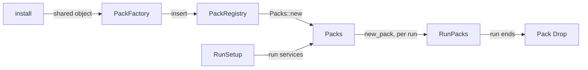

<plan-context>

# Per-run Packs

runvil moves from one Pack object per process, shared by every run, to one Pack instance per run, made by a `PackFactory` that each Plugin inserts at `install`. A Plugin's shared state, such as MCP's connections and web's HTTP clients, lives in its factory. Each object takes the services that live as long as it does, when it is created: Host-wide services reach `install`, the run's own services reach `new_pack`, and a tool call gets only facts about that call. The first step reshapes the Plugin API with no behavior change, and the second makes Packs per run and moves run services to `new_pack`.

## Notes

- **Repository:** `c:\Users\Vinnie\cursor\runvil`, a Rust workspace on Windows (PowerShell), at `master` `56925dd41` when this plan was written. Every path in this plan is relative to that root, except paths in the sibling repository `runvil-plugin-api`, which say so.
- **Conventions:** `AGENTS.md` and the `AGENTS.md` of every crate a step touches define the terms and layout conventions.
- **Build:** `cargo build --locked -p workshop`. The two lint commands compile every other target, so there is no standalone workspace build or `cargo check` (`AGENTS.md` lines 45 to 51, `.github/workflows/ci.yml`).
- **Package tests:** `cargo nextest run --locked -p <package>`, for example `-p harness-runner`, `-p plugin-mcp`, or `-p workshop-agents`. For runvil-plugin use `cargo nextest run --locked -p runvil-plugin --all-features`: its `tests/it` binary needs the `test-support` feature and runs no tests without it, which the first full-suite command's `--all-features` covers.
- **Full suite**, both of:
  - `cargo nextest run --locked --workspace --exclude workshop --exclude workshop-server --exclude workshop-server-api --all-features`
  - `cargo nextest run --locked -p workshop -p workshop-server -p workshop-server-api`
- **Lint** with warnings denied: run `$env:CARGO_BUILD_WARNINGS = 'deny'` first, then both of:
  - `cargo clippy --workspace --exclude workshop --exclude workshop-server --exclude workshop-server-api --all-targets --all-features`
  - `cargo clippy -p workshop -p workshop-server -p workshop-server-api --all-targets`
- **Format:** `cargo fmt --all --check`.
- **Structural checks:** `cargo test -p build-xtask`, and `node --test crates/workshop/ui/test/docs-claims.mjs`.
- **API surface:** run `Remove-Item Env:CARGO_BUILD_WARNINGS -ErrorAction SilentlyContinue`, then `cargo +nightly-2026-09-05 xtask api --check`. The toolchain is pinned in `crates/build-xtask/src/api/toolchain.rs` line 19. The `runvil` facade's surface does not change, so `crates/runvil/public-api.txt` needs no bless.
- **Pre-push hook:** `.githooks/pre-push` runs the docs-claims scan, the first clippy command, and `cargo deny check` when cargo-deny is installed. No step pushes.
- **Parameter names:** a parameter that a body ignores may take a leading underscore, such as `_run`. That is not a surface change.
- **Pre-existing bug, unrelated:** the doc at `crates/runvil-plugin/src/service.rs` line 159 names the refusal reason `make_invalid_id_error`, but line 172 emits `invalid_id`. Leave it.

## Terms

From `AGENTS.md` lines 9 to 13:

- The **Engine** is the `runvil` and `runvil-*` crates; it parses prompts and steps runs.
- The **Harness** drives one run and answers the Engine's effects.
- The **Host** is the application, here the Workshop.
- A **Plugin** is an entry point that installs zero or more Packs.
- A **Pack** is code that installs an optional prelude and zero or more tools.

`crates/workshop/ui/test/docs-claims.mjs` enforces this wording in rulebooks and Pack-facing comments.

The sibling repository `runvil-plugin-api` already plans per-run Packs for C Plugins: its `crates/runvil-plugin-sys/include/runvil_plugin.h` lines 70 to 86 reserve `RV_PACK_NEW` ("make one Pack's per-run instance") and `RV_PACK_DELETE`, beside the Plugin instance that `RV_PLUGIN_LOAD` makes. This plan gives linked Rust Plugins the same two levels.

## Today's design

- **A Plugin** is a public `install(packs: &mut PackRegistry, config: Value) -> Result<(), Error>` that inserts its Pack with `packs.insert(INFO, config["<key>"].clone())`. Examples: `crates/plugin-std/src/pack.rs` line 48 and `crates/plugin-mcp/src/lib.rs` line 141. Every `Error` in this plan is `runvil_types::error::Error`.
- **`PackInfo`** (`crates/runvil-plugin/src/pack.rs` lines 156 to 237) is `Clone`, `Copy`, `#[non_exhaustive]` const data. Its public fields are `fqn`, `prelude`, `needs` (run service ids), `construct`, and `description`, and its const builders are `new(fqn, construct)`, `description`, `prelude`, and `needs`. `construct` is `fn(name: &PackId, config: Value, services: &HostServices) -> Result<Arc<dyn Pack>, Error>` (lines 180 to 184).
- **`PackRegistry`** (`crates/runvil-plugin/src/registry.rs`):
  - `insert(info, config)` (line 104) refuses `invalid_fqn`, `duplicate_pack`, `reserved_pack_id`, and `reserved_name`;
  - `into_entries()` (line 159) yields `(PackInfo, PackId, Value)`;
  - `list()` (line 151) stays as it is;
  - the built-in `runvil/subagents` is the const `BUILTIN` (line 210) with the private construct `builtin` (lines 219 to 223), which `default()` inserts with `Value::Null`;
  - the `Debug` impl (line 174) notes that it hides config.
- **`Packs`** (`crates/harness-internal/runner/src/packs.rs`, package `harness-runner`) is public and re-exported as `harness::pack::Packs` (`crates/harness/src/lib.rs` line 48):
  - `Packs::new(packs, services)` (line 95) calls every `construct` once at Host startup with the Host-wide services. It stores a failure as unavailable and warns once.
  - Each run's crate-private `snapshot(prompt, services, cancel)` (lines 122 to 127) runs `pick` (line 141), `wait_ready` (line 221), and `begin_run` (line 262).
  - The crate-private `RunPacks` (line 297) holds `services`, `packs: BTreeMap<PackId, PackState>`, and `catalog`. The module-private `PackState` (line 304) is `Usable { info, pack }`, `Unavailable(String)`, or `NeedsUnmet(Vec<ServiceId>)`, and the snapshot's `needs` check (line 344) gives `NeedsUnmet`.
  - `RunPacks::call` (lines 448 to 455) lends the run's services to every call through `ToolContext::new(&tool, &access, &origin, &services)`.
  - The crate-private `refusals` (line 167) backs `Host::parse`'s check of `uses:`.
- **Preparation** passes the run's services into the snapshot: `host.packs.snapshot(&prompt, setup.services.clone(), cancel)` (`crates/harness-internal/runner/src/prepare.rs` lines 118 to 121).
- **`ToolContext`** (`crates/runvil-plugin/src/context.rs` lines 28 to 84) lends the tool id, access, origin, and the run's services, through `service(&KEY)` (line 78). `TestCall::with_services` (`crates/runvil-plugin/src/testing.rs` line 51) feeds those services in tests.
- **Two `HostServices` maps** (`crates/runvil-plugin/src/service.rs` lines 1 to 11): the Host-wide map (search provider, Tokio runtime) reaches only `construct`, and the run's own map (the conversation's input broker) reaches only calls. `HostServices` has `new`, `provide`, `get`, and `provides` (lines 151 to 216).
- **The Workshop** (`crates/workshop/server/src/agents.rs`): `services(registry)` (line 184) builds the Host-wide map, `with_plugins(services, servers)` (line 150) calls the four `install`s and then `Packs::new`, and `AgentSessions::new` (line 277) builds the `Host`. Each conversation's run gets `RunSetup.services` from `Conversation::run_services()`, a one-entry map holding a `SessionInputBroker` under `INPUT_BROKER` (`crates/workshop/agents/src/conversation-run.rs` lines 35 to 57).
- **plugin-std** (`crates/plugin-std/src/pack.rs`): the private const `STD` (lines 34 to 35) names `runvil/std`. The private `construct` (lines 64 to 72) refuses config other than null or `{}` with "std takes no configuration", and builds the private `Std { tools }` from `spec::all()`, a cached static.
- **plugin-user-input:** the private const `USER_INPUT` (`crates/plugin-user-input/src/lib.rs` lines 87 to 90) names `runvil/user-input` with `ask::construct`, a prelude, and `needs(NEEDS)`. The `pub(crate)` `ask::construct` (`crates/plugin-user-input/src/ask.rs` lines 25 to 34) refuses config other than null or `{}` with "user-input takes no configuration", and builds the private `UserInput { tools }`. The ask call looks the broker up per call (`ask.rs` line 65) and answers "no operator is connected to this run" without one. `INPUT_BROKER` is `pub const INPUT_BROKER: ServiceKey<dyn InputBroker>` with id `runvil/input-broker` (`lib.rs` line 117), and `InputBroker` is the async trait at `lib.rs` lines 147 to 156.
- **plugin-web** (`crates/plugin-web/src/web.rs`): the private `construct` (lines 61 to 104) reads `SEARCH_PROVIDER` and `TOKIO_RUNTIME`, fails naming whichever is missing, and builds the private `Web { tools, fetch: WebFetch, search: WebSearch }` from `FetchClient::new().tool(Handle::clone(&runtime))` and `WebSearch::new(provider)`.
- **plugin-mcp:** the private `construct` (`crates/plugin-mcp/src/lib.rs` lines 150 to 200) runs in this order:
  - it reads `config` null as no servers and an object as server entries, and fails the whole Pack for anything else;
  - it reads `RUNTIME` (`TOKIO_RUNTIME`, line 146), failing with "MCP needs runvil/tokio-runtime, and this host provides none" without it;
  - it parses each entry with `entry::parse`, spawning `connect::run` on the runtime for a good entry and recording `Namespace::Refused` for a bad one, so a bad entry never fails the Pack;
  - it returns `Mcp::new(name, namespaces, runtime)`, which fails when `name` yields no valid tool ids (`crates/plugin-mcp/src/dynamic.rs` lines 137 to 146).
- **MCP types** (`crates/plugin-mcp/src/dynamic.rs`): `Mcp` (lines 67 to 72) is `pub(crate)` with private fields `get`, `call`, `namespaces: BTreeMap<String, Namespace>`, and `runtime: Handle`. `Namespace` (lines 33 to 34) is a `pub(crate)` enum deriving only `Debug`, so it is not `Clone`. Tests see a server's status only through the `get_dynamic_tools` tool, by way of the `settled` and `ready` helpers in `crates/plugin-mcp/tests/it/support.rs` (lines 117 to 141).

## Target design



- **Startup:** the Host calls each Plugin's `install` with the Host-wide services. The Plugin builds whatever it shares across runs, then inserts each Pack with a factory that holds it.
- **Each run:** the Harness's snapshot calls `new_pack` once for each Pack the run holds, with the run's services. The instance drops when the run's future ends.
- **The services rule:** each object takes the services that live as long as it does, when it is created, and keeps what it needs.
  - Host-wide services reach only `install`.
  - The run's services reach only `new_pack`.
  - A call gets only facts about that call through `ToolContext`: the tool id, the access, and the origin.
  - Both maps stay the type `HostServices`. The parameter names say which map is which: `services` at `install`, `run` at `new_pack`.
- **Why per-call lookup goes:** it existed only because a shared Pack object could not hold one run's broker. The run's map is frozen for the run, so a per-call lookup never sees a change.

## Decisions

- **`install`** in all four Plugins becomes `install(packs: &mut PackRegistry, config: Value, services: &HostServices) -> Result<(), Error>`.
- **`PackFactory`** is a new trait in `crates/runvil-plugin/src/pack.rs`, re-exported from the crate root, with a blanket impl for plain functions and closures modeled on `PromptFinder`'s in `crates/runvil-internal/prompt/src/finder.rs` lines 20 to 27. The first step gives it its final signature.
  - `new_pack` runs inside the run's future, so it must not block, do I/O, or panic.
  - In the first step, `Packs::new` calls each factory once at startup with an empty run map, and no factory reads `run`. The second step moves the call into each run's snapshot with the run's own services, so no factory is rewritten twice.
- **Factory shapes:**
  - std, user-input, and the built-in use plain functions, which the blanket impl covers.
  - web: a private type in `crates/plugin-web/src/web.rs` holds the HTTP clients `install` builds and implements `PackFactory`. Each run's `Web` clones them, or builds them from what the type holds.
  - MCP: a private `Servers` type in `crates/plugin-mcp/src/lib.rs` holds `Arc<BTreeMap<String, Namespace>>` and the runtime `Handle`, and implements `PackFactory`. Each run's `Mcp` clones both and builds its two `ToolInfo`s. The factory cannot be `Arc<Servers>`, because the orphan rule forbids implementing `runvil_plugin::PackFactory` for `Arc<Servers>` in plugin-mcp, and `Namespace` is not `Clone`.
  - A capturing closure annotates its return type as `Result<Arc<dyn Pack>, Error>`. A closure passed as `impl PackFactory` gets no expected signature from the blanket impl, so its parameters would need explicit types and `Ok(Arc::new(..))` would infer `Arc<Concrete>`, not `Arc<dyn Pack>`.
- **`PackInfo`** loses `construct` in the first step and `needs` in the second. It stays const data: `PackInfo::new(fqn)` plus `description` and `prelude`.
- **`PackRegistry::insert(info, factory)`** drops `config`, because `install` reads its own config. `into_entries()` yields each entry's factory, or the reason it was inserted unavailable.
- **`PackRegistry::insert_unavailable(info, reason)`** is for a Pack whose setup failed at install, such as bad config or a missing Host-wide service. It refuses what `insert` refuses, and `Host::parse` keeps refusing a prompt that declares such a Pack, naming the reason.
- **`Packs::new(registry)`** drops its `services` parameter.
- **`Host::parse` refuses** a declared Pack that is not installed or was inserted unavailable. A `new_pack` failure during a run cannot be known at parse time. It makes that Pack unavailable to that run, and the run's first step refuses a declared one with `RequirementsUnmet`, as a `ready` failure does today.
- **A missing run service is the factory's refusal.** The factory reads what it needs from `run` and fails naming a missing one, the way web's `construct` names a missing Host-wide service today. The Pack is then unavailable to that run, and it is never made or waited on. That makes `PackInfo::needs`, `PackState::NeedsUnmet`, and the snapshot's `needs` check redundant, so they go. `HostServices::provides` stays as public API, because Workshop tests use it.
- **`ToolContext` holds per-call facts only:** `ToolContext::new(tool, access, origin)`. `ToolContext::service` and `TestCall::with_services` go, and `RunPacks` no longer holds the run's services.
- **A panicking `new_pack`** is caught and makes that Pack unavailable to the run with the reason "the Pack's factory panicked". This matches how a panicking call is answered `Dropped`, and it reuses the `catch_unwind` pattern in `crates/harness-internal/runner/src/effect_loop.rs`.
- **Logging:**
  - `Packs::new` warns once per entry inserted unavailable, which keeps today's single startup warning. In the first step it also warns once per factory that refuses at startup, as it warns for a failing `construct` today.
  - A factory refusal during a run logs at debug. Every run makes user-input as an undeclared `runvil` Pack, so a Host with no operator, such as the `run-prompt` example, would otherwise warn on every run. The roster already gives the run the reason.
  - A panicking factory logs at error.
- **Only the Packs a run holds are made:** the declared ones, plus every `runvil` Pack no declaration replaces. An undeclared third-party Pack's factory is never called.
- **MCP:** `install` parses `config["mcp"]` and reads the Tokio runtime from `services` as `construct` does today, inserting the Pack unavailable with today's reason when either fails, and starts one connection task per good server entry into the shared `Servers`. Connections still start at Host startup and live as long as the Host, and every run sees the same server states.
- **Web:** `install` reads the search provider and the Tokio runtime from `services`, inserting the Pack unavailable naming whichever is missing, and builds `FetchClient` and `WebSearch` once into its shared type.
- **User-input:** in the second step its factory takes `INPUT_BROKER` from `run`, and fails with "user-input needs runvil/input-broker, and this run provides none" when it is missing. `UserInput` holds `broker: Arc<dyn InputBroker>`, and the ask call uses it directly. The Workshop needs no change for this, because `RunSetup.services` already holds the broker.
- **std and the built-in:** each checks its config at install, inserting std unavailable with "std takes no configuration" for bad config. Its plain-function factory builds the tool list for each instance and ignores `run`. The built-in's config is always null, so it needs no check.
- **No change to the C loader** (`crates/harness-internal/plugin-loader`). When `insert_pack` lands, a library Pack's factory can hold `Arc<Plugin>` and send `RV_PACK_NEW`, and its instance's `Drop` sends `RV_PACK_DELETE`.

## Scope of the factory step

Runner paths below are under `crates/harness-internal/runner/`.

- **Docs:** sweep every doc mention of `construct` in runvil-plugin, the `plugin-*` crates, harness-runner, harness, and the Workshop. This includes the runvil-plugin crate docs (`crates/runvil-plugin/src/lib.rs` lines 7 to 30 and 55 to 62) and the rustdoc examples in `crates/runvil-plugin/src/pack.rs` that call `PackInfo::new` and `insert`. Remove the `Debug` note about hiding config in `crates/runvil-plugin/src/registry.rs`.
- **The built-in** in `crates/runvil-plugin/src/registry.rs` becomes `PackInfo::new("runvil/subagents")` inserted through its plain-function factory.
- **`PackInfo::new` callers** (29 in 21 files): runner `tests/it/{prepare,prepare-input,prepare-ready,prepare-host-services,tool_context,render,scripted,asker}.rs` and `src/{packs-tests,packs-tests-pick,packs-tests-render,host-tests}.rs`; `crates/harness/tests/suite/asker.rs`; `crates/runvil-plugin/src/{registry,registry-tests,pack}.rs` and `crates/runvil-plugin/tests/it/pack_info.rs`; and each Plugin's own.
- **`PackRegistry::insert` callers** (26 in 12 files): `crates/runvil-plugin/src/registry-tests.rs` and the `pack.rs` rustdoc example; runner `src/{host-tests,packs-tests}.rs` and `tests/it/{scripted,render,support}.rs`; `crates/harness/tests/suite/asker.rs`; and each Plugin's own.
- **`into_entries` callers** (9 in 7 files): runner `src/packs.rs`; `crates/runvil-plugin/src/registry-tests.rs`; `crates/plugin-std/tests/it/tools.rs`; `crates/plugin-web/src/web-tests.rs`; `crates/plugin-mcp/tests/it/support.rs`; `crates/plugin-user-input/tests/it/ask.rs`; `crates/workshop/server/tests/it/std_real_directory.rs`.
- **`Packs::new` callers** (19 in 15 files): runner `tests/it/{prepare,prepare-ready,prepare-prelude,harness,harness-stop-timing,render,scripted}.rs` and `src/{packs-tests,host-tests}.rs`; `crates/harness/tests/suite/{support,asker}.rs`; `crates/harness/examples/run-prompt.rs`; `crates/workshop/server/src/agents.rs`; `crates/workshop/agents/src/input-tests.rs`; `crates/workshop/agents/tests/it/support.rs`.
- **`construct` field reads** (11 in 8 files), all `(info.construct)(..)` calls, move to the factory that `into_entries` yields: runner `src/packs.rs` (line 99); `crates/runvil-plugin/src/registry-tests.rs`; `crates/runvil-plugin/tests/it/pack_info.rs` (3); `crates/plugin-web/src/web-tests.rs` (2); `crates/plugin-user-input/tests/it/ask.rs`; `crates/plugin-std/tests/it/tools.rs`; `crates/plugin-mcp/tests/it/support.rs`; `crates/workshop/server/tests/it/std_real_directory.rs`.
- **`install` callers:** the Workshop's `with_plugins` (`crates/workshop/server/src/agents.rs` lines 150 to 176) passes `&services` to all four and calls `Packs::new(packs)`. Also std in `crates/workshop/server/tests/it/std_real_directory.rs` and `crates/plugin-std/tests/it/tools.rs` (4); user-input in `crates/workshop/agents/src/input-tests.rs`, `crates/workshop/agents/tests/it/support.rs`, and `crates/plugin-user-input/tests/it/ask.rs`; web in `crates/plugin-web/src/web-tests.rs` (3); MCP in `crates/plugin-mcp/tests/it/support.rs`.

## Scope of the per-run step

Runner paths below are under `crates/harness-internal/runner/`.

- **Runner `src/packs.rs`:**
  - `Packs` keeps each entry's factory, or the reason it was inserted unavailable, and `Packs::new` no longer calls factories.
  - `snapshot(prompt, services, cancel)` runs `pick`, then `new_pack(&id, &services)` for each picked Pack under `catch_unwind`, then `wait_ready` on the instances made, then `begin_run`.
  - `RunPacks` drops its `services` field, and `call` builds `ToolContext::new(&tool, &access, &origin)`.
  - `PackState::NeedsUnmet`, its roster reason, and the `needs` check go.
  - `refusals` reads the reasons of entries inserted unavailable.
  - `Debug` shows each entry's FQN, its Pack id, and whether it is unavailable.
- **runvil-plugin:** `ToolContext` drops its `services` field and `service` (`crates/runvil-plugin/src/context.rs`), `PackInfo::needs` goes, `TestCall` drops `with_services` (`crates/runvil-plugin/src/testing.rs`), and the `PackFactory` doc drops its startup note.
- **Plugins:** only user-input changes. Its factory takes `INPUT_BROKER` from `run`, `UserInput` holds it, and the per-call lookup at `crates/plugin-user-input/src/ask.rs` line 65 goes. The other factories already ignore `run`.
- **Docs:**
  - The `Pack` trait (`crates/runvil-plugin/src/pack.rs` lines 22 to 29 and the `ready` docs): each run gets its own instance, `Drop` runs when the run ends, and the text "A Pack that recovers answers Ok to a later call" goes.
  - The `crates/runvil-plugin/src/service.rs` module docs: the Host-wide map reaches `install`, and each run's own reaches `new_pack`.
  - The `ToolContext` docs: per-call facts only.
  - The runvil-plugin `lib.rs` invariants and runner `src/lib.rs` lines 42 to 48, stated as the services rule.
  - Runner `src/host.rs`, and the `Harness::new` docs in runner `src/harness.rs`.
  - The harness facade docs (`crates/harness/src/lib.rs` lines 1 to 30 and the `pack` module), and the module docs of `crates/workshop/server/src/agents.rs`.
  - Each Plugin's "the one object every run shares" comments.
  - The comment above the activation test in `crates/workshop/ui/test/docs-claims.mjs` (lines 152 to 154), which says Packs are built once. The test's rule stays, so new docs say "made for each run", never "activated".
- **Fixtures that read a run service per call** take it at `new_pack` instead: runner `tests/it/{prepare-host-services,prepare-input,asker}.rs`, `crates/harness/tests/suite/asker.rs`, and `crates/runvil-plugin/tests/it/pack_info.rs`.
- **`ToolContext::new` callers** drop the services argument: runner `src/packs.rs`, `crates/runvil-plugin/src/{context,testing}.rs`, and `crates/workshop/server/tests/it/std_real_directory.rs` (line 110).
- **`ToolContext::service` callers** (11 in 8 files): `crates/runvil-plugin/src/context.rs` (3), `crates/runvil-plugin/tests/it/{test_call,pack_info}.rs`, `crates/plugin-user-input/src/ask.rs`, `crates/harness/tests/suite/asker.rs`, and runner `tests/it/{asker,prepare-host-services,prepare-input}.rs`.
- **`TestCall::with_services` callers** move their service into the Pack's factory: `crates/runvil-plugin/tests/it/pack_info.rs` (line 155), `crates/runvil-plugin/tests/it/test_call.rs` (line 51), and `crates/plugin-user-input/tests/it/ask.rs` (line 99).
- **`needs` uses** go: `crates/runvil-plugin/src/registry-tests.rs`, `crates/runvil-plugin/tests/it/pack_info.rs`, `crates/plugin-user-input/src/lib.rs`, `crates/plugin-user-input/tests/it/ask.rs`, `crates/plugin-std/tests/it/tools.rs`, `crates/plugin-std/src/pack-tests.rs`, `crates/plugin-mcp/tests/it/main.rs`, `crates/plugin-web/src/web-tests.rs`, `crates/harness/tests/suite/asker.rs`, and runner `tests/it/{asker,prepare-host-services}.rs`, `src/{packs,packs-tests,packs-tests-render,packs-tests-pick}.rs`. The needy cases in runner `src/{packs-tests,packs-tests-pick,packs-tests-render}.rs` become factories that fail without their service.
- **The `tests/it/prepare-ready.rs` fixtures** become factories that capture the shared `Startup`.

## Out of scope

The intended direction is recorded so this work does not block it.

- The C Pack verbs.
- Splitting `HostServices` into separate Host-wide and run types.
- **The run inbox.** User-input's broker wiring in the per-run step is temporary. A mailbox per run replaces it, designed together with sub-agents:
  - The Harness owns one inbox per run, and the run reads from it.
  - `RunControl` hands the sending side to the Host's agent window and to a parent run, so a parent can command or interrupt a sub-agent and the operator can type ahead.
  - A separate rendezvous primitive stays for questions such as approvals, so a message typed ahead can never answer a prompt the operator did not see.
- **Two-phase shutdown.** First a synchronous "start stopping" signal to every Plugin, then a `Drop` that blocks until the Plugin's pending async work is done.
  - A Plugin's blocking `Drop` runs only on a thread outside the runtime, after live runs are canceled and awaited.
  - A Pack instance's `Drop` never blocks: it hands pending work to its Plugin.
- **Moving `InputBroker` and `SearchProvider` into `runvil-plugin`,** beside `TOKIO_RUNTIME`, so Hosts implement contract-level services without linking specific Plugin crates.

### Open questions

None

</plan-context>

## Steps

<step-1>

1. [done] **Plugins insert Packs with a factory** (points: 10) - Add `PackFactory` and its blanket impl, drop `PackInfo::construct`, make `PackRegistry::insert` take a factory, add `insert_unavailable`, make `into_entries` yield the factory result, and give each Plugin's `install` the Host-wide services, using the factory shapes in Decisions and inserting every setup failure unavailable. `Packs::new(registry)` calls each factory once with an empty `HostServices`, stores the result as it stores `construct`'s today, and warns once per unavailable entry, so runs still share one instance and run services still reach calls through `ToolContext`. Port every caller and doc in the plan's scope of the factory step. Tests: `insert_unavailable` refuses a bad FQN and a duplicate; `Host::parse` refuses a prompt that declares a Pack inserted unavailable, naming the reason; std and user-input installed with config `1` are unavailable with their "takes no configuration" reasons; web installed without a Tokio runtime, and without a search provider, is unavailable naming the missing service, replacing `construct_fails_naming_whichever_host_wide_service_is_missing` in `crates/plugin-web/src/web-tests.rs`; two instances from one MCP install's factory report the same server status through `get_dynamic_tools`.
   - Score: `PackFactory` 1, blanket impl 0 (follows `PromptFinder`'s), `pub use pack::PackFactory` 0, `PackInfo` 0, `PackInfo::new` 0, `PackRegistry::insert` 1, `insert_unavailable` 1, `into_entries` 0, `Packs::new` 1, std `install` 1, user-input `install` 1, `ask::new_pack` 0, web `install` 1, MCP `install` 1, `Mcp::new` 0. Other changes: web's private shared factory type 1, MCP's private `Servers` factory 1, the built-in's private factory 0, callers and docs 0.

`crates/runvil-plugin/src/pack.rs`

```rust
/// Makes instances of one installed Pack. A Plugin
/// builds it at `install` and keeps in it what every
/// instance shares. In this build the Harness calls
/// it once, at Host startup, with an empty `run` map.
pub trait PackFactory: Send + Sync {
    /// Makes one instance named `id`. `run` holds the
    /// run's own services. Runs inside the run's
    /// future, so it must not block, do I/O, or panic.
    /// An error makes the Pack unavailable, naming
    /// the reason.
    fn new_pack(
        &self,
        id: &PackId,
        run: &HostServices,
    ) -> Result<Arc<dyn Pack>, Error>;
}
// new

/// A plain function or closure with `new_pack`'s
/// parameters and return type is a factory.
impl<Func> PackFactory for Func
where
    Func: Fn(
            &PackId,
            &HostServices,
        ) -> Result<Arc<dyn Pack>, Error>
        + Send
        + Sync,
{
    fn new_pack(
        &self,
        id: &PackId,
        run: &HostServices,
    ) -> Result<Arc<dyn Pack>, Error>;
}
// new

/// Const data naming one Pack: its FQN, an optional
/// prelude, the run services it needs, and a one-line
/// description.
#[derive(Clone, Copy)]
#[non_exhaustive]
pub struct PackInfo {
    pub fqn: &'static str,
    pub prelude: Option<&'static str>,
    pub needs: &'static [ServiceId],
    pub description: &'static str,
}
// changed, was: also `pub construct: fn(name: &PackId,
//   config: Value, services: &HostServices)
//   -> Result<Arc<dyn Pack>, Error>`
// callers:
// crates/harness-internal/runner/src/packs.rs (1)
// crates/runvil-plugin/tests/it/pack_info.rs (3)
// crates/plugin-web/src/web-tests.rs (2)
// and 5 more files

impl PackInfo {
    /// Names the Pack `fqn`; the builders add the
    /// rest.
    pub const fn new(fqn: &'static str) -> PackInfo;
    // changed, was: new(fqn, construct)
    // callers:
    // crates/plugin-std/src/pack.rs (1)
    // crates/plugin-web/src/web.rs (1)
    // crates/runvil-plugin/src/registry.rs (1)
    // and 18 more files
}
```

`crates/runvil-plugin/src/lib.rs`

```rust
/// The factory trait, at the crate root beside `Pack`
/// and `PackInfo`.
pub use pack::PackFactory;
// new
```

`crates/runvil-plugin/src/registry.rs`

```rust
impl PackRegistry {
    /// Adds the Pack `info` names, made by `factory`.
    /// Refuses an invalid FQN (`invalid_fqn`), a
    /// duplicate (`duplicate_pack`), a reserved Pack
    /// id (`reserved_pack_id`), or a reserved name
    /// (`reserved_name`).
    pub fn insert(
        &mut self,
        info: PackInfo,
        factory: impl PackFactory + 'static,
    ) -> Result<(), Error>;
    // changed, was: insert(&mut self, info: PackInfo,
    //   config: Value)
    // callers:
    // crates/runvil-plugin/src/registry-tests.rs (13)
    // crates/harness-internal/runner/src/host-tests.rs (2)
    // crates/plugin-std/src/pack.rs (1)
    // and 9 more files

    /// Adds the Pack `info` names as unavailable for
    /// `reason`, such as bad config or a missing
    /// Host-wide service. Refuses what `insert`
    /// refuses. `Host::parse` refuses a prompt that
    /// declares it, naming `reason`.
    pub fn insert_unavailable(
        &mut self,
        info: PackInfo,
        reason: Error,
    ) -> Result<(), Error>;
    // new

    /// Yields each Pack's info, its id, and its factory,
    /// or the reason it was inserted unavailable.
    pub fn into_entries(
        self,
    ) -> impl Iterator<
        Item = (
            PackInfo,
            PackId,
            Result<Arc<dyn PackFactory>, Error>,
        ),
    >;
    // changed, was: Item = (PackInfo, PackId, Value)
    // callers:
    // crates/harness-internal/runner/src/packs.rs (1)
    // crates/runvil-plugin/src/registry-tests.rs (2)
    // crates/plugin-std/tests/it/tools.rs (2)
    // and 4 more files
}
```

`crates/plugin-std/src/pack.rs`

```rust
/// Inserts `runvil/std`. Its config, `config["std"]`,
/// must be null or `{}`; anything else inserts it
/// unavailable with "std takes no configuration".
/// Ignores `services`.
pub fn install(
    packs: &mut PackRegistry,
    config: Value,
    services: &HostServices,
) -> Result<(), Error>;
// changed, was: install(packs, config)
// callers:
// crates/plugin-std/tests/it/tools.rs (4)
// crates/workshop/server/src/agents.rs (1)
// crates/workshop/server/tests/it/std_real_directory.rs (1)
```

`crates/plugin-user-input/src/lib.rs`

```rust
/// Inserts `runvil/user-input`. Its config,
/// `config["user-input"]`, must be null or `{}`;
/// anything else inserts it unavailable with
/// "user-input takes no configuration". Ignores
/// `services`.
pub fn install(
    packs: &mut PackRegistry,
    config: Value,
    services: &HostServices,
) -> Result<(), Error>;
// changed, was: install(packs, config)
// callers:
// crates/workshop/server/src/agents.rs (1)
// crates/workshop/agents/src/input-tests.rs (1)
// crates/workshop/agents/tests/it/support.rs (1)
// and 1 more file
```

`crates/plugin-user-input/src/ask.rs`

```rust
/// Makes one `runvil/user-input` instance named `id`.
/// Ignores `run`; the ask call still looks up the
/// run's input broker on each call.
pub(crate) fn new_pack(
    id: &PackId,
    run: &HostServices,
) -> Result<Arc<dyn Pack>, Error>;
// changed, was: construct(name: &PackId,
//   config: Value, services: &HostServices)
// callers:
// crates/plugin-user-input/src/lib.rs (1)
```

`crates/plugin-web/src/web.rs`

```rust
/// Inserts the web Pack with a factory holding the
/// HTTP clients every instance shares, built from the
/// search provider and Tokio runtime in `services`.
/// A missing one inserts the Pack unavailable, naming
/// it. Config the Pack refused before inserts it
/// unavailable with the same reason.
pub fn install(
    packs: &mut PackRegistry,
    config: Value,
    services: &HostServices,
) -> Result<(), Error>;
// changed, was: install(packs, config)
// callers:
// crates/plugin-web/src/web-tests.rs (3)
// crates/workshop/server/src/agents.rs (1)
```

`crates/plugin-mcp/src/lib.rs`

```rust
/// Inserts the MCP Pack. Parses `config["mcp"]`,
/// reads the Tokio runtime from `services`, and starts
/// one connection task per good server entry, into
/// servers every instance shares. Config that is not
/// null or an object, or a missing runtime, inserts
/// the Pack unavailable, naming the problem. A bad
/// entry is refused alone, as `Namespace::Refused`.
pub fn install(
    packs: &mut PackRegistry,
    config: Value,
    services: &HostServices,
) -> Result<(), Error>;
// changed, was: install(packs, config)
// callers:
// crates/plugin-mcp/tests/it/support.rs (1)
// crates/workshop/server/src/agents.rs (1)
```

`crates/plugin-mcp/src/dynamic.rs`

```rust
impl Mcp {
    /// Makes one MCP Pack instance named `name` over
    /// the servers in `namespaces`, which every
    /// instance shares. Fails when `name` yields no
    /// valid tool ids.
    pub(crate) fn new(
        name: &PackId,
        namespaces: Arc<BTreeMap<String, Namespace>>,
        runtime: Handle,
    ) -> Result<Mcp, Error>;
    // changed, was: namespaces: BTreeMap<String,
    //   Namespace>
    // callers:
    // crates/plugin-mcp/src/lib.rs (1)
    // crates/plugin-mcp/src/dynamic-tests.rs (1)
}
```

`crates/harness-internal/runner/src/packs.rs`

```rust
impl Packs {
    /// Takes every Pack `packs` holds. In this build it
    /// calls each factory once with an empty run map,
    /// and warns once per Pack inserted unavailable or
    /// refused by its factory.
    pub fn new(packs: PackRegistry) -> Packs;
    // changed, was: new(packs: PackRegistry,
    //   services: HostServices)
    // callers:
    // crates/workshop/server/src/agents.rs (1)
    // crates/harness/examples/run-prompt.rs (1)
    // crates/harness/tests/suite/support.rs (1)
    // and 12 more files
}
```

</step-1>

<step-2>

2. **Make each run's Packs per run, with the run's services** (points: 6) - `Packs` keeps each entry's factory or its unavailable reason, and each run's `snapshot` makes the Packs the run holds with `new_pack(&id, &services)` under `catch_unwind`, before `wait_ready` and `begin_run`, logging refusals at debug and panics at error. Calls get only per-call facts: `ToolContext::new` drops `services`, and `ToolContext::service`, `TestCall::with_services`, `PackInfo::needs`, and `PackState::NeedsUnmet` go. user-input's factory takes the input broker from `run`, and its instance holds it. Port every caller, fixture, and doc in the plan's scope of the per-run step. Tests: each snapshot calls each held Pack's factory once and gets a distinct instance, replacing `new_builds_every_registered_pack_once_with_its_config_the_builtin_included` in `crates/harness-internal/runner/src/packs-tests.rs`; a Pack the run does not hold is never made; a run's instances drop when `Harness::run` returns, checked with a drop counter; a failing factory leaves that Pack unavailable to that run only, and the next run makes it again; a panicking factory leaves the Pack unavailable with "the Pack's factory panicked"; a factory that refuses a missing run service never has its Pack's `ready` polled; user-input's factory over a run with no input broker fails naming `runvil/input-broker`; the ask call uses the broker its instance took.
   - Score: `PackFactory` 0 (doc), `PackInfo` 0, `PackInfo::needs` 0, `ToolContext::new` 0, `ToolContext::service` 0, `TestCall::with_services` 0, `ask::new_pack` 1, `Packs::new` 1 (keeps each factory or reason, and `Debug`). Other changes, with signatures unchanged: per-run making in `snapshot` 3 (failure handling), `refusals` reading unavailable reasons 1, callers, fixtures, and docs 0.

`crates/runvil-plugin/src/pack.rs`

```rust
/// Makes each run's instance of one installed Pack. A
/// Plugin builds it at `install` and keeps in it what
/// every run's instance shares.
pub trait PackFactory: Send + Sync {
    /// Makes this run's instance named `id`, taking
    /// what it needs from the run's own services in
    /// `run`. Runs inside the run's future, so it must
    /// not block, do I/O, or panic. An error, such as
    /// a missing run service, makes the Pack
    /// unavailable to this run, naming the reason.
    fn new_pack(
        &self,
        id: &PackId,
        run: &HostServices,
    ) -> Result<Arc<dyn Pack>, Error>;
}
// changed, was: called once at Host startup with an
//   empty run map
// callers:
// crates/harness-internal/runner/src/packs.rs (1)

/// Const data naming one Pack: its FQN, an optional
/// prelude, and a one-line description.
#[derive(Clone, Copy)]
#[non_exhaustive]
pub struct PackInfo {
    pub fqn: &'static str,
    pub prelude: Option<&'static str>,
    pub description: &'static str,
}
// changed, was: also `pub needs: &'static [ServiceId]`
// callers:
// crates/harness-internal/runner/src/packs.rs (1)
// crates/runvil-plugin/tests/it/pack_info.rs (2)
// crates/plugin-web/src/web-tests.rs (1)
// and 1 more file

impl PackInfo {
    /// Lists the run services the Pack needs.
    pub const fn needs(
        self,
        needs: &'static [ServiceId],
    ) -> PackInfo;
    // removed
    // callers:
    // crates/runvil-plugin/src/registry-tests.rs (3)
    // crates/plugin-user-input/src/lib.rs (1)
    // crates/plugin-std/tests/it/tools.rs (1)
    // and 9 more files
}
```

`crates/runvil-plugin/src/context.rs`

```rust
impl<'a> ToolContext<'a> {
    /// Facts about one call: the tool id, its access,
    /// and its origin.
    pub fn new(
        tool: &'a ToolId,
        access: &'a Access,
        origin: &'a ToolCallOrigin,
    ) -> Self;
    // changed, was: also `services: &'a HostServices`
    // callers:
    // crates/runvil-plugin/src/context.rs (2)
    // crates/runvil-plugin/src/testing.rs (1)
    // crates/harness-internal/runner/src/packs.rs (1)
    // and 1 more file

    /// Looks up the run service `key` names.
    pub fn service<T: ?Sized + Send + Sync + 'static>(
        &self,
        key: &ServiceKey<T>,
    ) -> Option<Arc<T>>;
    // removed
    // callers:
    // crates/runvil-plugin/src/context.rs (3)
    // crates/runvil-plugin/tests/it/test_call.rs (2)
    // crates/plugin-user-input/src/ask.rs (1)
    // and 5 more files
}
```

`crates/runvil-plugin/src/testing.rs`

```rust
impl TestCall {
    /// Lends `services` to the call as its run's
    /// services.
    pub fn with_services(
        mut self,
        services: HostServices,
    ) -> TestCall;
    // removed
    // callers:
    // crates/runvil-plugin/tests/it/test_call.rs (1)
    // crates/runvil-plugin/tests/it/pack_info.rs (1)
    // crates/plugin-user-input/tests/it/ask.rs (1)
}
```

`crates/plugin-user-input/src/ask.rs`

```rust
/// Makes this run's `runvil/user-input` instance named
/// `id`, holding the input broker from `run`. Fails
/// with "user-input needs runvil/input-broker, and
/// this run provides none" when `run` has none.
pub(crate) fn new_pack(
    id: &PackId,
    run: &HostServices,
) -> Result<Arc<dyn Pack>, Error>;
// changed, was: ignored `run`
// callers:
// crates/plugin-user-input/src/lib.rs (1)
```

`crates/harness-internal/runner/src/packs.rs`

```rust
impl Packs {
    /// Takes every Pack `packs` holds, keeping each
    /// factory for the runs to call, and warns once per
    /// Pack inserted unavailable.
    pub fn new(packs: PackRegistry) -> Packs;
    // changed, was: called each factory once at startup
    // callers:
    // crates/workshop/server/src/agents.rs (1)
    // crates/harness/examples/run-prompt.rs (1)
    // crates/harness/tests/suite/support.rs (1)
    // and 12 more files
}
```

</step-2>
