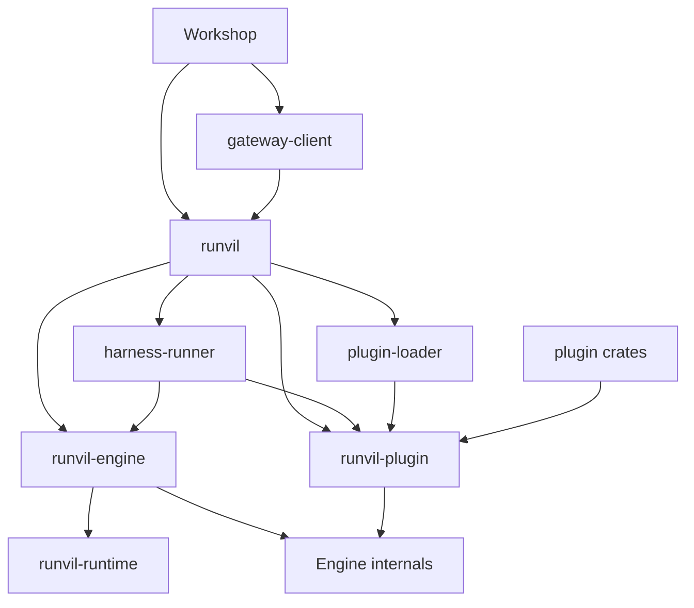

# Make `runvil` the one crate a Host depends on

Today a Host writes against three crates: `harness`, `runvil` and `runvil_plugin`. After this plan it writes against one, `runvil`, and a check proves that every type a `runvil` signature names is nameable through `runvil`.

All paths below are in the `runvil/` repository. The work is five commits. Each one frees the name the next one takes, so the order is fixed.

## End state

- **`runvil`** (`crates/runvil`, today `crates/harness`): the Host-facing facade.
- **`runvil-engine`** (`crates/runvil-engine`, today `crates/runvil`): the Engine's facade with all 106 names, for anyone writing a harness.
- **`runvil-runtime`** (`crates/runvil-internal/runtime`, today `runvil-engine`): the internal `Run` state machine.
- **Unchanged names:** `runvil-plugin`, `harness-runner`, `harness-plugin-loader`, `harness-test-plugin`, `harness-gateway-client`, and both container folders.



### The `runvil` surface: 124 names, each at one path

- **Root, 18:**
  - Harness: `Harness`, `Host`, `RunSetup`, `RunReport`, `RunControl`.
  - Engine: `Prompt`, `PromptFinder`, `RunLimits`, `RunSeed`, `Error`, `ErrorCode`, `ErrorFact`, `SourceLoc`, `OutputTrust`, `ToolId`, `ToolInfo`, `ToolOutput`, `make_tool_error`.
- **`runvil::harness`, 18:** `BoxFuture`, `InferenceBroker`, `Timer`, `display_chain`, `Packs`, `Plugin`, `PluginReport`, `PluginSource`, `insert_plugin`, `insert_plugin_dir`, `MemoryRecorder`, `Record`, `RecordKind`, `RecorderFuture`, `RunId`, `RunMeta`, `RunRecorder`, `make_recorder_error`.
- **`runvil::plugin`, 12:** the items `runvil-plugin` defines: `Pack`, `PackFactory`, `PackFuture`, `PackInfo`, `PackOrigin`, `PackRegistry`, `HostServices`, `ServiceId`, `ServiceKey`, `TOKIO_RUNTIME`, `ToolContext`, `RenderContext`.
- **Engine modules, 76, at today's paths:** `effect` (3: `Round`, `ToolCallOrigin`, `ToolCaller`), `event` (2), `ids` (5), `model` (22), `packs` (3: `GlobalName`, `PackId`, `PackRef`), `prompt` (7), `vfs` (27), `timestamp` (1), `metrics` (6).

## Decisions

- **`runvil` leaves out 17 Engine names**, as you chose: `Run`, `Step`, `RunParams`, `ToolCatalog`, `effect::{Effect, EffectAnswer, EffectId, IssuedEffect, PackToolSets}`, `vfs::{VfsOp, VfsOutcome, perform_vfs_op, make_store_error}`, `packs::{RosterEntry, Prelude}`, `cancel::{CancelHandle, Canceled}`. I checked `crates/runvil/public-api.txt`: no kept item names any of them. The `cancel` module goes away, and a Host cancels through `RunControl`.
- **Layout as you sketched.** A module says which layer defines an item: `harness` for the Harness, `plugin` for the Plugin contract, everything else the Engine's.
- **The Plugin contract goes in `runvil::plugin`** (medium confidence: it mirrors `runvil_plugin::` name for name, but you did not pick it).
- **Workshop crates may no longer depend on an Engine crate.** A new rule in the product matrix makes them reach the Engine only through `runvil` (medium confidence: it enforces the goal, but it is a rule you did not ask for).
- **`harness-gateway-client` uses `runvil` in production code** and keeps `runvil-engine` under `[dev-dependencies]` for one test, `src/wire/request-tests.rs`, which steps a real `Run`.
- **`runvil_plugin_sys` joins the allowlist for `runvil` only.** `insert_plugin` takes its `PluginEntry`, and that crate lives in another repository, so it cannot be re-exported under the check's rules.
- **Folders follow crate names; containers keep theirs.** `runvil-internal` and `harness-internal` are not renamed.
- **History stays as written.** Files under `vibe/` and `plan/` keep the old names.
- **Fixtures follow meaning.** In `crates/build-xtask` tests, a fixture that stands for the Engine facade becomes `runvil-engine`, and one that stands for the Harness facade becomes `runvil`. Made-up internal names stay.

## Step 1: `runvil-engine` becomes `runvil-runtime`

- `git mv crates/runvil-internal/engine crates/runvil-internal/runtime`.
- Replace `runvil-engine` with `runvil-runtime`, `runvil_engine` with `runvil_runtime`, and `runvil-internal/engine` with `runvil-internal/runtime`, in every tracked file outside `vibe/`, `plan/` and `Cargo.lock`. Today those strings mean only this crate, so a plain replace is safe. It touches:
  - [runvil/Cargo.toml](runvil/Cargo.toml) (members, the workspace dependency), the crate's own manifest and `AGENTS.md` heading
  - [runvil/crates/runvil/src/lib.rs](runvil/crates/runvil/src/lib.rs) (13 paths) and `crates/runvil/Cargo.toml`
  - [runvil/.github/workflows/ci.yml](runvil/.github/workflows/ci.yml) lines 108 and 346
  - six source files in the `lua`, `prompt` and runtime crates, and the comment at `crates/runvil-internal/prompt/Cargo.toml:24`
  - [runvil/crates/build-xtask/src/type_size.rs](runvil/crates/build-xtask/src/type_size.rs): the six `ALLOWED` entries keyed by the folder
  - build-xtask doc comments and the fixtures that use the name (`product/tests.rs`, `facade_shape-tests.rs`, `test_support_leak-tests.rs`, `engine_guards-tests.rs`, `engine_clippy-tests.rs`)
- Regenerate `Cargo.lock` with one cargo command that omits `--locked`.
- **Gate:** `rg "runvil[-_]engine|runvil-internal/engine" -g "!vibe/**" -g "!plan/**" -g "!Cargo.lock"` prints nothing. Step 2 reuses this name, so a leftover would silently point at the wrong crate.

## Step 2: `runvil` becomes `runvil-engine`

- `git mv crates/runvil crates/runvil-engine`, then confirm `crates/runvil` no longer exists. Untracked leftovers go to `cabinet/_trash/`; otherwise step 3's move would land inside the old folder.
- **Manifests:** the package name; in the root, `runvil-engine = { path = "crates/runvil-engine" }` and `default-members`; `runvil.workspace = true` becomes `runvil-engine.workspace = true` in six dependents (`harness`, `harness-gateway-client`, `harness-runner`, and Workshop's `agents`, `run-log`, `server`).
- **Code:** `runvil::` becomes `runvil_engine::` in every `.rs` file under `crates/runvil-engine/{tests,examples}`, `crates/harness`, `crates/harness-internal`, `crates/harness-gateway-client` and `crates/workshop`. Not under `crates/build-xtask`.
- **Check constants:**
  - [runvil/crates/build-xtask/src/product.rs](runvil/crates/build-xtask/src/product.rs): `PUBLIC_RUNVIL` (138) and the `runvil-internal` exception (288) name `runvil-engine`
  - [runvil/crates/build-xtask/src/engine_guards.rs](runvil/crates/build-xtask/src/engine_guards.rs): `ENGINE_ROOT_CRATES` (16)
  - `engine_clippy.rs:35`, `facade_shape.rs:28` (`FACADE_DIR`), `site.rs:54-55`
- **`cargo xtask api`:** in [runvil/crates/build-xtask/src/api/load.rs](runvil/crates/build-xtask/src/api/load.rs), `FACADE` is one string used as both package and crate name, which breaks for a hyphenated name. Replace it with a `Facade` value and thread `&Facade` through `load`, `items`, `closure`, `listing` and `api.rs`. `FACADES` holds one entry for now. The fixture tests pass their own `Facade`, so they keep their made-up layout.

```rust
pub(super) struct Facade {
    /// The package `cargo doc -p` takes; its crate name swaps `-` for `_`.
    pub(super) package: &'static str,
    /// The crate directory, which holds `public-api.txt`.
    pub(super) dir: [&'static str; 2],
    /// The container whose crates may define a re-exported item.
    pub(super) container: &'static str,
}
```

- **Listing:** bless `crates/runvil-engine/public-api.txt` with the pinned nightly. It must equal the old file with `runvil::` replaced by `runvil_engine::`; any other difference is read before it is accepted.
- **CI and docs:** `ci.yml` lines 102 and 346; [runvil/crates/workshop/ui/test/docs-claims.mjs](runvil/crates/workshop/ui/test/docs-claims.mjs) lines 119 and 157; the header comment of the three `clippy.toml` copies; [runvil/AGENTS.md](runvil/AGENTS.md) lines 9, 39, 48 and 49; `crates/runvil-internal/README.md:3`; `crates/harness/Cargo.toml:11`; root `Cargo.toml:108`.
- **Prose in Rust docs, edited by reading:** "the `runvil` facade" becomes "the `runvil-engine` facade" in the runtime crate (`lib.rs`, `execute.rs`, `execute/run.rs`, two test-suite docs), `model-client/src/detail.rs`, `prompt/src/detail.rs`, the facade suite's `main.rs`, three Workshop crate docs and the build-xtask module docs. A backticked `runvil` that means the Pack vendor id stays (`harness-runner`'s `packs.rs` and `lib.rs`, `runvil-types`' `packs.rs` and `metrics.rs`, `runvil-lua`'s `bindings.rs`, `runvil-plugin`'s `registry.rs`).
- **Gate:** `cargo metadata` lists no package named `runvil`, and `rg "\brunvil::" crates -t rust -g "!build-xtask/**"` prints nothing. The compiler and `cargo doc` with `-D warnings` catch every missed code path and doc link, since no crate has that name now.

## Step 3: `harness` becomes `runvil`, with its items at their final paths

- `git mv crates/harness crates/runvil`; the package name; the root workspace dependency and `default-members`; `harness.workspace = true` becomes `runvil.workspace = true` in four dependents.
- **`crates/runvil/src/lib.rs`:** the same 35 items it exports today, moved:
  - `harness::{Harness, Host, RunSetup, RunReport, RunControl}` to the root
  - `harness::{BoxFuture, InferenceBroker, Timer, display_chain}`, `pack::Packs`, all of `plugin::*`, and the eight recorder items of `record::*` to `runvil::harness`
  - `pack::{HostServices, PackOrigin, PackRegistry}` to `runvil::plugin`
  - `pack::PackId` to `runvil::packs::PackId`, `record::RunSeed` to the root, `Timestamp` to `runvil::timestamp`; `PromptFinder`, `RunLimits` and `vfs::*` keep their paths
- **Host imports** follow that mapping in Workshop's `agents`, `run-log` and `server`, in `harness-gateway-client`, and in the facade's own `tests/` and `examples/`. `crates/harness-internal/runner` is left alone: its `harness::` is its own module.
- **Check constants:** `product.rs` `family()` puts the exact name `runvil` in the Harness family and `runvil-*` in the Engine family, and `HARNESS_FACADE` is `"runvil"`; `facade_shape.rs:31`; `tidy.rs:65`; `test_support_leak.rs:212`; `site.rs:59-60`. Fixtures follow, including the real-layout pin in `harness_bans-tests.rs:147-170` and the family pins in `product/tests.rs`.
- **CI and docs:** `ci.yml:105`; `docs-claims.mjs:160`; `AGENTS.md` line 10 becomes "the `runvil` crate and the `harness-*` crates"; the Workshop crate docs; the facade suite's `main.rs`; `crates/workshop/run-log/Cargo.toml:14`; `crates/shared-error-source/src/lib.rs:5`.
- **Gate:** `cargo metadata` lists no package named `harness`; `rg "\bharness::" crates/workshop crates/harness-gateway-client crates/runvil -t rust` prints nothing; Cargo's two `harness = false` bench settings are still there.

## Step 4: `runvil` re-exports the Engine API and the Plugin contract

- **`lib.rs`:** add the other 80 Engine names and the other 9 Plugin contract names, as single-item `pub use` lines inside documented `pub mod` blocks, which is what the facade shape check requires. Rewrite the crate docs to say this is the one crate a Host depends on, and that the stepping API is in `runvil-engine`.
- **Host crates:** `runvil_engine::` becomes `runvil::` at the same sub-path. `runvil_plugin::{ServiceKey, TOKIO_RUNTIME, HostServices, Pack, PackRegistry, ToolContext}` become `runvil::plugin::…`, and `runvil_plugin::{OutputTrust, ToolId, ToolOutput}` become `runvil::…`.
- **Manifests:** remove `runvil-engine` from Workshop's `agents`, `run-log` and `server`, and `runvil-plugin` from `server`. In `harness-gateway-client`, move `runvil-engine` to `[dev-dependencies]`.
- **The facade's own suite and example** import from `runvil::` only, which shows a Host needs one crate.
- **New matrix rule** in `product.rs`: a Workshop crate that depends on an Engine-family crate is a violation, with a fixture test. The three Workshop `## Invariants` docs state the new rule.
- **Docs:** `AGENTS.md` line 10 gains "and the one crate a Host depends on"; line 39 names both facades; `site.rs` describes `runvil` as what a Host depends on.
- **Gate:** `rg "runvil_engine::|runvil_plugin::" crates/workshop crates/runvil -t rust` prints nothing, and in `crates/harness-gateway-client` it matches only `src/wire/request-tests.rs`.

## Step 5: `cargo xtask api` proves `runvil` closed

- **`Facade` grows three things**, each needed by the second entry:
  - `containers` becomes a list. For `runvil` it is `harness-internal` and `runvil-internal`, because rustdoc names a re-exported item by the crate that defines it, so `pub use runvil_engine::Prompt;` resolves to `runvil_prompt`. The product matrix already limits `runvil` to reaching those crates through `runvil-engine` and `runvil-plugin`.
  - `public`: crates outside a container that may define a re-exported item. For `runvil` it is `runvil-plugin`.
  - `allowed`: third-party crates beyond the shared serde list. For `runvil` it is `runvil_plugin_sys`.
- **`FACADES` gets its second entry**, and `cargo xtask api` runs every facade in order with one summary line each. No new flag, so the CI step does not change.
- **Bless `crates/runvil/public-api.txt`** once the check reports no violations. For each violation:
  - A signature names an item `runvil` lacks: re-export it. If it is one of the 17, it comes back, and the commit message says so.
  - A doc links to one of the 17: reword the doc so it does not link.
  - A doc names an internal crate: reword it.
  - Anything else, including rustdoc JSON failing for `harness-test-plugin`: stop and report.
- **Docs:** `AGENTS.md` line 49 and the `api.rs` module docs name both listings.
- **Extra check for this step:** `cargo nextest run --locked -p build-xtask --run-ignored only` with `RUSTUP_TOOLCHAIN=nightly-2026-09-05`, plus one new fixture where a second facade re-exports the first facade's re-export.
- **Last look:** run `cargo outline` in `runvil`. The `runvil` page should have no "Named, not re-exported" section.

## Verification, run in full before every commit

These are the commands in `AGENTS.md` lines 46 to 51:

- `cargo fmt --all --check`
- `cargo test -p build-xtask` and `node --test crates/workshop/ui/test/docs-claims.mjs`
- both `cargo clippy` commands with `CARGO_BUILD_WARNINGS=deny`
- both `cargo nextest run --locked` commands
- both `cargo doc` commands with `RUSTDOCFLAGS="-D warnings"`, naming the facade packages as they are called at that step
- `cargo +nightly-2026-09-05 xtask api --check` with `CARGO_BUILD_WARNINGS` unset

One commit per step, on the branch that is checked out when the work starts. Nothing is pushed until you say so.

## Order and cost

- **No step can move or merge.** Step 2 needs the name step 1 frees, step 3 needs the name and folder step 2 frees, and step 5 checks the surface step 4 builds. Steps 4 and 5 stay apart because one changes the API and the other changes a tool.
- **Host files change twice.** About 150 import lines go from `runvil::` to `runvil_engine::` in step 2 and back in step 4. I accept that so every commit builds without a temporary alias.
- **Most of the work is in steps 2 and 3**: about 25 build-xtask test files hold fixtures tied to the constants that change.

## Out of scope

- Flattening `crates/` or renaming the containers.
- Renaming `harness-gateway-client`, `harness-runner` or `harness-plugin-loader`.
- Trimming Engine names that no Host imports beyond the 17.
- Teaching vibelight to expand a whole-crate re-export.