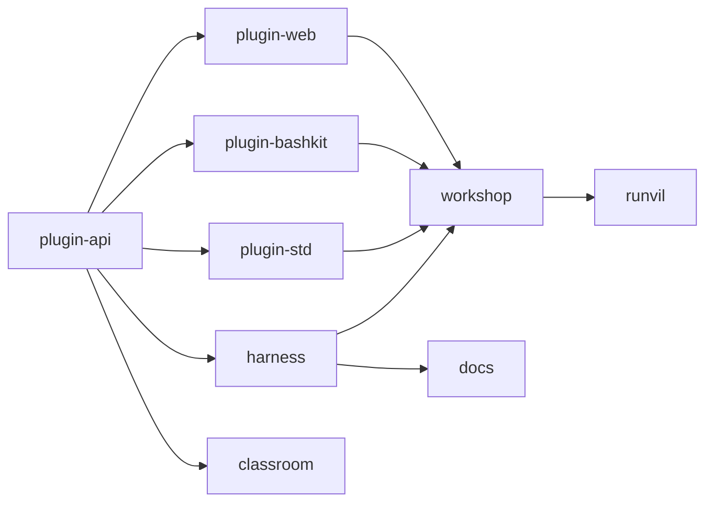

# Pack render verb

This is the part of the plan for contract 0.7 that concerns this repository. Everything else merges first, and this repository pins the Workshop commit that carries the rest.

## The idea in plain terms

- **Catalog tool.** A tool a Pack declares when a run starts, such as `fs/edit`. Lua can call it by id, a prompt offers it with `tools.offer("fs/edit")` or `tools.offer("fs")`, and its parameters are documented and fixed for the run.
- **Model-facing tool.** A tool that exists only in a render's answer, such as `fs/str_replace` for Anthropic models or `fs/apply_patch` for OpenAI models. Only the model can call it. Lua can't name it.
- **Render.** At a section entry's first `models.loop` round, the Harness asks each offered Pack: "here are the tools the section offered and here is the model, what should the model see?" The answer is frozen for that section entry.
- **The name-locked rule.** A tool name always means one parameter schema. A render may give a catalog tool another wire name and description, but different parameters need a different tool name. So a Plugin's `call` matches on the tool name it receives and keeps no memory of what it rendered.
- **What exists today.** The Engine and Harness already do all of this for Rust Packs (`Effect::Render`, the merge, the run log). The C contract stops at verb 6, so a library Pack always passes its tools through unchanged. Today's merge also lets a render rewrite a catalog tool's parameters.
- **What this plan adds.** The verb, the SDK method, the loader's use of it, and the name-locked check in the Engine's merge.

## Repository order

Each repository pins the one before it by commit, so each wave waits for the previous wave's merge. The four repositories in wave 2 run in parallel.

**The contract commit.** Every repository that names the contract uses one commit id of `runvil-plugin-api`: the Harness, the three Plugins, and Workshop's SDK line. `runvil-plugin-sys` sets `links`, so Cargo refuses two commits of the contract in one build. The id is recorded once, after wave 1 merges. If `runvil-plugin-api` gets another commit after that, all five are pinned again.

## Wave 4: runvil, runvil-docs, runvil-classroom

- **runvil.** Two commits: `Add the plan for the Workshop pin`, then `Pin Workshop at <sha>`, in the form of commits `c17624e66` and `2bd5f8b6e`.
- **runvil-docs.** One commit, `Say that a render keeps a catalog tool's parameters`, in 12-tools.md: "What a Pack's render can change", the model-only tools section, the freeze steps, and the `tool_sets_invalid` message in `16-limits-and-errors.md`. The author reads `CONTRIBUTING.md` first. It needs only the Harness merge, so it can run beside wave 3.
- **runvil-classroom.** One commit, `Bring the Plugin tutorial up to contract 0.7`, in `tutorials/tutorial-plugin-architecture.md`, pushed straight to `master` as you chose. Its branch rules allow that push. It needs only wave 1.
