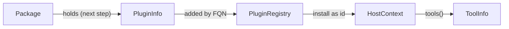

# Plugin Registry and Info Rename

<product-contract>

## Product Requirements

The Harness's registry of installable Plugins is named for packages, and the static data of Plugins, tools, and models goes by three different names. This plan renames them so each name says what the thing is, and frees "package" for the unit Plugins ship in: a linked crate today, and a dynamic library in the next step. It also calls the Engine-built Plugin kind built-in rather than native, so "native" means only compiled code. It is a pure rename. Hosts and Plugin crates see new type, constant, and error names; prompts see only two reworded `plugins.*` error messages.

- Problem and users:
  - `PackageRegistry` (`crates/harness-internal/runner/src/packages.rs`, lines 21-31) lists and installs Plugins, keyed by a `vendor/name` string the code calls a "package name". The `Package` struct (`crates/runvil-plugin/src/plugin.rs`, lines 106-155) describes one Plugin. The next step, an API that loads Plugins from dynamic libraries, needs "package" for a container that holds one or more Plugins, such as a dynamic library. "The next step" means that work throughout this plan.
  - `ToolDescriptor` (`crates/runvil-internal/types/src/tools/descriptor.rs`, line 24) and `ModelDescriptor` (`crates/runvil-internal/types/src/models.rs`, line 158) are the same kind of thing as `Package`, the static data of one item, under a different suffix.
  - `PluginKind::Native` (`crates/harness-internal/runner/src/packages.rs`, lines 33-42) and "Engine-native" in `AGENTS.md` (line 12) name the Engine-built kind, today only `runvil/subagents`. Its behavior lives in the Engine, not in compiled package code, and its own doc already says "Built into every registry". Yet "native" also means compiled code, in `AGENTS.md`'s "native build" and "native dependencies" (lines 43-44) and in the planned native preludes, so one word has two meanings.
  - The users are Host authors (Workshop, and Paperweight in the `wg21-paperflow` repository), Plugin crate authors, agents working in the Engine and the Harness, and prompt authors, through the language guide's wording.
- Goals:
  - The registry is named for what it holds: `PluginRegistry`.
  - A Plugin's `vendor/name` is its fully qualified name (FQN) in code, messages, and docs.
  - The static data types are `PluginInfo`, `ToolInfo`, and `ModelInfo`, and each has only that name: no "label", "descriptor", or "package" beside it.
  - The Engine-built Plugin kind is `PluginKind::Builtin`, and prose calls it built-in, so "native" means only compiled code.
  - `AGENTS.md` defines Plugin, FQN, Plugin id, Plugin registry, and package, and says a Host installs each Plugin once.
  - Model-facing text calls the one-segment name a "Plugin id", never a "Plugin name", which would now read as the FQN.
  - The language guide follows every rename: it says "fully qualified name", "model info", "Plugin id", and "bundled Plugins", and names no old type.
- Non-goals:
  - Any behavior change, including refusing a second install of one FQN.
  - The package container type, the dynamic-library entry point, and any C API.
  - Any change to Plugin ids, tool ids, or wire names, or to how `tools.offer`, `plugins.get`, and `plugins.offer` behave. Only two of their error messages change, and only in wording.
- Success criteria:
  - The exit criteria under Testing Plan pass after each step.
  - The completeness searches under Testing Plan print nothing beyond the allowed lines each one names, so no old name survives in the `runvil` repository outside `vibe/` plan records.
  - Recorded runs replay unchanged.
- Constraints:
  - Each step's commit compiles and passes on its own.
  - Serialized formats stay identical. `ToolInfo` keeps every serde field, and serde writes no type name. `ModelInfo` is never serialized: its derive list has no serde trait (`crates/runvil-internal/types/src/models.rs`, line 156).
  - The `runvil` and `harness` facades hold only single-item `pub use` lines and grouping modules (`crates/build-xtask/src/facade_shape.rs`, lines 1-15). The `runvil` surface is listed in `crates/runvil/public-api.txt`; `cargo +nightly-2026-09-05 xtask api --bless` rewrites the listing and `--check` compares it (`crates/build-xtask/src/api.rs`, lines 33-51).
  - The wording scan `crates/workshop/ui/test/docs-claims.mjs` (lines 100-118) refuses a lowercase "plugin" in `AGENTS.md`, `.cursor/rules` files, and `## Invariants` crate docs, so prose writes "Plugin registry".
  - Source directories are flat: one or two child modules sit beside the parent as `parent-label.rs`, and three or more move into a subdirectory (`AGENTS.md`, Structural Rules). No source file exceeds 500 lines (`crates/build-ceiling/src/lib.rs`).
- Open questions: None

## Functional Specification

A Host builds a `PluginRegistry`, adds each Plugin crate's `PLUGIN`, and installs Plugins by FQN under a Plugin id, the same steps it takes today under the old names. Install refusals and the two `plugins.*` argument refusals keep their meaning, with messages reworded to the new vocabulary. Prompts declare and call Plugins exactly as before.

- Actors and workflows:
  - A Plugin crate exports `pub const PLUGIN: PluginInfo`, built with `PluginInfo::new(fqn, construct)` and the `description`, `prelude`, and `needs` builders.
  - A Host calls `PluginRegistry::new()`, `add` for each `PLUGIN`, then `HostContext::new(plugins, services)` and `install(fqn, name, config)`. Workshop does this in `with_plugins` (`crates/workshop/server/src/agents.rs`, lines 149-192).
  - A prompt still writes `plugins: [web]` and `tools.call('web/fetch', ...)`.
- Inputs and outputs:
  - The names, from the outside in:
    - A package is the unit Plugins ship in. A linked package is a `plugin-*` crate, and a library package will be a dynamic library. A package can hold several Plugins, and it has no name in Runvil yet.
    - A Plugin's FQN, such as `runvil/web`, is `vendor/name` and keys the registry. The vendor is only the first segment, so two publishers can each ship a Plugin named `web`; nothing in the code is a vendor.
    - A Plugin id, such as `web`, is the local name the Host installs a Plugin under, by default the FQN's second segment (`crates/harness-internal/runner/src/packages.rs`, lines 156-162). Prompts see only Plugin ids.
    - A tool id is `<Plugin id>/<tool>`, such as `web/fetch`, and the model sees the wire name `web_fetch` (`runvil-docs` repository, `src/language/12-tools.md`, lines 192-200). Both are unchanged.
  - `PluginInfo` is a Plugin's static data. The `Plugin` trait (`crates/runvil-plugin/src/plugin.rs`, lines 21-105) is the live object its `construct` builds at install, one per Plugin. `ToolInfo` and `ModelInfo` are the static data of a tool and of a catalogued model.
- States and validation:
  - `PluginRegistry::add` refuses an FQN that is not two valid one-segment names, and an FQN the registry already holds, a built-in's included (`runvil/subagents`).
  - `install` refuses an unknown FQN, a built-in under another Plugin id, another Plugin under a built-in's Plugin id, and a Plugin id that is taken or differs from an installed one only by `-`, `_`, or `.`.
  - A Host installs each Plugin once. `install` still accepts one FQN more than once, because Workshop installs `plugin-mcp` once per MCP server (`crates/plugin-mcp/src/lib.rs`, line 4; `crates/workshop/server/src/agents.rs`, lines 179-189).
- Errors and recovery:
  - `InstallError` (`crates/harness-internal/runner/src/host.rs`, lines 221-275) becomes:
    - `InvalidFqn { fqn }`: "Plugin fully qualified name `{fqn}` is not a vendor/name pair"
    - `DuplicatePlugin { fqn }`: "Plugin `{fqn}` is already in the registry"
    - `UnknownPlugin { fqn }`: "Plugin `{fqn}` is not in the registry; add it with PluginRegistry::add before building the HostContext"
    - `ReservedName { fqn, name }`: "Plugin `{fqn}` cannot be installed as {name}: a built-in Plugin keeps its own Plugin id, and no other Plugin may take it"
    - `NameTaken { name, existing }`: "Plugin id {name} is taken by the installed {existing}; install it under another Plugin id"
  - `plugins.get` and `plugins.offer` (`crates/runvil-internal/lua/src/plugins.rs`, lines 132 and 195) refuse a bad argument with "plugins.get takes a Plugin id, got {type}" and "plugins.offer takes a Plugin id, a Plugin object, or a list of them, got {found}". `plugins.offer`'s refusal of a Plugin the run lacks, "no Plugin named ... in this run", keeps its words, because the name it quotes is the Plugin id itself.
  - Workshop logs "the Plugin was not added to the registry" when `add` refuses a Plugin.
  - The construct-failure warning names the Plugin's FQN in a field called `fqn`.
- Security and privacy behavior: No change.
- Acceptance criteria:
  - `harness::plugin` exports `PluginRegistry`, and `runvil_plugin` exports `PluginInfo` and `ToolInfo`, with no old name beside them.
  - `harness::plugin::PluginKind` has the variants `Builtin` and `Linked`, and no `Native`.
  - `crates/runvil/public-api.txt` lists `ToolInfo` and `ModelInfo`, and no `ToolDescriptor` or `ModelDescriptor`.
  - Each `plugin-*` crate exports `PLUGIN` and no `PACKAGE`.
  - Each `InstallError`, `plugins.get`, and `plugins.offer` message reads as given above.
  - The `AGENTS.md` Plugin entry reads as given under Technical Design.
  - Every language-guide line listed under Technical Design is rewritten, and the docs checks pass.

</product-contract>
<implementation-contract>

## Technical Design

Three type renames meet in the Plugin contract: the tool and model types first, because the Plugin crates and the Harness use both, then the Plugin types and the registry. Public surfaces change in three places: the `runvil` facade, the `harness::plugin` module, and the `runvil-plugin` contract. File names follow the new type names. Beside them, `PluginKind::Native` becomes `Builtin`, and model-facing text says "Plugin id" for the one-segment name. Nothing serialized changes, and no behavior changes.

- Architecture:
  - The levels are package, Plugin, and tool. A package holds Plugins (next step). Each Plugin's `PluginInfo` is added to the `PluginRegistry` by FQN, the `HostContext` installs it under a Plugin id, and the live Plugin's `tools()` returns its `ToolInfo` values.
  - The `Plugin` trait keeps its name. `PluginInfo` and the live `Plugin` are one to one, because a Host installs each Plugin once; `plugin-mcp`, which Workshop installs once per MCP server, is the one exception until its redesign.



- Modules and interfaces:
  - The declarations below are the result of the rename. Bodies are elided with `;` or `{ ... }`, `// was ...` marks each rename, and rustfmt decides line breaks. A doc comment appears below only where this plan fixes its new wording.
  - Every other doc comment, comment, test name, and assertion message in a touched file that says "package", "label", or "descriptor" in a renamed sense is rewritten in the new vocabulary too. Examples are the `PluginInfo` struct doc and its `text` example (`crates/runvil-plugin/src/plugin.rs`, lines 107-121), the `ToolInfo` docs (`crates/runvil-internal/types/src/tools/descriptor.rs`, lines 15, 39, and 46), and the module docs of `packages.rs` and `host.rs`. The completeness searches under Testing Plan check them.

```rust
// crates/runvil-internal/types/src/tools/info.rs  (was tools/descriptor.rs)
//! The [`ToolInfo`]: everything an Engine needs to know about a tool
//! except how to run it.

/// A tool described as data.
///
/// A `ToolInfo` holds the tool's stable id, the description the model
/// reads, its parameter schema, whether its output is structured, and
/// whether a stop leaves its calls running.
#[derive(Debug, Clone, PartialEq, Eq, Serialize, Deserialize)]
#[non_exhaustive]
pub struct ToolInfo {
    // was ToolDescriptor. The fields are unchanged, and serde writes no type
    // name, so recorded runs and replays read exactly as before.
    pub id: ToolId,
    pub description: String,
    pub parameters_schema: Value,
    pub structured_output: bool,
    #[serde(default)]
    pub survives_stop: bool,
}

impl ToolInfo {
    #[must_use]
    pub fn new(id: ToolId, description: impl Into<String>, parameters_schema: Value) -> ToolInfo;

    #[must_use]
    pub fn structured(mut self, structured: bool) -> ToolInfo;

    #[must_use]
    pub fn survives_stop(mut self, survives: bool) -> ToolInfo;
}

// crates/runvil-internal/types/src/tools.rs
mod info; // was `mod descriptor;`
pub use info::ToolInfo; // was descriptor::ToolDescriptor

// crates/runvil/src/lib.rs, `pub mod tools` (one item per line, in name order)
pub use runvil_types::tools::OutputTrust;
pub use runvil_types::tools::ToolCatalog;
pub use runvil_types::tools::ToolCatalogError;
pub use runvil_types::tools::ToolCatalogErrorKind;
pub use runvil_types::tools::ToolError;
pub use runvil_types::tools::ToolErrorKind;
pub use runvil_types::tools::ToolId;
pub use runvil_types::tools::ToolIdError;
pub use runvil_types::tools::ToolIdErrorKind;
pub use runvil_types::tools::ToolInfo; // was ToolDescriptor, now after ToolIdErrorKind
pub use runvil_types::tools::ToolOutput;

// crates/runvil-internal/lua/src/handles.rs
impl ToolBinding {
    pub fn from_info(alias: &str, info: &ToolInfo) -> Self; // was from_descriptor(alias, descriptor: &ToolDescriptor)
}

// crates/runvil-internal/types/src/models.rs
//! Public model vocabulary: stable identity, catalog, and model info. // was "and descriptor"

/// The reason building a [`ModelCatalog`] from its `ModelInfo` values failed.
#[derive(Debug, Clone, PartialEq, Eq)]
#[non_exhaustive]
pub enum ModelCatalogError {
    /// Two `ModelInfo` values shared one stable [`ModelId`], which would make
    /// lookups ambiguous.
    #[non_exhaustive]
    DuplicateId { server: String, name: String }, // unchanged, and so is its message
}

/// Describes one catalogued model.
///
/// It holds the model's identity, description, context window, thinking
/// mode, and the provider id the catalog names, if any.
///
/// Two gateway types share the name but are different types:
/// `gateway_api_types::ModelInfo`, one entry of the gateway's `/v1/models`
/// list, and `gateway_local::gguf::ModelInfo`, the metadata read from a
/// GGUF file.
#[derive(Debug, Clone, PartialEq, Eq)]
#[non_exhaustive]
pub struct ModelInfo {
    // was ModelDescriptor. Not serialized, so nothing recorded changes.
    id: ModelId,
    description: String,
    context: NonZeroU32,
    thinking: ThinkingMode,
    provider: Option<String>,
}

impl ModelInfo {
    /// Builds a `ModelInfo` from its identity and catalog fields. // was "Builds a descriptor"
    #[must_use]
    pub fn new(
        id: ModelId,
        description: impl Into<String>,
        context: NonZeroU32,
        thinking: ThinkingMode,
    ) -> Self;

    #[must_use]
    pub fn with_provider(self, provider: impl Into<String>) -> Self;

    pub fn id(&self) -> &ModelId;
    pub fn description(&self) -> &str;
    pub fn context(&self) -> NonZeroU32;
    pub fn thinking(&self) -> ThinkingMode;
    pub fn provider(&self) -> Option<&str>;
}

pub struct ModelCatalog {
    models: Vec<ModelInfo>, // was Vec<ModelDescriptor>
}

impl ModelCatalog {
    pub fn new(models: impl IntoIterator<Item = ModelInfo>) -> Result<ModelCatalog, ModelCatalogError>;
    pub fn models(&self) -> &[ModelInfo];
    pub fn get(&self, id: &ModelId) -> Option<&ModelInfo>;
}

// crates/runvil/src/lib.rs, `pub mod model` (one item per line, in name order)
pub use runvil_types::models::ModelCatalog;
pub use runvil_types::models::ModelCatalogError;
pub use runvil_types::models::ModelId;
pub use runvil_types::models::ModelIdError;
pub use runvil_types::models::ModelInfo; // was ModelDescriptor, now after ModelIdError
pub use runvil_types::models::ThinkingMode;

// crates/runvil-internal/engine/src/execute/config.rs
impl RunContext {
    pub fn model(mut self, model: ModelInfo) -> RunContext; // was ModelDescriptor
    pub fn current_model(&self) -> Option<&ModelInfo>; // was Option<&ModelDescriptor>
}

// crates/runvil-internal/engine/src/execute/bindings.rs
impl ModelBindings {
    pub fn resolve(&self, label: &str) -> Option<&ModelInfo>; // was ModelDescriptor
    pub fn model(&self, id: &ModelId) -> Option<&ModelInfo>; // was ModelDescriptor
}

// crates/runvil-plugin/src/plugin.rs  (was `Package`)
#[derive(Clone, Copy)]
#[non_exhaustive]
pub struct PluginInfo {
    /// The Plugin's fully qualified name (FQN): `vendor/name` with two
    /// segments, such as `runvil/web`. A Host installs the Plugin under the
    /// second segment unless it picks another Plugin id.
    pub fqn: &'static str, // was `name`
    pub prelude: Option<&'static str>,
    pub needs: &'static [ServiceId],
    #[expect(
        clippy::type_complexity,
        reason = "spelled out so a Plugin author reads the signature construct implements in one place"
    )]
    pub construct: fn(
        name: &PluginId,
        config: serde_json::Value,
        services: &HostServices,
    ) -> Result<Arc<dyn Plugin>, ToolError>,
    pub description: &'static str,
}

impl PluginInfo {
    #[expect(
        clippy::type_complexity,
        reason = "spelled out so a Plugin author reads the signature construct implements in one place"
    )]
    #[must_use]
    pub const fn new(
        fqn: &'static str, // was `name`
        construct: fn(
            name: &PluginId,
            config: serde_json::Value,
            services: &HostServices,
        ) -> Result<Arc<dyn Plugin>, ToolError>,
    ) -> PluginInfo;

    #[must_use]
    pub const fn description(self, description: &'static str) -> PluginInfo;

    #[must_use]
    pub const fn prelude(self, prelude: &'static str) -> PluginInfo;

    #[must_use]
    pub const fn needs(self, needs: &'static [ServiceId]) -> PluginInfo;
}

impl fmt::Debug for PluginInfo {
    // f.debug_struct("PluginInfo").field("fqn", ..), then "description",
    // "prelude" (is_some), "needs", and finish_non_exhaustive(), as today
    fn fmt(&self, f: &mut fmt::Formatter<'_>) -> fmt::Result { ... }
}

pub trait Plugin: Send + Sync {
    // trait name and methods unchanged; only the element type of tools() changes
    fn tools(&self) -> Vec<ToolInfo>; // was Vec<ToolDescriptor>
    fn ready(&self) -> PluginFuture<'_, Result<(), ToolError>> { ... }
    fn call<'a>(
        &'a self,
        cx: ToolContext<'a>,
        args: serde_json::Value,
    ) -> PluginFuture<'a, Result<ToolOutput, ToolError>>;
}

// crates/runvil-plugin/src/lib.rs
pub use plugin::{Plugin, PluginFuture, PluginInfo}; // was {Package, Plugin, PluginFuture}
pub use runvil_types::tools::{
    OutputTrust, ToolCallOrigin, ToolCaller, ToolError, ToolErrorKind, ToolId, ToolIdError,
    ToolIdErrorKind, ToolInfo, ToolOutput, // was ToolDescriptor
};

// crates/plugin-web/src/web.rs  (was `pub const PACKAGE: Package`)
pub const PLUGIN: PluginInfo =
    PluginInfo::new("runvil/web", construct).description("Search the web and fetch pages");

// crates/plugin-web/src/lib.rs
pub use crate::web::{PLUGIN, SEARCH_PROVIDER}; // was {PACKAGE, SEARCH_PROVIDER}

// crates/plugin-user-input/src/lib.rs
pub const PLUGIN: PluginInfo = PluginInfo::new("runvil/user-input", ask::construct)
    .description("Ask the person running the prompt")
    .prelude(PRELUDE)
    .needs(NEEDS);

// crates/plugin-mcp/src/lib.rs
pub const PLUGIN: PluginInfo =
    PluginInfo::new("runvil/mcp", construct).description("Tools from one MCP server");

// crates/plugin-mcp/src/server.rs
pub(crate) info: ToolInfo, // was `descriptor: ToolDescriptor`

// Every `construct` in plugin-web, plugin-user-input, plugin-mcp, and the runner's built-in:
#[expect(
    clippy::needless_pass_by_value, // the built-in's lint is clippy::unnecessary_wraps
    reason = "the PluginInfo construct signature fixes the argument types" // was "the Package construct signature ..."
)]

// crates/harness-internal/runner/src/registry.rs  (was packages.rs)
/// Every Plugin a Host can install, by fully qualified name.
#[derive(Debug)]
pub struct PluginRegistry {
    // was PackageRegistry
    entries: BTreeMap<&'static str, (PluginInfo, PluginKind, PluginId)>,
}

/// Where a Plugin comes from.
#[derive(Clone, Copy, Debug, PartialEq, Eq)]
#[non_exhaustive]
pub enum PluginKind {
    // name and Linked unchanged
    /// Built into every registry; its behavior will live in the Engine, and
    /// today's one built-in, `runvil/subagents`, has none yet.
    Builtin, // was Native
    /// Added by the Host with [`PluginRegistry::add`].
    Linked,
}

impl Default for PluginRegistry {
    fn default() -> PluginRegistry;
}

impl PluginRegistry {
    #[must_use]
    pub fn new() -> PluginRegistry;

    /// # Errors
    /// Returns [`InstallError::InvalidFqn`] when the FQN is not a
    /// `vendor/name` pair of valid one-segment names, and
    /// [`InstallError::DuplicatePlugin`] when the registry holds the FQN
    /// already.
    pub fn add(&mut self, info: PluginInfo) -> Result<(), InstallError>; // was `package: Package`

    pub fn list(&self) -> impl Iterator<Item = (&PluginInfo, PluginKind)>;

    pub(crate) fn entry(&self, fqn: &str) -> Option<(PluginInfo, PluginKind, &PluginId)>;

    /// Whether `name` is a built-in's default Plugin id, which only that
    /// built-in may be installed under.
    pub(crate) fn reserves(&self, name: &PluginId) -> bool; // name unchanged
}

/// The built-ins every registry holds from the start.
const BUILTIN: [PluginInfo; 1] = [PluginInfo::new("runvil/subagents", builtin)
    .description("Reserves the subagents name for the Engine's subagent tools, which are not built yet")];
// was NATIVE, built by `native`

/// Builds a built-in's [`Builtin`] object; see [`BUILTIN`].
fn builtin(
    _name: &PluginId,
    _config: Value,
    _services: &HostServices,
) -> Result<Arc<dyn Plugin>, ToolError>; // was `native`

/// The object of a built-in Plugin, which offers no tools; see [`BUILTIN`].
struct Builtin; // was Native
// Its unreachable `call` answers "{tool} belongs to a built-in Plugin, whose
// calls the Engine answers" (was "a native Plugin").

/// The default Plugin id for the FQN `vendor/name`: its second segment,
/// when both segments are valid one-segment names.
pub(crate) fn default_id(fqn: &str) -> Option<PluginId>; // was package_name(package: &str)

// crates/harness-internal/runner/src/lib.rs
mod registry; // was `mod packages;`
pub use registry::{PluginKind, PluginRegistry}; // was packages::{PackageRegistry, PluginKind}

// crates/harness-internal/runner/src/host.rs
use runvil_plugin::{HostServices, Plugin, PluginId, PluginInfo};
use crate::registry::{PluginKind, PluginRegistry};

pub struct HostContext {
    plugins: PluginRegistry, // was `packages: PackageRegistry`
    services: HostServices,
    installed: Vec<Installed>,
}

struct Installed {
    name: PluginId,
    info: PluginInfo, // was `package: Package`
    plugin: Result<Arc<dyn Plugin>, String>,
}

impl HostContext {
    #[must_use]
    pub fn new(plugins: PluginRegistry, services: HostServices) -> HostContext;

    /// # Errors
    /// Returns [`InstallError::UnknownPlugin`], [`InstallError::ReservedName`],
    /// or [`InstallError::NameTaken`].
    pub fn install(
        &mut self,
        fqn: &str, // was `package: &str`
        name: Option<PluginId>,
        config: serde_json::Value,
    ) -> Result<PluginId, InstallError>;
}

// Inside `install`, the construct-failure warning:
tracing::warn!(
    plugin = %name,
    fqn = info.fqn, // was `package = package.name`
    %error,
    "Plugin construct failed; it is installed as unavailable"
);

#[derive(Debug, Clone, PartialEq, Eq, thiserror::Error)]
#[non_exhaustive]
pub enum InstallError {
    /// The added Plugin's FQN is not `vendor/name`, or a segment of it is
    /// not a valid one-segment name.
    #[error("Plugin fully qualified name `{fqn}` is not a vendor/name pair")]
    InvalidFqn {
        // was InvalidPackage { package }
        /// The FQN as its `PluginInfo` spells it.
        fqn: &'static str,
    },
    /// The registry holds the added Plugin's FQN already, as a built-in or
    /// as a Plugin added before.
    #[error("Plugin `{fqn}` is already in the registry")]
    DuplicatePlugin {
        // was DuplicatePackage { package }
        /// The FQN as its `PluginInfo` spells it.
        fqn: &'static str,
    },
    /// The registry holds no Plugin with the FQN the install asked for.
    #[error(
        "Plugin `{fqn}` is not in the registry; add it with PluginRegistry::add before building the HostContext"
    )]
    UnknownPlugin {
        // was UnknownPackage { package }
        /// The FQN the install asked for.
        fqn: String,
    },
    /// A built-in was asked for under a Plugin id other than its own, or
    /// another Plugin under a built-in's Plugin id.
    #[error(
        "Plugin `{fqn}` cannot be installed as {name}: a built-in Plugin keeps its own Plugin id, and no other Plugin may take it"
    )]
    ReservedName {
        /// The FQN as its `PluginInfo` spells it.
        fqn: &'static str, // was `package`
        /// The Plugin id the install asked for.
        name: PluginId,
    },
    #[error(
        "Plugin id {name} is taken by the installed {existing}; install it under another Plugin id"
    )]
    NameTaken {
        // variant and fields unchanged; only the message changes
        name: PluginId,
        existing: PluginId,
    },
}

// crates/harness-internal/runner/src/host-run.rs
use runvil::tools::{ToolCatalog, ToolError, ToolErrorKind, ToolId, ToolInfo, ToolOutput}; // was ToolDescriptor
use runvil_plugin::{HostServices, Plugin, PluginId, PluginInfo, ServiceId, ToolContext};

enum RunPlugin {
    Usable {
        info: PluginInfo, // was `package: Package`
        plugin: Arc<dyn Plugin>,
        tools: Vec<ToolInfo>, // was Vec<ToolDescriptor>
    },
    Unavailable(String),
    NeedsUnmet(Vec<ServiceId>),
}

impl HostRunContext {
    pub(super) fn snapshot<'a>(
        installed: impl Iterator<
            Item = (&'a PluginId, PluginInfo, &'a Result<Arc<dyn Plugin>, String>),
        >, // was `Package`
        services: HostServices,
        mut failures: BTreeMap<PluginId, String>,
    ) -> HostRunContext;
}

// crates/harness/src/lib.rs, `pub mod plugin` (one item per line, in name order)
pub use harness_runner::HostContext;
pub use harness_runner::InstallError;
pub use harness_runner::PluginKind;
pub use harness_runner::PluginRegistry; // was PackageRegistry
pub use runvil_plugin::HostServices;
pub use runvil_plugin::PluginId;

// crates/workshop/server/src/agents.rs, `with_plugins`
use harness::plugin::{HostContext, HostServices, PluginRegistry};

let mut plugins = PluginRegistry::new(); // was `packages`
for info in [
    plugin_web::PLUGIN,
    plugin_user_input::PLUGIN,
    plugin_mcp::PLUGIN,
] {
    if let Err(error) = plugins.add(info) {
        tracing::warn!(%error, "the Plugin was not added to the registry"); // was "the Plugin package was not added"
    }
}
let mut host = HostContext::new(plugins, services);
if let Err(error) = host.install(plugin_web::PLUGIN.fqn, None, Value::Null) { ... }
let ask = match host.install(plugin_user_input::PLUGIN.fqn, None, Value::Null) { ... };
if let Err(error) = host.install(plugin_mcp::PLUGIN.fqn, Some(id), entry) { ... }
```

- File and public API changes:
  - File renames, each with its parent's `mod` line:
    - `crates/runvil-internal/types/src/tools/descriptor.rs` becomes `tools/info.rs`.
    - `crates/harness-internal/runner/src/packages.rs` and `packages-tests.rs` become `registry.rs` and `registry-tests.rs`.
    - `crates/harness-internal/runner/tests/it/packages.rs` becomes `tests/it/registry.rs`.
    - `crates/runvil-plugin/tests/it/package.rs` becomes `tests/it/plugin_info.rs`.
  - Public surfaces:
    - The `runvil` facade's `model` and `tools` modules (`crates/runvil/src/lib.rs`, lines 95 and 109).
    - The `harness::plugin` module (`crates/harness/src/lib.rs`, lines 27-39). Besides `PluginRegistry`, it re-exports `PluginKind` (line 36), whose variant `Native` becomes `Builtin`: a breaking change for any Host that names the variant. Neither Workshop nor Paperweight (`wg21-paperflow` repository, `crates/`) names `PluginKind` today.
    - The `runvil-plugin` re-exports (`crates/runvil-plugin/src/lib.rs`, lines 65-72).
    - `crates/runvil/public-api.txt` changes its 14 `ToolDescriptor` lines and 17 `ModelDescriptor` lines and nothing else.
  - Names that name a renamed type follow it. `ToolBinding::from_descriptor` (`crates/runvil-internal/lua/src/handles.rs`, line 56) becomes `from_info`, and `plugin-mcp`'s `descriptor` field (`crates/plugin-mcp/src/server.rs`, line 46) becomes `info`. Test helpers, test names, and locals that say "descriptor" or "package" in these senses say "info", "tool info", "model info", or "Plugin", and the locals become `info` and `plugins`.
  - "Label" is a fourth name for `Package` and is renamed with it: prose says `PluginInfo`, and code says `info`. It appears in:
    - `crates/runvil-plugin/src/plugin.rs`, lines 1, 107, and 158
    - `crates/harness-internal/runner/src/host.rs`, lines 52, 233, 240, and 257
    - `crates/runvil-internal/types/src/plugins.rs`, lines 11-12
    - `crates/plugin-web/src/web.rs`, lines 1 and 22, and `crates/plugin-web/src/web-tests.rs`, line 1
    - `crates/plugin-user-input/src/lib.rs`, line 82, and line 1 of `crates/plugin-user-input/tests/it/main.rs` and `tests/it/ask.rs`
    - `crates/plugin-mcp/src/lib.rs`, line 85
    - the `runvil-plugin` dependency comment in `crates/plugin-web/Cargo.toml` (line 10), `crates/plugin-user-input/Cargo.toml` (line 13), and `crates/plugin-mcp/Cargo.toml` (line 10)
    - `crates/harness-internal/runner/tests/it/asker.rs`, line 14
    - `crates/runvil-plugin/tests/it/package.rs`, line 1, and the `label` loop variable, lines 175-183
  - `plugin-web`'s other labels, for a charset, an address range, and an extraction, are unrelated and stay.
  - In prose, a type is written in backticks, with "`ToolInfo` values" or "`PluginInfo` values" for plurals, never "infos". In identifiers, one value is `info`, and a collection is `infos` or a plural noun such as `tools`.
  - Unrelated names keep their words: the gateway's provider descriptors (`crates/gateway/cloud-providers`), JavaScript's `Object.getOwnPropertyDescriptor` in Workshop UI tests, Cargo's "package" in `crates/build-xtask`, and Lua's `package` library in the language guide.
  - "Native" for compiled code, or for a non-browser client, keeps its word: native preludes in the Deferred items, `AGENTS.md`'s "native build" and "native dependencies" (lines 43-44), every gateway, speech-to-text, and Workshop desktop use, the native clients in `crates/workshop/server/src/cross_site.rs` and `crates/shared-loopback`, and the native modules in `crates/runvil-internal/lua/src/require.rs` (line 15). `AGENTS.md`'s "Rust's built-in test harness" (line 22) is qualified by its owner and stays.
  - The Plugin entry in `AGENTS.md` (line 12) becomes:

    > **Plugin**: a named unit of tools, and optionally a Lua prelude, that a Host adds to its Plugin registry and installs into a `HostContext` by its fully qualified name (FQN), such as `runvil/web`, under a local name the Host chooses, its Plugin id, such as `web`. Every tool it offers sits under its Plugin id (`web/fetch`). A Host installs each Plugin once; `plugin-mcp`, installed once per MCP server, is the one exception until its redesign. Plugins ship in packages: a linked package is a `plugin-*` crate implementing `runvil-plugin`, and a library package is a dynamic library (not built yet). A Plugin is linked or library by the package it ships in, or built-in (`runvil/subagents`, reserved for subagent tools the Engine will implement under the fixed name `subagents`, which no other Plugin may take; not built yet). Linked and library Plugins use only the `runvil-plugin` API. Every run receives every usable Plugin's tools: those of each installed Plugin that built and whose per-run services the run has. Declaring a Plugin under `plugins:` in a prompt's frontmatter installs its Lua prelude and makes it required, and the prompt's Lua decides what the model sees. A Plugin has no other name: never capability, pack, or addon. A package is what Plugins ship in, never a Plugin.

  - The language guide, in the `runvil-docs` repository, changes "package name" or "package" to "fully qualified name" in the Plugin sense only:
    - `src/language/04-how-a-prompt-runs.md`, line 368
    - `src/language/05-lua-environment.md`, line 2365
    - `src/language/12-tools.md`, lines 36, 81, 147, 150, 218, 223, 226, and 313. Line 226 becomes "A fully qualified name is not a Plugin id". Line 36 also says "bundled Plugins" in place of "built-in Plugin packages", because those are linked Plugins such as `runvil/web`, and "built-in" now means only the Engine-built kind.
    - `src/language/13-web-fetch-and-search.md`, lines 40, 60, and 66
    - `src/language/17-quick-reference.md`, line 247
  - The language guide also changes "model descriptor" in `src/language/10-models.md`:
    - Line 354: "each model is described by a model descriptor and named by a model id" becomes "each model is described by its model info and named by a model id".
    - Line 356: "Each model descriptor carries a description, ..." becomes "Each model's info carries a description, ...".
  - The language guide also says "Plugin id" where it says "Plugin name", in `src/language/12-tools.md`. Lines 314, 701, 1059, and 1064 quote the reworded `plugins.get` and `plugins.offer` messages, and line 696 says "It checks no Plugin id grammar". "The Plugin named by", on lines 546 and 1137, and "no Plugin named", on line 1069, stay.
  - The guide's mentions of Lua's `package` library stay: chapter 03, line 1934; chapter 05, lines 138, 268, 559, 567, 570, 583, 596, and 606; and chapter 17, line 126.
  - Every other rename in this plan changes no guide line. The guide names none of `ToolDescriptor`, `Package`, `PACKAGE`, `PackageRegistry`, `PluginKind`, or `InstallError`, and never calls a Plugin's static data a "label" or a Plugin "native". Its other uses of those words are unrelated and stay: "label" for role, fence, and location labels, and "built-in" for the task built-ins, the built-in substitution sources, and the built-in fetch policy and blocked table. The quick reference's "Provided by" column (`src/language/17-quick-reference.md`, lines 255-257) already lists FQNs such as `runvil/web`, so only its intro sentence, line 247, changes.
- Data, persistence, failure, security, and privacy constraints:
  - Recorded runs and replays read as before, because no serialized field or format changes. No recording, fixture, or shipped prompt holds the old `plugins.*` message text: a search for "takes a Plugin name" outside `.rs` files and `vibe/` finds none.
  - The changed observable text is the five `InstallError` messages, the two `plugins.*` argument errors, Workshop's add-failure warning, the construct-failure warning's field name, the built-in stub's unreachable call error, and `Debug` output. `PluginInfo` prints its own type name and `fqn` where it printed `Package` and `name`, `PluginRegistry` prints its new type name and `Builtin` for its built-in's kind, and `HostContext` prints its registry under `plugins`, not `packages`. No test asserts on those names: the `Debug` test in `crates/runvil-plugin/tests/it/package.rs` (line 188) checks only values.

</implementation-contract>
<verification-contract>

## Testing Plan

No behavior changes, so the plan adds no tests: the existing suites, under the new names, prove the rename. Completeness searches prove no old name survives, and the facade listing proves the public surface moved exactly. Each step's commit passes the same gates before it lands.

- Unit:
  - Renamed tests keep their assertions. Assertions on message text follow the new messages. For example, `install_refuses_a_package_the_registry_does_not_hold` (`crates/harness-internal/runner/tests/it/packages.rs`) becomes `install_refuses_a_plugin_the_registry_does_not_hold` and looks for `PluginRegistry::add`.
- Integration and end-to-end:
  - Every existing suite of the touched crates passes unchanged apart from names, including the facade suites (`crates/runvil/tests/suite/`, `crates/harness/tests/suite/`) and Workshop's (`crates/workshop/agents/`, `crates/workshop/server/`).
- Regression, security, and performance:
  - Completeness searches, run from the repository root named in each. Each one prints nothing beyond the allowed lines it names; a search that prints nothing exits 1, and that counts as a pass. The code gains no "package" in the container sense; that sense lives only in `AGENTS.md` until the next step.
    - After Step 1:
      - `rg -n "ToolDescriptor|ModelDescriptor|from_descriptor" crates` prints nothing.
      - `rg -n -i "descriptor" crates -g "!crates/gateway/cloud-providers/**" -g "!crates/gateway-api-types/**" -g "!*.{js,mjs,ts}"` prints nothing. The excluded paths hold the gateway's provider descriptors and JavaScript's `Object.getOwnPropertyDescriptor`.
    - After Step 2:
      - `rg -n -i "package" -g "*.rs" crates/runvil-plugin crates/harness crates/harness-internal crates/plugin-web crates/plugin-user-input crates/plugin-mcp crates/workshop/server crates/workshop/agents crates/runvil-internal/types` prints only `crates/workshop/server/build.rs`, line 2, which names the UI's npm package.
      - `rg -n -i -w "labels?" crates/runvil-plugin crates/plugin-user-input crates/plugin-mcp crates/runvil-internal/types/src/plugins.rs crates/harness-internal/runner/src/host.rs crates/harness-internal/runner/tests/it/asker.rs crates/plugin-web/Cargo.toml crates/plugin-web/src/web.rs crates/plugin-web/src/web-tests.rs` prints nothing.
      - `rg -n "package registry|package name" AGENTS.md` prints nothing.
      - `rg -n "PluginKind::Native|\bNATIVE\b|Engine-native" crates/harness crates/harness-internal crates/workshop/server AGENTS.md` prints nothing.
      - `rg -n -i "(^|[^a-z])natives?" crates/harness-internal/runner crates/workshop/server/src/agents.rs crates/workshop/server/src/agents` prints nothing. Unlike `\bnatives?\b`, this form also matches inside snake_case names, because `_` is a word character that hides a `\b` boundary. Nine of today's test names would slip past `\bnatives?\b`, such as `a_declared_native_is_met_when_installed_and_missing_when_not`. The form also skips words such as "alternative".
      - `rg -n -w "Plugin name" crates AGENTS.md` prints nothing. The whole-word form leaves "Plugin names" and "Plugin named" alone.
    - In the `runvil-docs` repository, one search per rename:
      - `rg -n -i "descriptor" src/language` prints nothing.
      - `rg -n -w "packages?" src/language` prints only the Lua `package` library lines listed under Technical Design.
      - `rg -n -i "built-in Plugin" src/language` prints nothing.
      - `rg -n -w "Plugin name" src/language` prints nothing.
      - `rg -n "PackageRegistry|\bPackage\b|\bPACKAGE\b|ToolDescriptor|ModelDescriptor|PluginKind|InstallError|Engine-native" src/language` prints nothing, as it does today.
  - The replay suite (`crates/runvil/tests/suite/replay.rs`) passing proves recorded runs are unchanged.
  - The rename has no performance effect.
- Exit criteria, run in PowerShell from the `runvil` root after each step's changes and before its commit is finalized:
  - `cargo fmt --all --check`
  - `$env:CARGO_BUILD_WARNINGS='deny'`, then `cargo clippy --workspace --exclude workshop --exclude workshop-server --exclude workshop-server-api --all-targets --all-features` and `cargo clippy -p workshop -p workshop-server -p workshop-server-api --all-targets`
  - `cargo nextest run --locked --workspace --exclude workshop --exclude workshop-server --exclude workshop-server-api --all-features` and `cargo nextest run --locked -p workshop -p workshop-server -p workshop-server-api`
  - `$env:RUSTDOCFLAGS='-D warnings'`, then `cargo doc --workspace --no-deps --all-features --exclude workshop --exclude workshop-server --exclude workshop-server-api`, `cargo doc -p runvil --no-deps`, and `cargo doc -p harness --no-deps`
  - `cargo test -p build-xtask`, which includes both facades' shape checks
  - `node --test crates/workshop/ui/test/docs-claims.mjs`
  - `Remove-Item Env:CARGO_BUILD_WARNINGS -ErrorAction SilentlyContinue; cargo +nightly-2026-09-05 xtask api --check`
  - That step's completeness searches
  - For the docs commit: the `runvil-docs` searches, then from the `runvil` root, `$env:RUNVIL_DOCS=(Resolve-Path ../runvil-docs).Path; cargo xtask site --books-only`

</verification-contract>
<decision-record>

## Decision Record

- Decisions:
  - The registry is `PluginRegistry`, because it holds and installs Plugins. User: "PackageRegistry was the wrong name. It should have been PluginRegistry".
  - "Package" names the unit Plugins ship in, and one package can hold several Plugins. A linked crate is a linked package, and a dynamic library will be a library package. User: "We have to have a name for the bundle" and "A DLL can have multiple plugins".
  - A Plugin's `vendor/name` is its fully qualified name, FQN. It reads clearly against "Plugin id", as in "a Plugin's fully qualified name, `runvil/web`, is not its Plugin id, `web`". User: "FQN fully qualified name".
  - The static data types are `PluginInfo`, `ToolInfo`, and `ModelInfo`. User: "Then I want PluginInfo and ToolInfo" and "I want ModelInfo".
  - "Label", the prose name for `Package`, is renamed with it to `PluginInfo`, so the static data has one name. The user chose this in plan review over leaving "label" as informal prose.
  - The suffix stays `Info` rather than `Descriptor` everywhere. Descriptor names would rename only `Package`, so Step 1 would not exist, and would avoid the third `ModelInfo`, but the next step is a handle-based C API, where "descriptor" reads as an integer handle, as in a file descriptor. The user confirmed `Info` in plan review.
  - The Engine's `ModelInfo` doc names the gateway's two `ModelInfo` types, so a search that finds all three explains itself. The user chose this in plan review.
  - The Engine-built Plugin kind is built-in, not native: `PluginKind::Native` becomes `PluginKind::Builtin`, `NATIVE` becomes `BUILTIN`, the stub `Native` and its construct `native` become `Builtin` and `builtin`, and prose says "built-in" and "built-ins" where it said "native", "Engine-native", and "natives". "Native" then means only compiled code, as in native preludes and `AGENTS.md`'s native dependencies, and the kind's own doc already says "Built into every registry". The language guide's "built-in Plugin packages" becomes "bundled Plugins", so "built-in" names only this kind. It lands in Step 2, which already renames `packages.rs`, rewrites the `InstallError` messages, and writes the new `AGENTS.md` entry. User: "change Native to Builtin in the rename plan".
  - The `Plugin` trait keeps its name, and `PluginInfo` is its static data, one to one.
  - Each `plugin-*` crate's constant is `PLUGIN`, because it holds one `PluginInfo`.
  - A Host installs each Plugin once, and the `AGENTS.md` entry says so, naming `plugin-mcp` as the exception until its redesign. The rename does not enforce the rule. User: "There can only be one plugin instance. You can't build the same plugin twice." and "Now, we're not changing it here."
  - The error variants are `InvalidFqn`, `DuplicatePlugin`, `UnknownPlugin`, `ReservedName`, and `NameTaken`. `NameTaken`'s message says "Plugin id", because "Plugin name" would now read as the FQN. These were proposed in planning, and the user raised no objection. For the same reason, the Engine's `plugins.get` and `plugins.offer` errors, the test `expect` messages, and the language guide's quotes of those errors say "Plugin id". The user chose this in plan review, over leaving the Engine messages as they were.
  - The language guide follows every rename in this plan, in one `runvil-docs` commit after the code steps. Renames the guide never mentions change no guide line, and a docs search per rename shows each is complete. User: "I want @runvil-docs/src/language updated as part of the plan, for all the renames".
  - "package" stays a lowercase word defined inside the `AGENTS.md` Plugin entry, not a fifth capitalized defined term beside Engine, Harness, Host, and Plugin. This was proposed in planning, and the user raised no objection.
  - The work is two code steps and one docs commit. Step 1 renames tool and model data to `ToolInfo` and `ModelInfo`, which share a suffix, a defining crate, and the facade listing. Step 2 renames the Plugin vocabulary, so it reviews on its own. The full gate runs twice. Step 2 follows Step 1, because both edit the same `use` lines and Step 2's declarations under Technical Design already use `ToolInfo`. User: "just the rename. Don't over scope it." and "keep the number of steps reasonably low".
  - The agent running this plan makes the `runvil-docs` guide changes and commits them in that repository itself, after Step 2 and before the Close commit, so the Close commit marks a finished `docs` todo. No `step-N` range holds this work, because the Vibe Coder's per-step cycle commits in one repository. The operator commits nothing. User: "do the commit yourself and runville docs".
- Rejected alternatives:
  - Keeping `PackageRegistry` and calling the dynamic library a "bundle": the registry's name stays wrong, and "bundle" is not Runvil vocabulary. No revisit condition.
  - "Plugin name" or "qualified name" for `vendor/name`: "Plugin name" is too close to "Plugin id", and the user chose FQN. No revisit condition.
  - `PluginDescriptor`, matching `ToolDescriptor` and `ModelDescriptor`: the smaller change, but "descriptor" reads as a handle in the coming C API, and the user chose `Info` names for all three types. No revisit condition.
  - Naming the struct `Plugin` and renaming the trait, for example to `PluginInstance`: the trait already owns the name in every Plugin crate and throughout the runner (`crates/runvil-plugin/src/plugin.rs`, lines 21-105; `Arc<dyn Plugin>` in `crates/harness-internal/runner/src/host-run.rs`), so the rename would widen, and `Plugin::call` would read worse. Revisit if the trait is redesigned.
  - `IPlugin` for the trait: no trait in `crates/` has an `I` prefix, Rust naming does not use one, and it widens the rename just as much. No revisit condition.
  - "Library" as the container's name: in the language guide a library is a section loaded with `require` (`runvil-docs` repository, `src/language/03-blocks-and-prose.md`, "Sharing code with `require`"), so Host-facing text says "dynamic library" in full and "library package". No revisit condition.
  - A `PluginFqn` newtype in this rename: it changes structure, not names. Revisit in the next step.
  - `PluginKind::BuiltIn`, with a capital I: the user chose `Builtin`. No revisit condition.
  - Three code commits, one each for tools, models, and Plugins: one more review cycle and full gate, with no design question of its own, since the tool and model renames move together through the same crates. No revisit condition.
  - Keeping `Native` for the Engine-built kind: "native" would keep two meanings once native preludes exist. No revisit condition.
- Assumptions, risks, and notes:
  - Engine, Harness, Host, and Plugin are capitalized defined terms (`AGENTS.md`, Definitions). Workshop is a Host. The Engine is the `runvil` and `runvil-*` crates, `runvil-plugin` and everything under `crates/runvil-internal/` included, and the Harness is the `harness` and `harness-*` crates, `harness-runner` and `harness-gateway-client` included.
  - Paperweight (`wg21-paperflow` repository, `crates/paperweight/src/app.rs`) uses `PackageRegistry` through a vendored copy of `runvil`, so it stops compiling when it next takes the vendored code, and it updates then.
  - `ModelInfo` already names two gateway types: `gateway_api_types::ModelInfo` (`crates/gateway-api-types/src/metadata.rs`, line 181), which `gateway-protocol` re-exports, and `gguf::ModelInfo` (`crates/gateway/local/src/gguf.rs`, line 80). No file that uses `ModelDescriptor` imports either one, and `harness-gateway-client` decodes the gateway's model list with its own private `ModelsListEntry` (`crates/harness-gateway-client/src/catalog.rs`, lines 12-31), so no file will see two `ModelInfo` types. A search for `ModelInfo` will find all three, and the Engine's doc names the other two so that result explains itself. Naming them passes `cargo xtask api`, whose doc-text check refuses only crates under `crates/runvil-internal/` (`crates/build-xtask/src/api/load.rs`, lines 46-49), and `crates/runvil-internal/types/src/models.rs` already describes the gateway's model ids.
  - Under one install per Plugin, the Plugin id is a short local alias for the FQN.
  - The vendor disappears after install. Two FQNs with the same second segment default to the same Plugin id, so the Host must give one of them another Plugin id, and prompts never see which vendor they got.
  - Tool ids follow the Plugin id, so a Host that installs `runvil/web` as `browse` gets `browse/fetch`.
  - The `AGENTS.md` sentence "Every tool it offers sits under its Plugin id" describes today's behavior and will change with the toolset design.
  - `PluginKind` keeps its name, because it says where a Plugin comes from, while its `Native` variant becomes `Builtin`; the next step adds `Library` beside `Builtin` and `Linked`.
  - The language guide's "task built-ins" (`runvil-docs` repository, `src/language/15-tasks.md`, line 2102) are Engine tools that belong to no Plugin. The guide never mentions `runvil/subagents` or a built-in Plugin, so the two uses of "built-in" never meet there, and both mean that the Engine supplies the thing.
  - No `vibe/` record of this plan exists yet, and `vibe/ACTIVE` is absent. The Run Sequence names the record by its seed date, as `vibe/YYYY-MM-DD-N-plugin-registry-rename.md`, which is `vibe/2026-10-18-2-plugin-registry-rename.md` when seeded on 2026-10-18. No `PLUGIN`, `PluginInfo`, `PluginRegistry`, `ToolInfo`, `Builtin`, or `fqn` exists in `crates/`.

### Deferred and Out of Scope

- Deferred: the package container type and the dynamic-library entry point. A dynamic library is a package with one export that receives a table of host functions and registers one or more Plugins through it, and a linked package registers the same way. Revisit in the next step.
- Deferred: `PluginKind::Library` beside `Builtin` and `Linked`, package identity (name, version, and hash) recorded in each run's Plugin roster so replays are pinned, and a `PluginFqn` newtype. Revisit in the next step.
- Deferred: native preludes, where a package's native code runs in every section VM of a prompt that declares the Plugin and defines globals through a handle-based C API that the Engine implements with its own mlua. Revisit in the next step; it does not wait for the toolset design.
- Deferred: the tools half of the dynamic-library API. Revisit after the toolset design, so the API is not built around fixed tool lists.
- Deferred: toolsets. A Plugin offers named toolsets that are rendered for each model just before each request, and their tools can differ by model in name, parameters, and semantics, such as a diff tool for some models and a string-replace tool for others. Lua then offers toolsets, selects subsets such as read-only tools by trait rather than by name, and calls stable Plugin functions instead of model tools, and the names "Plugin id", "tool id", and "wire name" are reconsidered. Today's `plugins.offer` already offers a whole Plugin (`runvil-docs` repository, `src/language/12-tools.md`, lines 828-830). User: "The Lua can never name the tools because it, it can be rendered late." Revisit as its own design, before the tools half of the dynamic-library API.
- Deferred: the `plugin-mcp` redesign to one instance with a fixed set of exploration tools whose results report each server's offerings, after which `install` refuses a second install of one FQN. Revisit with that redesign.
- Out of scope: historical `vibe/` plan records, design reports kept outside the repository, Paperweight's vendored copy, Cargo's "package" in `crates/build-xtask`, and Lua's `package` library in the language guide.

</decision-record>
<project-survey>

## Project Survey

- Status: complete
- Build command: `cargo build --locked -p gateway`, the workspace's only default member (`Cargo.toml`, line 19). Crate build scripts bundle the UIs with esbuild, so `crates/workshop/node_modules` and `crates/gateway/config-ui/ui/node_modules` must exist; both are present on this machine, and CI creates them with `npm ci --prefix crates/workshop` and `npm ci --prefix crates/gateway/config-ui/ui`. The clippy runs under Linter compile every crate this plan touches, so no separate build is needed.
- Focused test command pattern: `cargo nextest run --locked -p <package> --all-features <test-name-filter>`, where the filter matches the test's full module path, such as `packages` in `harness-runner`. `-E 'test(<name>)'` gives a nextest filterset, and `-E 'binary(it) & test(<name>)'` narrows to one integration binary. Drop `--all-features` for `workshop`, `workshop-server`, and `workshop-server-api`. cargo-nextest 0.9.128 is installed.
- Component test command pattern: `cargo nextest run --locked -p <package> --all-features`, without `--all-features` for `workshop`, `workshop-server`, and `workshop-server-api`.
- Full-suite test command: `cargo nextest run --locked --workspace --exclude workshop --exclude workshop-server --exclude workshop-server-api --all-features`, then `cargo nextest run --locked -p workshop -p workshop-server -p workshop-server-api`.
- Linter command: in PowerShell, `$env:CARGO_BUILD_WARNINGS='deny'` as its own statement, then `cargo clippy --workspace --exclude workshop --exclude workshop-server --exclude workshop-server-api --all-targets --all-features` and `cargo clippy -p workshop -p workshop-server -p workshop-server-api --all-targets`. Never run a standalone `cargo check --workspace` beside clippy. Companion gates, each a yes-or-no check:
  - `cargo test -p build-xtask` for the product and container boundaries, the Engine dependency guards, the doctest ban, the `test-support` leak guard, and the shape of both facades.
  - `node --test crates/workshop/ui/test/docs-claims.mjs`, the wording scan: no lowercase "plugin", "host", "engine", or "harness" in rulebooks (the `AGENTS.md` Definitions section is skipped), no "Host" in `crates/runvil` or `crates/runvil-internal`, and no "activat" in Plugin-facing comments.
  - `Remove-Item Env:CARGO_BUILD_WARNINGS -ErrorAction SilentlyContinue`, then `cargo +nightly-2026-09-05 xtask api --check` for the facade surface against `crates/runvil/public-api.txt`; `--bless` rewrites the listing. The nightly cargo turns its own warnings into errors while `CARGO_BUILD_WARNINGS` is set, and the check clears `RUSTDOCFLAGS` itself.
- Formatter check command: `cargo fmt --all --check`, with rustfmt `style_edition = "2024"`. The pre-commit hook runs it.
- Docs command: in PowerShell, `$env:RUSTDOCFLAGS='-D warnings'`, then `cargo doc --workspace --no-deps --all-features --exclude workshop --exclude workshop-server --exclude workshop-server-api`, `cargo doc -p runvil --no-deps`, and `cargo doc -p harness --no-deps`. The language guide in the sibling `runvil-docs` repository builds from this repository with `$env:RUNVIL_DOCS=(Resolve-Path ../runvil-docs).Path; cargo xtask site --books-only`. It needs `mdbook`, and v0.4.44 is installed; its link check verifies link targets as files but not `#` anchors.
- Test placement and naming conventions:
  - Unit tests take three forms: a sibling `<module>-tests.rs` wired with `#[cfg(test)] #[path = "<module>-tests.rs"] mod tests;`, as `crates/harness-internal/runner/src/packages-tests.rs` and `host-tests.rs` are; an inline `#[cfg(test)] mod tests { }`, as in `crates/runvil-internal/types/src/models.rs` and `crates/runvil-internal/engine/src/execute/bindings.rs`; or a `tests.rs` or `tests/` child, as `crates/runvil-internal/types/src/tools/tests.rs` and `crates/workshop/server/src/agents/tests.rs` are.
  - Integration tests compile as one binary per crate at `tests/it/main.rs`, which declares each topic as `mod <topic>;` (`crates/harness-internal/runner/tests/it/main.rs` declares `packages`, and `prepare.rs` wires siblings such as `prepare-ready.rs`), or `tests/suite/main.rs` in `runvil` and `harness`. `crates/runvil-plugin/tests/it/main.rs` is `#![cfg(feature = "test-support")]`, so its tests run only under `--all-features`.
  - Test functions are snake_case sentences that state the behavior, such as `install_refuses_a_package_the_registry_does_not_hold`. Tests use `expect` freely, which the root `clippy.toml` allows in tests.
- Directory map:
  - This repository, `runvil`, is at `c:\Users\Vinnie\cursor\runvil`, and every path in this plan is relative to its root unless it names another repository. The shell is Windows PowerShell. The plan's line numbers are from `fd91a35b1` ("Close plan: json-global"), with a clean worktree on 2026-10-18; if a line has moved, find the quoted text or the named item instead.
  - The language guide lives in the separate `runvil-docs` git repository at `c:\Users\Vinnie\cursor\runvil-docs` (`../runvil-docs`), at `9519407` ("Document the json global in the language guide"), with chapters under `src/language/`. It has no build or tests of its own, and its commit subjects are imperative sentence case. Paperweight lives in `c:\Users\Vinnie\cursor\wg21-paperflow` and does not change.
  - `crates/` holds all code. Its top level is the public and shared layer: `runvil` (the Engine's facade), `runvil-plugin`, `harness` and `harness-gateway-client`, the linked Plugins `plugin-web`, `plugin-mcp`, and `plugin-user-input`, `gateway-api-types`, the `shared-*` crates, and the `build-*` tooling (`build-xtask` behind `cargo xtask`, and `build-ceiling`).
  - Four manifestless containers hold private crates: `crates/runvil-internal/` (Engine: `types`, `parser`, `lua`, `engine`, `vfs`, `model-client`), `crates/harness-internal/` (`runner`, package `harness-runner`), `crates/gateway/`, and `crates/workshop/`. The root `Cargo.toml` is a virtual workspace manifest with resolver 3, edition 2024, and `rust-version = "1.95"`.
  - Outside `crates/`: `AGENTS.md` (the root rulebook and its Definitions), `guide/`, `prompts/`, `vibe/` (dated plan records and `ACTIVE`), `.github/workflows/`, `.githooks/`, `.cargo/config.toml` (the `xtask` alias), and root `clippy.toml`, `deny.toml`, `rustfmt.toml`, and `rust-toolchain.toml` (stable). The pinned nightly `nightly-2026-09-05` is installed.
- Component boundaries: `runvil-plugin` depends on `runvil-types` and `runvil-vfs`, and each `plugin-*` crate on `runvil-plugin` alone. The `runvil` facade depends on the six `runvil-internal` crates, and `runvil-engine` on the other five. `harness-runner` depends on `runvil` and `runvil-plugin`, `harness` on `harness-runner`, `runvil`, and `runvil-plugin`, and `harness-gateway-client` on `harness`, `runvil`, and `plugin-web`. `workshop-server` depends on `harness`, `harness-gateway-client`, `runvil`, `runvil-plugin`, and the three `plugin-*` crates, and `workshop-agents` on `harness`, `runvil`, and `plugin-user-input`. The gateway family never depends on the Engine or the Harness. `cargo test -p build-xtask` enforces these boundaries.
- Conventions summary:
  - Workspace lints deny clippy `all` and `pedantic`, `unwrap_used` and `expect_used` outside tests, and bare `allow` attributes, so code uses `#[expect(..., reason = "...")]`. `missing_docs` warns, rustdoc denies broken and private intra-doc links, and the gates deny warnings.
  - Doc comments hold no compiled code blocks; a fence is tagged `text` or `lua`.
  - Source directories are flat: a subdirectory needs at least three files, and otherwise modules sit beside the parent as `parent-label.rs`, wired with `#[path = "parent-label.rs"] mod label;`. Every source file stays under the 500-line ceiling that `build_ceiling::check` enforces from each crate's `build.rs`.
  - Engine, Harness, Host, and Plugin are capitalized defined terms. Engine crate text says "the caller" and never names the Host. Comments state only non-obvious constraints, and error messages are written for model consumption.
  - Text files are LF, and commit subjects are imperative sentence case.

</project-survey>
<execution-plan>

## Execution Instructions

<step-1>

### Step 1: Tool and model info names [completed]

- Component: `none`
- Tests: Verify runs these from the repository root in PowerShell, in this order. A search that must print nothing passes with empty output, and `rg` then exits 1.
  - `cargo fmt --all --check`
  - `$env:CARGO_BUILD_WARNINGS='deny'`, then `cargo clippy --workspace --exclude workshop --exclude workshop-server --exclude workshop-server-api --all-targets --all-features` and `cargo clippy -p workshop -p workshop-server -p workshop-server-api --all-targets`
  - `$env:RUSTDOCFLAGS='-D warnings'`, then `cargo doc --workspace --no-deps --all-features --exclude workshop --exclude workshop-server --exclude workshop-server-api`, `cargo doc -p runvil --no-deps`, and `cargo doc -p harness --no-deps`
  - `cargo test -p build-xtask`
  - `node --test crates/workshop/ui/test/docs-claims.mjs`
  - `Remove-Item Env:CARGO_BUILD_WARNINGS -ErrorAction SilentlyContinue`, then `cargo +nightly-2026-09-05 xtask api --check`
  - `rg -n "ToolDescriptor|ModelDescriptor|from_descriptor" crates` prints nothing
  - `rg -n -i "descriptor" crates -g "!crates/gateway/cloud-providers/**" -g "!crates/gateway-api-types/**" -g "!*.{js,mjs,ts}"` prints nothing

Verify's FOCUSED scope adds each touched package's suite through the survey's component command, which covers `runvil`'s replay suite (`crates/runvil/tests/suite/replay.rs`).

- Tests first: this step is a pure rename with no new behavior, so it has no failing-test-first shape. The existing tests, renamed, are its tests, and the coder states that deviation. Its focused tests are each touched package's suite, run with the survey's component command.
- Code: rename `ToolDescriptor` to `ToolInfo` and `ModelDescriptor` to `ModelInfo` as declared under Technical Design: the two types, the facade's `tools` and `model` modules, `ToolBinding::from_info`, `RunContext::model` and `current_model`, `ModelBindings`, `ModelCatalog`, `Plugin::tools`, the `runvil-plugin` re-exports, `plugin-mcp`'s `Listed.info`, and `host-run.rs`. The crates are `runvil-types`, the `runvil` facade with its suite, example, and `Cargo.toml` comment, `runvil-parser`, `runvil-lua`, `runvil-model-client`, `runvil-engine` with its bench, `runvil-plugin`, the three `plugin-*` crates, `harness-runner`, the `harness` suite, and `harness-gateway-client`.
  - Move `crates/runvil-internal/types/src/tools/descriptor.rs` to `tools/info.rs`, and write `mod info;` and `pub use info::ToolInfo;` in `tools.rs`.
  - The facade's `pub mod tools` lists `ToolInfo` after `ToolIdErrorKind`, and `pub mod model` lists `ModelInfo` after `ModelIdError`, one item per line in name order.
  - `ModelInfo`'s doc gains the paragraph under Technical Design that names `gateway_api_types::ModelInfo` and `gateway_local::gguf::ModelInfo`. It uses plain backticks, not intra-doc links, because `runvil-types` does not depend on the gateway crates and a link would fail the docs gate.
  - Words: prose writes `ToolInfo`, `ModelInfo`, "tool info", or "model info", with "`ToolInfo` values" for plurals and never "infos". A local holding one value is `info`, and a collection is `infos` or a plural noun such as `tools` or `models`. The gateway's provider descriptors and JavaScript's `Object.getOwnPropertyDescriptor` keep their words. Engine crate text never names the Host.
  - The compiler finds code uses. Rewrite these spots it does not find:
    - prose in `crates/runvil-internal/types/src/tools.rs` (lines 9-12), `crates/runvil-internal/types/src/tools/registry.rs` (lines 1, 9, 21, 41, 47, 64, 66, and 72), `crates/runvil-plugin/src/lib.rs` (line 12), and `crates/runvil-internal/engine/src/lua/tests.rs` (line 48)
    - prose that says a tool's descriptor: `crates/runvil-plugin/src/plugin.rs` (line 89), `crates/plugin-user-input/src/lib.rs` (lines 32 and 74), `crates/plugin-web/src/web.rs` (line 105), `crates/harness-internal/runner/src/harness-control.rs` (line 41), and `crates/harness-internal/runner/src/performers.rs` (line 100)
    - the comment in `crates/runvil/Cargo.toml` (line 21)
    - test names and helpers in `crates/runvil-internal/types/src/tools/tests.rs` (`inspect_descriptor`, `catalog_descriptor`), `crates/runvil/tests/suite/support.rs` (`descriptor`), `crates/runvil-internal/engine/src/test_support/tools.rs` (`descriptor`), `crates/runvil-internal/lua/src/handles-tests.rs` (`descriptor`), `crates/harness-internal/runner/src/host-tests.rs` (`survives_stop_answers_from_the_runs_snapshot_of_descriptors`), and `crates/harness-internal/runner/tests/it/harness-stop.rs` (`a_stop_leaves_any_tool_call_whose_descriptor_survives_stops_in_flight`)
    - prose in `crates/runvil-internal/types/src/models.rs` (lines 1, 112, 116, 167, 236, 240-242, 264, 276, and 282), `crates/runvil-internal/model-client/src/lib.rs` (line 20), and `crates/runvil-internal/engine/src/model.rs` (line 7)
    - tests in `crates/runvil-internal/types/src/models.rs` (`a_model_descriptor_keeps_its_context_window_and_thinking_mode`, `a_model_catalog_contains_each_descriptor_it_was_built_from`, and the `descriptor` closure) and `crates/runvil-internal/engine/src/execute/bindings.rs` (the `descriptor` helper and `two_roles_bound_to_one_model_share_one_descriptor_entry`)
    - prose in `crates/runvil-internal/parser/src/contract/models.rs` (lines 5 and 18) and, under `crates/runvil-internal/engine/src/execute/`, `fill.rs` (lines 13 and 38), `requirements.rs` (line 239), and `config.rs` (lines 228, 326, 371, and 374)
    - the locals `descriptor` and `descriptors` and the comment "it is not a descriptor" in `crates/harness-gateway-client/src/catalog.rs` (lines 187-212), and the same words in `catalog-tests.rs` (lines 107-130) and `broker-tests.rs` (lines 253-258)
    - the two descriptor searches in Tests find every remaining spot
  - Bless the listing last: `Remove-Item Env:CARGO_BUILD_WARNINGS -ErrorAction SilentlyContinue; cargo +nightly-2026-09-05 xtask api --bless`. It changes the 14 `ToolDescriptor` lines and the 17 `ModelDescriptor` lines of `crates/runvil/public-api.txt`, which move to their sorted places, and nothing else.
- Done when: `runvil::tools::ToolInfo`, `runvil::model::ModelInfo`, and `runvil_plugin::ToolInfo` exist with no old name beside them; `ToolInfo` keeps every serde field and `ModelInfo` stays unserialized, so recorded runs replay unchanged; and the Tests commands pass.

</step-1>
<step-2>

### Step 2: Plugin registry, Plugin info, built-in kind, and Plugin id wording

- Component: `none`
- Tests: as the final step, Verify runs FULL scope, then these from the repository root in PowerShell, in this order. A search that must print nothing passes with empty output, and `rg` then exits 1.
  - `cargo test -p build-xtask`
  - `node --test crates/workshop/ui/test/docs-claims.mjs`
  - `Remove-Item Env:CARGO_BUILD_WARNINGS -ErrorAction SilentlyContinue`, then `cargo +nightly-2026-09-05 xtask api --check`
  - `rg -n -i "package" -g "*.rs" crates/runvil-plugin crates/harness crates/harness-internal crates/plugin-web crates/plugin-user-input crates/plugin-mcp crates/workshop/server crates/workshop/agents crates/runvil-internal/types` prints only `crates/workshop/server/build.rs`, line 2, which names the UI's npm package
  - `rg -n -i -w "labels?" crates/runvil-plugin crates/plugin-user-input crates/plugin-mcp crates/runvil-internal/types/src/plugins.rs crates/harness-internal/runner/src/host.rs crates/harness-internal/runner/tests/it/asker.rs crates/plugin-web/Cargo.toml crates/plugin-web/src/web.rs crates/plugin-web/src/web-tests.rs` prints nothing
  - `rg -n "package registry|package name" AGENTS.md` prints nothing
  - `rg -n "PluginKind::Native|\bNATIVE\b|Engine-native" crates/harness crates/harness-internal crates/workshop/server AGENTS.md` prints nothing
  - `rg -n -i "(^|[^a-z])natives?" crates/harness-internal/runner crates/workshop/server/src/agents.rs crates/workshop/server/src/agents` prints nothing
  - `rg -n -w "Plugin name" crates AGENTS.md` prints nothing
  - both Step 1 searches still print nothing
- Tests first: change these assertions to the new text before the code, run them, and see them fail:
  - `install_refuses_a_package_the_registry_does_not_hold` (`crates/harness-internal/runner/tests/it/packages.rs`) becomes `install_refuses_a_plugin_the_registry_does_not_hold` and looks for `PluginRegistry::add`, and the `ReservedName` assertion in that file (lines 153-154) reads the new message.
  - `crates/harness-internal/runner/src/host-tests.rs`, line 177, reads "Plugin id user_input is taken by the installed user-input; install it under another Plugin id".
  - `crates/runvil-internal/lua/src/plugins-tests.rs`, lines 103 and 220, read the new `plugins.get` and `plugins.offer` messages.
  - Everything else is a pure rename whose existing tests, renamed, are its tests. Focused tests are each touched package's suite, run with the survey's component command.
- Messages, exactly:
  - `InvalidFqn { fqn }`: "Plugin fully qualified name `{fqn}` is not a vendor/name pair"
  - `DuplicatePlugin { fqn }`: "Plugin `{fqn}` is already in the registry"
  - `UnknownPlugin { fqn }`: "Plugin `{fqn}` is not in the registry; add it with PluginRegistry::add before building the HostContext"
  - `ReservedName { fqn, name }`: "Plugin `{fqn}` cannot be installed as {name}: a built-in Plugin keeps its own Plugin id, and no other Plugin may take it"
  - `NameTaken { name, existing }`: "Plugin id {name} is taken by the installed {existing}; install it under another Plugin id"
  - `plugins.get` (`crates/runvil-internal/lua/src/plugins.rs`, line 132): "plugins.get takes a Plugin id, got {type}"
  - `plugins.offer` (line 195): "plugins.offer takes a Plugin id, a Plugin object, or a list of them, got {found}". Its "no Plugin named ... in this run" refusal keeps its words.
  - The built-in stub's unreachable call error: "{tool} belongs to a built-in Plugin, whose calls the Engine answers".
  - Workshop's add failure warns "the Plugin was not added to the registry", and the construct-failure warning names the FQN in a field called `fqn`.
- Code: `Package` to `PluginInfo` (its `name` field to `fqn`), each `PACKAGE` to `PLUGIN`, `PackageRegistry` to `PluginRegistry`, `PluginKind::Native` to `PluginKind::Builtin`, and the `InstallError` variants, as declared under Technical Design. The crates are `runvil-plugin`, the three `plugin-*` crates, `runvil-types` (docs only), `runvil-lua` (messages only), `harness-runner`, the `harness` facade with its suites, example, and `Cargo.toml` comment, Workshop's `crates/workshop/server/src/agents.rs` and `src/agents/tests.rs`, Workshop's agents tests (`crates/workshop/agents/src/input-tests.rs`, `crates/workshop/agents/tests/it/support.rs`), and `AGENTS.md`.
  - Move `crates/harness-internal/runner/src/packages.rs` and `packages-tests.rs` to `registry.rs` and `registry-tests.rs`, `crates/harness-internal/runner/tests/it/packages.rs` to `tests/it/registry.rs`, and `crates/runvil-plugin/tests/it/package.rs` to `tests/it/plugin_info.rs`, each with its `mod` line and `#[path]` attribute.
  - `AGENTS.md`, line 12: the Plugin entry under Technical Design, verbatim. Its Definitions section is exempt from the wording scan, but the runner's `## Invariants` doc is not, so it writes "Plugin registry".
  - No behavior changes: `install` still accepts one FQN more than once, because Workshop installs `plugin-mcp` once per MCP server.
  - The compiler finds code uses. Rewrite these spots it does not find:
    - the `#[expect]` reasons in `crates/plugin-web/src/web.rs`, `crates/plugin-user-input/src/ask.rs` (line 23), `crates/plugin-mcp/src/lib.rs`, and the runner's built-in
    - "native" to "built-in" and "natives" to "built-ins", in the Engine-built sense only:
      - in `crates/harness-internal/runner/src/packages.rs`, now `registry.rs`: the `reserves` docs and every doc and comment that says "native" or "natives", the stub's call error text (line 149), and the private names `NATIVE`, `Native`, and `native`, which compile under either name, so only the native search finds them
      - in `crates/harness-internal/runner/src/host.rs`: the `install` doc (lines 87-89), the `DuplicatePlugin` and `ReservedName` docs, and the `ReservedName` message
      - the runner's crate docs (`crates/harness-internal/runner/src/lib.rs`, lines 30 and 32)
      - the tests in `crates/harness-internal/runner/src/packages-tests.rs`, `src/host-tests.rs`, `tests/it/packages.rs`, `tests/it/support.rs`, and `tests/it/prepare-ready.rs` (line 323), test names included
      - Workshop's `crates/workshop/server/src/agents.rs` (lines 13, 141, and 144) and `crates/workshop/server/src/agents/tests.rs` (line 2, and the assertion text on line 148)
      - the new `AGENTS.md` entry's "or built-in (`runvil/subagents`, ...)", as under Technical Design
      - the two native searches in Tests find every remaining spot
    - "Plugin name" to "Plugin id", where it means the one-segment name:
      - `crates/runvil-internal/lua/src/plugins.rs`: the `plugins.get` message (line 132), the `plugins.offer` message (line 195), and the doc on line 169; the assertions in `plugins-tests.rs` (lines 103 and 220) follow
      - the `expect` messages "a one-segment Plugin name parses" and "a Plugin name parses" in `crates/runvil-plugin/tests/it/package.rs` (lines 112, 128, and 174), `crates/plugin-web/src/web-tests.rs` (line 54), `crates/plugin-user-input/tests/it/ask.rs` (line 54), `crates/plugin-mcp/tests/it/main.rs` (line 34), and `crates/plugin-mcp/src/server-tests.rs` (line 22)
      - the comment in `crates/harness/Cargo.toml` (line 12)
      - the `NameTaken` message and its assertion (`crates/harness-internal/runner/src/host.rs`, line 267; `src/host-tests.rs`, line 177), as listed under Messages
      - the "Plugin name" search in Tests finds every remaining spot
    - the intra-doc link in `crates/runvil-plugin/src/context.rs` (line 29), the comment in `crates/runvil-plugin/src/service-tests.rs` (line 15), and the doc in `crates/runvil-internal/types/src/plugins.rs` (line 11)
    - the runner's `## Invariants` crate doc (`crates/harness-internal/runner/src/lib.rs`, lines 29-33), the `PACKAGE` docs in each `plugin-*` crate, and the harness crate doc (`crates/harness/src/lib.rs`, lines 3-5 and 28-31)
    - every "label" listed under Technical Design
    - Workshop's warning text, test names, helpers, and locals that say "package" in the Plugin sense (such as `echo_package`, `package_name`, and the `packages` registries), and assertions on the old message text
    - the test assertion in `crates/runvil-internal/types/src/plugins-tests.rs` (line 13), "a vendor/name pair is a package name, not a Plugin id", which says "a fully qualified name" instead
    - the package, label, native, and "Plugin name" searches in Tests find every remaining spot
  - Words: prose names the struct `PluginInfo` and a local holding one `info`, never "label" or "package". A registry local is `plugins`. Rulebooks and `## Invariants` docs write "Plugin registry", capitalized. "Native" for compiled code or a non-browser client keeps its word, as listed under Technical Design. Engine crate text, such as `crates/runvil-internal/types/src/plugins.rs` and `runvil-lua`'s messages, never names the Host.
- Done when: `harness::plugin` exports `PluginRegistry` and a `PluginKind` with `Builtin` and `Linked` and no `Native`; `runvil_plugin` exports `PluginInfo`; each `plugin-*` crate exports `PLUGIN` and no `PACKAGE`; every message reads as listed above; the `AGENTS.md` Plugin entry reads as given under Technical Design; and the FULL-scope commands and the Tests commands pass.

</step-2>

### After Step 2, before the Close commit: the runvil-docs language guide

The agent running this plan does this work and commits it itself; the operator does nothing. No `step-N` range holds it, because the Vibe Coder's per-step cycle commits only in `runvil`, as the Decision Record says.

- When and where: after Step 2's commit is finalized and before the Run Sequence's `Close plan:` commit, in the `runvil-docs` repository at `c:\Users\Vinnie\cursor\runvil-docs`, from a clean worktree at `9519407`. It runs after Step 2 because the guide quotes the messages Step 2 writes.
- Changes: every language-guide line listed under Technical Design, one rename at a time:
  - "fully qualified name" for "package name", or for "package" in the Plugin sense: `src/language/04-how-a-prompt-runs.md` line 368; `05-lua-environment.md` line 2365; `12-tools.md` lines 36, 81, 147, 150, 218, 223, 226 ("A fully qualified name is not a Plugin id"), and 313; `13-web-fetch-and-search.md` lines 40, 60, and 66; and `17-quick-reference.md` line 247
  - "bundled Plugins" for "built-in Plugin packages": `12-tools.md` line 36
  - "Plugin id" for "Plugin name": `12-tools.md` lines 314, 696, 701, 1059, and 1064, with every quoted message matching the text Step 2 left in `crates/runvil-internal/lua/src/plugins.rs`
  - "model info" for "model descriptor": `10-models.md` lines 354 and 356, worded as under Technical Design
  - Lua's `package` library lines, and the guide's other senses of "label" and "built-in", stay as listed under Technical Design.
- Writing rules: line numbers are from `9519407`, so after the first change in a file, find the quoted text instead.
- Checks, run in PowerShell, each passing before the commit:
  - From the `runvil-docs` root, every docs search under Testing Plan prints what it allows.
  - From the `runvil` root, `$env:RUNVIL_DOCS=(Resolve-Path ../runvil-docs).Path; cargo xtask site --books-only` passes.
  - One read of the whole diff against the Functional Specification and the Plugin entry under Technical Design.
- Commit: the agent stages the changed chapters and commits them in `runvil-docs` itself, as one commit with an imperative sentence-case subject, such as `Rename the Plugin and model vocabulary in the language guide`, then runs the Close commit in `runvil`. Nothing is pushed.

</execution-plan>
