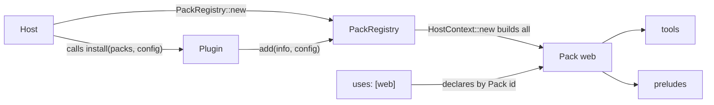

# Pack and Plugin Rename

<product-contract>

## Product Requirements

Runvil's code and docs call the named unit of tools and preludes a Plugin, and the 2026-10-18 rename reserved "package" for the crate or dynamic library that ships it. The owner, who is the repository's owner and the source of every quoted decision below, reversed both names: the unit becomes a Pack, "Plugin" moves to the one entry point a crate or dynamic library provides, which installs Packs, and the frontmatter key `uses:` replaces `plugins:`. A crate that provides a Plugin is a Plugin crate. This plan renames the code, the language guide, and the two live design reports to match, shrinks the root `AGENTS.md` to one-line definitions, rebuilds the mcp Pack around two static tools, and then makes the smallest reorganization that puts Plugins in charge: a Host only calls Plugins, and every Pack they register is built. Paths are relative to the `runvil` repository unless they start with `runvil-docs/`, `runvil-design/`, or `wg21-paperflow/`, which are sibling repositories.

- Problem and users:
  - Today a Plugin is the unit with tools and a Lua prelude, installed by its fully qualified name (FQN) under a Plugin id, and "Plugins ship in packages" (`AGENTS.md` line 12). The owner's model is the reverse: a crate or dynamic library provides one entry point, the Plugin, which the Host calls once and which installs zero or more Packs, and each Pack can have zero or more tools, an optional native prelude, and an optional Lua prelude.
  - Today the Host fills the registry, then picks Packs and installs each under an id with its own config. Workshop installs the MCP Pack once per server, under the server's name, with that server's `mcp.json` entry as config (`crates/workshop/server/src/agents.rs` lines 153-190; `crates/plugin-mcp/src/lib.rs` lines 85-125). The owner calls that per-server Pack "broken" and "a mistake".
  - Users: Host authors (Workshop, and Paperweight through a vendored snapshot), Plugin crate authors, coding agents that read `AGENTS.md` and crate docs, and prompt authors through the language guide.
- Goals:
  - Every name for the unit in code, messages, docs, and the two live design reports says Pack, following the name map in Technical Design.
  - "Plugin" means only an entry point that installs zero or more Packs, as the root `AGENTS.md` defines it. The crate that provides one is a Plugin crate, and a dynamic library will provide a library Plugin.
  - Prompts declare Packs as `uses: [web, mcp, json]`, and `plugins:` no longer parses.
  - The root `AGENTS.md` defines Pack and Plugin in one line each and keeps no rule that conflicts with the planned design.
  - A Host only calls Plugins. Each Plugin adds its Packs, zero or more, to the `PackRegistry`, and every registered Pack is built when the `HostContext` is created.
  - The mcp Pack is one Pack that offers two static tools, which describe and call the tools its configured servers provide.
- Non-goals:
  - The dynamic-library entry point and its C function table, a `PackSet` type, native preludes, and library Plugins.
  - Renaming any crate.
  - Making MCP fully correct: the owner accepts that it "might not work quite right".
  - Any change beyond the rename and the reorganization above.
  - Rewriting dated records.
- Success criteria:
  - Each commit passes the checks Execution Instructions assigns it, and after the last commit every exit criterion in Testing Plan passes.
  - The completeness searches print only their allowed lines, and every remaining "plugin", in any letter case, in `crates/`, `prompts/`, and `AGENTS.md` means a Plugin (an entry point that installs Packs), sits in "Plugin crate" or a crate name, or names another program's plugin.
  - The language guide builds, every link fragment names a heading that exists, and the guide uses no old term in any letter case.
- Constraints:
  - Each commit compiles and passes on its own.
  - Other senses of "package" stay exactly as they are: Cargo's (`Cargo.toml` files, `CrateInfo.package` in `crates/build-xtask/src/product.rs` lines 87-88), npm's (`package.json`), and Lua's `package` library, which the sandbox keeps nil (`crates/runvil-internal/lua/src/hardening.rs` line 24, `crates/runvil-internal/lua/src/tests/sandbox.rs` lines 52 and 77, `crates/runvil-internal/lua/src/globals-tests.rs` line 174).
  - Other programs' plugins keep their names: Tauri (`crates/workshop/desktop/tauri.conf.json` line 36, `@tauri-apps/plugin-*` imports, the `tauri-plugin-*` crates), ProseMirror (its `PluginKey`, imported through `@tiptap/pm/state`), CodeMirror's `ViewPlugin`, esbuild (`crates/workshop/ui/build.mjs`), and NSIS (the plugin paths in `crates/workshop/desktop/installer.nsi`).
  - `crates/runvil/public-api.txt` is generated: regenerate it, never edit it by hand.
  - Renamed source files keep the flat `parent-label.rs` form with explicit `#[path]` attributes.
  - `runvil-plugin` is an Engine crate for the Engine guards (`crates/build-xtask/src/engine_guards.rs` line 16) and the Engine clippy bans (`crates/runvil-plugin/clippy.toml`). Code and tests that Step 5 moves into it follow the Engine rules: no tokio, no wall clock, no timeouts, and no Harness crate.
  - Nothing under `vibe/` changes except this plan's own record. In `runvil-design`, only the two reports named in Technical Design change.
- Open questions: None

## Functional Specification

Prompt authors work as today, under new names: a prompt declares Packs under `uses:` and reaches them from Lua through the `packs` global. A Host now only creates a `PackRegistry`, calls each Plugin with that Plugin's config, and creates the `HostContext`, which builds every registered Pack. A Plugin decides which Packs exist. Messages that named a Plugin now name a Pack.

- Actors and workflows:
  - A prompt author writes `uses: [web, mcp, json]` in the frontmatter, then calls `packs.offer('web')`, `packs.get('web')`, `packs.required()`, and `packs.extras()`, and reads a Tool object's `pack` field. These replace `plugins.*` and `.plugin` one for one (`runvil-docs/src/language/12-tools.md`, examples from line 123 on, most of them between lines 527 and 1069).
  - A Pack object keeps exactly the two frozen fields a Plugin object has today: `name` and `tools` (`crates/runvil-internal/lua/src/plugins.rs` lines 42-43). So `local mcp = packs.get('mcp')` followed by `tools.offer(mcp.tools)` offers each of the `mcp` Pack's tools.
  - A Host calls `PackRegistry::new()`, which already holds the built-in `runvil/subagents` Pack. It then calls each linked Plugin, such as `plugin_web::install(&mut packs, config)`, and finally `HostContext::new(packs, services)`. Library Plugins come later. The Host never adds a Pack itself, never picks which Packs to build, and never picks a Pack id.
    - Workshop does this in `crates/workshop/server/src/agents.rs` (today `with_plugins`, lines 139-192). It passes `Value::Null` to web and user-input. It passes `{"mcp": <the mcpServers object>}` to plugin-mcp. Workshop reads that object from its MCP file today (`read_mcp_servers`, same file, lines 90-136) but returns it as sorted (name, entry) pairs. From Step 4 it returns the object itself.
  - A Plugin crate exports its Plugin, `pub fn install(packs: &mut PackRegistry, config: Value) -> Result<(), InstallError>`. It calls `packs.add(info, config[<pack id>].clone())` once for each Pack it offers, which may be none. The Plugin's config is a JSON object with one sub-object per Pack, keyed by Pack id; a missing key reads as `null`. Each Pack keeps its `PackInfo` (built with `PackInfo::new` and the `description`, `prelude`, and `needs` builders) as a private constant, and implements the `Pack` trait (`tools`, `ready`, `call`). Today these are `PluginInfo` and the `Plugin` trait in `crates/runvil-plugin/src/plugin.rs` (the trait at line 28, `PluginInfo` at line 124).
- Inputs and outputs:
  - Frontmatter `uses:` is a list of entries in declaration order, each a bare Pack id or a `vendor/name`. Each declared Pack is required, and its prelude runs in every section.
  - In the Workshop prompt contract JSON, field `plugins` becomes `uses`. The server writes it in `crates/workshop/server/src/routes/prompts.rs` (lines 54-55 and 198) and the UI reads it in `crates/workshop/ui/src/services/run-api.ts` (lines 64, 175, and 223).
    - Each entry keeps today's shape, `{"id": "<Pack id>"}` (`prompts.rs` lines 82-90). From Step 5 the server fills it from `PackRef::id()`, so `acme/poop` is sent as `poop`.
    - The UI accepts any string id (`run-api.ts` lines 80-88) and only skips the field (`crates/workshop/ui/src/parts/run/run-rows.ts` lines 1-4), so it needs no other change.
  - Tool ids keep their text, such as `web/fetch`. Their first segment is now called the Pack id, and a Pack id is always the second segment of the Pack's FQN, so `runvil/web` is `web`. The FQN's first segment is the vendor, so a Plugin names its vendor through every Pack it adds. Runvil's own Packs use the vendor `runvil`.
  - A `uses:` entry is either a bare Pack id, which always means the `runvil` Pack of that id (`web` means `runvil/web`), or a full `vendor/name`, which is the only way to name a third-party Pack (`acme/poop`).
  - The mcp Pack (`runvil/mcp`, Pack id `mcp`) takes the whole `mcpServers` object as its config, connects to every server in it, and offers exactly two static tools. They are modeled on Cursor's `GetDynamicTools` and `CallDynamicTool` (`runvil-design/research/2026-10-14-harness-mcp-dynamic-tools.md`, Appendix A, lines 2526-2584), and a namespace is a server's name exactly as written in `mcpServers`:
    - `mcp/get_dynamic_tools`, with optional `namespace` and `toolName`. With no arguments it lists each namespace, its status (`ready`, `loading`, or `error` with the reason), and its tools' names and descriptions. With `namespace` it returns every tool of that server as `tool`, `description`, and `inputSchema`. With both it returns one tool.
    - `mcp/call_dynamic_tool`, with required `namespace` and `toolName` and optional `arguments`. It calls that server's tool, as today's per-server call does.
    - Input schemas: `get_dynamic_tools` takes an object with the optional strings `namespace` and `toolName`. `call_dynamic_tool` takes an object with the required strings `namespace` and `toolName` and an optional object `arguments`, which defaults to `{}`. Arguments that are not an object are refused before anything is sent, as today.
    - Descriptions, which the model reads: `get_dynamic_tools` says "List the tools of the configured MCP servers. With no arguments, list each server's namespace, status, and tool names; with namespace, that server's tools and their input schemas; with namespace and toolName, one tool." `call_dynamic_tool` says "Call a tool of a configured MCP server by namespace and toolName, with arguments as a JSON object that matches the tool's input schema. List the servers' tools first to see it."
    - Both tools' output is untrusted, because descriptions, schemas, and results all come from the servers.
    - `get_dynamic_tools` answers JSON text, which a script reads with `json.decode`:
      - With no arguments: `{"namespaces": [...]}`, one entry per server in name order. Each entry has `namespace` and `status`, plus `reason` when the status is `error` and `tools` when it is `ready`. Each tool there has `tool` and `description`.
      - With `namespace`: that server's entry, each tool also with `inputSchema`. A server that is not ready answers with its entry's status and reason, and no tools.
      - With `namespace` and `toolName`: `{"namespace", "tool", "description", "inputSchema"}` for that one tool.
    - `toolName` without `namespace`, an unknown namespace, an unknown tool, and a `call_dynamic_tool` to a server that is not ready each give an error a model can read.
    - A tool's name is the one its server lists, and `toolName` must match it exactly. A tool's description is its `description`, else its `title`, else its name, as today. These names never become tool ids, so today's rule that drops a tool whose lowercased name is not a tool id (`crates/plugin-mcp/src/server.rs` lines 51-87) does not apply.
    - A `null` config means no servers. Any other config that is not an object refuses the construct, and so does a missing runtime service, as today.
    - Each entry is parsed on its own. An entry that fails, such as a local `command` entry, a bad header, or an unset `${env:NAME}`, becomes a namespace with status `error` and that reason, and the other servers still connect. One bad entry never fails the construct. Today only that server is unavailable, and this keeps it so.
- States and validation:
  - Each `uses:` entry is one or two valid segments. No two entries may share a Pack id, so `[web, acme/web]` fails to parse, because one run holds one Pack per Pack id and tool ids carry only the Pack id.
  - A run's Packs are the Packs it declares, plus every `runvil` Pack whose Pack id no declared Pack takes. A declared `acme/web` therefore replaces `runvil/web` in that run, and an undeclared third-party Pack is never in a run.
  - The registry may hold Packs from different vendors with the same Pack id, such as `runvil/web` and `acme/web`.
  - `plugins:` is refused as an unknown field, because `Frontmatter` denies unknown fields (`crates/runvil-internal/parser/src/frontmatter.rs` line 43).
  - `packs` becomes a reserved Engine global, and `plugins` stops being one (`crates/runvil-internal/lua/src/globals.rs` line 181).
- Errors and recovery:
  - Every message that names a Plugin in the unit sense names a Pack, with the same meaning:
    - The duplicate refusal reads "invalid frontmatter: Pack id {id} is declared more than once under uses" (today `crates/runvil-internal/parser/src/contract.rs` line 125).
    - The `InstallError` messages say "Pack" and "Pack id" (today `crates/harness-internal/runner/src/host.rs` lines 227-273). In Step 3 each keeps today's text with Plugin replaced by Pack, as in "Pack id {name} is taken by the installed {existing}; install it under another Pack id". From Step 5 every one of them comes from `PackRegistry::add`, and they read "Pack fully qualified name `{fqn}` is not a vendor/name pair", "Pack `{fqn}` is already in the registry", and, for a third-party Pack taking the built-in's reserved id, "Pack `{fqn}` cannot take the Pack id {name}, which the built-in runvil/{name} reserves". `UnknownPlugin` goes, because nothing installs by FQN any more, and `NameTaken` goes, because vendors may now share a Pack id. A Plugin returns the first error, and the Host logs it and goes on, as Workshop does today.
    - The Lua and prelude messages that name a Plugin say Pack and Pack id the same way: the `plugins.get` and `plugins.offer` argument errors and "Plugin objects are frozen" (`crates/runvil-internal/lua/src/plugins.rs` lines 59, 132, 177, and 195), the prelude errors (`crates/runvil-internal/lua/src/prelude.rs` lines 129, 163-165, 184, 196-197, 204, and 226-228), and the Pack id's Display text (`crates/runvil-internal/types/src/plugins.rs` line 180).
    - Each prelude's Lua chunk is named `@plugin:<id>` today (`crates/runvil-internal/lua/src/prelude.rs` lines 58 and 83), and Lua error messages show that name. It becomes `@pack:<id>`.
  - A declared Pack the run cannot resolve refuses the run through the existing refusal for missing and unavailable Packs. Only an unavailable entry has a reason, because `Requirements::missing_required` is a bare list of ids (`crates/runvil-internal/engine/src/execute/requirements.rs` lines 25-29 and 106-108), so every case below that gives a reason is reported as unavailable:
    - A bare id with no `runvil` Pack, and no other vendor's Pack of that id, is missing, as today. Its notice line reads "- missing required Pack: poop".
    - A bare id with no `runvil` Pack, when another vendor has a Pack of that id, is unavailable. Its notice line reads "- poop is unavailable: poop means runvil/poop, which is not installed; write acme/poop to use that Pack". With several such vendors, the reason names each FQN in FQN order, joined by "or", as in "write acme/poop or zed/poop to use that Pack".
    - A `vendor/name` that is not installed is unavailable. Its notice line reads "- poop is unavailable: acme/poop is not installed".
    - The `packs.offer` refusals say "Pack" and "declare it under uses:".
  - A `uses:` entry that does not parse fails with a `Frontmatter` error. From Step 5 the message is "invalid frontmatter: invalid uses entry `{text}`: {reason}". The reasons for an empty segment, a control character, and a character outside the allowed set stay as they are, and an entry with three or more segments gets "a uses entry is a Pack id, such as `web`, or vendor/name, such as `acme/web`". Until Step 5 an entry is a Pack id, the message is "invalid frontmatter: invalid Pack id `{text}`: {reason}", and an entry with a slash gets "a Pack id is one segment, such as `web`, with no '/'". The guide quotes these messages (`runvil-docs/src/language/12-tools.md` lines 300-313). An entry that is not a string, such as the map form, is refused with serde's invalid-type message, whose expected text today is "a Plugin's plain name, such as `web`" (`crates/runvil-internal/types/src/plugins.rs` line 119, pinned by `the_map_form_of_a_plugin_entry_is_refused_naming_the_plain_name_form`). That text becomes "a Pack's plain name, such as `web`" in Step 2 and "a Pack id, such as `web`, or vendor/name, such as `acme/web`" in Step 5.
  - A prompt still using `plugins:` fails with the parser's unknown-field error. A script still calling `plugins.*` fails with a Lua nil-index error. There is no compatibility path.
- Security and privacy behavior: Unchanged. The sandbox still never loads Lua's `package` library, and `packs` is an Engine global as `plugins` was. One new thing needs a guard: `PackRegistry` now holds each Pack's config, and an MCP config holds header values such as bearer tokens, so the registry's Debug output shows each entry's FQN, origin, and Pack id and never its config.
- Acceptance criteria:
  - `uses: [web]` parses, and the `web` Pack's prelude runs in every section, as `plugins: [web]` did.
  - `plugins: [web]` fails to parse with an unknown-field error.
  - `packs.offer('web')` offers `web_fetch` and `web_search`, and `tools.get('web/search').pack == packs.get('web')` is true.
  - The Workshop prompt contract has a `uses` field, and the run panel reads it.
  - After Workshop calls the three Plugins and creates its `HostContext`, the runs see the `web`, `user-input`, `subagents`, and `mcp` Packs, and the ask tool is `user-input/ask`.
  - With `runvil/web`, `acme/web`, and `acme/poop` registered:
    - `uses: [web]` runs with `runvil/web`.
    - `uses: [acme/web]` runs with `acme/web` in place of `runvil/web`.
    - `uses: [acme/poop]` runs with `acme/poop`.
    - `uses: [poop]` is refused with the reason naming `acme/poop`.
    - A run that declares nothing has `runvil/web` and no `acme` Pack.
    - When `acme/web`'s `ready` fails, `uses: [web]` still runs with `runvil/web`, and no run waits on `acme/web` unless it declares it.
  - With one configured MCP server, `mcp/get_dynamic_tools` lists that server's tools, and `mcp/call_dynamic_tool` returns one tool's result as untrusted output.
  - With a local entry beside a remote one, `mcp/get_dynamic_tools` shows the local namespace with status `error` and "local MCP servers (command) are not supported yet", and still lists the remote server's tools.

</product-contract>
<implementation-contract>

## Technical Design

Steps 1 to 3 change only names. Every Plugin name that means the unit becomes Pack, and every name for a Plugin crate stays. Step 4 rebuilds the mcp Pack around two static tools, on today's install API. Step 5 moves `PackRegistry` into `runvil-plugin`, the one crate a Plugin crate may depend on (`crates/build-xtask/src/product.rs` lines 19-22), so a Plugin can take it. It also replaces Host-side installation with Plugins that add Packs and a `HostContext` that builds them all.

- Architecture:



- Modules and interfaces:
  - The root `AGENTS.md` Definitions: the Plugin paragraph (line 12) is replaced by exactly these two lines, and "Four words" (line 7) becomes "Five words":

```markdown
- **Pack**: code which installs an optional native prelude, an optional Lua prelude, and zero or more tools.
- **Plugin**: an entry point which installs zero or more Packs.
```

  - The rest of `AGENTS.md`: the verification bullet's "Plugin lifecycle wording" (line 59) becomes "Pack lifecycle wording". The "Using the terms" bullet that restricts "Engine", "Harness", and "Plugin" (line 22) stays as it is.
  - `crates/workshop/ui/test/docs-claims.mjs`:
    - Remove the capability check (lines 114-116) and `CAPABILITY_ALLOWED` (lines 48-49).
    - Keep the lowercase "plugin" check (lines 111-113) and its allowlist (line 47).
    - Retarget the activation test's title and message (lines 178 and 193) to Packs. Its directory list (lines 166-176) names crates and stays.
    - Rewrite the comment above the directory list (lines 163-165), which restates the install-once rule, to say that Packs are built once, when the Host sets up, and every run takes a snapshot of them, so nothing activates a Pack when a run starts. That wording stays true before and after Step 5.
  - The background that the old paragraph held, which is no longer in `AGENTS.md`, lives in crate docs and the language guide:
    - A Pack has an FQN such as `runvil/web`, and its Pack id is the FQN's second segment, `web`, which prefixes its tools (`web/fetch`).
    - A linked Plugin is the `install` function of a Plugin crate (a `plugin-*` crate), and a library Plugin will be the entry point a dynamic library exports (not built yet).
    - `runvil/subagents` is a built-in Pack that reserves its id for the Engine's subagent tools.
- File and public API changes:
  - The top-level declarations after Step 5 appear below, signatures only, with bodies, docs, and most derives left out. A trailing `// was` comment names each old identifier or its old home. No Rust item is named `Plugin` after Step 3: a Plugin is the `install` function a Plugin crate exports, with the signature shown for `plugin-web` below. No `PackSet` is added.

```rust
// runvil (Engine facade)
pub mod packs {                                   // was runvil::plugins
    pub struct PackId(/* private */);             // was PluginId
    impl PackId {
        pub fn parse(name: &str) -> Result<PackId, PackIdError>;
        pub fn contains(&self, tool: &ToolId) -> bool;
    }
    #[non_exhaustive] pub struct PackIdError { /* private */ }   // was PluginIdError; kind() -> PackIdErrorKind
    #[non_exhaustive] pub enum PackIdErrorKind { Charset, Control, Empty, SegmentCount }   // was PluginIdErrorKind
    pub struct Prelude { /* private */ }
    impl Prelude {
        pub fn new(pack: PackId, source: impl Into<String>) -> Prelude;
        pub fn pack(&self) -> &PackId;                // was plugin()
        pub fn source(&self) -> &str;
    }
    pub struct GlobalName { /* private */ }        // unchanged, moves with the module, as do
                                                  // GlobalNameError and GlobalNameErrorKind

    /// One `uses:` entry: a bare Pack id, which means a runvil Pack, or vendor/name.
    #[derive(Debug, Clone, PartialEq, Eq)]        // Frontmatter derives these
    pub struct PackRef { /* private */ }          // new in Step 5; built only by its Deserialize impl,
                                                  // whose parse stays private to the types crate
    impl PackRef {
        pub fn vendor(&self) -> &str;             // "runvil" when the entry is bare
        pub fn id(&self) -> &PackId;              // the last segment
    }
}

#[non_exhaustive]
pub struct UnavailablePack { pub pack: PackId, pub reason: String }   // was UnavailablePlugin { plugin, reason }
impl UnavailablePack { pub fn new(pack: PackId, reason: impl Into<String>) -> UnavailablePack; }

#[non_exhaustive]
pub struct MissingService { pub pack: PackId, pub service: String }   // field was plugin
impl MissingService { pub fn new(pack: PackId, service: impl Into<String>) -> MissingService; }

#[non_exhaustive]
pub struct Requirements {
    pub missing_required: Vec<PackId>,
    pub missing_services: Vec<MissingService>,
    pub unavailable: Vec<UnavailablePack>,
    pub unmet_requirements: Vec<UnmetRequirement>,
}

impl RunContext {
    pub fn packs(self, usable: Vec<PackId>, unavailable: Vec<UnavailablePack>) -> RunContext;   // was plugins()
    pub fn preludes(self, preludes: Vec<Prelude>) -> RunContext;
}
impl Frontmatter { pub fn uses(&self) -> &[PackRef]; }   // was plugins() -> &[PluginId]; reads the `uses:` key
impl ToolId { pub fn pack(&self) -> PackId; }            // was plugin()

// runvil-plugin (the API a Plugin crate is written against)
pub type PackFuture<'a, T> = Pin<Box<dyn Future<Output = T> + Send + 'a>>;   // was PluginFuture

pub trait Pack: Send + Sync {                    // was trait Plugin
    fn tools(&self) -> Vec<ToolInfo>;
    fn ready(&self) -> PackFuture<'_, Result<(), ToolError>>;   // default: Ok(()) at once
    fn call<'a>(&'a self, cx: ToolContext<'a>, args: serde_json::Value)
        -> PackFuture<'a, Result<ToolOutput, ToolError>>;
}

#[derive(Clone, Copy)]
#[non_exhaustive]
pub struct PackInfo {                            // was PluginInfo
    pub fqn: &'static str,
    pub prelude: Option<&'static str>,
    pub needs: &'static [ServiceId],
    pub construct: fn(name: &PackId, config: serde_json::Value, services: &HostServices)
        -> Result<Arc<dyn Pack>, ToolError>,
    pub description: &'static str,
}
impl PackInfo {
    pub const fn new(fqn: &'static str, construct: /* as the field */) -> PackInfo;
    pub const fn description(self, description: &'static str) -> PackInfo;
    pub const fn prelude(self, prelude: &'static str) -> PackInfo;
    pub const fn needs(self, needs: &'static [ServiceId]) -> PackInfo;
}
pub use runvil_types::packs::{PackId, PackIdError, PackIdErrorKind};

// in src/registry.rs, moved from harness-runner with its unit tests (registry-tests.rs)
pub struct PackRegistry { /* by FQN: PackInfo, PackOrigin, Pack id, config */ }   // was PluginRegistry in harness-runner
impl fmt::Debug for PackRegistry { /* each entry's FQN, origin, and Pack id; never a config */ }   // was derived
impl Default for PackRegistry { /* holds the built-in runvil/subagents */ }
impl PackRegistry {
    pub fn new() -> PackRegistry;
    pub fn add(&mut self, info: PackInfo, config: serde_json::Value) -> Result<(), InstallError>;   // id = FQN's second segment
    pub fn list(&self) -> impl Iterator<Item = (&PackInfo, PackOrigin)>;
    pub fn into_entries(self)                    // new: what HostContext::new builds from
        -> impl Iterator<Item = (PackInfo, PackId, serde_json::Value)>;
}

#[derive(Clone, Copy, Debug, PartialEq, Eq)]
#[non_exhaustive]
pub enum PackOrigin { Builtin, Linked }          // was PluginKind in harness-runner; Library comes with library Plugins

#[non_exhaustive]
pub enum InstallError {                          // moved from harness-runner; every variant now comes from add
    InvalidFqn { fqn: &'static str },
    DuplicatePack { fqn: &'static str },         // was DuplicatePlugin
    ReservedName { fqn: &'static str, name: PackId },
}                                                // UnknownPlugin and NameTaken are gone

// a Plugin crate, such as plugin-web
const WEB: PackInfo =                            // was pub const PLUGIN
    PackInfo::new("runvil/web", construct).description("Search the web and fetch pages");
/// The Plugin: the one entry point a Plugin crate exports.
pub fn install(packs: &mut PackRegistry, config: serde_json::Value) -> Result<(), InstallError> {
    packs.add(WEB, config["web"].clone())
}
impl Pack for Web { /* tools, call */ }

// harness (Harness facade)
pub mod pack {                                    // was harness::plugin
    pub use harness_runner::HostContext;
    pub use runvil_plugin::HostServices;
    pub use runvil_plugin::InstallError;          // was harness_runner::InstallError
    pub use runvil_plugin::PackId;
    pub use runvil_plugin::PackOrigin;            // was harness_runner::PluginKind
    pub use runvil_plugin::PackRegistry;          // was harness_runner::PluginRegistry
}

// harness-runner, behind that module
pub struct HostContext { /* private */ }         // name unchanged
impl HostContext {
    pub fn new(packs: PackRegistry, services: HostServices) -> HostContext;   // builds every registered Pack
}                                                // install(fqn, name, config) is gone
```

  - Public facade (`crates/runvil/public-api.txt`):
    - Module `runvil::plugins` (line 833) becomes `runvil::packs`, and `GlobalName`, `GlobalNameError`, `GlobalNameErrorKind`, and `Prelude` move with it (`crates/runvil/src/lib.rs` lines 118-129).
    - `PluginId`, `PluginIdError`, and `PluginIdErrorKind` (lines 79, 80, and 20) become `PackId`, `PackIdError`, and `PackIdErrorKind`.
    - `UnavailablePlugin` (line 50) becomes `UnavailablePack`.
    - `RunContext::plugins` (line 501) becomes `RunContext::packs`.
    - The `MissingService::plugin` field (line 839), the `UnavailablePlugin::plugin` field (line 883), and `Prelude::plugin()` (line 689) become `pack`.
    - `Frontmatter::plugins()` (line 709) becomes `uses()`, returning `&[PackId]` in Step 2 and `&[PackRef]` from Step 5. `ToolId::plugin()` (line 734) becomes `pack()`.
    - `PackRef` is new in Step 5.
  - Plugin API (`crates/runvil-plugin`):
    - The `Plugin` trait, `PluginInfo`, and `PluginFuture` (`src/plugin.rs` lines 28, 124, and 19) become `Pack`, `PackInfo`, and `PackFuture`.
    - The file becomes `src/pack.rs`, and `tests/it/plugin_info.rs` becomes `tests/it/pack_info.rs`.
  - Harness (`crates/harness-internal/runner`, re-exported by `crates/harness`):
    - `PluginRegistry` and `PluginKind` (`src/registry.rs` lines 29 and 36) become `PackRegistry` and `PackOrigin`, and the enum's doc "Where a Plugin comes from" (line 33) becomes "Where a Pack comes from".
    - `InstallError::DuplicatePlugin` (`src/host.rs` line 238) becomes `DuplicatePack`. `UnknownPlugin` and `NameTaken` (lines 246 and 268) keep their names, because Step 5 deletes them. Their messages change like every other.
    - The Harness facade's grouping module `harness::plugin` (`crates/harness/src/lib.rs` lines 27-39) becomes `harness::pack`, singular like its sibling modules `record` and `vfs`. The module doc and the crate doc (lines 3-7) speak of Packs.
  - Each `plugin-*` crate's `PLUGIN` constant keeps its name through Step 4, now typed `PackInfo`. Step 5 replaces it.
  - Step 4, the mcp Pack, on today's install API:
    - `plugin-mcp`'s construct takes the whole `mcpServers` object, under the config rules in Functional Specification. It parses each entry on its own with today's `entry::parse` and starts one connection per parsed entry, reusing today's connection, discovery, and call code (`crates/plugin-mcp/src/connect.rs`, `result.rs`, and `server.rs`).
    - One new Pack object holds every server, implements `Pack` with the two static tools under the name `construct` receives, and resolves `ready` at once. Each server's state shows through `get_dynamic_tools`, and an entry that failed to parse shows there as status `error` with its reason.
    - The per-server `ToolInfo` ids go, and so does the tool-id filter in `catalog` (`server.rs` lines 51-87). A server's tools keep the names the server lists, and `connect::run` (`connect.rs` line 68) takes the server's name as a `String` in place of a `PackId` (a `PluginId` before Step 2), since a namespace is no longer an id.
    - The `PLUGIN` constant's description and doc (`crates/plugin-mcp/src/lib.rs` lines 85-92) and the crate doc (lines 1-66) describe one Pack over every configured server. The invariant that a local entry is refused stays, now per entry.
    - Workshop, still on today's install API: `with_plugins` installs `runvil/mcp` once, under its default id `mcp`, with the whole `mcpServers` object as config, in place of the per-server loop (`crates/workshop/server/src/agents.rs` lines 179-190). `read_mcp_servers` (lines 90-136) returns that object, and an empty object wherever it returns no entries today. The docs that describe one install per server change to match: the module doc (lines 12-14), the docs of the reader and of `with_plugins` (lines 82-89 and 139-148), the doc of the `[agents] mcp` setting (`crates/workshop/support/src/config.rs` lines 171-172), the comment on the `plugin-mcp` dependency (`crates/workshop/server/Cargo.toml` lines 26-27), and the module doc of `crates/workshop/server/src/agents/tests.rs` from "The `mcp.json` reader" on (lines 7-10). Step 5's prose search matches neither of the last two.
  - Step 5, the reorganization:
    - Move `PackRegistry`, `PackOrigin`, `InstallError`, and the built-in `runvil/subagents` Pack with its unreachable object (`crates/harness-internal/runner/src/registry.rs` lines 104-157) from `harness-runner` into `crates/runvil-plugin/src/registry.rs`, with the registry's unit tests (`registry-tests.rs`) beside it. `runvil-plugin`'s `lib.rs` re-exports `PackRegistry`, `PackOrigin`, and `InstallError`.
      - `runvil-plugin` gains the workspace dependency `thiserror` (root `Cargo.toml` line 107), because `InstallError` derives `thiserror::Error`. Today the crate depends only on `runvil-types`, `runvil-vfs`, and `serde_json` (`crates/runvil-plugin/Cargo.toml` lines 11-15). Nothing restricts its own dependencies, and `thiserror` passes the Engine guards.
      - The registry's crate-private `entry` and `reserves` (`registry.rs` lines 91-102), which `host.rs` calls (lines 97 and 104-105), become private to `runvil-plugin`. A new `PackRegistry::into_entries(self)` hands `HostContext::new` each Pack's info, id, and config. It leaves out the origin, which nothing reads once the reserved-id check moves into `add`. A Plugin receives the registry as `&mut`, so nothing stops it from replacing the registry, or from taking it with `std::mem::take` and calling this method; Decision Record accepts that risk with the vendor risk.
      - `PackRegistry`'s Debug is written by hand, showing each entry's FQN, origin, and Pack id and never its config. Today it is derived (`registry.rs` line 28), and `HostContext`'s Debug prints it (`host.rs` line 215).
      - `harness-runner` stops re-exporting `PackOrigin` and `PackRegistry` (`crates/harness-internal/runner/src/lib.rs` line 53, `PluginKind` and `PluginRegistry` before Step 3) and `InstallError` (line 48). The `harness::pack` module re-exports the moved types from `runvil-plugin`, one item per `pub use`, as the facade rule requires (`crates/build-xtask/src/facade_shape.rs` lines 1-5 and 31-35).
    - `PackRegistry::add` takes the Pack's config and keys the Pack by FQN, as it does today. It fixes the Pack id to the FQN's second segment, keeps its own checks for a bad or duplicate FQN, and takes over `install`'s reserved-id check (`crates/harness-internal/runner/src/host.rs` lines 103-111). `install`'s `NameTaken` check (lines 113-123) is dropped, so vendors may share a Pack id.
    - `uses:` entries become `PackRef`s, and `Frontmatter::uses()` returns `&[PackRef]`. `PackRef` deserializes with its own messages, given in Functional Specification, in place of the Pack id's (`crates/runvil-internal/types/src/plugins.rs` lines 100-125). Step 2 introduces `uses:` with `PackId`, and Step 5 widens it, so Step 5 regenerates `crates/runvil/public-api.txt` again. The Engine still checks declarations by `PackRef::id()`.
    - The Harness picks each run's Packs from the prompt's `uses:` entries before it waits for readiness: each declared FQN, plus every `runvil` Pack whose id no declared Pack takes. One `HostContext` function makes the pick, and three steps use its result:
      - The ready wait, `HostContext::wait_ready` (`host.rs` line 148, called from `crates/harness-internal/runner/src/prepare.rs` lines 330-331), waits only on the run's Packs and keys failures by FQN. Today it waits on every built Pack and keys failures by bare id, so two Packs that share a Pack id would share one failure entry.
      - The snapshot, `HostRunContext::snapshot` (`crates/harness-internal/runner/src/host-run.rs` line 54), holds only the run's Packs. Catalog, roster, and preludes then work by Pack id as they do today.
      - The `requirements` method (same file, line 158) reports what the pick cannot resolve as a missing or unavailable Pack, with the reasons given in Functional Specification.
    - `HostContext::new` builds every registered Pack with its stored config, the way `install` built one, and records a construct failure as unavailable. `HostContext::install` is removed. Because `PackRegistry::new()` holds the built-in, every `HostContext` builds `runvil/subagents`, so every run holds a usable `subagents` Pack with no tools, and declaring `subagents` is always met. `a_declared_builtin_is_met_when_installed_and_missing_when_not` (`crates/harness-internal/runner/src/host-tests.rs` line 248) keeps only the case where it is met, and tests that installed the built-in by hand drop that call.
    - Each `plugin-*` crate makes its `PackInfo` constant private, renamed after its Pack (`WEB` in `crates/plugin-web/src/web.rs` line 29, `USER_INPUT` in `crates/plugin-user-input/src/lib.rs` line 87, and `MCP` in `crates/plugin-mcp/src/lib.rs` line 91), and exports `install`, with the signature in Functional Specification. `plugin-mcp`'s `install` adds the Step 4 Pack with `config["mcp"]`.
    - Workshop: `with_plugins` (`crates/workshop/server/src/agents.rs` lines 149-192) calls `plugin_web::install`, `plugin_user_input::install`, and `plugin_mcp::install` directly, then `HostContext::new`, which builds the built-in that Workshop installs by hand today (line 176), and the ask tool id becomes the fixed `user-input/ask`. The `ask` field stays an `Option<ToolId>`, because the socket and wire code take it that way: `Some` when `plugin_user_input::install` succeeds and `None` when it fails, as today. This is the only production Host in the repository. The comment on `toolKind` (`crates/workshop/ui/src/parts/agent/transcript/tool-labels.ts` lines 49-53) stops saying a Host installs user-input under any namespace, and its match can stay.
    - Crate docs and comments that the reorganization makes false are rewritten: every one that says the Host installs a Pack by FQN, picks or defaults its Pack id, or that every run receives every usable Pack. Engine crate docs keep the Engine wording: they say "the caller", never the Host. Neither the completeness searches, which match names, nor rustdoc, which checks links, finds them, so read every hit of `git grep -n -i -E "installed (it )?under|installed as|picks another|chose|chooses|default (name|plugin id|pack id)|plain name|declared or not|every usable" -- crates` and rewrite each one about Packs. The known ones:
      - `crates/runvil-plugin/src/lib.rs` lines 4-8, `src/plugin.rs` lines 34-35, 126-131, and 136-138 (`src/pack.rs` from Step 3), and `tests/it/plugin_info.rs` line 3 (`pack_info.rs` from Step 3)
      - `crates/plugin-user-input/src/lib.rs` lines 4, 22, 93, and 107, `src/ask.rs` line 2, and `tests/it/ask.rs` line 2
      - `crates/plugin-web/src/lib.rs` lines 4 and 8
      - `crates/runvil-internal/types/src/plugins.rs` lines 5-14, 25-30, and 190-194, `src/names.rs` line 5, and `crates/runvil-internal/lua/src/prelude.rs` line 60
      - `crates/harness/src/lib.rs` lines 3-7 and 28-31, and the module docs of `crates/harness-internal/runner/src/host.rs` and `host-run.rs`
      - `crates/workshop/server/src/agents.rs` lines 12-14, 139-148, and 244-246, the rest of the module doc of `src/agents/tests.rs` (lines 1-7), `src/agents/wire-tests.rs` line 31, and `src/agents/socket_frames-tests.rs` line 75
    - Call sites that switch from `PluginRegistry::add`, `HostContext::install`, or a public `PLUGIN` constant to Plugins or `PackRegistry::add`:
      - Harness: the suite `crates/harness/tests/suite/asker.rs`.
      - Harness runner tests, all under `crates/harness-internal/runner/`:
        - `src/host-tests.rs`.
        - In `tests/it/`: `support.rs`, `registry.rs`, `scripted.rs`, `prepare.rs`, `prepare-ready.rs`, and `prepare-prelude.rs`.
      - `workshop-agents` tests: `crates/workshop/agents/tests/it/support.rs` lines 63-68 and `src/input-tests.rs` lines 270-275.
      - Integration tests of the `plugin-*` crates, which can no longer name the private constant: `crates/plugin-mcp/tests/it/main.rs` and `crates/plugin-user-input/tests/it/ask.rs`. They call `install` on a registry of their own and read the Pack back through `into_entries`. Unit tests inside a crate, such as `crates/plugin-web/src/web-tests.rs`, keep using the constant under its new name.
      - These build `HostContext::new` over a fresh `PackRegistry::new()`, which holds only the built-in. None of them asserts on rosters, extras, or Debug output, so they need only the Step 3 names: the example `crates/harness/examples/run-prompt.rs` (line 68), the suites `crates/harness/tests/suite/launch.rs`, `host.rs`, and `broker.rs`, and `tests/it/harness.rs`, `tests/it/harness-stop-timing.rs`, and `tests/it/harness-errors.rs` under `crates/harness-internal/runner/`.
      - `harness-gateway-client` and `build-xtask` have no such call sites.
  - Engine internals:
    - `ToolId::plugin_segment()` becomes `pack_segment()`.
    - The doc of `pack_sequence` (`crates/runvil-internal/lua/src/vm.rs` line 70) opens with the capitalized verb "Packs", which would read as the defined term, so it is reworded, for example to "Collects owned values into a 1-based Lua sequence table."
    - `PluginListError` and `check_distinct_plugins` (`crates/runvil-internal/parser/src/contract.rs` lines 123 and 132) become `PackListError` and `check_distinct_packs`.
    - The Lua global `plugins` (`crates/runvil-internal/lua/src/plugins.rs` line 139) becomes `packs`, and the Tool object field `plugin` (`crates/runvil-internal/lua/src/tools/userdata.rs` line 47) becomes `pack`.
  - Workshop: `PluginDto` (`crates/workshop/server/src/routes/prompts.rs` line 82) becomes `PackDto`, and `RunContractPlugin` (`crates/workshop/ui/src/services/run-api.ts` line 21) becomes `RunContractPack`.
  - File renames, each with its `#[path]` or `mod` line: `crates/runvil-internal/types/src/plugins.rs` and `plugins-tests.rs`, `crates/runvil-internal/lua/src/plugins.rs` and `plugins-tests.rs`, `crates/runvil-internal/parser/src/contract/tests-plugins.rs`, `crates/runvil-internal/engine/src/execute/tests/offering-plugins.rs`, and the facade suite's `crates/runvil/tests/suite/plugins.rs`. In each, `plugin` becomes `pack` and `plugins` becomes `packs`. `crates/build-xtask/src/product/plugin_tests.rs` tests the Plugin crate family and keeps its name.
  - Internal names follow the same map in any letter case: locals, fields, private functions, types, and constants, test names, and Debug field names. Lowercase forms are common: `git grep -h -o -E "fn [a-z0-9_]*plugin" -- crates` finds 110 function names, most of them tests. Examples: `RunPlugin` (`crates/harness-internal/runner/src/host-run.rs` line 28), `LuaPluginHandle` and `PLUGIN_OBJECTS_REGISTRY` (`crates/runvil-internal/lua/src/plugins.rs` lines 34 and 29), `PluginIdVisitor` (`crates/runvil-internal/types/src/plugins.rs` line 113), `HoldPlugin` and `echo_plugin` in the Harness runner tests, the fields `Frontmatter.plugins` (`crates/runvil-internal/parser/src/frontmatter.rs` line 72) and `Prelude.plugin` (`crates/runvil-internal/types/src/plugins.rs` line 198), and `parsePlugin` and `parsedPlugins` in `crates/workshop/ui/src/services/run-api.ts`.
  - Names that stay Plugin because they name a Plugin crate or its family:
    - The crates `plugin-web`, `plugin-mcp`, `plugin-user-input`, and `runvil-plugin`.
    - `Family::Plugin`, `PLUGIN_CONTRACT`, and `plugin_breach` (`crates/build-xtask/src/product.rs` lines 57, 157, and 266), and the family's test names and constants in `crates/build-xtask/src/product/plugin_tests.rs`, such as `PLUGIN_RULE` and `naming_plugin_web`.
    - `PLUGIN_DOC_DIRS` (`crates/workshop/ui/test/docs-claims.mjs` line 166).
    - The Workshop `plugins` workspace directory (`crates/workshop/workspace/src/workspace_file/siblings.rs` line 14). Nothing creates it yet, and under the new meaning it is a natural home for the dynamic libraries that provide library Plugins.
    - The phrase "Plugin crate" wherever it appears in prose.
  - Prompts and fixtures: `prompts/research-person.md` line 6 and `crates/workshop/agents/agents/chat.md` line 5 change `plugins:` to `uses:`, and so does the frontmatter in Rust and `.mjs` test fixtures. `chat.md` line 28 changes `plugins.offer("web")` to `packs.offer("web")`. The UI's contract fixtures in `crates/workshop/ui/test/run-api.mjs` and `run-panel.mjs` (line 127) change their `plugins` field to `uses`.
  - Language guide (`runvil-docs/src/`):
    - Unit-sense Plugin becomes Pack in every chapter that has it, most of all `language/12-tools.md`.
    - `plugins:` becomes `uses:`, `plugins.*` becomes `packs.*`, `.plugin` becomes `.pack`, "Plugin id" becomes "Pack id", and "bundled Plugins" becomes "bundled Packs". So do the lowercase spots a case-sensitive search misses: the key name `plugins` in prose lists becomes `uses`, the `{plugin}` placeholder in quoted notices becomes `{pack}`, `<plugin>` in the wire-name explanation becomes `<pack>`, and Lua locals named `plugin` follow the map. The known ones are `12-tools.md` lines 93-94, 182, 257, 286, 528, 763, 1368, 2413, and 2419, `04-how-a-prompt-runs.md` lines 261-262, `02-file-structure.md` lines 122, 369, and 540, and `15-tasks.md` line 47.
    - Quoted messages take their new text.
    - Beyond the renames, every passage the reorganization makes false or incomplete is rewritten. All are under `language/`. Find them by reading every hit of `git grep -n -i -E "install|picks? (a|no|another) plugin id|chooses|browse|operator|extras|undeclared|not declared|declared or not|every usable|every installed|one segment|single segment|plain name|runvil/" -- src/language` in `runvil-docs`. They fall in four groups. The lines below are the known ones, not a complete list:
      - The Host installing Packs becomes the Host calling Plugins, after which every registered Pack is built:
        - `01-what-a-prompt-is.md` 466
        - `04-how-a-prompt-runs.md` 245-254, 295, 326, 337, 364, and 383
        - `12-tools.md` 75, 81, 747, and 2492
        - `13-web-fetch-and-search.md` 60, 116, and 864
        - `17-quick-reference.md` 247
      - The Host choosing a Pack id becomes "a Pack id is always the second segment of its FQN". The examples that install `web` as `browse` and `user-input` as `operator` are removed:
        - `04-how-a-prompt-runs.md` 368
        - `05-lua-environment.md` 2390, 2437, and 2445
        - `12-tools.md` 81, 218, and 2494-2498
        - `13-web-fetch-and-search.md` 54, 66-75, and 105
      - Undeclared Packs: the extras and the catalog hold every runvil Pack, but a third-party Pack only when declared:
        - `04-how-a-prompt-runs.md` 157, 347-358, and 392
        - `12-tools.md` 103, 554, 649-654, 704-730, 737, 747-749, and 1142
        - `13-web-fetch-and-search.md` 81
        - `17-quick-reference.md` 133 and 213
      - Entries under `uses:`: a bare id means a runvil Pack, a third-party Pack is written as `vendor/name`, a run holds one Pack per Pack id, a declared third-party Pack replaces the runvil Pack of that id, and Lua reaches a declared `acme/poop` by its bare Pack id, as `packs.get('poop')`. These passages say an entry must be a single segment, or that `runvil/web` fails:
        - `05-lua-environment.md` 2388
        - `12-tools.md` 73, 136, 147-153, 218-226, and 300-313, where the parse messages take their new text from Functional Specification
        - `13-web-fetch-and-search.md` 42
        - `16-limits-and-errors.md` 369 and 450
        - `17-quick-reference.md` 21 and 247
      - No passage presents an MCP server as a Plugin, so the MCP change needs no guide edit.
    - `runvil-docs/plans/build-language-guide.md` is a dated plan and stays verbatim.
    - Heading anchors change, and so does every link to them. Of the 37 headings that contain "plugin" in any letter case, 11 have incoming links, 80 in all, such as the 23 links to `#tool-objects-and-plugin-objects` and the 20 to `#offering-tools-with-toolsoffer-and-pluginsoffer`. The docs site build does not check fragments, so the anchor check in Testing Plan finds the broken ones.
    - `table.pack` (`language/05-lua-environment.md` line 506) and Lua's `package` library (same file, lines 567-570) stay.
  - Design reports:
    - `runvil-design/research/2026-10-18-mlua-c-wrapper.md`, the whole report, with prose to match. The old names run through all of it, not only sections 2 and 3: Appendix A (lines 723-845) is a full C example that uses them, and the contents list, the headings of sections 5.2 and 6.3-6.5, and the references name them too. The references' language guide headings, such as "Declaring Plugins under `plugins:`", take the names the `runvil-docs` commit gives them. Each "plugin" and "package" hit is classified, because Lua's `package` library keeps its name:
      - `runvil_package_init` becomes `runvil_plugin_init`, `RvPackage` becomes `RvPlugin`, `RvPackageInfo` becomes `RvPluginInfo`, and `describe_package` becomes `describe_plugin`.
      - The old `RvPluginInfo` becomes `RvPackInfo`, `register_plugin` becomes `register_pack`, `plugin_data` and `plugin_id` become `pack_data` and `pack_id`, and `plugins:` becomes `uses:`.
      - `RvPluginInfo` exists both before and after with different meanings, so the swap runs in three passes. First, every old Plugin-sense name becomes a unique temporary token, such as `@@PACK_INFO@@` for `RvPluginInfo`. Second, every package-sense name becomes its Plugin name. Third, every token becomes its Pack name. The report has no `@@` today, so afterward a search for `@@` in it prints nothing.
      - The C example's values and parameters follow the same split: `ACME_URL_PACKAGE` becomes `ACME_URL_PLUGIN`, `URL_PLUGIN` becomes `URL_PACK`, `plugin_id_len` becomes `pack_id_len`, a parameter that holds an `RvPackage` becomes `plugin`, and a parameter of the old `RvPluginInfo` type becomes `pack`. `ACME_URL_PACKAGE` and `URL_PLUGIN` also go through the three passes, because swapping in the wrong order turns `ACME_URL_PLUGIN` into `ACME_URL_PACK`.
      - Prose names the code as it stands after this plan: `Plugin::call` (line 604) becomes `Pack::call`, the reference at line 701 names `crates/runvil-plugin/src/pack.rs`, `PackInfo`, and the `Pack` trait, and the Vocabulary line (line 8) states the new names.
    - `runvil-design/research/2026-10-18-runvil-plugin-naming.md` gets one status line at the top saying the 2026-10-19 Pack and Plugin rename supersedes its package and Plugin names. The body stays verbatim.
- Data, persistence, failure, security, and privacy constraints:
  - The Workshop prompt contract's JSON field changes on the server and in the UI in the same commit.
  - No other serialized format names Plugins. A search of `crates/` for serde renames and quoted `plugin` keys finds only Debug output field names (`crates/harness-internal/runner/src/host.rs` line 215 and `crates/harness-internal/runner/src/host-run.rs` line 248), the Lua global, and Tauri's config. `Frontmatter` derives only `Deserialize`, and `Requirements` and its entries derive no serde, so their renamed fields change no wire format. Old runs are not replayed.
  - The Workshop UI shows no wording about Runvil's Plugin to end users. `crates/workshop/ui/src/parts/run/run-rows.ts` line 3 only skips the contract's `plugins` field, which becomes `uses`.

</implementation-contract>
<verification-contract>

## Testing Plan

Renamed tests keep their assertions under new names, and a few new assertions pin down the behavior that does change. Each commit passes the gates Execution Instructions assigns it, and after the last commit every exit criterion holds. The language guide is checked by building the docs site, whose link check confirms only that each linked file exists, and by a case-insensitive search and an anchor check.

- Unit:
  - Parser:
    - `uses: [web]` parses to the Pack id `web`. After Step 5, `uses: [acme/poop]` parses to vendor `acme` and id `poop`, a bare entry's vendor is `runvil`, `uses: [web, acme/web]` fails with the duplicate Pack id message, and `uses: [a/b/c]` fails with the uses entry reason.
    - `plugins: [web]` fails as an unknown field.
    - A duplicate under `uses:` gives the new duplicate message (`crates/runvil-internal/parser/src/contract/tests-plugins.rs`, renamed).
  - Lua: `packs` is installed and reserved, `plugins` is neither, a Tool object exposes `pack` (`crates/runvil-internal/lua/src/plugins-tests.rs`, renamed), and a prelude's chunk is named `@pack:<id>`.
  - Harness and Plugin API: the registry and install tests pass under the new names and with the new `InstallError` messages (`crates/harness-internal/runner/src/registry-tests.rs` and `crates/harness-internal/runner/tests/it/registry.rs`). In Step 5 the registry-only tests, such as the first three in `tests/it/registry.rs`, move with the registry into `runvil-plugin` under the Engine rules. The `HostContext` tests stay in `harness-runner`, which `runvil-plugin` cannot depend on. Together they also cover the following:
    - `add` refuses each of its three errors: `InvalidFqn`, `DuplicatePack`, and `ReservedName`.
    - `add` accepts `acme/web` beside `runvil/web`.
    - `add` keeps a Pack's config, and the registry's Debug output shows no config.
    - `HostContext::new` builds every registered Pack, the built-in included, and records a construct failure as unavailable. A run over a fresh registry holds a usable `subagents` Pack, and declaring `subagents` is met.
    - The ready wait waits only on the run's Packs, and a `ready` failure of `acme/web` does not reach `runvil/web`.
  - Each `plugin-*` crate: its `install` adds its one Pack, with the config sub-object under its Pack id, as read back through `PackRegistry::into_entries`.
  - Harness snapshot: each case under Acceptance criteria with `runvil/web`, `acme/web`, and `acme/poop` registered, with its Packs or its refusal line.
  - `plugin-mcp`, in Step 4, adapted from `crates/plugin-mcp/tests/it/main.rs` and its fake server (`tests/it/fixture.rs`):
    - `get_dynamic_tools` lists the server's tools under their own names, and `call_dynamic_tool` returns a result marked untrusted.
    - A local entry beside a remote one shows as an `error` namespace with the not-supported reason, and the remote server still connects.
    - A `null` config gives no namespaces, a namespace keeps its server name's case, and `get_dynamic_tools` answers in the JSON shapes given in Functional Specification.
    - `toolName` without `namespace`, and a call to a server that is not ready, give errors a model can read.
    - An unknown namespace or tool gives an error a model can read.
    - Tests of one install per server are removed.
- Integration and end-to-end:
  - Workshop's host setup tests (`crates/workshop/server/src/agents/tests.rs`):
    - In Step 4 the six per-server tests (lines 263-373) go. The runtime-key test among them (lines 346-373) keeps its purpose in a new form that waits on nothing: a run that declares `mcp` completes. The mcp Pack's construct reads the runtime even with no servers, so this shows the server's runtime reaches `plugin-mcp`'s key. The `read_mcp_servers` tests (lines 193-261) read back an object.
    - In Step 5 they see the `web`, `user-input`, `subagents`, and `mcp` Packs and the ask tool `user-input/ask`.
  - The Workshop server's contract test reads `json["uses"]` (`crates/workshop/server/src/routes/prompts-tests.rs` line 88). The UI test `crates/workshop/ui/test/run-api.mjs` (lines 41, 97-98, and 142) parses `uses`, and `run-panel.mjs` (line 127) builds its contract with `uses`.
  - The Engine and Harness suites whose fixtures declare frontmatter use `uses:`.
- Regression, security, and performance:
  - `cargo test -p build-xtask` passes with no test changes, which shows the crate-family boundary still holds under the kept crate names.
  - The Lua sandbox tests that assert `package` is nil pass with no changes.
  - No performance impact is expected.
- Exit criteria:
  - `cargo nextest run --locked --workspace --exclude workshop --exclude workshop-server --exclude workshop-server-api --all-features` and `cargo nextest run --locked -p workshop -p workshop-server -p workshop-server-api` pass.
  - `cargo clippy --workspace --exclude workshop --exclude workshop-server --exclude workshop-server-api --all-targets --all-features` and `cargo clippy -p workshop -p workshop-server -p workshop-server-api --all-targets` pass, both with `CARGO_BUILD_WARNINGS=deny`.
  - `cargo fmt --all --check` passes.
  - Both doc builds pass with `RUSTDOCFLAGS="-D warnings"`: `cargo doc --workspace --no-deps --all-features --exclude workshop --exclude workshop-server --exclude workshop-server-api`, and `cargo doc -p runvil --no-deps`.
  - `xtask api --check` passes on the pinned nightly toolchain named in `crates/build-xtask/src/api/toolchain.rs`, with `CARGO_BUILD_WARNINGS` unset. Steps 2 and 5 first regenerate `crates/runvil/public-api.txt` with `xtask api --bless` as part of their work. No other step blesses, so an unintended facade change fails the check.
  - `cargo test -p build-xtask` and `node --test crates/workshop/ui/test/docs-claims.mjs` pass.
  - The Workshop UI test suite passes: `npm test` in `crates/workshop/ui` (see Project Survey).
  - Docs site build: `cargo xtask site --books-only` passes with `RUNVIL_DOCS` pointing at the `runvil-docs` checkout. It builds the books and checks their links (`crates/build-xtask/src/site.rs` lines 4-28 and 100-178, `runvil-docs/CONTRIBUTING.md` line 7). It runs for the `runvil-docs` commit only. Every rustdoc gate above runs in every step.
  - Completeness search in `runvil`: `git grep -n -E "PluginId|PluginInfo|PluginRegistry|PluginKind|PluginFuture|UnavailablePlugin|PluginDto|PluginListError|RunContractPlugin|harness::plugin|pub mod plugin|pub const PLUGIN|UnknownPlugin|NameTaken|HostContext::install|RunPlugin|HoldPlugin|LuaPluginHandle|PLUGIN_OBJECTS_REGISTRY|@plugin:|plugins:|plugins\.(offer|get|required|extras)" -- crates prompts AGENTS.md`, run after Step 5, prints only esbuild's `plugins:` lines (`crates/workshop/ui/build.mjs` and `crates/workshop/ui/test/tab-shimmer.mjs`). It matches names case-sensitively, so the next search covers the rest.
  - Case-insensitive search in `runvil`, run after Step 5: `git grep -n -i plugin -- crates prompts AGENTS.md`. Every hit has been read, and each remaining one means a Plugin (an entry point that installs Packs), sits in "Plugin crate" or a crate name (`plugin-web`, `plugin-mcp`, `plugin-user-input`, `runvil-plugin`, or their `_` forms), belongs to the Plugin crate family checks in `crates/build-xtask`, or names another program's plugin. Hits on crate names, other programs' names, and "Plugin crate" pass on sight.
  - Every hit of Step 5's prose search has been read, and each one about Packs has been rewritten.
  - Completeness search in `runvil-docs`, run for the `runvil-docs` commit: `git grep -n -i plugin -- src`. Every hit has been read, and each remaining one means a Plugin (an entry point that installs Packs) or a Plugin crate. The search ignores case because lowercase spots such as `.plugin`, `{plugin}`, the key name `plugins`, and heading anchors escape a case-sensitive one.
  - Anchor check in `runvil-docs`, run for the `runvil-docs` commit: before renaming, list every heading that contains "plugin" in any letter case (`git grep -n -i -E "^#{1,6} .*plugin" -- src`, 37 today) with its anchor slug. Three of them, such as "Offering tools with `tools.offer` and `plugins.offer`" (`src/language/12-tools.md` line 788), say plugins only in lowercase. After the commit, `git grep -n -F "#<old slug>" -- src` prints nothing for each heading that was renamed, and every link to a new slug names a heading that exists. The docs site build drops a link's fragment and checks only that the linked file exists (`crates/build-xtask/src/site.rs`, `resolve`), so only this check catches a broken anchor.

</verification-contract>
<decision-record>

## Decision Record

The owner swapped the two names because the unit is a Pack of tools and preludes and the entry point that installs Packs is the Plugin, which a Plugin crate provides. "Pack" won over every alternative because each alternative collides with something already in the repository or contradicts a Pack that has no tools. `AGENTS.md` shrinks instead of the design bending: every rule that conflicts goes, and two one-line definitions replace the Plugin paragraph. The reorganization makes Plugins the only way Packs enter a Host, with the fewest changes that achieve it, and it accepts an imperfect MCP Pack. The rest are naming calls made so that each name says what its thing is, and verification calls made so that each check catches what it claims to.

- Decisions:
  - The unit is renamed from Plugin to Pack, and the crate or library from package to Plugin.
    - Rationale: this is the owner's model. "Plugin" for what a loadable crate or library provides is its usual meaning, and the existing crate names already fit it.
    - The owner: "So the rename is Plugin becomes Pack, and Package becomes Plugin."
    - Plugin means the entry point, as the `AGENTS.md` line defines it. The crate that provides one is a Plugin crate, and a dynamic library will provide a library Plugin. The owner chose this reading over using Plugin for the crate itself.
  - The root `AGENTS.md` defines the two terms in one line each, as given in Technical Design.
    - The owner: "A pack is code which installs an optional native prelude, optional Lua prelude, zero or more tools." and "A plugin is an entry point which installs zero or more packs".
    - The only edits are capitals for the defined terms, which `AGENTS.md` writes capitalized, and "an" and "and" for grammar.
  - Every `AGENTS.md` rule that conflicts is removed, not adapted. The whole Plugin paragraph goes. That paragraph held three rules:
    - The install-once rule and its `plugin-mcp` exception. Nothing in the code enforced it.
    - The rule that Plugin crates use only the `runvil-plugin` API. `cargo test -p build-xtask` still enforces it through `crates/build-xtask/src/product.rs` (lines 19-21 and 266-278).
    - The built-in `runvil/subagents` reservation. `InstallError::ReservedName` still enforces it: today in `HostContext::install` (`crates/harness-internal/runner/src/host.rs` lines 103-111 and 250-260), and from Step 5 in `PackRegistry::add`.
    - The owner: "If any AGENTS.md rule would conflict, then remove the rule. Prefer shrinking AGENTS.md over modifying the planned design."
  - The capability check in `docs-claims.mjs` is removed.
    - Rationale: it enforced only the sentence "never capability, pack, or addon", which is now gone.
    - An agent recommendation, accepted with this plan.
  - The frontmatter key is `uses:`, and `plugins:` is removed with no compatibility path.
    - The owner: "I want this: uses: [web, mcp, json]" and "The old YAML key "plugins:" is removed".
  - Rust names use Pack.
    - The owner: "I want the word Pack in the Rust types. For example PackInfo. PackRegistry."
  - `PluginKind` becomes `PackOrigin`.
    - Rationale: the enum's own doc says "Where a Plugin comes from" (`crates/harness-internal/runner/src/registry.rs` line 33). `Linked` and the planned `Library` describe the Plugin that delivered the Pack, and `Builtin` means there is none.
    - An agent recommendation, accepted with this plan.
  - The Lua global is `packs`, and the Tool object field is `pack`.
    - Rationale: the global holds Pack objects, and the names match the Rust names.
  - The Workshop JSON field is `uses`.
    - Rationale: the prompt contract body mirrors the frontmatter keys one for one (`crates/workshop/ui/src/services/run-api.ts` line 175).
  - Crate names and the crate-family checks stay as they are.
    - Rationale: under the new definition every `plugin-*` crate is a Plugin crate, so there is no `Cargo.lock` churn and no change to the boundary checks.
  - The scope is the rename plus the entry-point reorganization, with the fewest changes that land both.
    - The owner first chose "Rename only, behavior unchanged; the single entry point is written into AGENTS.md and built in the dynamic-library step". He then said "for now, since we're not doing the DLL yet, let's keep it simple. Let's just pass the pack registry into the entry", and, asked which governs, chose "Add the Rust entry point to this plan as a step after the rename". Later: "Do not bloat this plan. I want the minimum changes needed to land the rename, and the reorganization."
  - A Host only calls Plugins, and each Plugin adds its Packs to the `PackRegistry`.
    - The owner: "The Host calls PackRegistry::new, then it calls the entry point for each discovered or linked plugin, and the plugin's entry point calls PackRegistry::add for each pack that the plugin offers (which can be none or more)". And: "The host should not be manipulating the pack registry directly."
  - Every registered Pack is built when the `HostContext` is created, and `HostContext::install` goes.
    - The owner: "Every Pack in the PackRegistry is built when the HostContext is created."
    - Consequence: with no install call, the Host no longer picks a Pack id, so a Pack id is always its FQN's second segment, today's default (`crates/harness-internal/runner/src/registry.rs` lines 50 and 74).
  - A bare `uses:` entry means only the `runvil` Pack of that id, and a third-party Pack must be written as `vendor/name`. A run holds its declared Packs plus every `runvil` Pack whose id they leave free.
    - The owner proposed letting a bare name fall back to the only third-party Pack of that name, then chose instead: "The stricter alternative is that unqualified names only ever mean runvil, and third-party Packs must be written in full."
    - Rationale: no name is ever ambiguous, and a runvil Pack added later cannot silently replace a third-party Pack in an existing prompt. Leaving undeclared third-party Packs out of a run follows from the same rule, because Lua reaches a run's Packs by bare id.
  - The Harness picks each run's Packs before the ready wait, which waits only on them and keys failures by FQN.
    - Rationale: a run would otherwise wait on Packs it never holds, and two Packs that share a Pack id would share one failure entry.
    - An agent recommendation, accepted with this plan.
  - A bare id that only another vendor has is reported as unavailable, with a reason that names the full name to write.
    - Rationale: only an unavailable entry has a reason, because `missing_required` is a bare list of ids.
    - An agent recommendation, accepted with this plan.
  - `uses:` entries get their own parse messages.
    - Rationale: the Pack id's one-segment reason is wrong for an entry that may have two segments.
    - An agent recommendation, accepted with this plan.
  - `PackRef` exposes only `vendor()` and `id()`, with `id()` returning `&PackId`. Its parse stays private to the types crate, and `into_entries` yields no `PackOrigin`.
    - Rationale: only its `Deserialize` impl builds a `PackRef`, the id is stored so a borrow costs nothing, and nothing reads a Pack's origin once `add` makes the reserved-id check.
    - An agent recommendation, accepted with this plan.
  - `PackRegistry::list()`, `PackOrigin`, and `PackInfo.description` stay, though only `crates/harness-internal/runner/tests/it/registry.rs` reads them today.
    - Rationale: they predate this plan, and removing `list()` would leave every Plugin crate's description unread, a cleanup beyond the rename.
    - The owner chose to keep them.
  - The vendor comes from each Pack's FQN, with no new entry-point API.
    - Rationale: every FQN already starts with its vendor, so a Plugin already names its vendor through each Pack it adds.
    - An agent recommendation, accepted with this plan.
  - A Plugin receives its own config, with one sub-object per Pack keyed by Pack id, and `PackRegistry::add` stores each Pack's config for `construct`.
    - The owner: "The entry point receives its Plugin's config, and that config can have a separate object for each Pack (naming the pack to map the config sub-object to its corresponding pack)."
  - `PackRegistry`, `PackOrigin`, `InstallError`, and the built-in move into `runvil-plugin`.
    - Rationale: a `plugin-*` crate may depend only on `runvil-plugin` (`crates/build-xtask/src/product.rs` lines 19-22), so a Plugin can only take a registry defined there. The Harness re-exports them.
  - `PackRegistry`'s Debug output leaves configs out.
    - Rationale: an MCP config holds header values such as bearer tokens, and the registry now stores configs until `HostContext::new` takes them.
    - An agent recommendation, accepted with this plan.
  - The built-in `runvil/subagents` stays in the registry from `PackRegistry::new()`.
    - Rationale: this keeps today's reservation check at add time unchanged. No Plugin delivers the built-in, which is what `PackOrigin::Builtin` says.
  - A Plugin crate's Plugin is a plain function named `install`, with the signature `fn(&mut PackRegistry, Value) -> Result<(), InstallError>`, and no Rust type names it.
    - Rationale: the verb matches its job, and a Host calls each Plugin by name, so a type alias would have no caller.
    - The owner chose no type alias.
  - The mcp Pack is one Pack with two static tools, `get_dynamic_tools` and `call_dynamic_tool`, modeled on Cursor's pair.
    - The owner: "there should just be 2 static tools that the mcp pack offers ... (match the Cursor tools, adjust as needed). And those two functions then reveal the tools discovered through the server config." And: "We should accept that mcp might not work quite right."
    - Adjustments: the names are snake case to fit tool ids, and `pattern` search, `mcpDetails`, and the authentication flow are left out.
    - The mcp Pack lands as its own step, Step 4, on today's install API, before the reorganization. Workshop installs `runvil/mcp` once, under `mcp`, with the whole server map, so Step 5 only gives `plugin-mcp` its `install`.
      - The owner chose to land it in its own commit before the reorganization.
    - A namespace is the server's name exactly as written in `mcpServers`.
      - Rationale: namespaces never become tool ids, so lowercasing them would only add a collision rule.
      - The owner chose names as written over today's lowercasing.
    - Each entry is parsed on its own, a `null` config means no servers, `toolName` is the server's own tool name, matched exactly, and `get_dynamic_tools` answers JSON text in the shapes given in Functional Specification.
      - Rationale: one bad entry would otherwise take every server down, where today only that server is unavailable; tool names never become tool ids; and a script can read JSON with `json.decode`.
      - An agent recommendation, accepted with this plan.
  - Dated records stay verbatim.
    - The owner chose: "Leave them verbatim; update only living docs, code, and the two design reports".
  - No replay compatibility work.
    - The owner: "there are no replays of old runs."
  - The two mcp tools' input schemas and descriptions are fixed in Functional Specification.
    - Rationale: the model reads both, and the repository designs model-facing text on purpose.
    - An agent recommendation, accepted with this plan.
  - Only `xtask api --check` gates a step, and Steps 2 and 5 bless the facade listing as part of their work.
    - Rationale: blessing before checking can never fail on the listing, so an accidental facade change in Step 3 or Step 4 would ship unnoticed.
    - An agent recommendation, accepted with this plan.
  - The completeness checks in `runvil` and `runvil-docs` each include a search that ignores letter case, beside the case-sensitive identifier search in `runvil`, and the language guide gets an anchor check.
    - Rationale: lowercase names and heading anchors escape a case-sensitive search, and the docs site build checks only that a linked file exists.
    - An agent recommendation, accepted with this plan.
- Rejected alternatives:
  - "Package" for the unit (the owner's first wording of this change):
    - Reason: it collides with Cargo's package, npm's `package.json`, and Lua's nil `package` library, and a blind swap would damage `crates/build-xtask` and the sandbox tests.
    - Revisit: none. The owner replaced it with Pack.
  - Keeping "package" for the crate or library (the 2026-10-18 vocabulary, `vibe/2026-10-18-2-plugin-registry-rename.md` line 70):
    - Reason: the owner's model puts the entry point at the Plugin level.
    - Revisit: none.
  - Toolset or toolbag for the unit:
    - Reason: a Pack can have zero tools, such as the prelude-only Packs `json`, `url`, and `markdown`, which these names contradict.
    - Revisit: if every Pack must offer tools.
  - Module:
    - Reason: it collides with Lua and Rust modules and with Runvil's section-loading `require`.
    - Revisit: none.
  - Library:
    - Reason: it already means a prompt library section, a dynamic library, and formerly a "library Plugin".
    - Revisit: none.
  - Bundle:
    - Reason: it was the first draft's name for the dynamic library (`runvil_bundle_init`), so it blurs Pack and Plugin.
    - Revisit: none.
  - Extension:
    - Reason: it reads as the installable binary, which is the Plugin.
    - Revisit: none.
  - Kit:
    - Reason: it works, but says less than Pack.
    - Revisit: if Pack proves confusing.
  - Other frontmatter keys: `packs:`, `addons:`, `toolsets:`, `bundles:`, `modules:`, `imports:`, `requires:`, and others:
    - Reason: the owner chose `uses:`. `packs:` would follow the pattern of keys that name their contents (`args`, `models`, `input`, `output`), and `imports:` and `requires:` sit too close to `require`.
    - Revisit: if a later key needs a "uses" sense for something other than Packs.
  - `PackKind` as a direct swap of `PluginKind`:
    - Reason: less exact than `PackOrigin`.
    - Revisit: if a variant arrives that is not about origin.
  - A Lua global named `uses`:
    - Reason: `uses.offer('web')` reads badly, and the global holds Pack objects.
    - Revisit: none.
  - A Pack object method `offered()` that returns the Pack's tools, as in `packs.get('mcp').offered()`:
    - Reason: the `tools` field already returns that list. "Offered" already means "in the section's tool scope", so the method would read as a different query. Pack and Tool objects are frozen data with no methods.
    - The owner chose to keep the `name` and `tools` fields as they are.
    - Revisit: in the toolset design, if Lua needs to ask which tools the model is offered right now.
  - A Workshop JSON field named `packs`:
    - Reason: it would break the contract's one-for-one mirror of frontmatter keys.
    - Revisit: if the contract stops mirroring the keys.
  - Renaming crates to `pack-*`, or renaming `runvil-plugin`:
    - Reason: those crates are Plugins, and renaming them would churn `Cargo.lock` and `crates/build-xtask/src/product.rs`.
    - Revisit: none.
  - The Host choosing which Packs to build, with an id and config for each (today's `HostContext::install`):
    - Reason: the owner said "A host can only install plugins", and the Plugin decides which Packs exist.
    - Revisit: none.
  - One mcp Pack per configured server:
    - Reason: the owner called it "broken" and "a mistake". It also needed one install per server, which no longer exists.
    - Revisit: none.
  - The research report's three-tool bridge, `tool_search`, `tool_describe`, and `tool_call` (`runvil-design/research/2026-10-14-harness-mcp-dynamic-tools.md` Section 10, lines 1322-1348):
    - Reason: the owner asked for two tools matching Cursor's.
    - Revisit: if models struggle to find tools without a separate search tool.
  - A trait or function table in `runvil-plugin` instead of passing `PackRegistry` itself:
    - Reason: the owner chose to keep it simple and pass the registry.
    - Revisit: in the dynamic-library step, where the C function table plays that role.
  - Keeping `PackRegistry` in `harness-runner`:
    - Reason: a Plugin crate could not name it.
    - Revisit: none.
  - A bare name that falls back to the only third-party Pack of that name, and fails if there are several:
    - Reason: a runvil Pack added later would silently replace the third-party Pack in prompts that wrote the bare name. Adding a second Plugin with that name would also break such prompts.
    - Revisit: if writing `vendor/name` proves a burden.
  - Declaring the vendor once per Plugin, through a new entry-point call:
    - Reason: the FQN already carries it.
    - Revisit: in the dynamic-library step, where the C design's `describe_plugin` names the Plugin once and the registry could check that every Pack the Plugin adds shares that vendor.
  - Tool ids that carry the vendor, so that two Packs with the same Pack id can share a run:
    - Reason: it would change the tool id grammar and every wire name.
    - Revisit: in the toolset design.
  - Having `HostContext::new` add the built-in:
    - Reason: by then the other Plugins have already added their Packs, so a Pack taking the reserved `subagents` id would get in first.
    - Revisit: if built-ins grow beyond a reservation.
  - Renaming `PLUGIN` to `PACK`, or `UnknownPlugin` to `UnknownPack`, in Step 3:
    - Reason: Step 5 makes the constant private and deletes the variant, so the new names would ship only to be deleted.
    - Revisit: none.
  - Rewriting dated records:
    - Reason: the owner chose to leave them verbatim.
    - Revisit: none.
  - A compatibility alias, or a custom error, for `plugins:`:
    - Reason: the owner removed the key, and the unknown-field error is enough.
    - Revisit: if old prompts in other repositories need help migrating.
  - Editing the long `AGENTS.md` Plugin paragraph in place:
    - Reason: the owner asked for short definitions and a smaller `AGENTS.md`.
    - Revisit: if agents keep misusing the FQN, the Pack id, or the built-in rules.
  - A lowercase "pack" guard in `docs-claims.mjs`:
    - Reason: it adds machinery, and "pack" has no competing sense in the rulebooks.
    - Revisit: if rulebooks start misusing the word.
  - A blind search and replace:
    - Reason: Plugin in its new sense, "Plugin crate", Cargo's and Lua's "package", and other programs' plugins must all survive.
    - Revisit: none.
  - Waiting on every built Pack before each run, with failures keyed by FQN:
    - Reason: a run would wait on, and log failures of, Packs it never holds.
    - Revisit: none.
  - Failing the mcp Pack's construct on its first bad entry:
    - Reason: one bad server would take every server down, where today only that server is unavailable.
    - Revisit: none.
  - A `Plugin` type alias, `pub type Plugin = fn(&mut PackRegistry, Value) -> Result<(), InstallError>`, re-exported by `harness::pack`:
    - Reason: no code would call a Plugin through it, since Workshop calls each `install` by name.
    - Revisit: in the dynamic-library step, where a loaded entry point needs a type.
  - Lowercased MCP namespaces:
    - Reason: kept from when a server's name became a Plugin id; with dynamic tools nothing needs it, and it would need a collision rule.
    - Revisit: if models stumble on case in namespaces.
  - Splitting Step 5 into two commits, first Plugins that add Packs with every runvil Pack in each run, then `vendor/name` entries and the per-run pick of declared third-party Packs:
    - Reason: the owner chose to keep Step 5 as one step.
    - Revisit: if Step 5 needs many fix rounds.
  - Merging Steps 2 and 3 into one rename commit:
    - Reason: it would save one full run of the gates, but a rename this wide is easier to review in two halves.
    - Revisit: none.
- Assumptions, risks, and notes:
  - Note: "the dynamic-library step" means the planned work that loads Plugins from dynamic libraries through the C API drafted in `runvil-design/research/2026-10-18-mlua-c-wrapper.md`. "The toolset design" means the planned design for naming and offering groups of tools, from the open findings of `runvil-design/research/2026-10-18-runvil-plugin-naming.md`. Neither is written yet.
  - Note: `json`, `url`, and `markdown` in examples such as `uses: [web, mcp, json]` are illustrative. No such Packs exist today. The Packs that exist are `runvil/web`, `runvil/user-input`, `runvil/mcp`, and the built-in `runvil/subagents`.
  - Note: this reverses the 2026-10-04 decision that retired "pack" as a second name for the unit (`vibe/2026-10/2026-10-04-2-plugin-rename.md` line 208). That record stays verbatim.
  - Note: each crate's constant was `PACKAGE` until 2026-10-18 (`vibe/2026-10-18-2-plugin-registry-rename.md` line 3), is `PLUGIN` now, and becomes private in Step 5, where `install` takes its public place.
  - Risk, accepted: the mcp Pack may not work quite right. Its `ready` resolves at once, so a run can see its two tools while servers are still connecting, and `get_dynamic_tools` reports such a server as `loading`.
  - Risk: one run cannot use two Packs that share a Pack id, such as `acme/web` together with `runvil/web`, because tool ids carry only the Pack id. Accepted.
  - Risk: nothing stops a Plugin from adding a Pack under the vendor `runvil`, which would put it in every run undeclared. Accepted, because a Host's author compiles in every linked Plugin; the dynamic-library step can check vendors. Nothing stops a Plugin from replacing the registry it receives either, which would drop the Packs that other Plugins added; the same reason accepts it.
  - Risk: `NameTaken` also refused ids that differed only by `-`, `_`, or `.`, such as `user-input` and `user_input`, which a model reading the tool list cannot tell apart. With `NameTaken` gone, nothing refuses them. Accepted, because only declared third-party Packs can join a run.
  - Note: Workshop's ask tool id becomes the fixed `user-input/ask`, because the Pack id can no longer change.
  - Note: in the code, `uses` appears only as an unrelated field in `crates/build-xtask/src/api/items.rs` (lines 102-180). No `Pack*` or `PACK` identifier exists in `crates/` or `prompts/`.
  - Note: other senses of "pack" stay: Lua's `table.pack` (`runvil-docs/src/language/05-lua-environment.md` line 506 and `crates/runvil-internal/lua/src/globals-tests.rs` line 321), the verb and "packed" in `crates/build-llama-cuda/src/bundle.rs` and `src/lib.rs` line 7, `crates/runvil-internal/engine/src/execute/tests/scheduler/fanout/scheduling.rs` lines 13 and 119, `crates/runvil-internal/types/src/ids.rs` line 13, and `crates/gateway/stt/README.md` line 79, CodeMirror's language packs in `crates/workshop/ui/src/parts/editor/editor-surface.ts` line 331, the private function `pack_sequence` in `crates/runvil-internal/lua/src/vm.rs`, and the test name `my-pack` in `crates/runvil-internal/types/src/names-tests.rs` line 51. Only the doc of `pack_sequence` changes, because it opens with the capitalized "Packs".
  - Risk: classifying "Plugin" in prose is manual, and mixed sentences such as "links the Plugin crate into the Host" keep "Plugin". The completeness searches and a read of every remaining hit catch mistakes.
  - Risk: renamed headings in the language guide break links, and the docs site build's link check does not catch a broken fragment, because it confirms only that the linked file exists (`crates/build-xtask/src/site.rs`, `resolve`). The anchor check in Testing Plan catches them.
  - Risk: the mlua report uses lowercase "plugin" loosely (lines 584-606, and sections 5 and 6). Each occurrence is classified as Pack or Plugin.
  - Risk: crate prose that the reorganization makes false has no zero-hit gate. Step 5's prose search finds the candidates, and each hit is read.

### Deferred and Out of Scope

- Deferred: the dynamic-library entry point and its C function table, and any `PackSet` type. Revisit in the dynamic-library step.
- Deferred: native preludes. Revisit in the dynamic-library step.
- Deferred: the rest of Cursor's pair for MCP: `pattern` search, short descriptions in the listing, `mcpDetails`, and an authentication flow. Revisit when MCP use shows the need.
- Deferred: tool identity and selection: whether Lua names tools, toolsets chosen by behavior traits, and wire names. These are the open findings F1, F2, and F5 in `runvil-design/research/2026-10-18-runvil-plugin-naming.md` (Table 1). F6, who picks Pack ids, is settled here: nobody does, because the id is the FQN's second segment. Revisit in the toolset design.
- Out of scope: `vibe/` (apart from this plan's record), and `runvil-design` chats, huddles, datasets, and dated research other than the two reports.
- Out of scope: `wg21-paperflow/vendor/runvil` and Paperweight. The snapshot predates the 2026-10-18 rename (it still has `crates/harness-internal/runner/src/packages.rs`) and picks up both renames when it is next vendored.

</decision-record>
<project-survey>

## Project Survey

The repositories, their starting points, the tools, and the commands every gate uses. The executing agent confirms them before Step 1.

- Status: complete
- Build command: `cargo build --locked -p gateway`, the workspace's only default member (`Cargo.toml` line 19). The clippy runs under Linter command compile every crate this plan touches, so no step needs a separate build. Crate build scripts bundle the UIs with esbuild, so `crates/workshop/node_modules` and `crates/gateway/config-ui/ui/node_modules` must exist. Both exist on this machine; when one is missing, run `npm ci` in `crates/workshop`, the npm workspace root (workspaces `ui`, `look`, and `platform`), or in `crates/gateway/config-ui/ui`.
- Focused test command pattern: `cargo nextest run --locked -p <package> --all-features <test-name-filter>`, without `--all-features` for `workshop`, `workshop-server`, and `workshop-server-api`. cargo-nextest 0.9.128 is installed. For the Workshop UI, `npm test` in `crates/workshop/ui`.
- Component test command pattern: `cargo nextest run --locked -p <package> --all-features`, without `--all-features` for `workshop`, `workshop-server`, and `workshop-server-api`. For the Workshop UI, `npm test` in `crates/workshop/ui`, whose `test` script is `node --test "test/**/*.mjs" "src/**/*.test.mjs"`.
- Full-suite test command, run in PowerShell from the `runvil` root like every command here: `cargo nextest run --locked --workspace --exclude workshop --exclude workshop-server --exclude workshop-server-api --all-features`, then `cargo nextest run --locked -p workshop -p workshop-server -p workshop-server-api`, then `npm test` in `crates/workshop/ui`.
- Linter command: `$env:CARGO_BUILD_WARNINGS="deny"`, which lasts for the session, then `cargo clippy --workspace --exclude workshop --exclude workshop-server --exclude workshop-server-api --all-targets --all-features` and `cargo clippy -p workshop -p workshop-server -p workshop-server-api --all-targets`. Three companion gates follow, each a yes-or-no check:
  - `cargo test -p build-xtask`, for the product and container boundaries, the Engine guards, and the shape of both facades.
  - `node --test crates/workshop/ui/test/docs-claims.mjs`, the wording and rulebook scan, which needs no `npm ci`.
  - `Remove-Item Env:CARGO_BUILD_WARNINGS -ErrorAction SilentlyContinue; cargo +nightly-2026-09-05 xtask api --check`, for the facade surface against `crates/runvil/public-api.txt`. The nightly is the one `crates/build-xtask/src/api/toolchain.rs` pins, and it is installed. Steps 2 and 5 first run the same command with `--bless`, which rewrites the listing; no other step blesses.
- Formatter check command: `cargo fmt --all --check`.
- Docs command: `$env:RUSTDOCFLAGS="-D warnings"`, then `cargo doc --workspace --no-deps --all-features --exclude workshop --exclude workshop-server --exclude workshop-server-api` and `cargo doc -p runvil --no-deps`. The workspace lints deny broken and private intra-doc links and unescaped backticks (root `Cargo.toml` lines 279-282).
- Docs site build, for the `runvil-docs` commit only: `$env:RUNVIL_DOCS="c:\Users\Vinnie\cursor\runvil-docs"; cargo xtask site --books-only`. It needs `mdbook`, and v0.4.44 is installed. `cargo test -p build-user-guide` builds fake guides of its own and never reads `runvil-docs`, so the full suite covers it.
- Test placement and naming conventions:
  - Unit tests sit in a sibling `<module>-tests.rs` wired with `#[cfg(test)] #[path = "<module>-tests.rs"] mod tests;`, as `crates/harness-internal/runner/src/registry-tests.rs` and `host-tests.rs` are, or in a `tests.rs` or `tests/` child, as `crates/workshop/server/src/agents/tests.rs` is.
  - Integration tests compile as one binary per crate at `tests/it/main.rs`, or at `tests/suite/main.rs` in `runvil` and `harness`, which declares each topic as a module. `crates/runvil-plugin/tests/it/main.rs` is `#![cfg(feature = "test-support")]` (line 5), so its tests run only under `--all-features`.
  - Test functions are snake_case sentences that state the behavior.
- Directory map:
  - Repositories, each clean on `master` when this plan was written. Every line number in this plan refers to these commits. Where a cited line no longer matches, find the passage by its quoted text.
    - `runvil` at `c:\Users\Vinnie\cursor\runvil`, commit `fc4a1c0ed`
    - `runvil-docs` at `c:\Users\Vinnie\cursor\runvil-docs`, commit `5bead4f34`, with the language guide under `src/language/`
    - `runvil-design` at `c:\Users\Vinnie\cursor\runvil-design`, commit `971f8652c`, with the design reports under `research/`
  - In `runvil`, `crates/` holds all code, `AGENTS.md` is the root rulebook, `prompts/` holds the shipped prompts, `vibe/` holds dated plan records and `ACTIVE`, and `guide/` holds the documentation site's landing page and chrome. The shell is Windows PowerShell.
  - Four directories without a manifest of their own hold private crates: `crates/runvil-internal/` (the Engine's `types`, `parser`, `lua`, `engine`, `vfs`, and `model-client`), `crates/harness-internal/` (`runner`, package `harness-runner`), `crates/gateway/`, and `crates/workshop/`.
- Component boundaries: `runvil-plugin` depends on `runvil-types`, `runvil-vfs`, and `serde_json` (`crates/runvil-plugin/Cargo.toml` lines 11-15). A `plugin-*` crate may depend only on `runvil-plugin`, `shared-*` crates, and outside libraries (`crates/build-xtask/src/product.rs` lines 19-22). `harness` depends on `harness-runner`, `runvil`, and `runvil-plugin` (`crates/harness/Cargo.toml` lines 14-16). `runvil-plugin` is an Engine crate for the Engine guards (`crates/build-xtask/src/engine_guards.rs` line 16) and the Engine clippy bans (`crates/runvil-plugin/clippy.toml`). `cargo test -p build-xtask` enforces these boundaries.
- Conventions summary:
  - Source directories are flat: a module with one or two submodules keeps them beside it as `parent-label.rs`, wired with `#[path]`.
  - Engine crate text says "the caller" and never names the Host, which `docs-claims.mjs` enforces for `crates/runvil` and `crates/runvil-internal`.
  - Searches use `git grep`, because `rg` here also reads gitignored trees such as `crates/workshop/node_modules` and `crates/workshop/ui/dist`.
</project-survey>
<execution-plan>

## Execution Instructions

<step-1>

### Step 1: Rulebook definitions [completed]

- Component: rulebook
- Tests: run in PowerShell from `c:\Users\Vinnie\cursor\runvil`:
  - `node --test crates/workshop/ui/test/docs-claims.mjs`
  - `git grep -n -E "Five words|\*\*Pack\*\*:|\*\*Plugin\*\*:|Pack lifecycle wording" -- AGENTS.md` prints four lines, one for each pattern
  - `git grep -n -E "Four words|named unit of tools|never capability|Plugin lifecycle wording" -- AGENTS.md` prints nothing
  - `git grep -n -i "capabilit" -- crates/workshop/ui/test/docs-claims.mjs` prints nothing

- Component placement: first of six. It states the two definitions every later step follows, it changes no Rust, and the `docs-claims.mjs` gate that Steps 2 to 5 run scans the rulebook it rewrites.
- Piece: one piece in one step. The `AGENTS.md` sentence "never capability, pack, or addon" and the capability check that enforces it must go in the same commit for `docs-claims.mjs` to pass.
- Before editing: read the root `AGENTS.md`, confirm the Project Survey, and check that each repository is at its listed commit (`runvil` at `fc4a1c0ed`, `runvil-docs` at `5bead4f34`, `runvil-design` at `971f8652c`) or that the cited lines still match. Where a cited line has moved, find the passage by its quoted text.
- `AGENTS.md`:
  - Replace the whole Plugin paragraph (line 12, which starts "- **Plugin**: a named unit of tools") with exactly the two lines in the block below.
  - Change "Four words" (line 7) to "Five words".
  - In the verification bullet (line 59), change "Plugin lifecycle wording" to "Pack lifecycle wording".
  - Leave the "Using the terms" bullet that restricts "Engine", "Harness", and "Plugin" (line 22) as it is, and make no other edit.

```markdown
- **Pack**: code which installs an optional native prelude, an optional Lua prelude, and zero or more tools.
- **Plugin**: an entry point which installs zero or more Packs.
```

- The removed paragraph's rules are removed, not adapted. The owner: "If any AGENTS.md rule would conflict, then remove the rule. Prefer shrinking AGENTS.md over modifying the planned design." They are the install-once rule and its `plugin-mcp` exception, which nothing enforced; the rule that Plugin crates use only the `runvil-plugin` API, which `cargo test -p build-xtask` still enforces; and the `runvil/subagents` reservation, which `InstallError::ReservedName` still enforces. The two new lines change the owner's wording only by capitalizing the defined terms and adding "an" and "and".
- `crates/workshop/ui/test/docs-claims.mjs`:
  - Remove the capability check (lines 114-116) and `CAPABILITY_ALLOWED` with its comment (lines 48-49). It enforced only the sentence this step removes.
  - Keep the lowercase "plugin" check (lines 111-113) and its allowlist (line 47).
  - Retarget the activation test's title and message (lines 178 and 193) to Packs. Keep its directory list, `PLUGIN_DOC_DIRS` (lines 166-176), which names crates.
  - Rewrite the comment above that list (lines 163-165), which restates the install-once rule, to say that Packs are built once, when the Host sets up, and every run takes a snapshot of them, so nothing activates a Pack when a run starts. That wording stays true before and after Step 5.
  - Add no lowercase "pack" guard.
- The plan record and `vibe/ACTIVE` are not this step's work, and nothing else under `vibe/` changes.
- Commit: one commit in `runvil` holding this step's changes, made once every test above passes, in the repository's usual form: an imperative subject, a paragraph, bullets, and trailers that end with `Plan:` and the record path that `vibe/ACTIVE` holds (`git show c5d883452` shows the form). Push nothing.
- Stop and report, instead of improvising, when a test fails for a reason this plan does not cover, a cited passage cannot be found by its line or its quoted text, or the step would need a change this plan rules out.

</step-1>

<step-2>

### Step 2: Engine and facade names [completed]

- Component: pack-rename
- Tests: run in PowerShell from `c:\Users\Vinnie\cursor\runvil`, in this order, after this step's `xtask api --bless`:
  - `Remove-Item Env:CARGO_BUILD_WARNINGS, Env:RUSTDOCFLAGS -ErrorAction SilentlyContinue; cargo nextest run --locked --workspace --exclude workshop --exclude workshop-server --exclude workshop-server-api --all-features`
  - `cargo nextest run --locked -p workshop -p workshop-server -p workshop-server-api`
  - `Push-Location crates/workshop/ui; npm test; Pop-Location`
  - `cargo test -p build-xtask`
  - `node --test crates/workshop/ui/test/docs-claims.mjs`
  - `cargo fmt --all --check`
  - `$env:CARGO_BUILD_WARNINGS="deny"; cargo clippy --workspace --exclude workshop --exclude workshop-server --exclude workshop-server-api --all-targets --all-features`
  - `$env:CARGO_BUILD_WARNINGS="deny"; cargo clippy -p workshop -p workshop-server -p workshop-server-api --all-targets`
  - `Remove-Item Env:CARGO_BUILD_WARNINGS -ErrorAction SilentlyContinue; cargo +nightly-2026-09-05 xtask api --check`
  - `$env:RUSTDOCFLAGS="-D warnings"; cargo doc --workspace --no-deps --all-features --exclude workshop --exclude workshop-server --exclude workshop-server-api`
  - `$env:RUSTDOCFLAGS="-D warnings"; cargo doc -p runvil --no-deps`
  - `git grep -n -E "PluginId|UnavailablePlugin|PluginDto|PluginListError|RunContractPlugin|LuaPluginHandle|PLUGIN_OBJECTS_REGISTRY|@plugin:|plugin_segment|::plugins|plugins\.(offer|get|required|extras)|plugins:" -- crates prompts AGENTS.md` prints only the esbuild `plugins:` lines in `crates/workshop/ui/build.mjs` and `crates/workshop/ui/test/tab-shimmer.mjs`

- Component placement: second of six. It renames the code to the vocabulary Step 1 defines, and the two code components after it are written against its names and widen the `uses:` key it adds.
- Piece: Engine names, the first of this component's two pieces, built sequentially before Step 3. Step 3's names build on these (`PackInfo`'s construct takes `&PackId`), and each commit must compile and pass alone. The owner kept the rename as two commits because a rename this wide is easier to review in halves.
- Scope, as Technical Design lists it: the public facade changes, the Engine internals, the Lua global `plugins` to `packs` and the Tool object field `plugin` to `pack`, the prelude chunk name, the Engine messages below, and the frontmatter key `plugins:` to `uses:`. Change every caller in the same commit: the Harness, `runvil-plugin`'s re-export (`src/lib.rs` line 68), the `plugin-*` crates (`plugin-mcp`'s `connect::run` takes a `PackId` until Step 4), the Workshop server and UI, `prompts/`, and test fixtures.
- Messages, each with Plugin in the unit sense replaced by Pack and the same meaning. Update every test that pins one:
  - Duplicate entry (`crates/runvil-internal/parser/src/contract.rs` line 125): "invalid frontmatter: Pack id {id} is declared more than once under uses".
  - Entry that does not parse (`crates/runvil-internal/types/src/plugins.rs` line 124): "invalid frontmatter: invalid Pack id `{text}`: {reason}". An entry with a slash gets the reason "a Pack id is one segment, such as `web`, with no '/'" (line 51). The empty-segment, control-character, and charset reasons keep their meaning.
  - An entry that is not a string, such as the map form: serde's expected text (line 119) becomes "a Pack's plain name, such as `web`", pinned by `the_map_form_of_a_plugin_entry_is_refused_naming_the_plain_name_form` under the name `the_map_form_of_a_pack_entry_is_refused_naming_the_plain_name_form`.
  - The Pack id's Display text (line 180): "invalid Pack id: {reason}".
  - Lua, in `crates/runvil-internal/lua/src/plugins.rs`: "Pack objects are frozen: cannot assign field {key:?}" (line 59), "packs.get takes a Pack id, got {type}" (line 132), the argument error at line 177, "packs.offer takes a Pack id, a Pack object, or a list of them, got {found}" (line 195), "packs.offer: the {name} Pack is unavailable in this run: {reason}" (line 207), and "packs.offer: no Pack named {text:?} in this run; declare it under uses: to require it, or offer it only when packs.get({text:?}) returns it" (line 212).
  - The prelude errors in `crates/runvil-internal/lua/src/prelude.rs` (lines 129, 163-165, 184, 196-197, 204, and 226-228) say Pack and Pack id.
  - Each prelude's Lua chunk name, `@plugin:<id>` (prelude.rs lines 58 and 83), becomes `@pack:<id>`, which Lua error messages show.
  - The requirements notice line "- missing required Plugin: {id}" (`crates/runvil-internal/engine/src/execute/requirements.rs` line 107) becomes "- missing required Pack: {id}".
- Behavior after this step, each covered by a renamed or new test. Renamed tests keep their assertions under new names.
  - `uses: [web]` parses to the Pack id `web`, and the `web` Pack's prelude runs in every section, as `plugins: [web]` did. Each declared Pack is required.
  - `plugins: [web]` fails to parse with the parser's unknown-field error, because `Frontmatter` denies unknown fields (`crates/runvil-internal/parser/src/frontmatter.rs` line 43). Add no compatibility alias and no custom error.
  - A duplicate under `uses:` fails with the duplicate message above (`crates/runvil-internal/parser/src/contract/tests-plugins.rs`, renamed).
  - `packs` is installed and is a reserved Engine global, and `plugins` is neither (`crates/runvil-internal/lua/src/globals.rs` line 181), so a script still calling `plugins.*` fails with a Lua nil-index error.
  - `packs.offer`, `packs.get`, `packs.required()`, and `packs.extras()` replace `plugins.*` one for one. A Tool object exposes `pack` (`crates/runvil-internal/lua/src/tools/userdata.rs` line 47), `tools.get('web/search').pack == packs.get('web')` is true, and `packs.offer('web')` offers `web_fetch` and `web_search`.
  - A Pack object keeps exactly the two frozen fields `name` and `tools`, so `local mcp = packs.get('mcp')` followed by `tools.offer(mcp.tools)` offers each of that Pack's tools.
  - A prelude's chunk is named `@pack:<id>`.
  - The Workshop prompt contract JSON field `plugins` becomes `uses` on the server and in the UI in the same commit: `crates/workshop/server/src/routes/prompts.rs` lines 54-55 and 198, with `PluginDto` (line 82) renamed `PackDto`, and `crates/workshop/ui/src/services/run-api.ts` lines 64, 175, and 223, with `RunContractPlugin` (line 21) renamed `RunContractPack` and `parsePlugin` and `parsedPlugins` following. Each entry keeps the shape `{"id": "<Pack id>"}` (`prompts.rs` lines 82-90). The UI accepts any string id (`run-api.ts` lines 80-88), and `crates/workshop/ui/src/parts/run/run-rows.ts` line 3 only skips the field, now `uses`, so the UI needs no other change.
  - The contract test reads `json["uses"]` (`crates/workshop/server/src/routes/prompts-tests.rs` line 88), `crates/workshop/ui/test/run-api.mjs` (lines 41, 97-98, and 142) parses `uses`, and `run-panel.mjs` (line 127) builds its contract with `uses`.
  - The Lua sandbox tests that assert `package` is nil pass with no changes, and `cargo test -p build-xtask` passes with no test changes.
- Prompts and fixtures: `prompts/research-person.md` line 6 and `crates/workshop/agents/agents/chat.md` line 5 change `plugins:` to `uses:`, `chat.md` line 28 changes `plugins.offer("web")` to `packs.offer("web")`, and the frontmatter in Rust and `.mjs` fixtures and in the Engine and Harness suites changes the same way.
- Files to rename, each with its `#[path]` or `mod` line and in the flat `parent-label.rs` form, with `plugin` becoming `pack` and `plugins` becoming `packs`: `crates/runvil-internal/types/src/plugins.rs` and `plugins-tests.rs`, `crates/runvil-internal/lua/src/plugins.rs` and `plugins-tests.rs`, `crates/runvil-internal/parser/src/contract/tests-plugins.rs`, `crates/runvil-internal/engine/src/execute/tests/offering-plugins.rs`, and `crates/runvil/tests/suite/plugins.rs`.
- Internal names follow the map in any letter case. In the Engine crates (`crates/runvil` and `crates/runvil-internal/`) rename them all now, including `LuaPluginHandle`, `PLUGIN_OBJECTS_REGISTRY`, `PluginIdVisitor`, the fields `Frontmatter.plugins` and `Prelude.plugin`, `plugin_segment`, `PluginListError` and `check_distinct_plugins`, locals, and test names. Outside them, rename what holds or names a renamed Engine item. Leave the `Plugin` trait, `PluginInfo`, `PluginFuture`, the registry and its kind, `InstallError`, `harness::plugin`, `RunPlugin`, `HoldPlugin`, `echo_plugin`, and the Harness's Debug field names to Step 3. Every hit of this step's name search is renamed in this step, even one whose type Step 3 renames: the `HostContext` field and the `HostContext::new` parameter `plugins` (`crates/harness-internal/runner/src/host.rs` lines 47 and 67) and the `HostRunContext` field `plugins` (`crates/harness-internal/runner/src/host-run.rs` line 28) become `packs`, while their types `PluginRegistry` and `RunPlugin` keep their names until Step 3.
- Crate docs and comments in the Engine crates say Pack for the unit and keep saying "the caller", never the Host, which `docs-claims.mjs` enforces. Reword the doc of `pack_sequence` (`crates/runvil-internal/lua/src/vm.rs` line 70), which opens with the verb "Packs", for example to "Collects owned values into a 1-based Lua sequence table."
- Facade: regenerate `crates/runvil/public-api.txt` with `Remove-Item Env:CARGO_BUILD_WARNINGS -ErrorAction SilentlyContinue; cargo +nightly-2026-09-05 xtask api --bless` before running the tests, and never edit it by hand. In this step `Frontmatter::uses()` returns `&[PackId]`.
- No other wire format changes: `Frontmatter` derives only `Deserialize`, `Requirements` and its entries derive no serde, and old runs are not replayed.
- Leave these as they are, and make no blind search and replace:
  - Cargo's package (`Cargo.toml` files, `CrateInfo.package` in `crates/build-xtask/src/product.rs` lines 87-88), npm's `package.json`, and Lua's `package` library, which the sandbox keeps nil (`crates/runvil-internal/lua/src/hardening.rs` line 24, `src/tests/sandbox.rs` lines 52 and 77, and `src/globals-tests.rs` line 174).
  - Other programs' plugins: Tauri (`crates/workshop/desktop/tauri.conf.json` line 36, the `@tauri-apps/plugin-*` imports, and the `tauri-plugin-*` crates), ProseMirror's `PluginKey`, CodeMirror's `ViewPlugin`, esbuild (`crates/workshop/ui/build.mjs`), and NSIS (`crates/workshop/desktop/installer.nsi`).
  - The names in Technical Design's "Names that stay Plugin" list, and the phrase "Plugin crate".
  - Other senses of pack: Lua's `table.pack` (`crates/runvil-internal/lua/src/globals-tests.rs` line 321), the verb and "packed" in `crates/build-llama-cuda/src/bundle.rs` and `src/lib.rs` line 7, `crates/runvil-internal/engine/src/execute/tests/scheduler/fanout/scheduling.rs` lines 13 and 119, `crates/runvil-internal/types/src/ids.rs` line 13, `crates/gateway/stt/README.md` line 79, CodeMirror's language packs (`crates/workshop/ui/src/parts/editor/editor-surface.ts` line 331), the function `pack_sequence`, and the test name `my-pack` (`crates/runvil-internal/types/src/names-tests.rs` line 51). No `Pack*` or `PACK` identifier exists in `crates/` or `prompts/` before this step.
  - The unrelated `uses` field in `crates/build-xtask/src/api/items.rs` (lines 102-180).
  - `runvil-docs`, `runvil-design`, `vibe/`, and `wg21-paperflow/vendor/runvil`.
- Commit: one commit in `runvil` holding this step's code and tests, made once every test above passes, in the repository's usual form: an imperative subject, a paragraph, bullets, and trailers that end with `Plan:` and the record path that `vibe/ACTIVE` holds (`git show c5d883452` shows the form). Push nothing.
- Stop and report, instead of improvising, when a test fails for a reason this plan does not cover, a cited passage cannot be found by its line or its quoted text, or the step would need a change this plan rules out.

</step-2>

<step-3>

### Step 3: Plugin API and Harness names [completed]

- Component: pack-rename
- Tests: run in PowerShell from `c:\Users\Vinnie\cursor\runvil`, in this order:
  - `Remove-Item Env:CARGO_BUILD_WARNINGS, Env:RUSTDOCFLAGS -ErrorAction SilentlyContinue; cargo nextest run --locked --workspace --exclude workshop --exclude workshop-server --exclude workshop-server-api --all-features`
  - `cargo nextest run --locked -p workshop -p workshop-server -p workshop-server-api`
  - `Push-Location crates/workshop/ui; npm test; Pop-Location`
  - `cargo test -p build-xtask`
  - `node --test crates/workshop/ui/test/docs-claims.mjs`
  - `cargo fmt --all --check`
  - `$env:CARGO_BUILD_WARNINGS="deny"; cargo clippy --workspace --exclude workshop --exclude workshop-server --exclude workshop-server-api --all-targets --all-features`
  - `$env:CARGO_BUILD_WARNINGS="deny"; cargo clippy -p workshop -p workshop-server -p workshop-server-api --all-targets`
  - `Remove-Item Env:CARGO_BUILD_WARNINGS -ErrorAction SilentlyContinue; cargo +nightly-2026-09-05 xtask api --check`
  - `$env:RUSTDOCFLAGS="-D warnings"; cargo doc --workspace --no-deps --all-features --exclude workshop --exclude workshop-server --exclude workshop-server-api`
  - `$env:RUSTDOCFLAGS="-D warnings"; cargo doc -p runvil --no-deps`
  - `git grep -n -E "PluginId|PluginInfo|PluginRegistry|PluginKind|PluginFuture|UnavailablePlugin|PluginDto|PluginListError|RunContractPlugin|DuplicatePlugin|harness::plugin|pub mod plugin|RunPlugin|HoldPlugin|LuaPluginHandle|PLUGIN_OBJECTS_REGISTRY|@plugin:|impl Plugin for|dyn Plugin|plugins:|plugins\.(offer|get|required|extras)" -- crates prompts AGENTS.md` prints only the esbuild `plugins:` lines in `crates/workshop/ui/build.mjs` and `crates/workshop/ui/test/tab-shimmer.mjs`

- Piece: Plugin API and Harness names, the second of this component's two pieces, built after Step 2 because it uses Step 2's `PackId` and `RunContext::packs`, and each commit must compile and pass alone.
- Scope, as Technical Design lists it under "Plugin API" and "Harness", with every caller changed in the same commit:
  - In `crates/runvil-plugin`: the `Plugin` trait, `PluginInfo`, and `PluginFuture` (`src/plugin.rs` lines 28, 124, and 19) become `Pack`, `PackInfo`, and `PackFuture`. Rename `src/plugin.rs` to `src/pack.rs` and `tests/it/plugin_info.rs` to `tests/it/pack_info.rs`, each with its `mod` or `#[path]` line.
  - In `crates/harness-internal/runner`: `PluginRegistry` and `PluginKind` (`src/registry.rs` lines 29 and 36) become `PackRegistry` and `PackOrigin`, and the enum's doc "Where a Plugin comes from" (line 33) becomes "Where a Pack comes from". `InstallError::DuplicatePlugin` (`src/host.rs` line 238) becomes `DuplicatePack`.
  - The Harness facade's module `harness::plugin` (`crates/harness/src/lib.rs` lines 27-39) becomes `harness::pack`, singular like its siblings `record` and `vfs`, still one item per `pub use`. Its module doc and the crate doc (lines 3-7) speak of Packs.
  - Internal names in the Harness, `runvil-plugin`, the `plugin-*` crates, and Workshop follow the map in any letter case: `RunPlugin` (`crates/harness-internal/runner/src/host-run.rs` line 28), `HoldPlugin` and `echo_plugin` in the Harness runner tests, the Debug field names (`host.rs` line 215 and `host-run.rs` line 248), locals, and test names.
- Keep these names, because Step 5 makes the constant private and deletes the variants, so new names would ship only to be deleted: each `plugin-*` crate's `PLUGIN` constant, now typed `PackInfo`, and `InstallError::UnknownPlugin` and `NameTaken`.
- Every `InstallError` message (`crates/harness-internal/runner/src/host.rs` lines 227-273) keeps today's text with Plugin replaced by Pack, the kept variants' messages included. For example, line 266 reads "Pack id {name} is taken by the installed {existing}; install it under another Pack id", and line 253 reads "Pack `{fqn}` cannot be installed as {name}: a built-in Pack keeps its own Pack id, and no other Pack may take it". Update the tests that pin them, such as `src/host-tests.rs` line 176.
- Behavior does not change. The registry and install tests (`crates/harness-internal/runner/src/registry-tests.rs` and `tests/it/registry.rs`) pass under the new names and messages, and renamed tests keep their assertions.
- Docs in these crates say Pack for the unit. Sentences about installing a Pack under a Pack id stay true until Step 5, which rewrites them, so leave their meaning alone here.
- This step does not bless the facade listing. If `xtask api --check` fails, the `runvil` facade changed by accident: stop and report.
- Leave Cargo's, npm's, and Lua's package, other programs' plugins (Tauri, ProseMirror, CodeMirror, esbuild, and NSIS), the names in Technical Design's "Names that stay Plugin" list, and the phrase "Plugin crate" as they are, and make no blind search and replace. `runvil-docs`, `runvil-design`, `vibe/`, and `wg21-paperflow/vendor/runvil` stay untouched.
- Commit: one commit in `runvil` holding this step's code and tests, made once every test above passes, in the repository's usual form: an imperative subject, a paragraph, bullets, and trailers that end with `Plan:` and the record path that `vibe/ACTIVE` holds (`git show c5d883452` shows the form). Push nothing.
- Stop and report, instead of improvising, when a test fails for a reason this plan does not cover, a cited passage cannot be found by its line or its quoted text, or the step would need a change this plan rules out.

</step-3>

<step-4>

### Step 4: The mcp Pack with two static tools

- Component: mcp-pack
- Tests: run in PowerShell from `c:\Users\Vinnie\cursor\runvil`, in this order:
  - `Remove-Item Env:CARGO_BUILD_WARNINGS, Env:RUSTDOCFLAGS -ErrorAction SilentlyContinue; cargo nextest run --locked --workspace --exclude workshop --exclude workshop-server --exclude workshop-server-api --all-features`
  - `cargo nextest run --locked -p workshop -p workshop-server -p workshop-server-api`
  - `Push-Location crates/workshop/ui; npm test; Pop-Location`
  - `cargo test -p build-xtask`
  - `node --test crates/workshop/ui/test/docs-claims.mjs`
  - `cargo fmt --all --check`
  - `$env:CARGO_BUILD_WARNINGS="deny"; cargo clippy --workspace --exclude workshop --exclude workshop-server --exclude workshop-server-api --all-targets --all-features`
  - `$env:CARGO_BUILD_WARNINGS="deny"; cargo clippy -p workshop -p workshop-server -p workshop-server-api --all-targets`
  - `Remove-Item Env:CARGO_BUILD_WARNINGS -ErrorAction SilentlyContinue; cargo +nightly-2026-09-05 xtask api --check`
  - `$env:RUSTDOCFLAGS="-D warnings"; cargo doc --workspace --no-deps --all-features --exclude workshop --exclude workshop-server --exclude workshop-server-api`
  - `$env:RUSTDOCFLAGS="-D warnings"; cargo doc -p runvil --no-deps`

- Component placement: third of six. It is written against the pack-rename component's names, and it comes before the plugin-entry-points component, whose `plugin_mcp::install` only adds this one Pack with `config["mcp"]`. The owner chose to land it in its own commit, on today's install API, before the reorganization.
- Piece: one piece, built jointly. The construct's config changes from one server entry to the whole server map, so `plugin-mcp`, Workshop's install, and their tests must change in the same commit to compile and pass.
- Build what Technical Design lists under "Step 4, the mcp Pack": the construct over the whole `mcpServers` object, with each entry parsed on its own by today's `entry::parse` and one connection per parsed entry reusing `crates/plugin-mcp/src/connect.rs`, `result.rs`, and `server.rs`; one new Pack object that holds every server; the removal of the per-server `ToolInfo` ids and of the tool-id filter in `catalog` (`server.rs` lines 51-87); `connect::run` (`connect.rs` line 68) taking the server's name as a `String`; the doc rewrites; and Workshop's single install.
- Config:
  - The construct takes the whole `mcpServers` object. A `null` config means no servers. Any other config that is not an object refuses the construct, and so does a missing runtime service, as today.
  - Each entry is parsed on its own. An entry that fails, such as a local `command` entry, a bad header, or an unset `${env:NAME}`, becomes a namespace with status `error` and that reason, and the other servers still connect. One bad entry never fails the construct. A local entry's reason is "local MCP servers (command) are not supported yet".
  - A namespace is the server's name exactly as written in `mcpServers`, with no lowercasing, because namespaces never become tool ids.
- Tools: the Pack offers exactly two static tools under the Pack id `construct` receives (`mcp` in Workshop), modeled on Cursor's `GetDynamicTools` and `CallDynamicTool` (`runvil-design/research/2026-10-14-harness-mcp-dynamic-tools.md`, Appendix A, lines 2526-2584). `ready` resolves at once, and each server's state shows through `get_dynamic_tools`.
  - `mcp/get_dynamic_tools` takes an object with the optional strings `namespace` and `toolName`. Its description reads: "List the tools of the configured MCP servers. With no arguments, list each server's namespace, status, and tool names; with namespace, that server's tools and their input schemas; with namespace and toolName, one tool."
  - `mcp/call_dynamic_tool` takes an object with the required strings `namespace` and `toolName` and an optional object `arguments`, which defaults to `{}`. Arguments that are not an object are refused before anything is sent, as today. It calls that server's tool as today's per-server call does. Its description reads: "Call a tool of a configured MCP server by namespace and toolName, with arguments as a JSON object that matches the tool's input schema. List the servers' tools first to see it."
  - Both tools' output is untrusted, because descriptions, schemas, and results all come from the servers.
  - A server's status is `ready`, `loading`, or `error` with the reason.
- `get_dynamic_tools` answers JSON text, which a script reads with `json.decode`:
  - With no arguments: `{"namespaces": [...]}`, one entry per server in name order. Each entry has `namespace` and `status`, plus `reason` when the status is `error` and `tools` when it is `ready`. Each tool there has `tool` and `description`.
  - With `namespace`: that server's entry, each tool also with `inputSchema`. A server that is not ready answers with its entry's status and reason, and no tools.
  - With `namespace` and `toolName`: `{"namespace", "tool", "description", "inputSchema"}` for that one tool.
- Each of these gives an error a model can read: `toolName` without `namespace`, an unknown namespace, an unknown tool, and a `call_dynamic_tool` to a server that is not ready.
- A tool's name is the one its server lists, and `toolName` must match it exactly. A tool's description is its `description`, else its `title`, else its name, as today.
- Left out on purpose: `pattern` search, short descriptions in the listing, `mcpDetails`, and an authentication flow.
- The `PLUGIN` constant keeps its name until Step 5. Its description and doc (`crates/plugin-mcp/src/lib.rs` lines 85-92) and the crate doc (lines 1-66) describe one Pack over every configured server, and the invariant that a local entry is refused stays, now per entry.
- Workshop, on today's install API: `with_plugins` installs `runvil/mcp` once, under its default id `mcp`, with the whole `mcpServers` object as config, in place of the per-server loop (`crates/workshop/server/src/agents.rs` lines 179-190). `read_mcp_servers` (lines 90-136) returns that object, and an empty object wherever it returns no entries today. Rewrite every doc Technical Design lists for this step, including the doc of the `[agents] mcp` setting (`crates/workshop/support/src/config.rs` lines 171-172) and the comment on the `plugin-mcp` dependency (`crates/workshop/server/Cargo.toml` lines 26-27).
- Tests:
  - In `plugin-mcp`, adapted from `crates/plugin-mcp/tests/it/main.rs` and its fake server (`tests/it/fixture.rs`):
    - `get_dynamic_tools` lists the server's tools under their own names, and `call_dynamic_tool` returns a result marked untrusted.
    - A local entry beside a remote one shows as an `error` namespace with the reason "local MCP servers (command) are not supported yet", and the remote server still connects and lists its tools.
    - A `null` config gives no namespaces, a namespace keeps its server name's case, and `get_dynamic_tools` answers in the three JSON shapes above.
    - `toolName` without `namespace`, a call to a server that is not ready, an unknown namespace, and an unknown tool each give an error a model can read.
    - Remove the tests of one install per server.
  - In `crates/workshop/server/src/agents/tests.rs`: remove the six per-server tests (lines 263-373). The runtime-key test among them (lines 346-373) keeps its purpose in a new form that waits on nothing: a run that declares `mcp` completes. The mcp Pack's construct reads the runtime even with no servers, so this shows the server's runtime reaches `plugin-mcp`'s key. The `read_mcp_servers` tests (lines 193-261) read back an object.
- Accepted risk: the mcp Pack may not work quite right. Its `ready` resolves at once, so a run can see its two tools while servers are still connecting, and `get_dynamic_tools` reports such a server as `loading`.
- Commit: one commit in `runvil` holding this step's code and tests, made once every test above passes, in the repository's usual form: an imperative subject, a paragraph, bullets, and trailers that end with `Plan:` and the record path that `vibe/ACTIVE` holds (`git show c5d883452` shows the form). Push nothing.
- Stop and report, instead of improvising, when a test fails for a reason this plan does not cover, a cited passage cannot be found by its line or its quoted text, or the step would need a change this plan rules out.

</step-4>

<step-5>

### Step 5: Plugins install Packs

- Component: plugin-entry-points
- Tests: run in PowerShell from `c:\Users\Vinnie\cursor\runvil`, in this order, after this step's `xtask api --bless`:
  - `Remove-Item Env:CARGO_BUILD_WARNINGS, Env:RUSTDOCFLAGS -ErrorAction SilentlyContinue; cargo nextest run --locked --workspace --exclude workshop --exclude workshop-server --exclude workshop-server-api --all-features`
  - `cargo nextest run --locked -p workshop -p workshop-server -p workshop-server-api`
  - `Push-Location crates/workshop/ui; npm test; Pop-Location`
  - `cargo test -p build-xtask`
  - `node --test crates/workshop/ui/test/docs-claims.mjs`
  - `cargo fmt --all --check`
  - `$env:CARGO_BUILD_WARNINGS="deny"; cargo clippy --workspace --exclude workshop --exclude workshop-server --exclude workshop-server-api --all-targets --all-features`
  - `$env:CARGO_BUILD_WARNINGS="deny"; cargo clippy -p workshop -p workshop-server -p workshop-server-api --all-targets`
  - `Remove-Item Env:CARGO_BUILD_WARNINGS -ErrorAction SilentlyContinue; cargo +nightly-2026-09-05 xtask api --check`
  - `$env:RUSTDOCFLAGS="-D warnings"; cargo doc --workspace --no-deps --all-features --exclude workshop --exclude workshop-server --exclude workshop-server-api`
  - `$env:RUSTDOCFLAGS="-D warnings"; cargo doc -p runvil --no-deps`
  - `git grep -n -E "PluginId|PluginInfo|PluginRegistry|PluginKind|PluginFuture|UnavailablePlugin|PluginDto|PluginListError|RunContractPlugin|harness::plugin|pub mod plugin|pub const PLUGIN|UnknownPlugin|NameTaken|HostContext::install|RunPlugin|HoldPlugin|LuaPluginHandle|PLUGIN_OBJECTS_REGISTRY|@plugin:|plugins:|plugins\.(offer|get|required|extras)" -- crates prompts AGENTS.md` prints only the esbuild `plugins:` lines in `crates/workshop/ui/build.mjs` and `crates/workshop/ui/test/tab-shimmer.mjs`
  - `git grep -n -i plugin -- crates prompts AGENTS.md`, with every hit read and classified as below
  - `git grep -n -i -E "installed (it )?under|installed as|picks another|chose|chooses|default (name|plugin id|pack id)|plain name|declared or not|every usable" -- crates`, with every hit read and each one about Packs rewritten

- Component placement: fourth of six, and the last code component. It needs the Pack names and the one-Pack mcp Pack, and the docs and design components describe what it builds.
- Piece: one piece in one commit, built jointly, because removing `HostContext::install`, Plugins that add Packs, the per-run pick, and `PackRef` all change the same call sites and tests. The owner chose to keep this step whole rather than split it in two.
- Build what Technical Design lists under "Step 5, the reorganization", with the signatures in its Rust block:
  - The move of `PackRegistry`, `PackOrigin`, `InstallError`, and the built-in `runvil/subagents` Pack with its unreachable object into `crates/runvil-plugin/src/registry.rs`, with `registry-tests.rs` beside it, the `thiserror` dependency, the hand-written Debug, `into_entries`, and the re-exports from `runvil-plugin` and `harness::pack`.
  - `PackRegistry::add(info, config)`, keyed by FQN, with the reserved-id check moved in and the `NameTaken` check dropped.
  - `PackRef` under `uses:`, and `Frontmatter::uses()` returning `&[PackRef]`.
  - One `HostContext` function that picks each run's Packs before the ready wait, used by `HostContext::wait_ready`, `HostRunContext::snapshot`, and `requirements`.
  - `HostContext::new` building every registered Pack, and `HostContext::install` removed.
  - One `install` per `plugin-*` crate, with each `PackInfo` constant made private and renamed `WEB`, `USER_INPUT`, and `MCP`.
  - Workshop's host setup, the `toolKind` comment (`crates/workshop/ui/src/parts/agent/transcript/tool-labels.ts` lines 49-53), the crate doc rewrites, and the call-site changes.
- The Host flow: a Host calls `PackRegistry::new()`, which already holds the built-in `runvil/subagents`, then calls each linked Plugin, such as `plugin_web::install(&mut packs, config)`, then `HostContext::new(packs, services)`. The Host never adds a Pack itself, never picks which Packs to build, and never picks a Pack id. A Plugin returns the first error, and the Host logs it and goes on, as Workshop does today.
- A Plugin is `pub fn install(packs: &mut PackRegistry, config: Value) -> Result<(), InstallError>`, a plain function with no type alias. It calls `packs.add(info, config[<pack id>].clone())` once for each Pack it offers, which may be none. Its config is a JSON object with one sub-object per Pack, keyed by Pack id, and a missing key reads as `null`. `plugin-mcp`'s `install` adds the Step 4 Pack with `config["mcp"]`.
- Workshop: `with_plugins` (`crates/workshop/server/src/agents.rs` lines 149-192) calls `plugin_web::install` and `plugin_user_input::install` with `Value::Null` and `plugin_mcp::install` with `{"mcp": <the mcpServers object>}`, then `HostContext::new`, which builds the built-in that Workshop installs by hand today (line 176). The ask tool id is the fixed `user-input/ask`. The `ask` field stays an `Option<ToolId>`: `Some` when `plugin_user_input::install` succeeds and `None` when it fails.
- Pack ids and vendors: a Pack id is always the second segment of the Pack's FQN (`runvil/web` is `web`), and the first segment is the vendor, so a Plugin names its vendor through every Pack it adds. Runvil's own Packs use the vendor `runvil`. The registry may hold Packs from different vendors with the same Pack id, such as `runvil/web` and `acme/web`.
- `uses:` entries:
  - Each entry is a bare Pack id, which always means the `runvil` Pack of that id (`web` means `runvil/web`), or a full `vendor/name`, the only way to name a third-party Pack (`acme/poop`). Entries keep declaration order, each declared Pack is required, and its prelude runs in every section. `PackRef::vendor()` is `"runvil"` for a bare entry, and the Engine checks declarations by `PackRef::id()`.
  - Each entry is one or two valid segments. No two entries may share a Pack id, so `uses: [web, acme/web]` fails with "invalid frontmatter: Pack id web is declared more than once under uses", because one run holds one Pack per Pack id and tool ids carry only the Pack id.
  - An entry that does not parse fails with "invalid frontmatter: invalid uses entry `{text}`: {reason}". The reasons for an empty segment, a control character, and a character outside the allowed set stay as they are, and an entry with three or more segments gets "a uses entry is a Pack id, such as `web`, or vendor/name, such as `acme/web`".
  - An entry that is not a string is refused with serde's invalid-type message, whose expected text becomes "a Pack id, such as `web`, or vendor/name, such as `acme/web`".
  - The Workshop prompt contract fills each `{"id": ...}` entry from `PackRef::id()`, so `acme/poop` is sent as `poop`. The UI needs no change.
- A run's Packs are the Packs it declares, plus every `runvil` Pack whose Pack id no declared Pack takes. A declared `acme/web` replaces `runvil/web` in that run, and an undeclared third-party Pack is never in a run. The ready wait waits only on the run's Packs and keys failures by FQN, and the snapshot holds only the run's Packs.
- A declared Pack the run cannot resolve refuses the run through the existing refusal for missing and unavailable Packs. Only an unavailable entry has a reason, because `Requirements::missing_required` is a bare list of ids (`crates/runvil-internal/engine/src/execute/requirements.rs` lines 25-29 and 106-108):
  - A bare id with no `runvil` Pack and no other vendor's Pack of that id is missing: "- missing required Pack: poop".
  - A bare id with no `runvil` Pack, when another vendor has a Pack of that id, is unavailable: "- poop is unavailable: poop means runvil/poop, which is not installed; write acme/poop to use that Pack". With several such vendors, the reason names each FQN in FQN order, joined by "or": "write acme/poop or zed/poop to use that Pack".
  - A `vendor/name` that is not installed is unavailable: "- poop is unavailable: acme/poop is not installed".
- `InstallError` messages, all now from `PackRegistry::add`:
  - `InvalidFqn`: "Pack fully qualified name `{fqn}` is not a vendor/name pair".
  - `DuplicatePack`: "Pack `{fqn}` is already in the registry".
  - `ReservedName`, for a third-party Pack taking the built-in's id: "Pack `{fqn}` cannot take the Pack id {name}, which the built-in runvil/{name} reserves".
- Security: `PackRegistry` now holds each Pack's config, and an MCP config holds header values such as bearer tokens, so its Debug output shows each entry's FQN, origin, and Pack id and never its config.
- Code and tests that move into `runvil-plugin` follow the Engine rules: no tokio, no wall clock, no timeouts, and no Harness crate.
- Keep as decided: `PackRef` exposes only `vendor()` and `id()`, with `id()` returning `&PackId`, and only its `Deserialize` impl builds one, with the parse private to the types crate. `into_entries` yields no `PackOrigin`. `PackRegistry::list()`, `PackOrigin`, and `PackInfo.description` stay. The built-in comes from `PackRegistry::new()`, not from `HostContext::new`, so no other Pack can take `subagents` first. The vendor comes from each FQN, with no new entry-point API, and no `PackSet` is added.
- Accepted risks, which need no guard: a Plugin can add a Pack under the vendor `runvil`, putting it in every run undeclared, and can replace or take the registry it receives; ids that differ only by `-`, `_`, or `.` are no longer refused; and one run cannot use two Packs that share a Pack id.
- Tests:
  - Parser: `uses: [acme/poop]` parses to vendor `acme` and id `poop`, a bare entry's vendor is `runvil`, `uses: [web, acme/web]` fails with the duplicate message, `uses: [a/b/c]` fails with the uses entry reason, and the map form fails with the new expected text.
  - Registry, moved with it into `runvil-plugin` (`registry-tests.rs` and the registry-only tests, such as the first three in `crates/harness-internal/runner/tests/it/registry.rs`): `add` refuses `InvalidFqn`, `DuplicatePack`, and `ReservedName`; it accepts `acme/web` beside `runvil/web`; it keeps a Pack's config; and the Debug output shows no config.
  - `HostContext`, whose tests stay in `harness-runner`, which `runvil-plugin` cannot depend on: `HostContext::new` builds every registered Pack, the built-in included, and records a construct failure as unavailable. A run over a fresh registry holds a usable `subagents` Pack with no tools, and declaring `subagents` is met, so `a_declared_builtin_is_met_when_installed_and_missing_when_not` (`src/host-tests.rs` line 248) keeps only the met case, and tests that installed the built-in by hand drop that call. The ready wait waits only on the run's Packs, and a `ready` failure of `acme/web` does not reach `runvil/web`.
  - Each `plugin-*` crate: its `install` adds its one Pack with the config sub-object under its Pack id, read back through `PackRegistry::into_entries`. The integration tests `crates/plugin-mcp/tests/it/main.rs` and `crates/plugin-user-input/tests/it/ask.rs` call `install` on a registry of their own, and unit tests such as `crates/plugin-web/src/web-tests.rs` use the private constant under its new name.
  - Snapshot, with `runvil/web`, `acme/web`, and `acme/poop` registered: `uses: [web]` runs with `runvil/web`; `uses: [acme/web]` runs with `acme/web` in place of `runvil/web`; `uses: [acme/poop]` runs with `acme/poop`; `uses: [poop]` is refused with the reason naming `acme/poop`; a run that declares nothing has `runvil/web` and no `acme` Pack; and when `acme/web`'s `ready` fails, `uses: [web]` still runs with `runvil/web`, and no run waits on `acme/web` unless it declares it.
  - Workshop host setup (`crates/workshop/server/src/agents/tests.rs`): after Workshop calls the three Plugins and creates its `HostContext`, runs see the `web`, `user-input`, `subagents`, and `mcp` Packs, and the ask tool is `user-input/ask`.
- Facade: regenerate `crates/runvil/public-api.txt` for `PackRef` and the new `Frontmatter::uses()` type with `Remove-Item Env:CARGO_BUILD_WARNINGS -ErrorAction SilentlyContinue; cargo +nightly-2026-09-05 xtask api --bless` before running the tests, and never edit it by hand.
- Prose: rewrite every crate doc and comment the reorganization makes false, that is, every one that says the Host installs a Pack by FQN, picks or defaults its Pack id, or that every run receives every usable Pack. Technical Design lists the known ones. Engine crate docs say "the caller", never the Host. Neither the name searches nor rustdoc finds these, so read every hit of the prose search in Tests.
- The background that the old `AGENTS.md` Plugin paragraph held lives in crate docs once this step lands, chiefly `runvil-plugin`'s crate doc: a Pack has an FQN such as `runvil/web`, and its Pack id is the FQN's second segment, `web`, which prefixes its tools (`web/fetch`); a linked Plugin is the `install` function of a Plugin crate (a `plugin-*` crate), and a library Plugin will be the entry point a dynamic library exports (not built yet); and `runvil/subagents` is a built-in Pack that reserves its id for the Engine's subagent tools.
- Classify every hit of the case-insensitive search. Each remaining one means a Plugin (an entry point that installs Packs), sits in "Plugin crate" or a crate name (`plugin-web`, `plugin-mcp`, `plugin-user-input`, `runvil-plugin`, or their `_` forms), belongs to the Plugin crate family checks in `crates/build-xtask`, is in Technical Design's "Names that stay Plugin" list, or names another program's plugin. Hits on crate names, other programs' names, and "Plugin crate" pass on sight. Rename every other one.
- Out of scope: `wg21-paperflow/vendor/runvil` and Paperweight, the dynamic-library entry point and its C function table, native preludes, and library Plugins. `runvil-docs`, `runvil-design`, and `vibe/` stay untouched.
- Commit: one commit in `runvil` holding this step's code and tests, made once every test above passes, in the repository's usual form: an imperative subject, a paragraph, bullets, and trailers that end with `Plan:` and the record path that `vibe/ACTIVE` holds (`git show c5d883452` shows the form). Push nothing.
- Stop and report, instead of improvising, when a test fails for a reason this plan does not cover, a cited passage cannot be found by its line or its quoted text, or the step would need a change this plan rules out.

</step-5>

<step-6>

### Step 6: Language guide rename and rewrite

- Component: language-guide
- Tests: run in PowerShell:
  - From `c:\Users\Vinnie\cursor\runvil`: `$env:RUNVIL_DOCS="c:\Users\Vinnie\cursor\runvil-docs"; cargo xtask site --books-only`
  - `git -C c:\Users\Vinnie\cursor\runvil-docs grep -n -i plugin -- src`, with every hit read; each remaining one means a Plugin (an entry point that installs Packs) or a Plugin crate
  - The old-slug check block below prints nothing
  - The fragment check block below prints `unresolved: 0`

- Component placement: fifth of six. The guide quotes messages and Pack ids that Steps 2 and 5 fix, so it lands after Step 5. Check every quoted message and Pack id against the `runvil` code at that point, and stop and report any difference from the texts below.
- Piece: one piece, built jointly. Heading renames and the links to them must change together for the anchor check, and the passages to rewrite overlap the passages to rename.
- Work in `c:\Users\Vinnie\cursor\runvil-docs`, under `src/`. Do what Technical Design lists under "Language guide": the renames (unit-sense Plugin to Pack, `plugins:` to `uses:`, `plugins.*` to `packs.*`, `.plugin` to `.pack`, "Plugin id" to "Pack id", "bundled Plugins" to "bundled Packs", and the lowercase spots it lists), the quoted messages, the heading anchors and every link to them, and the rewrite of every passage in its four groups, found by reading every hit of `git grep -n -i -E "install|picks? (a|no|another) plugin id|chooses|browse|operator|extras|undeclared|not declared|declared or not|every usable|every installed|one segment|single segment|plain name|runvil/" -- src/language`.
- What the rewritten passages say:
  - A Host calls Plugins. Each Plugin adds its Packs, zero or more, to the `PackRegistry`, and every registered Pack is built when the `HostContext` is created. The Host never installs a Pack itself, never picks which Packs to build, and never picks a Pack id.
  - A Pack id is always the second segment of its FQN (`runvil/web` is `web`), and it prefixes the Pack's tools (`web/fetch`). Remove the examples that install `web` as `browse` and `user-input` as `operator`.
  - The extras and the catalog hold every `runvil` Pack, but a third-party Pack only when the prompt declares it.
  - A bare `uses:` entry means the `runvil` Pack of that id, and a third-party Pack is written `vendor/name`, such as `acme/poop`. A run holds one Pack per Pack id, so `uses: [web, acme/web]` fails, and a declared `acme/web` replaces `runvil/web` in that run. Lua reaches a declared `acme/poop` by its bare Pack id, as `packs.get('poop')`. No passage may still say that an entry must be one segment or that `runvil/web` fails.
  - No passage presents an MCP server as a Plugin, so the mcp Pack change needs no guide edit.
- Quoted messages take their new text:
  - "invalid frontmatter: Pack id {id} is declared more than once under uses".
  - "invalid frontmatter: invalid uses entry `{text}`: {reason}", with the reason "a uses entry is a Pack id, such as `web`, or vendor/name, such as `acme/web`" for three or more segments (the passage at `src/language/12-tools.md` lines 300-313). The empty-segment, control-character, and charset reasons are unchanged.
  - The expected text for an entry that is not a string: "a Pack id, such as `web`, or vendor/name, such as `acme/web`".
  - Notice lines: "- missing required Pack: poop", "- poop is unavailable: poop means runvil/poop, which is not installed; write acme/poop to use that Pack", and "- poop is unavailable: acme/poop is not installed".
  - Lua errors: "Pack objects are frozen: cannot assign field ...", "packs.get takes a Pack id, got ...", "packs.offer takes a Pack id, a Pack object, or a list of them, got ...", "packs.offer: the {name} Pack is unavailable in this run: {reason}", and "packs.offer: no Pack named ... in this run; declare it under uses: to require it, or offer it only when packs.get(...) returns it".
  - A prelude's chunk name in Lua errors: `@pack:<id>`.
- Keep verbatim: `plans/build-language-guide.md`, a dated plan, and Lua's `table.pack` (`src/language/05-lua-environment.md` line 506) and `package` library (same file, lines 567-570).
- Anchor check:
  - At `5bead4f34`, `git -C c:\Users\Vinnie\cursor\runvil-docs grep -n -i -E "^#{1,6} .*plugin" -- src` lists 37 headings, each using Plugin in the unit sense, so each is renamed. Before renaming, rerun it and stop and report if the count differs.
  - Eleven of them have incoming links, 80 in all. Their old slugs and link counts: `tool-objects-and-plugin-objects` (23), `offering-tools-with-toolsoffer-and-pluginsoffer` (20), `plugin-preludes` (14, a heading in two places), `tools-plugins-and-the-plugins-key` (8), `plugins-at-prepare` (4), `plugin-ids-tool-ids-and-wire-names` (4), `waiting-for-plugins-and-taking-the-snapshot` (2), `what-the-web-plugin-gives-a-prompt` (2), `when-the-web-plugin-is-missing-or-unavailable` (1), `errors-from-pluginsoffer` (1), and `the-tool-catalog-and-extra-plugins` (1). Point each of the 80 links at its heading's new slug.
  - Three headings say plugins only in lowercase, such as "Offering tools with `tools.offer` and `plugins.offer`" (`src/language/12-tools.md` line 788).
  - The docs site build drops a link's fragment and checks only that the linked file exists (`crates/build-xtask/src/site.rs`, `resolve`), so only the two blocks below catch a broken anchor. The fragment check computes mdBook's slug for every heading under `src/` and prints each link fragment that names no heading; it printed `unresolved: 0` at `5bead4f34`. It does not check that the heading sits in the linked file, so the old-slug check covers the renamed headings.

Old-slug check block:

```powershell
foreach ($s in 'tool-objects-and-plugin-objects', 'offering-tools-with-toolsoffer-and-pluginsoffer', 'plugin-preludes', 'tools-plugins-and-the-plugins-key', 'plugins-at-prepare', 'plugin-ids-tool-ids-and-wire-names', 'waiting-for-plugins-and-taking-the-snapshot', 'what-the-web-plugin-gives-a-prompt', 'when-the-web-plugin-is-missing-or-unavailable', 'errors-from-pluginsoffer', 'the-tool-catalog-and-extra-plugins') { git -C c:\Users\Vinnie\cursor\runvil-docs grep -n -F "#$s" -- src }
```

Fragment check block:

```powershell
$root = 'c:\Users\Vinnie\cursor\runvil-docs\src'
$slugs = @{}
Get-ChildItem $root -Recurse -Filter *.md | ForEach-Object {
  $fence = $false
  foreach ($line in Get-Content -LiteralPath $_.FullName -Encoding UTF8) {
    if ($fence) {
      if ($line -match '^\s*(`{3,}|~{3,})\s*$' -and $Matches[1][0] -eq $fc -and $Matches[1].Length -ge $fl) { $fence = $false }
      continue
    }
    if ($line -match '^\s*(`{3,}|~{3,})') { $fence = $true; $fc = $Matches[1][0]; $fl = $Matches[1].Length; continue }
    if ($line -match '^#{1,6}\s+(.*?)\s*$') {
      $t = $Matches[1]
      if ($t -match '\{#([^}]+)\}\s*$') { $slugs[$Matches[1]] = 1; continue }
      $t = $t -replace '\[([^\]]*)\]\([^)]*\)', '$1'
      $s = -join ($t.ToCharArray() | ForEach-Object { if ([char]::IsLetterOrDigit($_) -or $_ -eq '_' -or $_ -eq '-') { [string][char]::ToLowerInvariant($_) } elseif ([char]::IsWhiteSpace($_)) { '-' } })
      $slugs[$s] = 1
    }
  }
}
$bad = Get-ChildItem $root -Recurse -Filter *.md | Select-String -Pattern '\]\([^)\s]*#([A-Za-z0-9_-]+)\)' -AllMatches | ForEach-Object { $hit = $_; foreach ($m in $hit.Matches) { if (-not $slugs.ContainsKey($m.Groups[1].Value)) { "$($hit.Path):$($hit.LineNumber): #$($m.Groups[1].Value)" } } }
"unresolved: $(@($bad).Count)"
$bad
```

- Commit: one commit in `runvil-docs`, made once every test above passes, in that repository's usual form (`git -C c:\Users\Vinnie\cursor\runvil-docs log -3` shows it). Push nothing.
- Stop and report, instead of improvising, when a test fails for a reason this plan does not cover, a cited passage cannot be found by its line or its quoted text, or the step would need a change this plan rules out.

</step-6>

<step-7>

### Step 7: Design report updates

- Component: design-reports
- Tests: run in PowerShell:
  - `git -C c:\Users\Vinnie\cursor\runvil-design grep -n -F "@@" -- research/2026-10-18-mlua-c-wrapper.md` prints nothing
  - `git -C c:\Users\Vinnie\cursor\runvil-design grep -n -w -E "runvil_package_init|RvPackage|RvPackageInfo|describe_package|register_plugin|plugin_data|plugin_id|plugin_id_len|ACME_URL_PACKAGE|URL_PLUGIN" -- research/2026-10-18-mlua-c-wrapper.md` prints nothing (36 lines match at `971f8652c`)
  - `git -C c:\Users\Vinnie\cursor\runvil-design grep -n -F -e "plugins:" -e "Plugin::call" -e "runvil-plugin/src/plugin.rs" -- research/2026-10-18-mlua-c-wrapper.md` prints nothing
  - `git -C c:\Users\Vinnie\cursor\runvil-design grep -n -i -E "plugin|package" -- research/2026-10-18-mlua-c-wrapper.md`, with every hit read; each remaining one names a Plugin (an entry point that installs Packs), a Plugin crate, or Lua's `package` library
  - `git -C c:\Users\Vinnie\cursor\runvil-design grep -n -F "Pack and Plugin rename supersedes" -- research/2026-10-18-runvil-plugin-naming.md` prints one line, line 3

- Component placement: last of six. The mlua report's references cite language guide headings by name and take the names Step 6 gives them.
- Piece: one piece holding both reports, built jointly because they share one commit in `runvil-design`.
- Work in `c:\Users\Vinnie\cursor\runvil-design`. Change only `research/2026-10-18-mlua-c-wrapper.md` and `research/2026-10-18-runvil-plugin-naming.md`. Chats, huddles, datasets, and other dated research stay verbatim.
- The mlua report: the whole file, with prose to match, as Technical Design lists under "Design reports". The old names run through Appendix A (lines 723-845), the contents list, the headings of sections 5.2 and 6.3-6.5, and the references, not only sections 2 and 3.
  - Package-sense names become Plugin names: `runvil_package_init` to `runvil_plugin_init`, `RvPackage` to `RvPlugin`, `RvPackageInfo` to `RvPluginInfo`, `describe_package` to `describe_plugin`, `ACME_URL_PACKAGE` to `ACME_URL_PLUGIN`, and a parameter that holds an `RvPackage` to `plugin`.
  - Old Plugin-sense names become Pack names: `RvPluginInfo` to `RvPackInfo`, `register_plugin` to `register_pack`, `plugin_data` to `pack_data`, `plugin_id` to `pack_id`, `plugin_id_len` to `pack_id_len`, `URL_PLUGIN` to `URL_PACK`, a parameter of the old `RvPluginInfo` type to `pack`, and `plugins:` to `uses:`.
  - `RvPluginInfo` exists before and after with different meanings, and `ACME_URL_PACKAGE` and `URL_PLUGIN` collide the same way, so swap in three passes. First, every old Plugin-sense name becomes a unique temporary token, such as `@@PACK_INFO@@` for `RvPluginInfo`. Second, every package-sense name becomes its Plugin name. Third, every token becomes its Pack name. The report has no `@@` today, so afterward a search for `@@` in it prints nothing.
  - Classify each remaining "plugin" and "package" hit by meaning. Lua's `package` library keeps its name, and the loose lowercase "plugin" (lines 584-606, and sections 5 and 6) becomes Pack or Plugin.
  - Prose names the code as it stands after Step 5: `Plugin::call` (line 604) becomes `Pack::call`, the references at lines 604 and 701 name `crates/runvil-plugin/src/pack.rs`, line 701 names `PackInfo` and the `Pack` trait, and the Vocabulary line (line 8) states the new names.
  - The references to language guide headings, such as "Declaring Plugins under `plugins:`" (line 714) and "Declared Plugins are required Plugins" and "Which Plugins add globals" (line 598), take each heading's exact new text from `runvil-docs` after Step 6.
- The naming report: insert one line directly below the H1 title, before the metadata bullets, reading `- Superseded: the 2026-10-19 Pack and Plugin rename supersedes this report's package and Plugin names.` Keep every other line verbatim, the existing Status bullet included.
- Commit: one commit in `runvil-design` containing only these two files, made once every test above passes, in that repository's usual form (`git -C c:\Users\Vinnie\cursor\runvil-design log -3` shows it). Push nothing.
- Stop and report, instead of improvising, when a test fails for a reason this plan does not cover, a cited passage cannot be found by its line or its quoted text, or the step would need a change this plan rules out.

</step-7>

</execution-plan>
