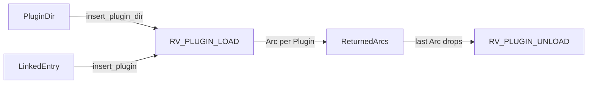

# Library Plugin loading MVP

<product-contract>

## Product Requirements

Runvil's Plugins are Rust functions compiled into the Host today, so every new Plugin adds crates and dependencies to the workspace, and nothing can load a Plugin from a file. This plan gives every Plugin one C entry point shape. A Plugin can then come from a dynamic library in a Plugin directory or be linked into the Host, and the plan proves the Host can insert, load, and unload such Plugins. No Packs, tools, or Lua pass through the entry point yet. Two small refactors land first: each run keeps one shared tool catalog, and the Pack registry's verb becomes "insert".

- Problem and users:
  - The users are Host authors (Workshop is the one Host today), Plugin authors, and the Harness, which runs prompts for a Host.
  - Today a Plugin is a Rust `install` function in a `plugin-*` crate, which the Host calls by name. Workshop calls web, user-input, and MCP (`crates/workshop/server/src/agents.rs`, lines 145-163).
  - Vocabulary: the Engine is the `runvil` and `runvil-*` crates (`crates/runvil` and `crates/runvil-internal`), which parse a prompt and step a run. The Harness is the `harness` and `harness-*` crates (`crates/harness` and `crates/harness-internal`), which step the Engine and perform every effect it asks for. A Host is an application that runs prompts through the Harness, such as Workshop. A Pack is the unit with tools and preludes: code that installs an optional native prelude, an optional Lua prelude, and zero or more tools. A Plugin is an entry point that installs zero or more Packs. In this plan the capitalized terms Engine, Harness, Host, Plugin, and Pack always carry these meanings, and any other meaning of the same word gets a qualified lowercase name. A library Plugin comes from a dynamic library. A linked Plugin is compiled into the Host. "Built-in" keeps its meaning in the code: a Pack every registry holds, today only `runvil/subagents`.
- Goals:
  - One entry point shape for library and linked Plugins, treated exactly the same. The only difference is that a library is opened before its Plugin loads and closed after its Plugin unloads.
  - A Host inserts Plugins with two free functions that take the `PackRegistry` it already fills: `insert_plugin_dir` for a Plugin directory, and `insert_plugin` for a linked entry point. Each loads its Plugins as it inserts them. `insert_plugin_dir` returns a report of which Plugins loaded and which failed, with reasons, and `insert_plugin` returns the one Plugin or its failure. Plugin authors never see these functions.
  - Each Plugin keeps its own instance, made when it loads and freed when it unloads, so cleanup runs in order and one process can hold several Hosts.
  - The C contract reserves its later verbs now, so their numbers never change.
  - Part 1: one tool catalog per run, shared by the Engine and the Harness, and `RunPack` renamed to `PackState`.
  - Part 2: `PackRegistry::add` renamed to `insert`, and the registry's doc says plainly that the Host owns it.
- Non-goals: the full list is under "Deferred and Out of Scope". The main ones:
  - Packs, tools, Lua, or mlua through the entry point.
  - Moving today's Plugin crates to the entry point shape.
  - Workshop wiring.
- Success criteria:
  - The fixture library inserts from a directory, loads, and reads `test-plugin 0.1.0`. Once nothing holds it, it unloads once and its library closes.
  - A broken file, a refusing Plugin, and a duplicate name are each reported with a readable reason, while the others still load.
  - Linked entry points get the same treatment, shown with fake entry points.
  - After Part 1 the runner tests pass unchanged, after Part 2 both completeness searches print nothing and the prose search prints only its listed leftovers, and every exit criterion passes after each code commit.
- Constraints:
  - `runvil-plugin` follows the Engine rules: no async runtime, no `async-trait`, and no HTTP client (`crates/runvil-plugin/src/lib.rs`, lines 37-45). It holds no `unsafe` code, because it isn't on the unsafe allowlist. The wording check that bans naming the Host or the Harness covers only `crates/runvil` and `crates/runvil-internal` (`crates/workshop/ui/test/docs-claims.mjs`, lines 124-135), so `runvil-plugin`'s docs may name both, as they already do.
  - A linked Plugin crate depends only on `runvil-plugin`, so every type a Plugin author names lives there.
  - `unsafe` code is allowed only in the crates listed in `OWNED` (`crates/build-xtask/src/unsafe_allowlist.rs`, lines 21-26), which holds four today. `#[unsafe(no_mangle)]` counts as unsafe code.
  - Outside its own family, a Harness crate may depend only on `runvil` and `runvil-plugin`. A crate under `crates/harness-internal/` needs four things:
    - entries in the root `Cargo.toml` `members` and `[workspace.dependencies]`, added by hand
    - a `build.rs` that `#[path]`-includes the build ceiling, as `crates/harness-internal/runner/build.rs` does
    - `[lints] workspace = true`
    - a `//! ## Invariants` crate doc
  - The `harness` facade holds only grouping `pub mod` blocks and single-item `pub use` re-exports (`crates/build-xtask/src/facade_shape.rs`, lines 1-6). Only `harness` may depend into `crates/harness-internal` from outside.
  - A lowercase "plugin" is banned in `## Invariants` crate docs, and the wording check `crates/workshop/ui/test/docs-claims.mjs` fails on it.
- Open questions (none of them blocks this plan):
  - Lua preludes: text handed over once, or a call per Lua VM?
  - A Plugin that fails partway: does it lose every Pack it inserted, or keep them? Today a linked Plugin's `install` keeps the Packs it inserted before failing.
  - Pack filters: may a filter name a single tool, or only match hints such as `readOnlyHint`?

## Functional Specification

The Host calls `insert_plugin_dir` for each Plugin directory and `insert_plugin` for each linked entry point, passing the `PackRegistry` it fills. Each call sends the load verb once to each Plugin it inserts, and returns what loaded and what failed. Each Plugin either names itself or fails with a reason, and a failure never stops the others. Each Plugin is shared through a reference count, and it unloads once, then closes its library if it has one, when everything holding it has let go. Separately, each run's snapshot builds one tool catalog that the Engine and the Harness share.

- Actors and workflows:
  - **Host:**
    - calls `insert_plugin_dir(&mut packs, dir)` for each Plugin directory and `insert_plugin(&mut packs, entry)` for each linked entry point
    - reads each `PluginReport`'s `plugins()` and `failures()`, and each `insert_plugin` result
    - drops what it got back when it's done with it. That releases only that hold: a Plugin stays loaded while anything else still holds it.
  - **Loader:**
    - `insert_plugin_dir` lists the directory's libraries, opens each one, resolves `runvil_plugin`, and sends it `RV_PLUGIN_LOAD`, in file-name order.
    - `insert_plugin` sends `RV_PLUGIN_LOAD` to the entry point it was given.
    - The `packs` parameter is where a Plugin's Packs will go. In this MVP no Plugin inserts any, so it stays untouched.
    - Dropping a Plugin sends `RV_PLUGIN_UNLOAD`, then closes its library.
  - **Plugin:** answers `RV_PLUGIN_LOAD` by making its instance and naming itself, or by refusing. It answers `RV_PLUGIN_UNLOAD` by freeing the instance, and any other verb with `RV_ERR_UNSUPPORTED`.
  - **Today's Plugin crates** (web, user-input, and MCP) keep their Rust `install` functions, and Workshop keeps calling them. In this plan, `insert_plugin` is exercised by tests.
  - **Each run (Part 1):** the snapshot builds one `ToolCatalog` and hands the Engine a clone. It routes each tool call through that catalog to the Pack the tool id's first segment names.
- Inputs and outputs:
  - Inputs: a Plugin directory path, or a linked entry point of type `PluginEntry`.
  - `insert_plugin_dir` returns a `PluginReport`. Its `plugins()` gives each loaded Plugin, with its name, version, and source (`Library(path)`), in load order. Its `failures()` gives each failure's source and readable reason, in the order it happened.
  - `insert_plugin_dir` returns an `io::Error` when the directory can't be read.
  - `insert_plugin` returns `Ok` with the loaded Plugin (source `Linked`), or `Err` with its failure.
- States and validation:
  - Each inserted entry point is loaded at once, and becomes a `Plugin` or a failure before the call returns.
  - A directory's candidates are its top-level regular files with the platform's library extension, in file-name order. Other files and subdirectories are ignored.
  - A name is at most 64 bytes, one segment with the same characters as a Pack id, checked with `PackId::parse`, which sets no length limit of its own. A version is non-empty UTF-8 of at most 64 bytes, with no control characters. A refusal reason is UTF-8 of at most 1024 bytes, and may be empty.
  - Names are unique within one `insert_plugin_dir` call. Across calls nothing remembers names; once Plugins insert Packs, the Pack registry refuses a duplicate Pack name, which catches two copies of one Plugin.
  - An `RvHost` function answers only the load call it was handed, on that call's thread, while that call runs. The rules are under "Technical Design".
- Errors and recovery:
  - Failure reasons are readable:
    - the library could not be opened
    - `runvil_plugin` is missing
    - the Plugin refused, with its reason
    - the Plugin misused the `RvHost` table
    - `RV_PLUGIN_LOAD` returned a non-OK status
    - `RV_PLUGIN_LOAD` returned without describing the Plugin
    - a Plugin of that name was already loaded from the same directory
  - A failing load gets no unload, and its library is closed at once. A failing load must free whatever it made.
  - A Plugin rejected for a duplicate name did load, so it is unloaded and dropped like any other Plugin.
  - One Plugin's failure never stops the others.
  - A Rust panic across `extern "C"` aborts the process, so the entry point must not unwind.
- Security and privacy behavior:
  - A library in a Plugin directory is trusted code: once opened, it runs with the Host's full rights. The Host chooses its Plugin directories.
  - On Windows a library is opened by absolute path with `LOAD_LIBRARY_SEARCH_DLL_LOAD_DIR | LOAD_LIBRARY_SEARCH_SYSTEM32`, so its own dependencies resolve only from its directory and System32. `crates/gateway/stt/whisper-ffi/src/library.rs`, lines 232-251, uses the same flags. The path is made absolute with `std::path::absolute`, not with `canonicalize` as whisper-ffi does, so on Windows it keeps its plain `C:\` form, and `PluginSource::Library` records that same path.
  - Strings a Plugin hands the `RvHost` functions are bounded before they're read, then validated and copied. Nothing the loader keeps points into a library except its entry point and the Plugin's instance pointer.
  - `Plugin`'s `Debug` shows the name, version, and source, never the library or the instance.
- Acceptance criteria: the unit and end-to-end items under "Testing Plan" pass, and every exit criterion passes after each code commit.

</product-contract>
<implementation-contract>

## Technical Design

Part 1 changes only crate-private structs in the run snapshot. Part 2 renames one `runvil-plugin` method and rewrites docs. Part 3 adds four pieces: the C contract's Rust mirror as a public `abi` module in `runvil-plugin`, a new Harness crate, `harness-plugin-loader`, that holds all the `unsafe` code, a `harness::plugin` facade module, and a fixture library. Each code fence below starts with a comment naming the one crate that declares, or will declare, its items. Types a fence only uses in a signature, such as `Value`, `BTreeMap`, or `PackId`, may come from other crates.

- Architecture:
  - Plugins live at the Harness level. The Engine never loads a library, never sees a Plugin or a `PackRegistry`, and receives only data from the Harness: the catalog, the roster, and the preludes. The Engine is pure, and a tool call is an effect the Harness performs.
  - Library and linked Plugins go through the same two free functions, `insert_plugin_dir` and `insert_plugin`. Each takes the Host's `PackRegistry` and loads each Plugin as it inserts it, so the Host manages one registry.
  - The functions live in the loader crate, which no Plugin crate depends on, so Plugin authors can't call them. Rust's privacy boundary is the crate and it has no `friend`, so a free function in another crate is how the Host gets a call that Plugins don't.
  - A `Plugin` owns its instance and, for a library Plugin, its library, and is shared through an `Arc`. What an insert call returns (a `PluginReport`, or the one `Arc<Plugin>` from `insert_plugin`) holds one `Arc` of each Plugin, and later every Pack and per-run Pack made from a Plugin holds one too. When the last `Arc` drops, the Plugin sends the unload verb, then closes its library. So the ownership order is enforced by Rust, not by the Host's care.
  - `PackRegistry` and `HostContext` keep their roles in this plan. A Host still fills the Pack registry by calling each Plugin crate's `install`.



- Modules and interfaces, unchanged: `HostContext` (`crates/harness-internal/runner/src/host.rs`, lines 51-61) is built from a `PackRegistry` once at startup.

```rust
// crate: harness-runner (crates/harness-internal/runner/src/host.rs)
pub struct HostContext {
    built: BTreeMap<&'static str, Built>,
}

struct Built {
    id: PackId,
    info: PackInfo,
    pack: Result<Arc<dyn Pack>, String>,
}

impl HostContext {
    pub fn new(packs: PackRegistry, services: HostServices) -> HostContext;
}
```

- Modules and interfaces, Part 1: the run snapshot's structs in `crates/harness-internal/runner/src/host-run.rs` are crate-private, so no public API changes. Today (lines 26-45):

```rust
// crate: harness-runner (crates/harness-internal/runner/src/host-run.rs), today
pub(crate) struct HostRunContext {
    services: HostServices,
    packs: BTreeMap<PackId, RunPack>,
}

enum RunPack {
    Usable { info: PackInfo, pack: Arc<dyn Pack>, tools: Vec<ToolInfo> },
    Unavailable(String),
    NeedsUnmet(Vec<ServiceId>),
}
```

After Part 1:

```rust
// crate: harness-runner (crates/harness-internal/runner/src/host-run.rs), after Part 1
/// One run's frozen snapshot of its Packs, by Pack id, its one tool
/// catalog, and the run's own services.
pub(crate) struct HostRunContext {
    services: HostServices,
    packs: BTreeMap<PackId, PackState>,
    catalog: ToolCatalog,
}

/// What one of the run's Packs looks like to it.
enum PackState {
    Usable { info: PackInfo, pack: Arc<dyn Pack> },
    Unavailable(String),
    NeedsUnmet(Vec<ServiceId>),
}

impl HostRunContext {
    /// The run's catalog: a clone sharing the snapshot's one list.
    pub(crate) fn catalog(&self) -> ToolCatalog;

    /// The usable Pack the tool id's first segment names, when the
    /// catalog holds the tool, and the tool's info.
    fn offering(&self, tool: &ToolId) -> Option<(&Arc<dyn Pack>, &ToolInfo)>;
}
```

- Modules and interfaces, Part 1, behavior:
  - `snapshot` validates each usable Pack's tools with the existing `validated` function, then builds the one `ToolCatalog` from all of them. It keeps each usable Pack's validated tools by Pack id until `packs` is collected, then builds the catalog by walking them in Pack id order, which is today's order. The snapshot's input arrives in pick order, declared Packs first, so building the catalog inside the input's `map` would reorder it. No prompt could see that, because the Engine sorts its offering by tool id (`crates/runvil-internal/engine/src/execute/context-bound.rs`, lines 40-46), but the refactor stays exact. Its fallback stays: if `ToolCatalog::new` fails, which per-tool validation rules out, it logs and uses an empty catalog.
  - `ToolCatalog` clones share one `Arc` list (`crates/runvil-internal/types/src/tools/registry.rs`, lines 20-26), so the Engine's copy and the Harness's are the same list.
  - `offering` replaces the per-Pack list scan with `catalog.get(tool)` plus `packs.get(&tool.pack())`. Validation guarantees that each catalog tool sits under its Pack's id, so together the two answer what the scan did. `survives_stop` and `ToolPerformer::call` keep using `offering`.
  - `roster`, `preludes`, `requirements`, and `Debug` change only `RunPack` to `PackState`.
  - The module doc (lines 1-9) says the snapshot builds the run's one catalog, which the Engine receives a clone of and the Harness routes calls through.
- Modules and interfaces, Part 2: `PackRegistry` (`crates/runvil-plugin/src/registry.rs`, lines 20-49) changes only its method name and its doc. After Part 2:

```rust
// crate: runvil-plugin (crates/runvil-plugin/src/registry.rs), after Part 2
/// Every Pack a Host's Plugins insert, by fully qualified name, each
/// with its Pack id and config.
///
/// The Host owns the registry; a Plugin only inserts its Packs into it,
/// by calling [`insert`](PackRegistry::insert) from its `install`
/// function. The Host makes the registry with
/// [`new`](PackRegistry::new), which holds the built-ins such as
/// `runvil/subagents` from the start, and calls each Plugin it links. Then
/// it hands the registry to `HostContext::new`, which reads it through
/// [`into_entries`](PackRegistry::into_entries) and calls each Pack's
/// `construct` once, at startup, to make the one Pack object every run
/// shares.
pub struct PackRegistry {
    entries: BTreeMap<&'static str, Registered>,
}

/// One Pack the registry holds.
struct Registered {
    info: PackInfo,
    origin: PackOrigin,
    id: PackId,
    config: Value,
}

#[non_exhaustive]
pub enum PackOrigin {
    Builtin,
    Linked,
}

impl PackRegistry {
    pub fn new() -> PackRegistry;
    pub fn insert(&mut self, info: PackInfo, config: Value) -> Result<(), InstallError>;
    pub fn list(&self) -> impl Iterator<Item = (&PackInfo, PackOrigin)>;
    pub fn into_entries(self) -> impl Iterator<Item = (PackInfo, PackId, Value)>;
}
```

- Modules and interfaces, Part 3, the C contract: one entry point shape, for library and linked Plugins alike.
  - Every call passes an `RvCall` that names a verb.
  - Loading returns the Plugin's instance pointer, and every later call passes it back.
  - Verb names follow `RV_<OBJECT>_<ACTION>`. Libraries open and close; Plugins load and unload.
  - Strings are pointer plus length.
  - An `RvHost` function identifies its call by the `RvCall` pointer it was handed. It compares that address with the open call's and never dereferences it.
  - Version 0.1 makes no compatibility promise.

```c
/* crate: none. The C ABI, version 0.1. runvil-plugin (src/abi.rs) mirrors
   it for the loader and linked Plugins; harness-test-plugin mirrors it for
   the fixture. */
typedef uint32_t RvStatus;  /* RV_OK 0, RV_ERR_MISUSE 4, RV_ERR_REFUSED 5, RV_ERR_UNSUPPORTED 6 */

/* UTF-8, not NUL-terminated. */
typedef struct RvStr { const char *ptr; size_t len; } RvStr;

/* A fixed-width integer, not a C enum, so its size never depends on the compiler. */
typedef uint32_t RvVerb;
#define RV_PLUGIN_LOAD    1  /* make the Plugin instance and name the Plugin; may set call->plugin */
#define RV_PLUGIN_UNLOAD  2  /* free the Plugin instance */
/* 3 to 7 are reserved; see the reserved verbs below. */

typedef struct RvCall RvCall;

typedef struct RvPluginInfo {
    uint32_t size;      /* sizeof(RvPluginInfo) */
    uint32_t reserved;  /* zero */
    RvStr name;         /* at most 64 bytes, one segment, same characters as a Pack id, e.g. "acme-url" */
    RvStr version;      /* non-empty, at most 64 bytes, no control characters */
} RvPluginInfo;

typedef struct RvHost {
    uint32_t size, api_major /* 0 */, api_minor /* 1 */, reserved;
    RvStatus (*refuse)(const RvCall *call, RvStr reason);                      /* at most once, in RV_PLUGIN_LOAD; reason is UTF-8, at most 1024 bytes; returns RV_ERR_REFUSED */
    RvStatus (*describe_plugin)(const RvCall *call, const RvPluginInfo *info);  /* exactly once, in RV_PLUGIN_LOAD */
} RvHost;

struct RvCall {
    uint32_t size;       /* sizeof(RvCall) */
    RvVerb verb;
    const RvHost *host;  /* the RvHost functions the Plugin may call during this call */
    void *plugin;        /* the Plugin instance: NULL going into RV_PLUGIN_LOAD, which may set it */
    void *pack_run;      /* the per-run Pack instance; always NULL in 0.1 */
    const void *args;    /* the verb's own arguments; NULL for RV_PLUGIN_LOAD and RV_PLUGIN_UNLOAD in 0.1 */
};

/* A library Plugin exports this name. A linked Plugin has the same shape
   under a name of its own crate's choosing. */
RvStatus runvil_plugin(RvCall *call);
```

- Modules and interfaces, Part 3, the status codes:
  - **`RV_OK` (0):** success.
  - **Codes 1 to 3:** reserved for the Lua API's own errors (Lua raised an error, a fatal error such as the memory limit or a cancel, and a wrong type).
  - **`RV_ERR_MISUSE` (4):** the caller broke the contract.
  - **`RV_ERR_REFUSED` (5):** the Plugin declined to load.
  - **`RV_ERR_UNSUPPORTED` (6):** the Plugin doesn't know the verb.

- Modules and interfaces, Part 3, the reserved verbs: the later verbs are reserved now, so their numbers never change. Each one gets its own arguments struct, pointed to by `call->args`, so no verb reads fields meant for another:

```c
/* crate: none. Verbs reserved for later versions of the C ABI. */
#define RV_PACK_NEW         3  /* make one Pack's per-run instance; sets call->pack_run */
#define RV_PACK_DELETE      4  /* free that per-run instance */
#define RV_TOOL_CALL        5  /* start one tool call; it finishes later through an RvHost function */
#define RV_TOOL_CANCEL      6  /* abandon a started call */
#define RV_PRELUDE_INSTALL  7  /* install the Pack's native prelude, once per Lua VM */
```

- Modules and interfaces, Part 3, the C types in `runvil-plugin`: the Rust mirror lives in a new public module, `abi`. It can't live in the Harness, because a linked Plugin crate may depend only on `runvil-plugin`. The loader uses these types, and so will linked Plugin crates once they move to the entry point shape. The fixture keeps its own copy, to prove a library Plugin needs nothing from Runvil. Declaring these types is safe Rust, because only calling a `PluginEntry` or reading through its pointers needs `unsafe`.

```rust
// crate: runvil-plugin (crates/runvil-plugin/src/abi.rs)
//! The C contract every Plugin entry point follows, library or linked.

/// What every function in the contract returns: zero for success.
pub type RvStatus = u32;
/// Success.
pub const RV_OK: RvStatus = 0;
/// The caller broke the contract.
pub const RV_ERR_MISUSE: RvStatus = 4;
/// The Plugin declined to load; `refuse` returns it.
pub const RV_ERR_REFUSED: RvStatus = 5;
/// The Plugin does not know the verb it was sent.
pub const RV_ERR_UNSUPPORTED: RvStatus = 6;

/// The operation an `RvCall` asks for.
pub type RvVerb = u32;
/// Make the Plugin instance and name the Plugin.
pub const RV_PLUGIN_LOAD: RvVerb = 1;
/// Free the Plugin instance.
pub const RV_PLUGIN_UNLOAD: RvVerb = 2;

/// The contract's major version, which `RvHost` reports.
pub const RV_API_MAJOR: u32 = 0;
/// The contract's minor version, which `RvHost` reports.
pub const RV_API_MINOR: u32 = 1;

/// A UTF-8 string that is not NUL-terminated.
#[repr(C)]
#[derive(Clone, Copy, Debug)]
pub struct RvStr {
    /// The first byte.
    pub ptr: *const c_char,
    /// The length in bytes.
    pub len: usize,
}

/// What a Plugin tells `describe_plugin` about itself.
#[repr(C)]
#[derive(Debug)]
pub struct RvPluginInfo {
    /// `size_of::<RvPluginInfo>()`.
    pub size: u32,
    /// Zero.
    pub reserved: u32,
    /// At most 64 bytes, one segment, with the same characters as a Pack id.
    pub name: RvStr,
    /// Non-empty, at most 64 bytes, with no control characters.
    pub version: RvStr,
}

/// The functions a Plugin may call back during a call.
#[repr(C)]
#[derive(Debug)]
pub struct RvHost {
    /// `size_of::<RvHost>()`.
    pub size: u32,
    /// `RV_API_MAJOR`.
    pub api_major: u32,
    /// `RV_API_MINOR`.
    pub api_minor: u32,
    /// Zero.
    pub reserved: u32,
    /// Declines the load, at most once, with a UTF-8 reason of at most 1024
    /// bytes; returns `RV_ERR_REFUSED`.
    pub refuse: unsafe extern "C" fn(*const RvCall, RvStr) -> RvStatus,
    /// Names the Plugin, exactly once, during `RV_PLUGIN_LOAD`.
    pub describe_plugin: unsafe extern "C" fn(*const RvCall, *const RvPluginInfo) -> RvStatus,
}

/// One call into a Plugin's entry point.
#[repr(C)]
#[derive(Debug)]
pub struct RvCall {
    /// `size_of::<RvCall>()`.
    pub size: u32,
    /// The operation.
    pub verb: RvVerb,
    /// The functions the Plugin may call during this call.
    pub host: *const RvHost,
    /// The Plugin instance: NULL going into `RV_PLUGIN_LOAD`, which may set it.
    pub plugin: *mut c_void,
    /// The per-run Pack instance; always NULL in version 0.1.
    pub pack_run: *mut c_void,
    /// The verb's own arguments; NULL for both version 0.1 verbs.
    pub args: *const c_void,
}

/// The shape of every Plugin entry point.
pub type PluginEntry = unsafe extern "C" fn(*mut RvCall) -> RvStatus;
```

- Modules and interfaces, Part 3, the new crate `harness-plugin-loader` (`crates/harness-internal/plugin-loader`): every top-level declaration it will have, file by file, with signatures and no bodies. Only `plugin.rs` is public, and the facade re-exports its two functions and four types. `src/lib.rs`, the crate root:

```rust
// crate: harness-plugin-loader (crates/harness-internal/plugin-loader/src/lib.rs)
//! `harness-plugin-loader` - inserts Plugins into a Host's Pack registry,
//! from dynamic libraries in a Plugin directory or linked into the Host.
//! Each Plugin loads as it is inserted.
//!
//! ## Invariants
//!
//! - May depend on: `runvil-plugin` among workspace crates.
//! - Every entry point gets the same calls, whether it came from a library
//!   or was linked in. The only difference is that a library is opened
//!   when it is inserted and closed after its Plugin is dropped.
//! - Dropping a `Plugin` sends `RV_PLUGIN_UNLOAD` once, with the instance
//!   pointer its `RV_PLUGIN_LOAD` set, then closes its library, if it has one.
//! - An entry point whose `RV_PLUGIN_LOAD` fails gets no `RV_PLUGIN_UNLOAD`, and its
//!   library is closed at once; a failing load must leave nothing
//!   running.
//! - The loader sends only `RV_PLUGIN_LOAD` and `RV_PLUGIN_UNLOAD`, and the
//!   `RvHost` functions answer only the `RV_PLUGIN_LOAD` call they were
//!   handed, on its thread.
//! - Nothing the loader keeps points into a library except its entry point
//!   and the Plugin's instance pointer; the name and version are copied.
#![expect(unsafe_code, reason = "opens dynamic libraries and calls C entry points")]

mod host;
mod load;
mod plugin;

pub use plugin::{insert_plugin, insert_plugin_dir, Plugin, PluginFailure, PluginReport, PluginSource};
```

`src/host.rs`, the `RvHost` table, its functions, and the two verb senders:

```rust
// crate: harness-plugin-loader (crates/harness-internal/plugin-loader/src/host.rs)
/// The `RvHost` table every call hands the Plugin.
pub(crate) static HOST: RvHost;

thread_local! {
    /// The RV_PLUGIN_LOAD call running on this thread, if any.
    static SESSION: RefCell<Option<Session>>;
}

/// What one RV_PLUGIN_LOAD has reported so far.
struct Session {
    call: *const RvCall,
    described: Option<Described>,
    refusal: Option<String>,
    misuse: Option<&'static str>,
}

/// The name and version a Plugin gave `describe_plugin`, copied.
pub(crate) struct Described {
    pub(crate) name: String,
    pub(crate) version: String,
}

/// Records the Plugin's refusal, validated; returns RV_ERR_REFUSED, or
/// RV_ERR_MISUSE for a call it doesn't answer or a second refusal.
unsafe extern "C" fn refuse(call: *const RvCall, reason: RvStr) -> RvStatus;

/// Records the Plugin's description once, validated; returns RV_OK or
/// RV_ERR_MISUSE.
unsafe extern "C" fn describe_plugin(call: *const RvCall, info: *const RvPluginInfo) -> RvStatus;

/// Sends RV_PLUGIN_LOAD through `entry` with a session open on this thread, then
/// closes it. On success, returns the description and the instance
/// pointer the Plugin set.
pub(crate) unsafe fn send_load(entry: PluginEntry) -> Result<(Described, *mut c_void), LoadError>;

/// Sends RV_PLUGIN_UNLOAD through `entry` with `plugin`. No session is open, so
/// any `RvHost` function the Plugin calls answers RV_ERR_MISUSE.
pub(crate) unsafe fn send_unload(entry: PluginEntry, plugin: *mut c_void);
```

`src/load.rs`, listing, opening, and owning:

```rust
// crate: harness-plugin-loader (crates/harness-internal/plugin-loader/src/load.rs)
/// The top-level regular files in `directory` whose extension is
/// `std::env::consts::DLL_EXTENSION`, sorted by file name, each made
/// absolute with `std::path::absolute`.
pub(crate) fn plugin_files(directory: &Path) -> io::Result<Vec<PathBuf>>;

/// The one symbol a library Plugin exports.
const ENTRY_POINT: &[u8] = b"runvil_plugin\0";

/// Opens the library at the absolute `path`; on Windows with
/// LOAD_LIBRARY_SEARCH_DLL_LOAD_DIR | LOAD_LIBRARY_SEARCH_SYSTEM32.
fn open_library(path: &Path) -> io::Result<libloading::Library>;

/// Opens the library at `path` and resolves ENTRY_POINT.
pub(crate) fn open_entry(path: &Path) -> Result<(libloading::Library, PluginEntry), LoadError>;

/// A live Plugin instance: the entry point and the pointer RV_PLUGIN_LOAD set.
/// Dropping it sends RV_PLUGIN_UNLOAD once.
pub(crate) struct Instance {
    entry: PluginEntry,
    plugin: *mut c_void,
}

impl Drop for Instance {
    fn drop(&mut self);
}

// SAFETY: the C contract lets RV_PLUGIN_UNLOAD come on any thread, and the
// loader never reads `plugin`.
unsafe impl Send for Instance {}
// SAFETY: `Instance` has no method that takes `&self`, so sharing it
// between threads exposes nothing.
unsafe impl Sync for Instance {}

/// A Plugin instance and, for a library Plugin, its library. Fields drop
/// in order, so RV_PLUGIN_UNLOAD is sent before the library closes.
pub(crate) struct Loaded {
    instance: Instance,
    library: Option<libloading::Library>,
}

/// Why one Plugin did not load; its message becomes the failure's reason.
#[derive(Debug, thiserror::Error)]
pub(crate) enum LoadError {
    #[error("the library could not be opened: {0}")]
    Open(std::io::Error),
    #[error("runvil_plugin is missing: {0}")]
    MissingEntry(libloading::Error),
    #[error("the Plugin refused: {0}")]
    Refused(String),
    #[error("the Plugin misused the RvHost table: {0}")]
    Misuse(&'static str),
    #[error("RV_PLUGIN_LOAD returned status {0}")]
    Status(RvStatus),
    #[error("RV_PLUGIN_LOAD returned without describing the Plugin")]
    Undescribed,
    #[error("a Plugin named {0} was already loaded from this directory")]
    Duplicate(String),
}
```

`src/plugin.rs`, the public surface:

```rust
// crate: harness-plugin-loader (crates/harness-internal/plugin-loader/src/plugin.rs)
/// Opens every dynamic library in `directory`, in file-name order, and
/// loads each one's Plugin by sending it RV_PLUGIN_LOAD. Its Packs will go
/// into `packs`; in this MVP no Plugin inserts any. A file that can't be
/// opened, has no `runvil_plugin`, fails to load, or repeats a Plugin name
/// this call already loaded is recorded in the report as a failure. A
/// repeat did load, so it is unloaded and dropped. A dependency library
/// beside a Plugin is opened too, and reported as missing `runvil_plugin`.
///
/// # Errors
/// Returns the I/O error when `directory` cannot be read.
#[expect(unused_variables, reason = "Plugins insert no Packs until insert_pack exists")]
pub fn insert_plugin_dir(packs: &mut PackRegistry, directory: &Path) -> std::io::Result<PluginReport>;

/// Loads a Plugin linked into the Host by sending `entry` RV_PLUGIN_LOAD,
/// and returns it. Its Packs will go into `packs`; in this MVP no Plugin
/// inserts any. `entry` must follow the C contract in
/// `runvil_plugin::abi`, as a library's must.
///
/// # Errors
/// Returns the failure, with the source `Linked`, when the Plugin refuses,
/// misuses the `RvHost` functions, or does not describe itself.
#[expect(unused_variables, reason = "Plugins insert no Packs until insert_pack exists")]
pub fn insert_plugin(packs: &mut PackRegistry, entry: PluginEntry) -> Result<Arc<Plugin>, PluginFailure>;

/// What one `insert_plugin_dir` call loaded and what failed. It holds one
/// `Arc` of each Plugin it loaded; dropping it releases only that hold.
#[derive(Debug)]
pub struct PluginReport {
    plugins: Vec<Arc<Plugin>>,
    failures: Vec<PluginFailure>,
}

impl PluginReport {
    /// Every Plugin this call loaded, in load order.
    #[must_use]
    pub fn plugins(&self) -> &[Arc<Plugin>];

    /// Every failure, in the order it happened.
    #[must_use]
    pub fn failures(&self) -> &[PluginFailure];
}

/// Where a Plugin's entry point came from.
#[derive(Debug, Clone, PartialEq, Eq)]
#[non_exhaustive]
pub enum PluginSource {
    /// A dynamic library at this absolute path, as `std::path::absolute`
    /// made it.
    Library(PathBuf),
    /// Compiled into the Host and inserted with `insert_plugin`.
    Linked,
}

/// One Plugin that loaded and named itself, shared through `Arc`. It owns
/// its instance and, for a library Plugin, its library. When the last `Arc`
/// drops, it sends RV_PLUGIN_UNLOAD, then closes the library.
pub struct Plugin {
    name: String,     // at most 64 bytes, one segment, by the same rules as a Pack id
    version: String,  // non-empty, at most 64 bytes, no control characters
    source: PluginSource,
    loaded: Loaded,
}

/// One inserted entry point that did not open or load.
#[derive(Debug, Clone)]
pub struct PluginFailure {
    source: PluginSource,
    reason: String,   // readable, such as "runvil_plugin is missing"
}

impl Plugin {
    /// The name the Plugin gave `describe_plugin`.
    #[must_use]
    pub fn name(&self) -> &str;

    /// The version the Plugin gave `describe_plugin`.
    #[must_use]
    pub fn version(&self) -> &str;

    /// Where its entry point came from.
    #[must_use]
    pub fn source(&self) -> &PluginSource;
}

/// Shows the name, version, and source, never the library or the instance.
impl fmt::Debug for Plugin { /* ... */ }

impl PluginFailure {
    /// Where the entry point that failed came from.
    #[must_use]
    pub fn source(&self) -> &PluginSource;

    /// Why it failed, readable.
    #[must_use]
    pub fn reason(&self) -> &str;
}
```

- Modules and interfaces, startup order: one crate per step. Only step 2 is built in this plan. Steps 1, 3, and 4 are what Workshop does today (`crates/workshop/server/src/agents.rs`, lines 145-163). A Host reaches the Harness items through the `harness` facade, which each step names.

1. Make the Pack registry (through `harness::pack::PackRegistry`):

```rust
// crate: runvil-plugin
let mut packs = PackRegistry::new();
```

2. Insert the library Plugins (through `harness::plugin::insert_plugin_dir`):

```rust
// crate: harness-plugin-loader
let report = insert_plugin_dir(&mut packs, &plugin_dir)?;   // RV_PLUGIN_LOAD to each library
```

3. Call each Plugin crate's `install`, as today, such as web's:

```rust
// crate: plugin-web
plugin_web::install(&mut packs, Value::Null)?;
```

4. Build every Pack (through `harness::pack::HostContext`):

```rust
// crate: harness-runner
let host = HostContext::new(packs, services);
```

Once Plugins insert Packs through the entry point, step 3 becomes `insert_plugin(&mut packs, plugin_web::entry)`. The Host then needn't keep the reports at all, because each Pack holds an `Arc` of its Plugin.

- File and public API changes:
  - **Part 1, `crates/harness-internal/runner/src/host-run.rs` only.** No test changes: `host-tests.rs` and `host-tests-pick.rs` reach the snapshot only through `catalog()`, `survives_stop`, and calls, whose signatures stay the same.
  - **Part 2, `crates/runvil-plugin/src/registry.rs`:**
    - the method itself, from `add` to `insert` (line 91), and its doc, "Adds `info`" becoming "Inserts `info`" (line 78)
    - `PackRegistry`'s doc (lines 20-27), replaced by the text in the fence above
    - the module doc: "each Pack a Plugin adds" becomes "inserts" (line 2), and "an add refuses with" becomes "an insert refuses with" (line 4)
    - "Added by a linked Plugin with [`PackRegistry::add`]" becomes "Inserted ... [`PackRegistry::insert`]" (line 47)
    - "A Pack [`PackRegistry::add`] refuses outright" (line 154), and "added Pack" or "Pack added" in the `InstallError` variant docs (lines 162, 169-170, and 176), become insert wording
  - **Part 2, `crates/runvil-plugin/src/registry-tests.rs`:** every call (lines 38-159), the module doc's "`add` refuses" (line 2), and the messages "a Pack added with needs" (line 52) and "the refused add" (line 94).
  - **Part 2, `crates/runvil-plugin/src/pack.rs`:** "which a Plugin adds to the Host's" (line 107), "and adds it from its `install` function" (line 114), the doc example's `packs.add(...)` (line 123), and "the config the Plugin added the Pack with" (line 141).
  - **Part 2, `crates/runvil-plugin/src/lib.rs`, line 14:** "It calls [`PackRegistry::add`]" becomes `insert`. After that paragraph, add the Host-owns sentence as its own paragraph: "The Host owns the [`PackRegistry`]; a Plugin only inserts its Packs into it."
  - **Part 2, `crates/harness-internal/runner/src/host.rs`, lines 5-7:** "The Host's Plugins add Packs to the registry" and "added it with" become insert wording.
  - **Part 2, `crates/harness/src/lib.rs`:** the crate doc's "which adds its Packs to the registry" (lines 3-4) and the `pack` module doc's "The registry a Host's Plugins add Packs to" (line 29) become insert wording.
  - **Part 2, the three Plugin crates' `install` functions:** `crates/plugin-web/src/web.rs` (line 45), `crates/plugin-user-input/src/lib.rs` (line 104), and `crates/plugin-mcp/src/lib.rs` (line 134).
  - **Part 2, the three Plugin crates' docs,** which become insert wording:
    - each crate doc's "The crate's Plugin, [`install`], adds the Pack": `crates/plugin-web/src/lib.rs` (line 4), `crates/plugin-user-input/src/lib.rs` (line 4), and `crates/plugin-mcp/src/lib.rs` (line 5)
    - each `install` doc's "The Plugin: adds the ... Pack to `packs`": `crates/plugin-web/src/web.rs` (line 33), `crates/plugin-user-input/src/lib.rs` (line 91), and `crates/plugin-mcp/src/lib.rs` (line 122)
    - "Neither adding nor declaring the Pack" in `crates/plugin-user-input/src/lib.rs` (line 62)
    - "the Plugin that adds it to a Host's Pack registry" in `crates/plugin-web/README.md` (line 3)
  - **Part 2, the three Plugin crates' tests:**
    - the `added` helpers become `inserted`, with their uses: `crates/plugin-mcp/tests/it/support.rs` (lines 36 and 52-53), `crates/plugin-mcp/tests/it/main.rs` (lines 23 and 28-47), `crates/plugin-user-input/tests/it/ask.rs` (lines 56, 67-68, and 119), and the `added` variable in `crates/plugin-web/src/web-tests.rs` (lines 80-85)
    - "`install` adds" and "install adds one Pack" become insert wording: `crates/plugin-mcp/tests/it/main.rs` (lines 3 and 30), `crates/plugin-mcp/tests/it/support.rs` (lines 1, 34, 45, and 53), `crates/plugin-user-input/tests/it/ask.rs` (lines 2, 54, 65, and 68), `crates/plugin-user-input/tests/it/main.rs` (line 1), and `crates/plugin-web/src/web-tests.rs` (lines 2 and 92)
  - **Part 2, `crates/workshop/server/src/agents.rs`, lines 148, 155, and 161:** the log messages "the ... Plugin added no Pack" become "inserted no Pack". No test asserts them.
  - **Part 2, tests:** `crates/harness-internal/runner/src/host-tests.rs` (line 153), `crates/harness-internal/runner/tests/it/scripted.rs` (lines 268-270), `crates/harness-internal/runner/tests/it/support.rs` (line 39), and `crates/harness/tests/suite/asker.rs` (line 45).
  - **Part 3, `runvil-plugin`:**
    - `src/abi.rs`, new and public, declared as shown, with its layout tests in `src/abi-tests.rs`, following the crate's `#[path]` test-file pattern
    - `src/lib.rs` gains `pub mod abi;`
    - in `src/lib.rs`, lines 16-17, "A library Plugin will be the entry point a dynamic library exports; it is not built yet." becomes "A Plugin can also be a C entry point with the shape in [`abi`]: a dynamic library exports it as `runvil_plugin`, or a Plugin crate links it in under a name of its own. The Harness loads these entry points when a Host inserts them; they insert no Packs yet."
  - **Part 3, the new crate `crates/harness-internal/plugin-loader`:**
    - entries in the root `Cargo.toml` `members` and `[workspace.dependencies]`, a `build.rs`, workspace lints, and the Invariants doc shown above
    - an entry in `OWNED`
    - dependencies on `libloading` (pinned at the workspace root), `thiserror`, and `runvil-plugin`
  - **Part 3, the new fixture crate `crates/harness-internal/test-plugin` (`harness-test-plugin`):**
    - `crate-type = ["cdylib", "rlib"]`, with no `[dependencies]` at all. Its `[dev-dependencies]` are `harness-plugin-loader`, for the end-to-end tests, and `runvil-plugin`, for `PackRegistry::new`. Both are allowed for a Harness crate.
    - an entry in `OWNED`, which grows from four crates to six; its doc and any test that pins the count change with it
    - `build.rs`, the `## Invariants` doc, workspace lints, and a `members` entry
    - only `runvil_plugin` is public. The mirrored types stay private, so `missing_docs` and `unreachable_pub` have one item to check, and the layout asserts are unit tests inside the crate, since its integration tests can't name the private types.
    - the export is `#[unsafe(no_mangle)] pub unsafe extern "C" fn runvil_plugin(call: *mut RvCall) -> RvStatus` with a `# Safety` section, because it dereferences its argument, and `clippy::not_unsafe_ptr_arg_deref` and `missing_safety_doc` are deny. Its signature names the private `RvCall`, which trips rustc's warn-by-default `private_interfaces` lint, so it carries `#[expect(private_interfaces, reason = "the C types stay private; only the entry point is exported")]`. Without it, the deny-warnings clippy runs fail.
  - **Part 3, `crates/harness/src/lib.rs`:** a new `pub mod plugin` re-exporting `insert_plugin`, `insert_plugin_dir`, `Plugin`, `PluginFailure`, `PluginReport`, and `PluginSource`, one item per line in name order. Its module doc reads: "Inserting Plugins into the Pack registry: from the dynamic libraries in a Plugin directory, or linked into the Host, and what each insert loaded." The facade adds `harness-plugin-loader` to its dependencies. The Host never names the `abi` types, so the facade doesn't re-export them.
  - **Unchanged:** `PackRegistry`'s code beyond Part 2's rename, and `HostContext`.
  - **No snapshot update:** only the `runvil` facade has a public API snapshot (`crates/runvil/public-api.txt`), and these changes don't touch it.
- Data, persistence, failure, security, and privacy constraints:
  - **Load:**
    - `RV_PLUGIN_LOAD` must call `describe_plugin` exactly once, then return `RV_OK`. It may set `call->plugin`, or leave it NULL if the Plugin keeps no state. Anything else is a failure, with the refuse reason when there is one. A call to `refuse` wins, even if the Plugin also described itself or returned `RV_OK`. After a refusal, a misuse wins over a non-OK status, and a non-OK status wins over a missing description, in the order the failure reasons are listed.
    - A failing `RV_PLUGIN_LOAD` must free whatever it made before it returns. The loader never sends `RV_PLUGIN_UNLOAD` for it, and closes a library Plugin's library at once.
  - **Unload:** after a successful `RV_PLUGIN_LOAD`, the loader sends `RV_PLUGIN_UNLOAD` exactly once, with the same `plugin` pointer, before the Plugin is dropped. It may come on any thread. `RV_PLUGIN_UNLOAD` must stop every thread the Plugin started and release everything it holds. An `RvHost` function called during it returns `RV_ERR_MISUSE`.
  - **`RvHost` functions:**
    - An `RvHost` function answers only the `RV_PLUGIN_LOAD` call it was handed, on that call's thread, while that call runs.
    - Any other `RvCall` pointer, a call from another thread, or a call after the load call returns gets `RV_ERR_MISUSE`.
    - So does a NULL pointer, a short `size`, a nonzero reserved field, an invalid name, version, or refusal reason, or a second `describe_plugin` or `refuse` call.
    - `send_load` enforces this with a thread-local session that holds the call's address. A function compares the `RvCall` address it was handed with the session's and never dereferences it, so a stale or foreign pointer is safe to receive.
    - Each string's length is checked against its cap before any byte is read: 64 bytes for a name or a version, and 1024 for a refusal reason. `ptr` is read only when `len` is nonzero, because `slice::from_raw_parts` with a NULL pointer is undefined behavior even at length 0. A NULL `ptr` with a nonzero `len` is misuse, and `{NULL, 0}` is the empty string, which only a refusal reason may be.
  - **Other verbs:** a Plugin answers a verb it doesn't know with `RV_ERR_UNSUPPORTED`. The 0.1 loader sends only `RV_PLUGIN_LOAD` and `RV_PLUGIN_UNLOAD`.
  - **No unwinding:** the entry point must not unwind, and the docs say so.
  - **Unload before close:** `Loaded` declares `instance` before `library`, and Rust drops fields in declaration order. So `RV_PLUGIN_UNLOAD` is sent before a library closes, with no hand-written `Drop` for `Loaded`. A linked Plugin's `library` is `None`.
  - **Lifetimes:** a Plugin's lifetime is its reference count. What an insert call returns holds one `Arc` of each Plugin it loaded, and so does any clone of it. Later, every Pack and per-run Pack made from a Plugin holds one too. The Plugin unloads, and its library closes, only when the last `Arc` drops, so dropping what an insert returned is always safe. In this MVP nothing else holds an `Arc` yet, so a Host that wants its Plugins to stay loaded keeps what the inserts returned.
  - **Thread safety:** `Plugin` is `Send` and `Sync`: `Instance` declares both, and `libloading::Library` is both.
  - **The unused parameter:** in this MVP no Plugin inserts Packs, so `packs` goes unused. Both functions carry `#[expect(unused_variables, reason = "...")]` until `insert_pack` exists, so the signature is already the final one.
  - **Safe surface:** the public surface is safe only: `insert_plugin_dir`, `insert_plugin`, `PluginReport`, `Plugin`, `PluginFailure`, and `PluginSource`. The `RvHost` functions, `ENTRY_POINT`, `Instance`, `Loaded`, and `LoadError` stay private.
  - **Workspace lints:** the clippy runs deny warnings, so new code meets the root `Cargo.toml` lints (lines 270-305):
    - `missing_docs` and `missing_debug_implementations`: every public item and field is documented and every public type implements `Debug`, as the fences show
    - pedantic clippy: `#[must_use]` on getters
    - `undocumented_unsafe_blocks`: a `// SAFETY:` comment on every `unsafe` block, and one directly above each `unsafe impl`, since two impls can't share a comment
    - `unsafe_op_in_unsafe_fn`: `unsafe` blocks inside `unsafe fn`s
    - `allow_attributes`: `#[expect]`, never `#[allow]`
  - **Defined-term wording:** the wording check `crates/workshop/ui/test/docs-claims.mjs` scans the whole crate doc of every `lib.rs` that carries `## Invariants`, with code spans skipped. So the loader's and the fixture's crate docs never use a lowercase "host", "engine", "harness", or "plugin" in prose. The docs say "the `RvHost` functions", not "the host functions". The defined terms keep their meaning in code comments, docs, messages, and plans too, which the check doesn't scan, so the same wording holds in every item doc, comment, and failure reason: "the `RvHost` functions" and "the `RvHost` table" for what a Plugin calls back, and "the loader" for the side that sends verbs.
  - **No persistence:** nothing is written to disk.

</implementation-contract>
<verification-contract>

## Testing Plan

The loader's unit tests drive the whole contract with fake entry points inserted through `insert_plugin`, so the linked path gets the same coverage as libraries. A fixture library covers the real library path end to end, on every platform the workspace builds. Parts 1 and 2 are covered by the existing suites, two completeness searches, and a prose search. Every exit criterion runs after each code commit.

- Unit:
  - **Fake entry points** are plain `extern "C" fn`s in the loader's test module, written against `runvil_plugin::abi` and inserted with `insert_plugin`. Each test uses its own fake and its own statics, so results don't depend on whether tests share a process. They cover these cases:
    - `RV_PLUGIN_LOAD` that describes once and returns `RV_OK`, with and without setting `call.plugin`. `insert_plugin` returns `Ok` with that name and the source `Linked`.
    - `RV_PLUGIN_LOAD` that returns `RV_OK` without describing.
    - `RV_PLUGIN_LOAD` that refuses with a reason: `insert_plugin` returns `Err` with that reason and the source `Linked`.
    - `RV_PLUGIN_LOAD` that both describes and refuses: the refusal wins.
    - `RV_PLUGIN_LOAD` that describes twice.
    - An invalid name, version, or size, including a name over 64 bytes, a NULL `ptr` with a nonzero `len`, and `{NULL, 0}` as a name.
    - A second `refuse` call, and a refusal reason over 1024 bytes or not UTF-8.
    - A misuse followed by `RV_OK`, or by a non-OK status, reports the misuse.
    - An `RvHost` function called with a different `RvCall` pointer, from another thread, or after the load call returned, each getting `RV_ERR_MISUSE`.
  - **Unload:**
    - Dropping the `Arc` that `insert_plugin` returned sends `RV_PLUGIN_UNLOAD` exactly once, with the pointer its `RV_PLUGIN_LOAD` set. The fake counts the calls in a static and records the pointer.
    - A clone of that `Arc` keeps the Plugin loaded after the original drops. No `RV_PLUGIN_UNLOAD` is sent until the clone drops, and then exactly one is.
    - With the `packs` parameter untouched, the Pack registry lists the same Packs after an insert call as before it.
    - An `RvHost` function called during `RV_PLUGIN_UNLOAD` gets `RV_ERR_MISUSE`.
    - An `RV_PLUGIN_LOAD` that sets `call.plugin` and then fails is never sent `RV_PLUGIN_UNLOAD`.
  - **Layout:** `size_of` and `offset_of` assertions pin the layouts of `RvStr`, `RvPluginInfo`, `RvHost`, and `RvCall` on 64-bit targets, in `runvil-plugin`'s own tests. The fixture's unit tests assert the same numbers for its mirrored copy, so the two can't drift apart. They're unit tests because the mirrored types are private.
  - **Directory listing:** `plugin_files` is checked for sorting, extension filtering, and skipping subdirectories.
  - **Part 2:** `crates/runvil-plugin/src/registry-tests.rs` keeps its cases under the new method name.
- Integration and end-to-end:
  - **The fixture** is `crates/harness-internal/test-plugin`. It mirrors the `#[repr(C)]` types itself and exports `#[unsafe(no_mangle)] pub unsafe extern "C" fn runvil_plugin`, which answers three ways:
    - `RV_PLUGIN_LOAD`: checks the `RvHost` version, sets `call.plugin` to a boxed instance, and describes `test-plugin` at version `0.1.0`.
    - `RV_PLUGIN_UNLOAD`: frees the box.
    - Any other verb: `RV_ERR_UNSUPPORTED`.
  - So every end-to-end test makes a real unload call when its report drops.
  - **Finding the library:** with `crate-type = ["cdylib", "rlib"]`, Cargo builds the library before the package's own integration tests run. `tests/it/main.rs` uses the dev-dependencies `harness-plugin-loader` and `runvil-plugin`. It finds the library at `current_exe().parent()` joined with `DLL_PREFIX + "harness_test_plugin" + DLL_SUFFIX`, and copies it into a directory under `env!("CARGO_TARGET_TMPDIR")`, named from the test name, the process id, and a counter.
  - **The cases:**
    - `insert_plugin_dir` loads the fixture, and the report's `plugins()` reads `test-plugin 0.1.0` with the source `Library(path)`, where `path` is `std::path::absolute` of the copied file.
    - The same fixture in two directories, inserted by two calls, loads in both. Names are checked only within one call.
    - A garbage file with the library extension fails at insert with a readable reason, and the fixture beside it still loads.
    - A `README.txt` is ignored.
    - Two copies under different file names: the first loads, and the second fails as a duplicate Plugin name.
    - A missing directory returns `io::Error`.
  - **Proof of closing:** each test drops its report, then removes its directory. Windows refuses to delete an open library, so on Windows a successful removal shows that every library closed. A failed removal is not proof of a leak on its own, because an antivirus scanner can also hold the file; see the risks.
- Regression, security, and performance:
  - **Part 1:** the runner suites pass unchanged, including `survives_stop` and catalog tests in `crates/harness-internal/runner/src/host-tests.rs`.
  - **Part 2:** the compiler catches every remaining call. Two completeness searches catch the doc links and log messages, and must both print nothing:
    - `git grep -n -E "PackRegistry::add|\.add\(" -- crates/runvil-plugin crates/plugin-web crates/plugin-user-input crates/plugin-mcp crates/harness crates/harness-internal`. Before Part 2 it prints exactly the registry calls and doc mentions, and nothing else.
    - `git grep -n "added no Pack" -- crates`
  - **Part 2, prose:** neither search above sees prose, so a third one does: `git grep -n -i -E "\badd(s|ed|ing)?\b" -- crates/runvil-plugin crates/plugin-web crates/plugin-user-input crates/plugin-mcp crates/harness/src crates/harness-internal/runner/src/host.rs crates/workshop/server/src/agents.rs`. After Part 2 it prints only these lines, which use "add" in another sense:
    - `crates/runvil-plugin`: "then adds the Engine's determinism bans" (`clippy.toml`), "The `test-support` feature adds" (`src/lib.rs`), "adding a [`PackInfo::description`]" (`src/pack.rs`), and "Adds `provider` to the map" (`src/service.rs`)
    - `crates/plugin-mcp`: "`reqwest` adds" (`Cargo.toml`) and "which adds `Bearer` itself" (`src/connect.rs`)
    - `crates/plugin-web`: "denied ranges add" (`src/address.rs`), "Adds a CIDR range" and "Adds an exception" (`src/config.rs`), and "This module adds" (`src/redirect.rs`)
  - **Security:** the misuse cases above cover the `RvHost` functions' boundary checks, the string bounds included.
  - **Performance:** no requirements; load and unload run once per Plugin.
- Exit criteria, run in PowerShell from the `runvil` root after each code commit:
  - `cargo fmt --all --check`
  - both clippy runs with `CARGO_BUILD_WARNINGS=deny`:
    - `cargo clippy --workspace --exclude workshop --exclude workshop-server --exclude workshop-server-api --all-targets --all-features`
    - `cargo clippy -p workshop -p workshop-server -p workshop-server-api --all-targets`
  - both nextest runs:
    - `cargo nextest run --locked --workspace --exclude workshop --exclude workshop-server --exclude workshop-server-api --all-features`
    - `cargo nextest run --locked -p workshop -p workshop-server -p workshop-server-api`
  - with `RUSTDOCFLAGS='-D warnings'`: `cargo doc --workspace --no-deps --all-features --exclude workshop --exclude workshop-server --exclude workshop-server-api`, `cargo doc -p runvil --no-deps` (the facade docs, built with default features, so without `--all-features`), and `cargo doc -p harness --no-deps`, because Part 3 adds a module to the `harness` facade
  - `cargo test -p build-xtask`, which covers the allowlist, tidy, the Invariants docs, and product boundaries
  - `node --test crates/workshop/ui/test/docs-claims.mjs`
  - after commit 2 only, the two completeness searches and the prose search above. They don't run after commit 3, where new code may use a raw pointer's `.add(`, which the first search matches.
  - skipped: `cargo +<pinned nightly> xtask api --check`, where the pinned nightly is the one named in `crates/build-xtask/src/api/toolchain.rs`, because it covers only the `runvil` facade and `crates/runvil/public-api.txt`, which no part touches

</verification-contract>
<decision-record>

## Decision Record

- Decisions:
  - **The MVP only proves loading.**
    - The call: load a Plugin from a directory through one small entry point, and record it, with no API, Lua, mlua, or Runvil dependency in the library.
    - Rationale: prove the mechanism before designing the full contract.
    - The user: "I just want a simple, small entry point just to prove that we could load it."
  - **One entry point with a verb.**
    - The call: every call into a Plugin goes through one function that takes an `RvCall` naming a verb.
    - Rationale: one symbol, and versioning by adding verbs.
    - The user: "It's probably better if we just have one entry point and we do a verb on that. Otherwise, we start having function pointers here, function pointers there".
  - **Verb names follow `RV_<OBJECT>_<ACTION>`.**
    - The calls: `RV_PLUGIN_LOAD` (1), `RV_PLUGIN_UNLOAD` (2), `RV_PACK_NEW` (3), `RV_PACK_DELETE` (4), `RV_TOOL_CALL` (5), `RV_TOOL_CANCEL` (6), and `RV_PRELUDE_INSTALL` (7). `insert_plugin_dir` and `insert_plugin` send `RV_PLUGIN_LOAD` as they insert.
    - Libraries open and close; Plugins load and unload. That keeps "load" from meaning two things.
    - The user: "I want RV_PLUGIN_LOAD, RV_PLUGIN_UNLOAD, RV_PACK_NEW, RV_PACK_DELETE and so on".
  - **Instance pointers.**
    - The call: loading returns a pointer to the Plugin's state, and every later call, unload included, passes it back.
    - Rationale: no globals, orderly cleanup, and several Hosts in one process.
    - The user: "the plugin is gonna return a void pointer ... that's gonna be the pointer to the plugin's state ... when we invoke the plugin to destroy, we're gonna pass that same pointer", and of multiple instances, "that might not be a bad thing".
    - The API allows many instances. A Host makes one per Plugin, and never two of one Plugin with different configs.
  - **The Plugin object owns its cleanup.**
    - The call: a loaded Plugin is an object whose drop sends the unload verb, then closes its library.
    - Rationale: a library may hold threads and handles that only it can stop.
    - The user: "a plugin object, the job is to clean up when it's destroyed".
  - **Each Plugin is reference counted.**
    - The call: a Plugin is shared through `Arc`. What its insert call returned holds one, and later every Pack and per-run Pack made from it holds one. The Plugin unloads, and its library closes, when the last one drops.
    - Rationale: Rust enforces the order, so no Host can close a library while something still uses it.
    - The user: "Should the PluginRegistry be reference counted, and each of the Packs and PackRun holds a reference to it ... then the PluginRegistry is eligible for destruction (when the rest of the owners let go)". The count is kept per Plugin rather than on one shared holder, as rejected below. The free functions later removed the Plugin registry itself.
  - **Library and linked Plugins are the same.**
    - The call: one entry point shape, and the only difference is opening and closing a library.
    - Rationale: one path, exercised daily by linked Plugins.
    - The user: "those have to be treated exactly the same. In other words ... the entry point has the same shape".
  - **Free functions instead of a Plugin registry.**
    - The call: `insert_plugin_dir(&mut PackRegistry, dir)` and `insert_plugin(&mut PackRegistry, entry)` live in the loader crate and load each Plugin as they insert it. The first returns a `PluginReport`; the second returns `Result<Arc<Plugin>, PluginFailure>`, because it loads exactly one Plugin.
    - Rationale: the Host manages one registry, the `PackRegistry` it already fills. Plugin authors can't call the functions, because their crates never depend on the loader crate. The `unsafe` stays in the loader. A Plugin's Packs, config, and services arrive as parameters, so no separate load pass is needed.
    - On why a separate crate is needed at all: Rust's privacy boundary is the crate, and it has no `friend`. So a method on `PackRegistry` can't be hidden from Plugin authors, but a free function in another crate can.
    - The user: "what if we just make insert plugin dir a free function?", then "yes. insert_plugin_dir and insert_plugin".
  - **The verb is "insert".**
    - The call: `insert_plugin_dir`, `insert_plugin`, `PackRegistry::insert`, and later `insert_pack`.
    - The user: "I prefer 'insert' over 'add'", "I like insert. insert_directory too", and "insert_plugin_dir and insert_plugin".
  - **Per-verb arguments, `RvStr` strings, an `RvHost` table on every call, and tool calls that start and finish later.**
    - Rationale: a single struct with every field invites misuse, a NUL byte is legal UTF-8, the Plugin needs a way to call the Host, and a tool call can't block the Harness.
    - The user accepted this refinement of their call struct: "This is good. Update the plan".
  - **The C types live in `runvil-plugin`.**
    - Rationale: a linked Plugin crate may depend only on `runvil-plugin`. The fixture keeps its own copy, to prove a library needs nothing from Runvil.
  - **The loader is its own crate, `harness-plugin-loader`.**
    - Rationale: `unsafe` stays in one auditable crate on the allowlist, and the facade can't hold items.
  - **Names.**
    - The calls: `Plugin` for one loaded Plugin, and `PluginReport` for what one insert call returns. The 2026-10-19 rename (`vibe/2026-10-19-2-pack-plugin-rename.md`) left `Plugin` free, and the entry point's function type is `PluginEntry`.
    - The user first asked for a "PluginRegistry", then chose free functions instead.
  - **Plugins live at the Harness level.**
    - The call: the Engine only ever calls a native prelude function handed to it as data.
    - Rationale: the Engine is pure, tool calls are effects the Harness performs, and replay feeds recorded results back without the Plugins present.
  - **Part 1: one shared catalog, and `PackState`.**
    - Rationale: the Engine and the Harness read one list, and the name stops clashing with a future per-run Pack instance.
    - The user: "won't the Engine want the Vec? You have it in the Harness", and "I like PackState".
  - **Part 2: the registry's doc says who owns it.**
    - The call: the doc says "The Host owns the registry; a Plugin only inserts its Packs into it." The user asked for this sentence to be stated plainly.
    - The first wording, "the one type in this crate the Host owns", was dropped in review, because `HostServices` is also a type in this crate the Host owns (`crates/runvil-plugin/src/service.rs`, lines 6-8). The user chose the replacement.
  - `**subagents` stays a built-in Pack, with its behavior in the Engine.** The four task tools act on the Engine's own list of running tasks and are rendered for each model inside the Engine's chat round (`crates/runvil-internal/engine/src/execute/scheduler/builtins.rs`, lines 1-24).
    - The Host decides whether `subagents` exists at all.
    - It joins every run like any other Runvil Pack, with no exception.
    - The model sees the task tools only when a section offers the Pack.
    - Declaring it in `uses:` means "required".
    - The user: "subagents needs to pretend to be a Pack, is so that the prompt can name it in 'uses:'", and, rejecting a special case, "now we have an exception which has to be explained".
  - `**tools.allow_tasks` is removed.**
    - The user: "we are removing tools.allow_tasks, that whole thing was a mistake".
  - **Only Packs can be offered to a model.** Tool subsets come later, through filters on a Pack's tools.
    - The user: "it should only be possible to offer packs. and maybe a filtered view of the tools in the pack/packs ... but that's for another plan".
  - **Plan fences name their crate.**
    - The call: each code fence names the one crate that declares its items.
    - The user: "mark each code fence with the crate its identifiers come from".
  - **Trims from the API review.** The user asked what could be trimmed that won't be needed later.
    - `ENTRY_POINT` is private to the loader, because only the loader resolves the symbol. A Rust library exports `runvil_plugin` by name with `#[unsafe(no_mangle)]`.
    - `insert_plugin` returns `Result<Arc<Plugin>, PluginFailure>` instead of a one-item report.
    - `PluginReport` has no public `Default`.
    - Everything else stays, because a later step needs it: `RvCall.pack_run` and `RvCall.args` (the per-run verbs), the version fields and the `RvHost` functions (every Plugin), `PluginSource` (telling a library's path from a linked Plugin), and the unused `packs` parameter (`insert_pack`).
- Rejected alternatives:
  - **Three levels: Plugin, a shared Pack object, and a per-run Pack.** Rejected for two levels, because the Plugin instance holds all shared state. Revisit if making a per-run Pack proves too costly.
  - **Separate function pointers for each callback,** such as a shutdown pointer in `RvPluginInfo`. Rejected for verbs on one entry point. Revisit never.
  - **One fat call struct holding every verb's fields.** Rejected for per-verb arguments behind `call->args`. Revisit never.
  - **NUL-terminated strings.** Rejected for pointer plus length. Revisit never.
  - **A C `enum` for verbs.** Rejected, because a C enum's size depends on the compiler. Revisit never.
  - **A per-load token, `RvPlugin`.** Rejected, because the `RvCall` pointer identifies the call. Revisit if an `RvHost` function must be valid outside one call.
  - `**insert_plugin` returning a `PluginReport`.** Rejected, because it loads exactly one Plugin, so a `Result` says exactly what happened. Revisit never.
  - `**ENTRY_POINT` public in `runvil-plugin`.** Rejected, because no Plugin author needs it. Revisit if a Host ever needs to resolve the symbol itself.
  - **A `PluginRegistry` type.** Rejected for free functions, because it was a second registry for the Host to manage. Merging it into `PackRegistry` as methods would put `unsafe` and library loading into the Plugin authors' crate, and would let a Plugin's `install` load other Plugins. Revisit never.
  - **A separate load pass after inserting.** Rejected, because the free functions take the Pack registry, so Packs, config, and services arrive at insert time. Revisit never.
  - **One reference count for all Plugins together.** Rejected for a count per Plugin. One count would keep every Plugin loaded while any single Pack or run of any Plugin lives. Revisit if Plugins must share one lifetime.
  - **The Host keeping a holder of the Plugins alive as long as it needs them.** Rejected, because Rust can't check it, and closing a library too early is undefined behavior. Revisit never.
  - **Never closing a library.** Rejected, because the Plugin object owns its library and its unload runs first. Revisit if Rust libraries prove unsafe to close.
  - **Shared state in library globals as a requirement.** Rejected, because Rust never drops statics and one process can hold several Hosts. Globals stay allowed inside a Plugin. Revisit never.
  - **The loader inside `harness-runner` or the facade.** Rejected, because the runner would need the unsafe allowlist and the facade may hold only re-exports. Revisit never.
  - **Recording loaded Plugins in `PackRegistry`.** Rejected, because the Pack registry holds Packs and follows the Engine rules. Revisit never.
  - **A separate list for library Plugins (`LibraryPlugins`).** Rejected for one path covering both kinds. Revisit never.
  - **Linked crates exporting `runvil_plugin`.** Rejected, because two such crates would collide in one binary. Revisit never.
  - **The verb names `RV_INIT` and `RV_DESTROY`.** Rejected for the `RV_<OBJECT>_<ACTION>` names. Revisit never.
  - **The C types in `harness-plugin-loader`.** Rejected, because a linked Plugin crate can't depend on a Harness crate. Revisit never.
  - `**insert_plugin_dir` and `insert_plugin` as `unsafe fn`.** Rejected, because every Host would need `unsafe`; the docs state the contract instead. Revisit if a Host needs to see the unsafety at the call site.
  - **Folding `PackState` into a per-run Pack trait.** Rejected: the record covers Packs that have no instance (`Unavailable`, `NeedsUnmet`) and keeps the Harness's validated tool list. Revisit never.
  - **Making `Registered` a `PackInfo`.** Rejected, because `PackInfo` is a Plugin's `const` declaration, while config and origin belong to the registry. Revisit never.
  - `**subagents` as a linked Plugin.** Rejected, because a Pack in the Harness can't reach the Engine's list of running tasks, and its tools are rendered inside the Engine. Revisit never.
  - **Built-in Packs joining a run only when declared.** Rejected, because it makes `subagents` an exception to explain. Revisit never.
  - **The Host deciding per prompt whether it gets `subagents`.** Rejected, because only the prompt knows whether its model orchestrates, and a prompt should behave the same under every Host. Revisit never.
- Assumptions, risks, and notes:
  - **Risk, Cargo's layout:** the fixture's location relies on Cargo writing the cdylib, unhashed, into `deps/` next to the test binary, and that layout is internal to Cargo. If it moves, build the fixture with `cargo build --message-format=json` and read the path from the output.
  - **Assumption, the VC runtime:** on Windows the fixture needs the VC runtime from System32, which development machines and CI runners have.
  - **Risk, antivirus on Windows:** a scanner can briefly hold a freshly copied or just-closed DLL, so a directory removal that fails on Windows CI may be the scanner rather than an open library. Check for that before treating such a failure as a leak.
  - **Risk, unload is trusted:** a Plugin that leaves a thread running crashes the process when its library closes. The contract says so, and the fixture proves only the well-behaved path.
  - **Note, libraries may stay mapped:** some platforms keep a library mapped after the close call. glibc does when the library registered thread-local destructors, which Rust code can. That's harmless: the unload verb still ran, and nothing calls into the library afterwards.
  - **Risk, dependency libraries beside a Plugin:** `insert_plugin_dir` opens every top-level library in the directory. A library a Plugin depends on, kept beside it so the Windows search flags find it, is opened too and reported as a failure, with "runvil_plugin is missing". Opening it also runs its own initialization code. Revisit when the first real Plugin ships with dependency libraries, for example by giving each Plugin its own subdirectory.
  - **Risk, safe functions run foreign code:** `insert_plugin_dir` and `insert_plugin` are safe functions that lead to foreign code running. Rust can't check a C entry point, so their docs state the contract, as `crates/gateway/stt/whisper-ffi/src/library.rs` does for its library.
  - **Assumption, 64-bit layout:** the layout assertions cover 64-bit targets only.
  - **Note, today's code:** today `PackRegistry::new` always holds `subagents` (`crates/runvil-plugin/src/registry.rs`, lines 51-69). The run's pick adds every `runvil` Pack the prompt didn't replace (`crates/harness-internal/runner/src/host.rs`, lines 145-151). Offering `subagents` adds nothing to a round (`crates/runvil-internal/lua/src/packs-tests.rs`, lines 318-339).

### Deferred and Out of Scope

- Deferred:
  - **Inserting Packs through the entry point.**
    - An `RvHost` function, `insert_pack`, callable during `RV_PLUGIN_LOAD`, becomes a `PackRegistry::insert` with `PackOrigin::Library` or `Linked`.
    - The `packs` parameter of `insert_plugin_dir` and `insert_plugin` starts receiving the Plugin's Packs, and the unused-parameter `expect` goes.
    - The loader checks that every Pack's vendor (the first segment of its `vendor/name` fully qualified name, `crates/runvil-plugin/src/registry.rs`, line 87) matches the Plugin, as `vibe/2026-10-19-2-pack-plugin-rename.md` deferred to this step.
    - Each Pack made from a Plugin holds an `Arc<Plugin>`, so the Plugin outlives every Pack it inserted.
    - Revisit as the next plan after this one.
  - **Moving web, user-input, and MCP to the entry point shape.**
    - A safe Rust layer in `runvil-plugin` turns a Rust trait into an entry point, so only that layer holds `unsafe`.
    - Host services become `RvHost` functions in the C table, such as "ask the user", because a Plugin can't receive Rust objects from the Host. Otherwise the Plugin brings its own runtime.
    - Workshop then inserts them with `insert_plugin`, and their `install` functions go away.
    - Revisit after `insert_pack`.
  - **The two-level model and the reserved verbs,** as one plan of its own. It reverses the decision in `vibe/2026-10/2026-10-07-1-plugin-api-minimal.md` that Packs are built once with "no per-run creation step". Revisit after the Plugin crates move to the entry point shape.
    - **The Plugin instance** is made once per Host when the Plugin loads and freed when it unloads, and holds everything shared, such as MCP connections, HTTP clients, or a loaded model.
    - **The per-run Pack instance** is made for each Pack a run holds when the run starts (`RV_PACK_NEW`) and freed when the run ends (`RV_PACK_DELETE`). It lists its tools when it's made, fixed for the run.
      - Making it is also the readiness check: it may wait a bounded time, or fail with a reason a model can read. The separate ready step goes away.
      - It must be cheap to make, so costly work belongs to the Plugin instance.
      - It replaces today's shared Pack object, built once by `construct`.
    - **Each run:** the Harness picks the run's Packs from `uses:`, refuses the run with a reason if a declared Pack is missing or unavailable, makes each per-run instance, and gives the Engine data only.
      - A tool call starts with `RV_TOOL_CALL` and returns at once. The Plugin reports the result later through an `RvHost` function, and `RV_TOOL_CANCEL` abandons a call.
      - The native prelude comes from `RV_PRELUDE_INSTALL`, once per Lua VM, sent by the Engine.
    - **Shutdown:** a run's per-run instances are freed when it ends. Each per-run instance holds an `Arc` of its `Plugin`, as each Pack does. So a Plugin unloads, and its library closes, only after its report, its Packs, and the last run using it have all let go.
    - **Services:** Host-wide services reach the Plugin's load, and per-run services reach the making of the per-run instance. A Pack missing a Host-wide service fails at startup, and one missing a per-run service fails when its run starts. Both report a reason.
    - **Threads:** several runs may call one Plugin instance at once, and one per-run instance may get several tool calls at once.
    - **Linked Plugins** need a per-run maker that holds the Plugin's shared state. Today's `construct` is a bare function and can't hold state.
  - **The `subagents` rule,** as an Engine plan:
    - remove `tools.allow_tasks`
    - stop `PackRegistry::new` forcing built-ins, so the Host inserts `subagents`
    - make `packs.offer('subagents')` show the four task tools, rendered for the section's model
    - `uses: subagents` means "required"
    - Revisit as its own plan.
  - **Offering only Packs.**
    - Remove `tools.offer` by id or tool object, and the lists that feed it: `tools.required()` and `tools.extras()`.
    - Keep `tools.call`, `tools.offer_local`, and the `tools.calls` counters.
    - Add filtered views of a Pack's tools by hints such as `readOnlyHint`, which needs annotations on `ToolInfo`.
    - Revisit as its own plan.
  - **A config per Plugin,** passed in `RV_PLUGIN_LOAD`'s arguments. Revisit with `insert_pack`.
  - **The dynamic library's hash in the Pack roster.** Revisit with `insert_pack`.
  - **Workshop loading from its `plugins` workspace directory** (`crates/workshop/workspace/src/workspace_file/siblings.rs`, line 14). Revisit with `insert_pack`.
  - **Revising the C draft** (`research/2026-10-18-mlua-c-wrapper.md` in the sibling `runvil-design` repository, the earlier design of the full C API, including the Lua API) to this contract: one entry point shape taking `RvCall`, `RvStr` strings, the verbs, the instance pointers, and no `RvPlugin` token. Revisit before the Lua API is built.
- Out of scope:
  - every verb other than `RV_PLUGIN_LOAD` and `RV_PLUGIN_UNLOAD`
  - Packs, tools, Lua, or mlua through the entry point, and so `PackOrigin::Library`
  - native preludes
  - a C header file
  - Workshop wiring
  - per-run Pack instances

</decision-record>
<project-survey>

## Project Survey

- Status: complete
- Build command: `cargo build --locked -p gateway` (CI's build; plain `cargo build` builds only the gateway, the workspace's `default-members`). Workshop is an explicit choice: `cargo build -p workshop`. Headless gateway shape: `cargo check -p gateway --no-default-features`. Runtime and serve paths never compile native dependencies or invoke build tools.
- Focused test command pattern: `cargo nextest run --locked -p <crate> --all-features <name-filter>`, where `<name-filter>` is a substring of the test path or a filterset such as `-E 'test(/^module::name/)'` (the form `.config/nextest.toml` uses). Add `--test it` or `--test suite` to run one integration target. Plugin crates reach `TestCall` through `runvil-plugin`'s `test-support` feature. The three Workshop crates drop `--all-features` and are named together: `-p workshop -p workshop-server -p workshop-server-api`.
- Component test command pattern: `cargo nextest run --locked -p <crate> --all-features` runs one crate's unit and integration targets, such as `-p runvil-plugin`, `-p harness-runner`, `-p harness`, `-p runvil`, `-p plugin-mcp`, `-p plugin-web`, or `-p plugin-user-input`. Boundary and structural checks run as `cargo test -p build-xtask`.
- Full-suite test command: `cargo nextest run --locked --workspace --exclude workshop --exclude workshop-server --exclude workshop-server-api --all-features`; Workshop crates separately: `cargo nextest run --locked -p workshop -p workshop-server -p workshop-server-api`. Wording and rulebook scan: `node --test crates/workshop/ui/test/docs-claims.mjs`. Nextest profiles are `default` and `ci` in `.config/nextest.toml`.
- Linter command: `cargo clippy --workspace --exclude workshop --exclude workshop-server --exclude workshop-server-api --all-targets --all-features`; Workshop: `cargo clippy -p workshop -p workshop-server -p workshop-server-api --all-targets`. The gate runs both with `CARGO_BUILD_WARNINGS=deny` (the pre-push hook does too). Workspace lints deny `unwrap_used`, `expect_used`, `todo`, and `allow_attributes`, and warn on `missing_docs` and `unreachable_pub`. Never run a standalone `cargo check --workspace` beside clippy; the one exception is the headless gateway check above.
- Formatter check command: `cargo fmt --all --check` (the pre-commit hook runs it; `rustfmt.toml` is at the repository root).
- Docs command: `cargo doc --workspace --no-deps --all-features --exclude workshop --exclude workshop-server --exclude workshop-server-api` with `RUSTDOCFLAGS="-D warnings"`. Facade docs: `cargo doc -p runvil --no-deps` with the same flags and without `--all-features`. Facade surface: `cargo +<pinned nightly> xtask api --check` with `CARGO_BUILD_WARNINGS` unset, checked against `crates/runvil/public-api.txt`. CI also builds `cargo doc -p harness --no-deps`.
- Test placement and naming conventions: Unit tests live in a sibling file named `<stem>-tests.rs` (or `<stem>-tests-<label>.rs`), wired with `#[cfg(test)] #[path = "<stem>-tests.rs"] mod tests;`. Integration tests live under `crates/<crate>/tests/<target>/main.rs`, with one `mod` per file declared in `main.rs`: the target is `it` for `runvil-plugin`, `harness-runner`, `plugin-mcp`, `plugin-user-input`, the gateway, and the Workshop crates, and `suite` for `runvil` and `harness`. Test file names are snake_case or `<stem>-<label>.rs` (such as `pack_info.rs` and `effect_loop-broker.rs`). Fixtures sit in `tests/fixtures` or `tests/prompts`; `harness = false` benches sit in `benches/` for the Engine and Lua crates. Behavior changes ship with tests in the same change. Engine tests never sleep, read the wall clock, wait with a timeout, or draw OS entropy; pseudo-random input uses a fixed seed that the failure prints; temporary directory names come from the test name, the process id, and a counter. Source directories stay flat: a subdirectory needs at least three files, otherwise use kebab siblings with `#[path]`.
- Directory map: `crates/` holds every Rust crate (17 top-level crates, plus the manifestless containers `runvil-internal`, `gateway`, `harness-internal`, and `workshop`, which hold their families' private crates) and `crates/shared-ui`, a TypeScript and CSS package. `.cargo/` holds aliases (`cargo workshop`, `cargo xtask`) and the Windows linker setup. `.config/` holds nextest. `.githooks/` holds pre-commit (formatter) and pre-push (wording scan, headless gateway check, clippy, cargo-deny). `.github/workflows/` holds CI and release workflows. `guide/` holds the mdBook sources (`books/gateway`, `books/language`, `books/workshop`) and the landing page. `vibe/` holds dated plan records by month, and `prompts/` holds example prompts, `local/` holds local gateway config, prompts, and fixtures, `tools/` holds Node scripts (`.mjs`), and `images/` holds banner art. The root has `Cargo.toml`, `Cargo.lock`, `rust-toolchain.toml`, `clippy.toml`, `deny.toml`, `AGENTS.md`, and `gateway.local.example.toml`.
- Component boundaries: The Engine is the facade crate `runvil` over `runvil-internal/*` (`types`, `vfs`, `parser`, `lua`, `engine`, `model-client`); it never depends on `tokio`, `reqwest`, or the other banned crates. `runvil-plugin` is the Plugin contract and depends on `runvil-types` and `runvil-vfs`. The Harness is `harness` over `harness-internal/runner`, which depend on `runvil` and `runvil-plugin`. The Plugin crates `plugin-mcp`, `plugin-web`, and `plugin-user-input` depend on `runvil-plugin` alone. `harness-gateway-client` depends on `harness`, `plugin-web`, and `runvil`. The Host, Workshop, sits on top: `workshop-server` depends on `harness`, `harness-gateway-client`, the three Plugin crates, `runvil`, and `runvil-plugin`, plus the `workshop-*` crates, and the `workshop` desktop app depends on `workshop-server-api` and `gateway-api-discovery`. No crate under `crates/gateway/` depends on `runvil`, `harness`, or a Plugin crate; `harness-gateway-client` is the Harness-side client. Dependencies point only downward; a Cargo cycle means the design is wrong.
- Conventions summary: Rust edition 2024 on stable (`rust-toolchain.toml`, MSRV 1.95), workspace-inherited lints and package fields, `publish = false`, a `build.rs` with a `build-ceiling` build-dependency in many crates, `--locked` on every Cargo gate, and the Boost license. The five Definitions (Engine, Harness, Host, Pack, Plugin) are capitalized and have one meaning each; `docs-claims.mjs` enforces them in every `AGENTS.md`, `## Invariants` crate doc, and `.cursor/rules` file. Engine crates never mention the Host. Unsafe code stays in its owned boundary; comments explain constraints and cite upstream issue URLs for workarounds; error messages are written for model consumption; JSON that reaches a recorder round-trips exactly. Plans are dated records in `vibe/YYYY-MM/` named `YYYY-MM-DD-N-<slug>.md`, and commits are short imperative sentences. The Workshop UI is TypeScript in an npm workspace at `crates/workshop` (`npm ci --prefix crates/workshop`) with `eol=lf` entries in `.gitattributes`, and Lua is the prompt scripting language through `mlua`.

</project-survey>
<execution-plan>

## Execution Instructions

This plan runs as six steps in four components, one commit per step. That replaces the three code commits the work items first listed (Part 1, Part 2, and Part 3 as single commits). The Run Sequence owns the seed copy of this plan as `vibe/2026-10-20-1-library-plugin-loading.md`, the `vibe/ACTIVE` file, and the `Close plan: library-plugin-loading` commit, so no step touches them.

- Components, in dependency order, with the reason for each placement:
  - **Run catalog** (Part 1), step 1. It touches only crate-private structs in `harness-runner` and nothing else needs it, so it goes first, as the plan's part order says.
  - **Insert vocabulary** (Part 2), step 2. It goes before Part 3 because the Part 3 docs and the new `insert_plugin` functions use the "insert" wording, and they take a `PackRegistry` whose method is `insert`.
  - **Plugin C contract** (Part 3, the `abi` module in `runvil-plugin`), step 3. It goes before the loader because the loader and every linked Plugin crate import its types, and the fixture's private mirror pins the same layout numbers.
  - **Plugin loader** (Part 3, the `harness-plugin-loader` crate, its fixture, and the `harness::plugin` facade), steps 4 to 6. It needs the contract from step 3.
- Pieces, with the reason for sequential or joint construction:
  - Run catalog: one piece, one step. There is nothing to sequence.
  - Insert vocabulary: one piece, built jointly. Renaming the method breaks every intra-doc link to `PackRegistry::add` under `-D warnings`, and the completeness searches judge the code and the wording together, so they land in one commit.
  - Plugin C contract: one piece, one step. It is safe declarations plus layout tests.
  - Plugin loader, three pieces built sequentially:
    - Linked Plugin loading (step 4): the crate, the `RvHost` table, the verb senders, unload ownership, and `insert_plugin`. It can't be cut smaller, because the workspace denies warnings and every private item here has no caller except `insert_plugin`. Fake entry points cover it completely.
    - Fixture library (step 5): needs only the C layout from step 3, and its own unit tests cover it by calling its export directly. It comes before library loading because that piece's end-to-end tests need it.
    - Library Plugin loading and the facade (step 6): needs the loader from step 4 and the fixture from step 5. The end-to-end tests cover it and the facade module together.
- Placement of the old work items: Commit 1 is step 1. Commit 2 is step 2. Commit 3 is steps 3 to 6.

- Dependencies and verification:
  - Start from `runvil` at `c4578fd8f` ("Update rustls-webpki and webpki-root-certs in lockfile"), clean, with no `vibe/ACTIVE`. It differs from `8cfa9124a` ("Tidy up vibe dir") only in `Cargo.lock`.
  - Run the steps in number order. Part 3's doc text uses Part 2's "insert" wording.
  - Run every exit criterion under "Testing Plan" after each step's commit. Each step's Tests list spells them out. Only step 2 also runs the two completeness searches and the prose search, because after Part 3 new code may use a raw pointer's `.add(`.
  - Each commit follows the shape of recent commits: an imperative subject, a prose paragraph, mechanism bullets, `Design:` lines, and a `Plan:` trailer.
  - Push nothing.

<step-1>

### Step 1: Share one tool catalog per run [completed]

- Component: Run catalog
- Tests:
  - `cargo nextest run --locked -p harness-runner --all-features`
  - `cargo fmt --all --check`
  - `$env:CARGO_BUILD_WARNINGS = 'deny'; cargo clippy --workspace --exclude workshop --exclude workshop-server --exclude workshop-server-api --all-targets --all-features`
  - `$env:CARGO_BUILD_WARNINGS = 'deny'; cargo clippy -p workshop -p workshop-server -p workshop-server-api --all-targets`
  - `cargo nextest run --locked --workspace --exclude workshop --exclude workshop-server --exclude workshop-server-api --all-features`
  - `cargo nextest run --locked -p workshop -p workshop-server -p workshop-server-api`
  - `$env:RUSTDOCFLAGS = '-D warnings'; cargo doc --workspace --no-deps --all-features --exclude workshop --exclude workshop-server --exclude workshop-server-api`
  - `$env:RUSTDOCFLAGS = '-D warnings'; cargo doc -p runvil --no-deps`
  - `$env:RUSTDOCFLAGS = '-D warnings'; cargo doc -p harness --no-deps`
  - `cargo test -p build-xtask`
  - `node --test crates/workshop/ui/test/docs-claims.mjs`

Part 1 of the plan. Edit only `crates/harness-internal/runner/src/host-run.rs`. Its structs are crate-private, so no public API changes, and `crates/runvil/public-api.txt` stays as it is. Run every command above from the `runvil` root in PowerShell.

- Rename the private enum `RunPack` to `PackState` and drop the `tools: Vec<ToolInfo>` field from its `Usable` variant. It becomes `Usable { info: PackInfo, pack: Arc<dyn Pack> }`, with `Unavailable(String)` and `NeedsUnmet(Vec<ServiceId>)` unchanged. Doc: "What one of the run's Packs looks like to it."
- `HostRunContext` becomes `{ services: HostServices, packs: BTreeMap<PackId, PackState>, catalog: ToolCatalog }`. Doc: "One run's frozen snapshot of its Packs, by Pack id, its one tool catalog, and the run's own services."
- `snapshot` validates each usable Pack's tools with the existing `validated` function, then builds the one `ToolCatalog` from all of them:
  - It keeps each usable Pack's validated tools, by Pack id, until `packs` is collected, then builds the catalog by walking them in Pack id order, which is today's order.
  - Do not build the catalog inside the input's `map`. The snapshot's input arrives in pick order, declared Packs first, so that would reorder it. No prompt could see the difference, because the Engine sorts its offering by tool id (`crates/runvil-internal/engine/src/execute/context-bound.rs`, lines 40-46), but the refactor stays exact.
  - The fallback stays: if `ToolCatalog::new` fails, which per-tool validation rules out, it logs and uses an empty catalog.
- `pub(crate) fn catalog(&self) -> ToolCatalog` returns a clone of the stored catalog. Clones share one `Arc` list (`crates/runvil-internal/types/src/tools/registry.rs`, lines 20-26), so the Engine's copy and the Harness's are the same list.
- `fn offering(&self, tool: &ToolId) -> Option<(&Arc<dyn Pack>, &ToolInfo)>` replaces its per-Pack list scan with `catalog.get(tool)` plus `packs.get(&tool.pack())`, and answers only when that Pack is `PackState::Usable`. Validation guarantees each catalog tool sits under its Pack's id, so the two lookups answer what the scan did. `survives_stop` and `ToolPerformer::call` keep using `offering`.
- `roster`, `preludes`, `requirements`, and the `Debug` impl change only `RunPack` to `PackState`.
- Module doc (lines 1-9) says the snapshot builds the run's one catalog, which the Engine receives a clone of and the Harness routes calls through.
- No test changes. `host-tests.rs`, `host-tests-pick.rs`, and the runner's integration tests reach the snapshot only through `catalog()`, `survives_stop`, and calls, whose signatures stay the same. Acceptance: the runner tests pass unchanged, including `survives_stop` and the catalog tests in `crates/harness-internal/runner/src/host-tests.rs`.
- Commit this step alone, with the shape from the Execution Instructions (imperative subject, prose paragraph, mechanism bullets, `Design:` lines, and a `Plan:` trailer naming `vibe/2026-10-20-1-library-plugin-loading.md`). Push nothing.

</step-1>

<step-2>

### Step 2: Rename PackRegistry add to insert [completed]

- Component: Insert vocabulary
- Tests:
  - `cargo nextest run --locked -p runvil-plugin -p harness-runner -p harness -p plugin-web -p plugin-user-input -p plugin-mcp --all-features`
  - `git grep -n -E "PackRegistry::add|\.add\(" -- crates/runvil-plugin crates/plugin-web crates/plugin-user-input crates/plugin-mcp crates/harness crates/harness-internal` (must print nothing)
  - `git grep -n "added no Pack" -- crates` (must print nothing)
  - `git grep -n -i -E "\badd(s|ed|ing)?\b" -- crates/runvil-plugin crates/plugin-web crates/plugin-user-input crates/plugin-mcp crates/harness/src crates/harness-internal/runner/src/host.rs crates/workshop/server/src/agents.rs` (must print only the leftover lines listed below)
  - `cargo fmt --all --check`
  - `$env:CARGO_BUILD_WARNINGS = 'deny'; cargo clippy --workspace --exclude workshop --exclude workshop-server --exclude workshop-server-api --all-targets --all-features`
  - `$env:CARGO_BUILD_WARNINGS = 'deny'; cargo clippy -p workshop -p workshop-server -p workshop-server-api --all-targets`
  - `cargo nextest run --locked --workspace --exclude workshop --exclude workshop-server --exclude workshop-server-api --all-features`
  - `cargo nextest run --locked -p workshop -p workshop-server -p workshop-server-api`
  - `$env:RUSTDOCFLAGS = '-D warnings'; cargo doc --workspace --no-deps --all-features --exclude workshop --exclude workshop-server --exclude workshop-server-api`
  - `$env:RUSTDOCFLAGS = '-D warnings'; cargo doc -p runvil --no-deps`
  - `$env:RUSTDOCFLAGS = '-D warnings'; cargo doc -p harness --no-deps`
  - `cargo test -p build-xtask`
  - `node --test crates/workshop/ui/test/docs-claims.mjs`

Part 2 of the plan. Run every command above from the `runvil` root in PowerShell. A search that prints nothing exits with status 1, and that is the pass. Rename `PackRegistry::add` to `insert` and change every "add" wording the plan lists. The compiler catches every remaining call, and the two completeness searches catch the doc links and log messages. Before this step the first search prints exactly the registry calls and doc mentions, and nothing else.

Wording rule: "adds" becomes "inserts", "added" becomes "inserted", "adding" becomes "inserting", and "an add" becomes "an insert". Line numbers below are exact at the start state, because step 1 touches none of these files.

- `crates/runvil-plugin/src/registry.rs`:
  - The method `add` becomes `insert` (line 91), with the signature `pub fn insert(&mut self, info: PackInfo, config: Value) -> Result<(), InstallError>`. Its doc "Adds `info`" becomes "Inserts `info`" (line 78).
  - Replace `PackRegistry`'s doc (lines 20-27) with this text exactly:

```text
/// Every Pack a Host's Plugins insert, by fully qualified name, each
/// with its Pack id and config.
///
/// The Host owns the registry; a Plugin only inserts its Packs into it,
/// by calling [`insert`](PackRegistry::insert) from its `install`
/// function. The Host makes the registry with
/// [`new`](PackRegistry::new), which holds the built-ins such as
/// `runvil/subagents` from the start, and calls each Plugin it links. Then
/// it hands the registry to `HostContext::new`, which reads it through
/// [`into_entries`](PackRegistry::into_entries) and calls each Pack's
/// `construct` once, at startup, to make the one Pack object every run
/// shares.
```

  - Module doc: "each Pack a Plugin adds" becomes "inserts" (line 2), and "an add refuses with" becomes "an insert refuses with" (line 4).
  - "Added by a linked Plugin with [`PackRegistry::add`]" becomes "Inserted by a linked Plugin with [`PackRegistry::insert`]" (line 47).
  - "A Pack [`PackRegistry::add`] refuses outright" (line 154) becomes `insert`. "added Pack" and "Pack added" in the `InstallError` variant docs (lines 162, 169-170, and 176) become insert wording.
- `crates/runvil-plugin/src/registry-tests.rs`: every call (lines 38-159) uses `insert`. The module doc's "`add` refuses" (line 2) becomes "`insert` refuses". The messages "a Pack added with needs" (line 52) and "the refused add" (line 94) become insert wording. The cases keep their names and coverage.
- `crates/runvil-plugin/src/pack.rs`: "which a Plugin adds to the Host's" (line 107), "and adds it from its `install` function" (line 114), the doc example's `packs.add(...)` (line 123), and "the config the Plugin added the Pack with" (line 141).
- `crates/runvil-plugin/src/lib.rs`, line 14: "It calls [`PackRegistry::add`]" becomes `insert`. After that paragraph, add this sentence as its own paragraph: "The Host owns the [`PackRegistry`]; a Plugin only inserts its Packs into it." Leave the library Plugin sentence (lines 16-17) alone; step 3 rewrites it.
- `crates/harness-internal/runner/src/host.rs`, lines 5-7: "The Host's Plugins add Packs to the registry" and "added it with" become insert wording.
- `crates/harness/src/lib.rs`: the crate doc's "which adds its Packs to the registry" (lines 3-4) and the `pack` module doc's "The registry a Host's Plugins add Packs to" (line 29) become insert wording.
- The three Plugin crates' `install` functions call `insert`: `crates/plugin-web/src/web.rs` (line 45), `crates/plugin-user-input/src/lib.rs` (line 104), and `crates/plugin-mcp/src/lib.rs` (line 134).
- The three Plugin crates' docs become insert wording:
  - each crate doc's "The crate's Plugin, [`install`], adds the Pack": `crates/plugin-web/src/lib.rs` (line 4), `crates/plugin-user-input/src/lib.rs` (line 4), and `crates/plugin-mcp/src/lib.rs` (line 5)
  - each `install` doc's "The Plugin: adds the ... Pack to `packs`": `crates/plugin-web/src/web.rs` (line 33), `crates/plugin-user-input/src/lib.rs` (line 91), and `crates/plugin-mcp/src/lib.rs` (line 122)
  - "Neither adding nor declaring the Pack" in `crates/plugin-user-input/src/lib.rs` (line 62)
  - "the Plugin that adds it to a Host's Pack registry" in `crates/plugin-web/README.md` (line 3)
- The three Plugin crates' tests:
  - the `added` helpers become `inserted`, with their uses: `crates/plugin-mcp/tests/it/support.rs` (lines 36 and 52-53), `crates/plugin-mcp/tests/it/main.rs` (lines 23 and 28-47), `crates/plugin-user-input/tests/it/ask.rs` (lines 56, 67-68, and 119), and the `added` variable in `crates/plugin-web/src/web-tests.rs` (lines 80-85)
  - "`install` adds" and "install adds one Pack" become insert wording: `crates/plugin-mcp/tests/it/main.rs` (lines 3 and 30), `crates/plugin-mcp/tests/it/support.rs` (lines 1, 34, 45, and 53), `crates/plugin-user-input/tests/it/ask.rs` (lines 2, 54, 65, and 68), `crates/plugin-user-input/tests/it/main.rs` (line 1), and `crates/plugin-web/src/web-tests.rs` (lines 2 and 92)
- `crates/workshop/server/src/agents.rs`, lines 148, 155, and 161: the log messages "the ... Plugin added no Pack" become "inserted no Pack". No test asserts them.
- Tests that call the method: `crates/harness-internal/runner/src/host-tests.rs` (line 153), `crates/harness-internal/runner/tests/it/scripted.rs` (lines 268-270), `crates/harness-internal/runner/tests/it/support.rs` (line 39), and `crates/harness/tests/suite/asker.rs` (line 45).
- Unchanged: `PackRegistry`'s code beyond the rename, and `HostContext`. No snapshot update, because only the `runvil` facade has a public API snapshot and nothing here touches it.

Acceptance, after this step:

- Both completeness searches print nothing.
- The prose search prints only these lines, which use "add" in another sense:
  - `crates/runvil-plugin`: "then adds the Engine's determinism bans" (`clippy.toml`), "The `test-support` feature adds" (`src/lib.rs`), "adding a [`PackInfo::description`]" (`src/pack.rs`), and "Adds `provider` to the map" (`src/service.rs`)
  - `crates/plugin-mcp`: "`reqwest` adds" (`Cargo.toml`) and "which adds `Bearer` itself" (`src/connect.rs`)
  - `crates/plugin-web`: "denied ranges add" (`src/address.rs`), "Adds a CIDR range" and "Adds an exception" (`src/config.rs`), and "This module adds" (`src/redirect.rs`)
- Every exit criterion above passes, and `crates/runvil-plugin/src/registry-tests.rs` keeps its cases under the new method name.

Commit this step alone, with the shape from the Execution Instructions (imperative subject, prose paragraph, mechanism bullets, `Design:` lines, and a `Plan:` trailer naming `vibe/2026-10-20-1-library-plugin-loading.md`). Push nothing.

</step-2>

<step-3>

### Step 3: Add the Plugin C contract module [completed]

- Component: Plugin C contract
- Tests:
  - `cargo nextest run --locked -p runvil-plugin --all-features abi`
  - `cargo fmt --all --check`
  - `$env:CARGO_BUILD_WARNINGS = 'deny'; cargo clippy --workspace --exclude workshop --exclude workshop-server --exclude workshop-server-api --all-targets --all-features`
  - `$env:CARGO_BUILD_WARNINGS = 'deny'; cargo clippy -p workshop -p workshop-server -p workshop-server-api --all-targets`
  - `cargo nextest run --locked --workspace --exclude workshop --exclude workshop-server --exclude workshop-server-api --all-features`
  - `cargo nextest run --locked -p workshop -p workshop-server -p workshop-server-api`
  - `$env:RUSTDOCFLAGS = '-D warnings'; cargo doc --workspace --no-deps --all-features --exclude workshop --exclude workshop-server --exclude workshop-server-api`
  - `$env:RUSTDOCFLAGS = '-D warnings'; cargo doc -p runvil --no-deps`
  - `$env:RUSTDOCFLAGS = '-D warnings'; cargo doc -p harness --no-deps`
  - `cargo test -p build-xtask`
  - `node --test crates/workshop/ui/test/docs-claims.mjs`

Part 3, the C types in `runvil-plugin`. Run every command above from the `runvil` root in PowerShell. Do not run the Part 2 completeness searches here. This step adds a new public module, `abi`, to `runvil-plugin`. It can't live in the Harness, because a linked Plugin crate may depend only on `runvil-plugin`. Declaring these types is safe Rust, because only calling a `PluginEntry` or reading through its pointers needs `unsafe`, and `runvil-plugin` is not on the unsafe allowlist, so it holds no `unsafe` code.

- `crates/runvil-plugin/src/abi.rs`, new and public, declared exactly as in the Technical Design's `abi` fence (module doc "The C contract every Plugin entry point follows, library or linked.") with these items, each documented, each `#[repr(C)]` where it is a struct, and each type `Debug` (`RvStr` also `Clone` and `Copy`):
  - `RvStatus = u32`, with `RV_OK` (0), `RV_ERR_MISUSE` (4), `RV_ERR_REFUSED` (5), and `RV_ERR_UNSUPPORTED` (6)
  - `RvVerb = u32`, with `RV_PLUGIN_LOAD` (1) and `RV_PLUGIN_UNLOAD` (2). A fixed-width integer, not a C enum, so its size never depends on the compiler.
  - `RV_API_MAJOR` (0) and `RV_API_MINOR` (1)
  - `RvStr { ptr: *const c_char, len: usize }`, `RvPluginInfo { size, reserved, name, version }`, `RvHost { size, api_major, api_minor, reserved, refuse, describe_plugin }`, and `RvCall { size, verb, host, plugin, pack_run, args }`
  - `PluginEntry = unsafe extern "C" fn(*mut RvCall) -> RvStatus`. Its doc also says the entry point must not unwind, because a Rust panic across `extern "C"` aborts the process.
- The module doc also records the rest of the contract, so the reserved numbers never change:
  - Every call passes an `RvCall` that names a verb. Loading returns the Plugin's instance pointer, and every later call passes it back. Strings are pointer plus length, UTF-8, not NUL-terminated. Version 0.1 makes no compatibility promise.
  - Verb names follow `RV_<OBJECT>_<ACTION>`. Libraries open and close; Plugins load and unload.
  - Verbs 3 to 7 are reserved for later versions: `RV_PACK_NEW` (3, make one Pack's per-run instance and set `call->pack_run`), `RV_PACK_DELETE` (4, free it), `RV_TOOL_CALL` (5, start one tool call that finishes later through an `RvHost` function), `RV_TOOL_CANCEL` (6, abandon a started call), and `RV_PRELUDE_INSTALL` (7, install the Pack's native prelude, once per Lua VM). Each gets its own arguments struct behind `call->args`. Do not declare constants for them yet.
  - Status codes 1 to 3 are reserved for the Lua API's own errors (Lua raised an error, a fatal error such as the memory limit or a cancel, and a wrong type).
  - Meaning of each status: `RV_OK` is success, `RV_ERR_MISUSE` means the caller broke the contract, `RV_ERR_REFUSED` means the Plugin declined to load, and `RV_ERR_UNSUPPORTED` means the Plugin doesn't know the verb.
  - A library Plugin exports the entry point as `runvil_plugin`. A linked Plugin has the same shape under a name of its own crate's choosing.
- `crates/runvil-plugin/src/abi-tests.rs`, new, wired from `abi.rs` with `#[cfg(test)] #[path = "abi-tests.rs"] mod tests;`, following the crate's `#[path]` pattern. The layout assertions use `size_of` and `offset_of`, gated on `#[cfg(target_pointer_width = "64")]`, and pin these numbers (the fixture in step 5 asserts the same numbers for its mirrored copy, so they can't drift):
  - `RvStr`: size 16, `ptr` at 0, `len` at 8
  - `RvPluginInfo`: size 40, `size` at 0, `reserved` at 4, `name` at 8, `version` at 24
  - `RvHost`: size 32, `size` at 0, `api_major` at 4, `api_minor` at 8, `reserved` at 12, `refuse` at 16, `describe_plugin` at 24
  - `RvCall`: size 40, `size` at 0, `verb` at 4, `host` at 8, `plugin` at 16, `pack_run` at 24, `args` at 32
  - The constants keep their values: `RV_OK` 0, `RV_ERR_MISUSE` 4, `RV_ERR_REFUSED` 5, `RV_ERR_UNSUPPORTED` 6, `RV_PLUGIN_LOAD` 1, `RV_PLUGIN_UNLOAD` 2, `RV_API_MAJOR` 0, and `RV_API_MINOR` 1.
- `crates/runvil-plugin/src/lib.rs`: add `pub mod abi;`. Rewrite the crate doc sentence "A library Plugin will be the entry point a dynamic library exports; it is not built yet." (originally lines 16-17; find it by its text, because step 2 added a paragraph above it) to: "A Plugin can also be a C entry point with the shape in [`abi`]: a dynamic library exports it as `runvil_plugin`, or a Plugin crate links it in under a name of its own. The Harness loads these entry points when a Host inserts them; they insert no Packs yet." Keep the capitalized defined terms: if the crate doc carries `## Invariants`, the wording check fails on a lowercase "host", "engine", "harness", or "plugin" outside code spans.
- Lints that apply: `missing_docs` and `missing_debug_implementations` (every public item and field documented, every public type `Debug`), `unreachable_pub`, and `allow_attributes` (use `#[expect]`, never `#[allow]`). The intra-doc link to [`abi`] must resolve under `-D warnings`.
- No change to `crates/runvil/public-api.txt`.

Commit this step alone, with the shape from the Execution Instructions (imperative subject, prose paragraph, mechanism bullets, `Design:` lines, and a `Plan:` trailer naming `vibe/2026-10-20-1-library-plugin-loading.md`). Push nothing.

</step-3>

<step-4>

### Step 4: Insert linked Plugins [completed]

- Component: Plugin loader
- Tests:
  - `cargo nextest run --locked -p harness-plugin-loader --all-features`
  - `cargo fmt --all --check`
  - `$env:CARGO_BUILD_WARNINGS = 'deny'; cargo clippy --workspace --exclude workshop --exclude workshop-server --exclude workshop-server-api --all-targets --all-features`
  - `$env:CARGO_BUILD_WARNINGS = 'deny'; cargo clippy -p workshop -p workshop-server -p workshop-server-api --all-targets`
  - `cargo nextest run --locked --workspace --exclude workshop --exclude workshop-server --exclude workshop-server-api --all-features`
  - `cargo nextest run --locked -p workshop -p workshop-server -p workshop-server-api`
  - `$env:RUSTDOCFLAGS = '-D warnings'; cargo doc --workspace --no-deps --all-features --exclude workshop --exclude workshop-server --exclude workshop-server-api`
  - `$env:RUSTDOCFLAGS = '-D warnings'; cargo doc -p runvil --no-deps`
  - `$env:RUSTDOCFLAGS = '-D warnings'; cargo doc -p harness --no-deps`
  - `cargo test -p build-xtask`
  - `node --test crates/workshop/ui/test/docs-claims.mjs`

Part 3, the loader crate, linked half. Run every command above from the `runvil` root in PowerShell. Do not run the Part 2 completeness searches here. This step creates `harness-plugin-loader` and everything a linked Plugin needs: the `RvHost` table, the two verb senders, unload ownership, and `insert_plugin`. Library opening and `insert_plugin_dir` come in step 6, so leave out everything that only they use. Every private item here must have a caller in non-test code, because the clippy runs deny warnings and `dead_code` would fail the build.

Crate wiring, in `crates/harness-internal/plugin-loader` (package `harness-plugin-loader`):

- `Cargo.toml`: workspace-inherited package fields and `publish = false` as in `crates/harness-internal/runner/Cargo.toml`, `[lints] workspace = true`, dependencies on `runvil-plugin` and `thiserror` (both from the workspace), and the `build-ceiling` build-dependency. Do not add `libloading` yet.
- `build.rs`: `#[path]`-includes the build ceiling, as `crates/harness-internal/runner/build.rs` does.
- Root `Cargo.toml`, by hand: add `"crates/harness-internal/plugin-loader"` to `members`, and `harness-plugin-loader = { path = "crates/harness-internal/plugin-loader" }` to `[workspace.dependencies]` beside `harness-runner`.
- `crates/build-xtask/src/unsafe_allowlist.rs`: `OWNED` gains `"crates/harness-internal/plugin-loader"`, so `[&str; 4]` becomes `[&str; 5]`. Update the module doc's "the four crates that own an unsafe boundary" to "five", and the module doc of `unsafe_allowlist-tests.rs` ("outside the four owned crates") to "five". Fix any other test that pins the count.
- `Cargo.lock`: let Cargo write the new crate into it (for example with `cargo metadata`) and commit it, because the nextest gates run with `--locked`.
- If `cargo test -p build-xtask` flags the new crate under a boundary, tidy, or Invariants rule, fix the crate to follow the rule. Never skip the check.

Source files, as the Technical Design shows them (signatures, docs, and the `// crate:` fences are the contract; write the bodies):

- `src/lib.rs`: the crate doc with `## Invariants`, `#![expect(unsafe_code, reason = "opens dynamic libraries and calls C entry points")]`, `mod host; mod load; mod plugin;`, and `pub use plugin::{...}`. In this step the `pub use` names `insert_plugin`, `Plugin`, `PluginFailure`, and `PluginSource`, and the Invariants doc leaves out every clause and phrase about libraries, Plugin directories, and `insert_plugin_dir`. Step 6 puts them back, so the final doc is word for word the Technical Design's.
- `src/host.rs`: `pub(crate) static HOST: RvHost`, the thread-local `SESSION`, `Session`, `Described`, the two `unsafe extern "C"` functions `refuse` and `describe_plugin`, `pub(crate) unsafe fn send_load(entry: PluginEntry) -> Result<(Described, *mut c_void), LoadError>`, and `pub(crate) unsafe fn send_unload(entry: PluginEntry, plugin: *mut c_void)`.
- `src/load.rs`: `Instance { entry: PluginEntry, plugin: *mut c_void }` with a `Drop` that calls `send_unload` once, and `unsafe impl Send` and `unsafe impl Sync` for it with one `// SAFETY:` comment directly above each (two impls can't share a comment). Then `Loaded`, which in this step holds only `instance: Instance`; step 6 adds the library field after it. Then `LoadError` (private, `thiserror`, `Debug`) with these variants and exact messages:
  - `Refused(String)`: "the Plugin refused: {0}"
  - `Misuse(&'static str)`: "the Plugin misused the RvHost table: {0}"
  - `Status(RvStatus)`: "RV_PLUGIN_LOAD returned status {0}"
  - `Undescribed`: "RV_PLUGIN_LOAD returned without describing the Plugin"
- `src/plugin.rs`: the public surface, safe only: `PluginSource` (`#[non_exhaustive]`, `Debug`, `Clone`, `PartialEq`, `Eq`, variants `Library(PathBuf)` and `Linked`), `Plugin` (private fields `name`, `version`, `source`, `loaded`, getters `name()`, `version()`, `source()` with `#[must_use]`, and a hand-written `Debug` that shows the name, version, and source and never the instance), `PluginFailure` (private `source` and `reason`, `Debug`, `Clone`, getters `source()` and `reason()` with `#[must_use]`), and `pub fn insert_plugin(packs: &mut PackRegistry, entry: PluginEntry) -> Result<Arc<Plugin>, PluginFailure>`. `insert_plugin` carries `#[expect(unused_variables, reason = "Plugins insert no Packs until insert_pack exists")]`, because `packs` stays untouched in this MVP. Its doc states the contract that `entry` must follow the C contract in `runvil_plugin::abi`, that it must not unwind, and that this safe function runs foreign code, as `crates/gateway/stt/whisper-ffi/src/library.rs` documents for its library. If clippy flags a field that is only dropped as never read, rename it with a leading underscore; never use `#[allow]`.

Behavior to build:

- **Load.** `insert_plugin` calls `send_load(entry)`. `RV_PLUGIN_LOAD` must call `describe_plugin` exactly once, then return `RV_OK`. It may set `call->plugin`, or leave it NULL if the Plugin keeps no state. Anything else is a failure. On success the result is an `Arc<Plugin>` with the described name and version, source `Linked`, and an `Instance` holding the entry point and the pointer `RV_PLUGIN_LOAD` set. A failing load gets no `RV_PLUGIN_UNLOAD`; a failing load must free whatever it made.
- **Failure reason precedence,** in the order of the `LoadError` variants: a call to `refuse` wins (even if the Plugin also described itself or returned `RV_OK`), then a misuse of the `RvHost` table, then a non-OK status, then a missing description. A second `refuse` call returns `RV_ERR_MISUSE` to the Plugin, and the failure still reports the first refusal.
- **Unload.** After a successful load, dropping the last `Arc<Plugin>` sends `RV_PLUGIN_UNLOAD` exactly once, with the same `plugin` pointer, and it may happen on any thread. An `RvHost` function called during it returns `RV_ERR_MISUSE`, because no session is open. `RV_PLUGIN_UNLOAD` must stop every thread the Plugin started and release everything it holds.
- **The `RvHost` functions** answer only the `RV_PLUGIN_LOAD` call they were handed, on that call's thread, while that call runs. Any other `RvCall` pointer, a call from another thread, or a call after the load call returned gets `RV_ERR_MISUSE`. So does a NULL pointer, a short `size`, a nonzero reserved field, an invalid name, version, or refusal reason, or a second `describe_plugin` or `refuse` call. `send_load` enforces this with a thread-local session holding the call's address; a function compares the `RvCall` address it was handed with the session's and never dereferences it, so a stale or foreign pointer is safe to receive.
- **String bounds.** Each string's length is checked against its cap before any byte is read: 64 bytes for a name or a version, and 1024 for a refusal reason. `ptr` is read only when `len` is nonzero, because `slice::from_raw_parts` with a NULL pointer is undefined behavior even at length 0. A NULL `ptr` with a nonzero `len` is misuse, and `{NULL, 0}` is the empty string, which only a refusal reason may be. A name is one segment with the same characters as a Pack id, checked with `PackId::parse` (re-exported by `runvil-plugin`), which sets no length limit of its own. A version is non-empty UTF-8 with no control characters. A refusal reason is UTF-8 and may be empty. Strings are validated, then copied, so nothing the loader keeps points into a Plugin except its entry point and its instance pointer.
- **Thread safety.** `Plugin` is `Send` and `Sync`; assert it with a compile-time check in the tests.
- **Wording and lints.** The crate doc is checked by `docs-claims.mjs`, which scans the whole crate doc of every `lib.rs` carrying `## Invariants` with code spans skipped. Never use a lowercase "host", "engine", "harness", or "plugin" in that prose; write "the `RvHost` functions" and "the `RvHost` table", and "the loader" for the side that sends verbs. Keep the same wording in every item doc, comment, and failure reason. The workspace lints also require: `missing_docs` and `missing_debug_implementations` on every public item, `#[must_use]` on getters, a `// SAFETY:` comment on every `unsafe` block and directly above each `unsafe impl`, `unsafe` blocks inside `unsafe fn`s, and `#[expect]` instead of `#[allow]`.

Unit tests, in sibling `<stem>-tests.rs` files wired with `#[cfg(test)] #[path = "..."] mod tests;` (for example `host-tests.rs` for the `RvHost` boundary and `plugin-tests.rs` for insert and unload). Fake entry points are plain `extern "C" fn`s written against `runvil_plugin::abi` and inserted with `insert_plugin`, so the linked path gets the same coverage as libraries. Each test uses its own fake and its own statics, so results don't depend on whether tests share a process. They cover:

- `RV_PLUGIN_LOAD` that describes once and returns `RV_OK`, with and without setting `call.plugin`: `insert_plugin` returns `Ok` with that name and the source `Linked`.
- `RV_PLUGIN_LOAD` that returns `RV_OK` without describing: the failure reads "RV_PLUGIN_LOAD returned without describing the Plugin".
- `RV_PLUGIN_LOAD` that refuses with a reason: `Err` with that reason (under "the Plugin refused: ...") and the source `Linked`.
- `RV_PLUGIN_LOAD` that both describes and refuses: the refusal wins.
- `RV_PLUGIN_LOAD` that describes twice: the second call gets `RV_ERR_MISUSE`, and the failure is the misuse.
- An invalid name, version, or size: a name over 64 bytes, a NULL `ptr` with a nonzero `len`, `{NULL, 0}` as a name, an empty version, a version over 64 bytes or with a control character, a short `size`, and a nonzero reserved field.
- A second `refuse` call, and a refusal reason over 1024 bytes or not UTF-8.
- A misuse followed by `RV_OK`, or by a non-OK status, reports the misuse. A non-OK status alone reports "RV_PLUGIN_LOAD returned status {0}".
- An `RvHost` function called with a different `RvCall` pointer, from another thread, or after the load call returned, each getting `RV_ERR_MISUSE`.
- Dropping the `Arc` that `insert_plugin` returned sends `RV_PLUGIN_UNLOAD` exactly once, with the pointer its `RV_PLUGIN_LOAD` set. The fake counts the calls in a static and records the pointer.
- A clone of that `Arc` keeps the Plugin loaded after the original drops. No `RV_PLUGIN_UNLOAD` is sent until the clone drops, and then exactly one is.
- With the `packs` parameter untouched, the Pack registry lists the same Packs after an insert call as before it.
- An `RvHost` function called during `RV_PLUGIN_UNLOAD` gets `RV_ERR_MISUSE`.
- An `RV_PLUGIN_LOAD` that sets `call.plugin` and then fails is never sent `RV_PLUGIN_UNLOAD`.
- `Plugin`'s `Debug` output shows the name, version, and source.

Commit this step alone, with the shape from the Execution Instructions (imperative subject, prose paragraph, mechanism bullets, `Design:` lines, and a `Plan:` trailer naming `vibe/2026-10-20-1-library-plugin-loading.md`). Push nothing.

</step-4>

<step-5>

### Step 5: Add the fixture library [completed]

- Component: Plugin loader
- Tests:
  - `cargo nextest run --locked -p harness-test-plugin --all-features`
  - `cargo fmt --all --check`
  - `$env:CARGO_BUILD_WARNINGS = 'deny'; cargo clippy --workspace --exclude workshop --exclude workshop-server --exclude workshop-server-api --all-targets --all-features`
  - `$env:CARGO_BUILD_WARNINGS = 'deny'; cargo clippy -p workshop -p workshop-server -p workshop-server-api --all-targets`
  - `cargo nextest run --locked --workspace --exclude workshop --exclude workshop-server --exclude workshop-server-api --all-features`
  - `cargo nextest run --locked -p workshop -p workshop-server -p workshop-server-api`
  - `$env:RUSTDOCFLAGS = '-D warnings'; cargo doc --workspace --no-deps --all-features --exclude workshop --exclude workshop-server --exclude workshop-server-api`
  - `$env:RUSTDOCFLAGS = '-D warnings'; cargo doc -p runvil --no-deps`
  - `$env:RUSTDOCFLAGS = '-D warnings'; cargo doc -p harness --no-deps`
  - `cargo test -p build-xtask`
  - `node --test crates/workshop/ui/test/docs-claims.mjs`

Part 3, the fixture library. Run every command above from the `runvil` root in PowerShell. Do not run the Part 2 completeness searches here. The fixture is a real dynamic library that follows the C contract and needs nothing from Runvil, so it keeps its own private copy of the `#[repr(C)]` types, to prove a library Plugin needs nothing from `runvil-plugin`. Step 6 loads it from the end-to-end tests, so this step covers it by calling its export directly.

Crate wiring, in `crates/harness-internal/test-plugin` (package `harness-test-plugin`):

- `Cargo.toml`: workspace-inherited package fields and `publish = false` as in the sibling Harness crates, `[lints] workspace = true`, `crate-type = ["cdylib", "rlib"]`, the `build-ceiling` build-dependency, and no `[dependencies]` at all. Step 6 adds the dev-dependencies.
- `build.rs`: `#[path]`-includes the build ceiling, as `crates/harness-internal/runner/build.rs` does.
- Root `Cargo.toml`, by hand: add `"crates/harness-internal/test-plugin"` to `members`. No `[workspace.dependencies]` entry, because nothing depends on it.
- `crates/build-xtask/src/unsafe_allowlist.rs`: `OWNED` gains `"crates/harness-internal/test-plugin"`, so `[&str; 5]` becomes `[&str; 6]`. Update the module doc's "the five crates" to "six" and the doc in `unsafe_allowlist-tests.rs` ("the five owned crates") to "six". Fix any other test that pins the count.
- `Cargo.lock`: let Cargo write the new crate into it and commit it, because the nextest gates run with `--locked`.
- If `cargo test -p build-xtask` flags the new crate under a boundary, tidy, or Invariants rule, fix the crate to follow the rule. Never skip the check.

Source, in `src/lib.rs` plus a sibling test file wired with `#[cfg(test)] #[path = "lib-tests.rs"] mod tests;`:

- The crate doc carries `//! ## Invariants` and says: no dependencies at all, so a library Plugin needs nothing from Runvil; only `runvil_plugin` is public; the mirrored C types stay private and are pinned by unit tests to the same layout numbers as `runvil_plugin::abi`; the entry point never unwinds. It uses the capitalized defined terms, because `docs-claims.mjs` scans the whole crate doc with code spans skipped and fails on a lowercase "host", "engine", "harness", or "plugin" in prose; write "the `RvHost` table". Add `#![expect(unsafe_code, reason = "exports a C entry point")]`.
- Private mirrored types: `RvStatus`, the status and verb constants, `RvStr`, `RvPluginInfo`, `RvHost`, and `RvCall`, with the same fields and `#[repr(C)]` layout as the Technical Design's `abi` fence.
- The one public item, documented:

```rust
/// The fixture's Plugin entry point.
///
/// # Safety
/// `call` must point to a valid `RvCall` whose `host` points to a valid
/// `RvHost`, as the C contract requires.
#[unsafe(no_mangle)]
#[expect(private_interfaces, reason = "the C types stay private; only the entry point is exported")]
pub unsafe extern "C" fn runvil_plugin(call: *mut RvCall) -> RvStatus
```

  It needs a `# Safety` section because it dereferences its argument, and `clippy::not_unsafe_ptr_arg_deref` and `missing_safety_doc` are deny. Without the `#[expect(private_interfaces ...)]`, the deny-warnings clippy runs fail. It must never unwind (no `unwrap`, `expect`, or indexing that can panic).
- Behavior:
  - `RV_PLUGIN_LOAD`: checks the `RvHost` version first (before allocating anything, a table whose `size` is too short or whose `api_major` is not 0 gets `RV_ERR_UNSUPPORTED` and leaves `call.plugin` NULL), makes a boxed instance, calls `describe_plugin` once with the name `test-plugin` and the version `0.1.0` (`size` set to the size of `RvPluginInfo`, `reserved` zero), and only when that returns `RV_OK` sets `call.plugin` to the box. If `describe_plugin` returns a non-OK status, it frees the box and returns that status, because a failing load must free whatever it made.
  - `RV_PLUGIN_UNLOAD`: frees the box that `call.plugin` points to. A NULL `plugin` returns `RV_ERR_MISUSE`.
  - Any other verb: `RV_ERR_UNSUPPORTED`.

Unit tests in `lib-tests.rs` (unsafe is allowed here, because the crate is on the allowlist). The mirrored types are private, so the layout asserts must be unit tests inside the crate:

- Layout assertions with `size_of` and `offset_of`, gated on `#[cfg(target_pointer_width = "64")]`, with the same numbers `runvil_plugin::abi` pins: `RvStr` size 16 (`ptr` 0, `len` 8); `RvPluginInfo` size 40 (`size` 0, `reserved` 4, `name` 8, `version` 24); `RvHost` size 32 (`size` 0, `api_major` 4, `api_minor` 8, `reserved` 12, `refuse` 16, `describe_plugin` 24); `RvCall` size 40 (`size` 0, `verb` 4, `host` 8, `plugin` 16, `pack_run` 24, `args` 32). Also assert the constants `RV_OK` 0, `RV_ERR_MISUSE` 4, `RV_ERR_REFUSED` 5, `RV_ERR_UNSUPPORTED` 6, `RV_PLUGIN_LOAD` 1, and `RV_PLUGIN_UNLOAD` 2.
- Calling `runvil_plugin` directly with a hand-built mirrored `RvHost` whose `describe_plugin` records what it was given: `RV_PLUGIN_LOAD` describes `test-plugin` at `0.1.0` exactly once, returns `RV_OK`, and sets a non-NULL `call.plugin`; `RV_PLUGIN_UNLOAD` with that pointer returns `RV_OK`; `RV_PACK_NEW` (3) and any other verb return `RV_ERR_UNSUPPORTED`; a table with a short `size` or a nonzero `api_major` returns `RV_ERR_UNSUPPORTED` and leaves `call.plugin` NULL; a `describe_plugin` that returns a non-OK status makes `RV_PLUGIN_LOAD` return that status with `call.plugin` still NULL.

Commit this step alone, with the shape from the Execution Instructions (imperative subject, prose paragraph, mechanism bullets, `Design:` lines, and a `Plan:` trailer naming `vibe/2026-10-20-1-library-plugin-loading.md`). Push nothing.

</step-5>

<step-6>

### Step 6: Insert library Plugins and expose them through the facade [completed]

- Component: Plugin loader
- Tests:
  - `cargo nextest run --locked -p harness-plugin-loader -p harness-test-plugin --all-features`
  - `cargo fmt --all --check`
  - `$env:CARGO_BUILD_WARNINGS = 'deny'; cargo clippy --workspace --exclude workshop --exclude workshop-server --exclude workshop-server-api --all-targets --all-features`
  - `$env:CARGO_BUILD_WARNINGS = 'deny'; cargo clippy -p workshop -p workshop-server -p workshop-server-api --all-targets`
  - `cargo nextest run --locked --workspace --exclude workshop --exclude workshop-server --exclude workshop-server-api --all-features`
  - `cargo nextest run --locked -p workshop -p workshop-server -p workshop-server-api`
  - `$env:RUSTDOCFLAGS = '-D warnings'; cargo doc --workspace --no-deps --all-features --exclude workshop --exclude workshop-server --exclude workshop-server-api`
  - `$env:RUSTDOCFLAGS = '-D warnings'; cargo doc -p runvil --no-deps`
  - `$env:RUSTDOCFLAGS = '-D warnings'; cargo doc -p harness --no-deps`
  - `cargo test -p build-xtask`
  - `node --test crates/workshop/ui/test/docs-claims.mjs`

Part 3, library half and the facade. Run every command above from the `runvil` root in PowerShell. Do not run the Part 2 completeness searches here, because new code may use a raw pointer's `.add(`, which the first search matches. This step adds library opening and `insert_plugin_dir` to the loader from step 4, loads the fixture from step 5 end to end, and re-exports the loader through the `harness` facade. A library Plugin and a linked Plugin get exactly the same calls; the only difference is that a library is opened before its Plugin loads and closed after its Plugin unloads.

Loader changes, in `crates/harness-internal/plugin-loader`:

- `Cargo.toml`: add `libloading` from the workspace (pinned at `0.8` in the root `Cargo.toml`). Update `Cargo.lock` and commit it.
- `src/load.rs`, as the Technical Design shows:
  - `pub(crate) fn plugin_files(directory: &Path) -> io::Result<Vec<PathBuf>>`: the top-level regular files in `directory` whose extension is `std::env::consts::DLL_EXTENSION`, sorted by file name, each made absolute with `std::path::absolute` (not `canonicalize`, so on Windows the path keeps its plain `C:\` form). Other files and subdirectories are ignored. An unreadable directory returns the `io::Error`.
  - `const ENTRY_POINT: &[u8] = b"runvil_plugin\0"`, private to the loader.
  - `fn open_library(path: &Path) -> io::Result<libloading::Library>`: on Windows it opens the absolute path with `LOAD_LIBRARY_SEARCH_DLL_LOAD_DIR | LOAD_LIBRARY_SEARCH_SYSTEM32`, so the library's own dependencies resolve only from its directory and System32, exactly as `crates/gateway/stt/whisper-ffi/src/library.rs` (lines 232-251) does. Elsewhere it uses the plain open.
  - `pub(crate) fn open_entry(path: &Path) -> Result<(libloading::Library, PluginEntry), LoadError>`: opens the library and resolves `ENTRY_POINT`.
  - `Loaded` gains `library: Option<libloading::Library>`, declared after `instance`. Rust drops fields in declaration order, so `RV_PLUGIN_UNLOAD` is sent before the library closes, with no hand-written `Drop` for `Loaded`. A linked Plugin's `library` is `None`. Add the `// SAFETY:` comments the new `unsafe` blocks need.
  - `LoadError` gains these variants with exact messages: `Open(std::io::Error)`: "the library could not be opened: {0}"; `MissingEntry(libloading::Error)`: "runvil_plugin is missing: {0}"; `Duplicate(String)`: "a Plugin named {0} was already loaded from this directory".
- `src/plugin.rs`:
  - `pub fn insert_plugin_dir(packs: &mut PackRegistry, directory: &Path) -> std::io::Result<PluginReport>`, with `#[expect(unused_variables, reason = "Plugins insert no Packs until insert_pack exists")]`. For each file from `plugin_files`, in file-name order: open it and resolve `runvil_plugin`; send `RV_PLUGIN_LOAD`; record the Plugin or a failure. Its doc states the contract as in the Technical Design, including that a dependency library beside a Plugin is opened too and reported as missing `runvil_plugin`, that the contract is not checkable by Rust, and that the entry point must not unwind.
  - Failure handling: a file that can't be opened, has no `runvil_plugin`, or fails to load is recorded as a `PluginFailure` with the source `PluginSource::Library(path)` (the same absolute path) and the `LoadError` message as the reason. A failing load gets no unload, and its library is closed at once. One Plugin's failure never stops the others.
  - Duplicate names: names are unique within one `insert_plugin_dir` call. A Plugin whose name repeats one this call already loaded did load, so it is built, then dropped like any other Plugin (it is sent `RV_PLUGIN_UNLOAD`, then its library closes), and the call records a `Duplicate` failure. Across calls nothing remembers names.
  - `PluginReport` (`Debug`, private fields `plugins: Vec<Arc<Plugin>>` and `failures: Vec<PluginFailure>`), with `#[must_use]` getters `plugins()` (every loaded Plugin, in load order) and `failures()` (every failure, in the order it happened). It holds one `Arc` of each Plugin it loaded, and dropping it releases only that hold. No public `Default`.
  - A library Plugin's source is `Library(path)`, where `path` is `std::path::absolute` of the file.
- `src/lib.rs`: `pub use plugin::{...}` now also names `insert_plugin_dir` and `PluginReport`, and the Invariants doc gets back the clauses step 4 left out, so the final crate doc is word for word the Technical Design's (library opened when inserted and closed after its Plugin is dropped, unload before close, a failing load's library closed at once, and nothing the loader keeps pointing into a library except its entry point and the Plugin's instance pointer). Keep every defined term capitalized in that prose.
- Unit test for `plugin_files` in a sibling `load-tests.rs`: it checks sorting by file name, extension filtering (a `.txt` file is skipped, the platform's library extension is kept), skipping subdirectories (including a subdirectory whose name ends in the library extension), and absolute results. Directory names come from the test name, the process id, and a counter under `std::env::temp_dir()`, and each test removes its directory.

End-to-end tests, in the fixture crate `crates/harness-internal/test-plugin`:

- `Cargo.toml`: add `[dev-dependencies]` `harness-plugin-loader` (for `insert_plugin_dir`) and `runvil-plugin` (for `PackRegistry::new`), both from the workspace. Both are allowed for a Harness crate. Update `Cargo.lock`, and the crate's `May depend on` Invariants line if `cargo test -p build-xtask` requires it.
- `tests/it/main.rs`, with one `mod` per support file declared in it, as the other `it` targets do. With `crate-type = ["cdylib", "rlib"]`, Cargo builds the library before the package's own integration tests run. The test finds the library at `std::env::current_exe()?.parent()` joined with `DLL_PREFIX + "harness_test_plugin" + DLL_SUFFIX` (from `std::env::consts`), and copies it into a directory under `env!("CARGO_TARGET_TMPDIR")`, named from the test name, the process id, and a counter.
- The cases, each through `insert_plugin_dir` with a fresh `PackRegistry::new()`:
  - `insert_plugin_dir` loads the fixture, and the report's `plugins()` reads `test-plugin 0.1.0` with the source `Library(path)`, where `path` is `std::path::absolute` of the copied file, and `failures()` is empty.
  - The same fixture in two directories, inserted by two calls, loads in both. Names are checked only within one call.
  - A garbage file with the library extension fails at insert with a readable reason that starts with "the library could not be opened", and the fixture beside it still loads.
  - A `README.txt` beside the fixture is ignored.
  - Two copies under different file names: the first by file name loads, and the second fails as a duplicate Plugin name ("a Plugin named test-plugin was already loaded from this directory").
  - A missing directory returns `io::Error`.
- Proof of closing: each test drops its report, then removes its directory with `std::fs::remove_dir_all` and requires success. Windows refuses to delete an open library, so on Windows a successful removal shows that every library closed. A failed removal is not proof of a leak on its own, because an antivirus scanner can also hold a freshly copied or just-closed DLL; check for that before treating a Windows CI failure as a leak.
- The unload-once and refusal behaviors are already covered by step 4's fakes, which share the code path after the entry point is resolved.

The facade, in `crates/harness`:

- `crates/harness/Cargo.toml` adds `harness-plugin-loader` from the workspace. Only `harness` may depend into `crates/harness-internal` from outside.
- `crates/harness/src/lib.rs` gets a new `pub mod plugin` that re-exports `insert_plugin`, `insert_plugin_dir`, `Plugin`, `PluginFailure`, `PluginReport`, and `PluginSource` as single-item `pub use` lines, one item per line in that order, because the facade holds only grouping `pub mod` blocks and single-item re-exports (`crates/build-xtask/src/facade_shape.rs`, lines 1-6). Its module doc reads: "Inserting Plugins into the Pack registry: from the dynamic libraries in a Plugin directory, or linked into the Host, and what each insert loaded." The Host never names the `abi` types, so the facade doesn't re-export them.

Commit this step alone, with the shape from the Execution Instructions (imperative subject, prose paragraph, mechanism bullets, `Design:` lines, and a `Plan:` trailer naming `vibe/2026-10-20-1-library-plugin-loading.md`). Push nothing.

</step-6>

</execution-plan>