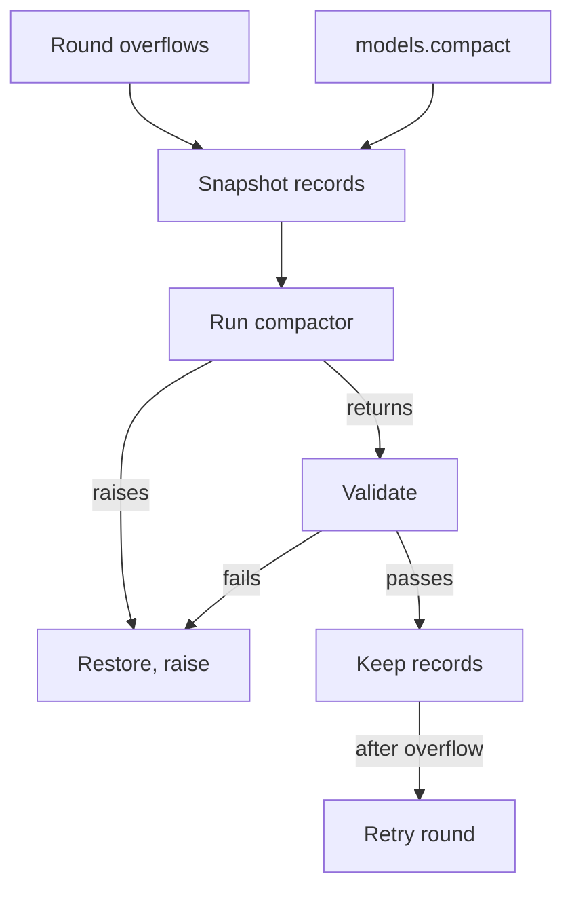

# One conversation per section

Paths: `lua/` is `crates/runvil-internal/lua/src/` and `engine/` is `crates/runvil-internal/engine/src/`. A test file named with no directory is an Engine test under `engine/execute/tests/`. Guide chapters are in `runvil-docs` `src/language/`.

<product-contract>

## Product Requirements

Today a section can build any number of message lists, and every `models.loop` round rebuilds its tool list from the section's offers. After this plan each section has exactly one conversation, `messages`, created by the Engine with the section's VM. Its tool list is fixed at its first loop round, compaction is the one place history is rewritten, and records can hold metadata the model never sees.

- Problem:
  - Several lists per section make it unclear which list owns the tool list, or whether an offer between two loops is a change.
  - A tool list rebuilt every round can change the request prefix mid-conversation, which discards the provider's prompt cache.
  - Compaction has no working path: `compactors.fail` is the only policy, and a compactor that returns raises.
- Users: prompt authors, compactor authors, Pack and tool authors whose tools may receive records, and the Workshop chat agent (`crates/workshop/agents/agents/chat.md`).
- Goals: the Functional Specification below, with both repositories' docs matching the finished code. Non-goals are under Deferred and Out of Scope.
- Success criteria: every acceptance criterion is pinned by a test, every gate passes after each `runvil` commit, the completeness searches and the docs sweep come back clean, and the language guide builds.
- Constraints:
  - No backward compatibility and no noticing of old forms, anywhere: no guiding errors, compatibility paths, or migration notes in code, tests, or docs.
  - Error and status messages are written for a model to read: concise, factual, self-contained, and naming what is missing or unmet.
  - The Lua crate (`crates/runvil-internal/lua`) cannot depend on the Engine crate (`crates/runvil-internal/engine`).
  - JSON that reaches a recorder or a replay comparison must round-trip exactly.
  - `node --test crates/workshop/ui/test/docs-claims.mjs` enforces the wording rules. Every edit to an `AGENTS.md` or an `## Invariants` crate doc must pass it, and so must every `.rs`, `.md`, `.lua`, `.toml`, and `.txt` line under `crates/runvil` and `crates/runvil-internal`, code and test strings included: no "host" or "workshop" in any case, no lowercase "harness", no "Harness-", and no "RunHarness". That covers test prompts that copy the Workshop chat agent's shape.
  - No Rust file may pass 500 lines, or `crates/build-ceiling/src/lib.rs` fails the build. A split makes private child modules only, laid out by the flat-directory rule in `AGENTS.md` (line 69), and widens nothing to compile. Close to the limit at `aca75013f`: `lua/messages.rs` (441 lines), `lua/prelude-tests.rs` (433), `lua/compactors-tests.rs` (432), `lua/error-value.rs` (428), `lua/globals-tests.rs` (416), and `lua/models_loop/machine-tests.rs` (411).
  - Language guide house rules: a single dash, never an em dash or a double dash; four-backtick code fences; one line per paragraph.
  - Every `runvil` commit passes the gates on its own. Nothing is pushed.
- Open questions: none.

## Functional Specification

The Lua surface a section sees after the change, its rules, its error texts, and the acceptance criteria the tests pin.

- The surface:
  - `messages`, the section's `MessageList` userdata:
    - builders `system(content, meta?)`, `user(content, meta?)`, `assistant(content, tool_calls?, meta?)`, and `tool(content, tool_call_id, meta?)`. Docs show `assistant(content, nil, meta)` for a reply with no tool calls, because a table in the second place is read as `tool_calls`;
    - `append(record)`, where a record table may hold `role`, `content`, `tool_calls`, `tool_call_id`, and `meta`;
    - `replace(first, last, records...)`, which replaces an inclusive range and works only while a compactor runs;
    - `#messages`, `messages[i]`, `pairs`, and `ipairs`, which read records as read-only views. A view reads those five fields, and its JSON form includes `meta`;
    - `messages.new` reads nil like any other non-integer key, so calling it fails with Lua's own error.
  - `models.loop(compactor?)` and `handle:loop(compactor?)`. An omitted compactor means `compactors.fail`.
  - `models.compact(compactor, reason)`, where `reason` is any string. It returns nothing.
  - `compactors.fail(reason)` raises `context_exhausted` with any reason string. `compactors.clear` removes every record and leaves the rendered tool list attached.
  - `tools.offer`, `packs.offer`, and `tools.offer_local` work only before the section's tool list is rendered.
  - To the model, wire messages hold only `role`, `content`, `tool_call_id`, and `tool_calls`, and every round after the first sends the same tool schemas, byte for byte. In the run log, each Chat record holds `after`, `keep`, and the wire messages after `keep`, so a change to `meta` alone adds nothing.
- Lifetimes: every section entry gets a fresh, empty list. That covers walked sections, each `jump` target, `call` chains, task chains, fan-out arms, and the H1 pass, whose list drops with its VM. A `require`d library sees the requiring section's list. History clears with the section by design, and `models.compact(compactors.clear, reason)` starts over without leaving it.
- Rules:
  - **The conversation.** `messages` keeps its identity for the section's whole life, compactions included. Assigning the global raises, and so do assigning by index and writing to a view.
  - **One loop at a time.** A `models.loop` or `handle:loop` started while a loop or a compactor runs in the same section raises kind `lua`, whether it starts from a local tool's handler, an overflow compactor, or a manual compactor. A loop after an earlier loop returned or raised runs normally. `models.infer` and `tools.call` stay allowed inside handlers and compactors.
  - **The rendered tool list.** The first `models.loop` or `handle:loop` round that builds its tools renders them, before the projection and the precheck, so a first round the precheck refuses still fixes the list.
    - A round refused before the build renders nothing, so a later offer still works: a round over an empty `messages`, a section with no model, a round cap of 0, and a build that fails.
    - Every later round, the retry after a compaction and rounds on another model included, sends the same schemas, and the scope gate checks calls against the same names.
    - After the render, every call to the three offer functions raises, even one identical to an earlier offer. A first round with nothing offered fixes an empty list.
    - The list is attached to `messages`, so it lasts exactly as long as the section, and compactions, restores, and `compactors.clear` never detach it. It holds the schemas and each advertised name's catalog tool. Once shaped Packs, the dynamic set, and the discovery tools exist, it also holds the shape mapping, a dynamic-set snapshot, and whether the discovery tools are present.
    - It is called "the rendered tool list", because "tool catalog" names the run-wide set (`12-tools.md`, lines 101-129).
  - **Record metadata.** `meta` is any JSON-representable value whose compact JSON (`serde_json::to_string`) is at most `MAX_RECORD_META_BYTES`, 8192 bytes to start. It is set only when a record is added or replaced, converts from Lua like every other record field, and `json.null` means none. Records the loop adds hold none, and a refused record leaves the list unchanged.
  - **Compaction** starts when a loop round overflows, at the precheck or in a provider's context-overflow reply, or when the section calls `models.compact` outside any loop:
    1. The Engine snapshots the records, one `Arc` per record, and leaves the send state and the rendered tool list alone.
    2. It sets the list's `compacting` flag and calls `compactor(reason)`, with `"precheck"` or `"provider"` after an overflow and the caller's string for `models.compact`.
    3. The compactor edits `messages` in place: it reads views, rewrites with `replace`, and may use the builders, `append`, `models.infer`, and `tools.call`. `models.loop` and `models.compact` raise inside it.
    4. If it raises, the Engine restores the snapshot, clears the flag, and raises the compactor's failure. A tool's side effects are not undone.
    5. If it returns, the Engine clears the flag and validates. The structural rules are the projection's cross-record rules and always apply: each tool-call batch is answered right after it, call ids are unique, no tool record is an orphan, system records lead, and a composed system block holds only text. Breaking one raises kind `lua`. The size rules apply only after an overflow: the token estimate must fall below the snapshot's, and the retried round must pass the precheck. Breaking one raises `context_exhausted` with the overflow's reason. Every failure restores the snapshot first.
    6. On success, `messages` stays the same object and holds the compacted records.
    7. After an overflow, the loop retries the round without counting it against `max_tool_iterations`. A round compacts at most once, so a retry that overflows again restores the snapshot and raises `context_exhausted`. The snapshot is kept until the retried round's answer arrives and dropped on any other answer, so a retry that fails another way, such as an empty list after `compactors.clear`, a provider error, or a stop, keeps the compacted records.
  - An empty list after `compactors.clear` is allowed. The next round fails with `messages must not be empty` unless records are added first.



- Examples. The last is a summarizing compactor for the docs and the tests: it keeps the system block and the last two user turns and summarizes the rest into one user record, cutting on a user record so no tool-call batch is split. With fewer than two user turns, it summarizes everything after the system block.

```lua
models.compact(compactors.clear, "manual compaction")
models.compact(function(reason) messages:replace(#messages, #messages) end, "drop the failed reply")

local function compact(reason)
  local first = 1
  while messages[first] and messages[first].role == "system" do
    first = first + 1
  end
  local cut, turns = #messages + 1, 0
  for i = #messages, first, -1 do
    if messages[i].role == "user" then
      turns = turns + 1
      if turns == 2 then cut = i break end
    end
  end
  if cut == first then return compactors.fail(reason) end
  local lines = {}
  for i = first, cut - 1 do
    lines[#lines + 1] = messages[i].role .. ": " .. json.encode(messages[i].content)
  end
  local summary = models.infer("Summarize this conversation:\n" .. table.concat(lines, "\n"))
  messages:replace(first, cut - 1, {
    role = "user",
    content = "Summary of the earlier conversation: " .. summary,
    meta = { summary = true },
  })
end

models.loop(compact)
```

- Errors. Each is raised at the author's call, has kind `lua` unless stated, and can be caught with `pcall`. The wording follows the existing refusal style and has not been reviewed yet.
  - From commit 1, `LOOP_RUNNING`: `a loop or a compactor is already running in this section; ask a side question with models.infer(prompt)`
  - From commit 2:
    - assigning the global (`messages::ASSIGNMENT_REFUSAL`): `messages is the section's conversation and cannot be reassigned; change it with append(record) or replace(first, last, records...)`
    - assigning by index: `messages cannot be assigned to by index; add records with append(record) and change them with replace(first, last, records...)`
    - writing to a view: `records read from messages are read-only; change messages with replace(first, last, records...)`
    - `HANDLE_FIRST`: `models.loop takes (compactor?); call handle:loop(compactor?) to run on a model handle`
    - `LOOP_ARITY`: `models.loop takes (compactor?)`
    - `NO_RECEIVER`: `call loop on a model handle with a colon: handle:loop(compactor?)`
    - `METHOD_ARITY`: `handle:loop takes (compactor?)`
    - a non-function compactor keeps `compactor must be a function, got {type}`. The loop checks the receiver, then the arity, then the compactor's type, then whether a loop or a compactor is running.
  - From commit 3, an offer after the render, raised before any other check of that call: `tools.offer: the section's tool list is fixed at its first models.loop round; make every offer before the first loop, or offer in another section`, with the same tail after `packs.offer:` and `tools.offer_local:`.
  - From commit 4:
    - a builder given a `meta` that isn't JSON-representable: `messages[{index}] meta must be JSON-representable: {reason}`. `append` and `replace` convert the whole record table first, so they keep `messages[{index}] must be a JSON-representable message table: {reason}`;
    - a `meta` that is too large: `messages[{index}] meta is {size} bytes as JSON; the limit is 8192 bytes`.
  - From commit 5, `context_exhausted` reads `context exhausted: {detail}`. The detail is today's text for `precheck` (`the request precheck overflowed the model's context window`) and `provider` (`the provider rejected the request as exceeding the model's context window`), and the reason itself otherwise. The error's `reason` field holds the reason string.
  - From commit 6:
    - `COMPACT_RUNNING`: `models.compact cannot start while a loop or a compactor is running in this section`
    - arguments: `models.compact takes (compactor, reason)`, `compactor must be a function, got {type}`, and `reason must be a string, got {type}`
    - a failed structural rule raises the projection's existing refusal, and a failed size rule raises `context_exhausted` with the overflow's reason.
  - From commit 7:
    - `replace works only inside a compactor; rewrite history with models.compact(compactor, reason)`
    - `compactors.clear works only inside a compactor; empty messages with models.compact(compactors.clear, reason)`
    - the three commit 2 texts become `messages is the section's conversation and cannot be reassigned; add records with append(record), or rewrite history with models.compact(compactor, reason)`, `messages cannot be assigned to by index; add records with append(record), or rewrite history with models.compact(compactor, reason)`, and `records read from messages are read-only; rewrite history with models.compact(compactor, reason)`;
    - `ListEditError::LateSystem`, which ends `so change the leading block with replace(first, last, records...)` today, becomes `messages[{index}] is a system message after a non-system message; system messages lead the list, and only a compactor can change the leading block`.
  - `messages must not be empty` stays. `NOT_A_LIST` and `COMPACTOR_RETURNED` go. A chat request whose `messages` field is not a list becomes a malformed yield, because only the Engine builds that field.
- Privacy and recovery:
  - `meta` never reaches the model, because the projection builds wire messages from the four contract fields. Lua and tools see it, and a view passed as tool arguments records its `meta` with the call, under the round-trip rule.
  - The sandbox has no `rawset`, `rawget`, or debug library, so author code cannot get past the `_G` guard.
  - A failed compaction leaves `messages` as it was before, and a refused edit leaves it unchanged. The Workshop chat agent wraps `models.loop` in `pcall`, so a failed compaction ends only the turn.
- Acceptance criteria:
  - The list: one per section, created only by the Engine with the VM. Two reads are `rawequal`, it starts empty, and Lua reaches no other list. After a `jump`, and in each task chain, fan-out arm, and `call`ed section, it is a different, empty list. A `call` leaves the caller's records unchanged, the first section starts empty after H1 ran `models.loop`, and a `require`d library reads the requiring section's list.
  - Assigning the global raises, and the list still reads afterwards. Assigning by index raises its own refusal.
  - Both loop entries take only `(compactor?)`, with the texts and check order above.
  - A loop started from a local tool's handler or a compactor while a loop or a compactor runs raises `LOOP_RUNNING`. A loop after an earlier loop returned, or raised under `pcall`, runs, and so does a handler's loop when `tools.call` reaches it outside any loop.
  - The rendered tool list:
    - it is fixed at the first round, even when the precheck refuses that round, and every later request sends the same tool bytes, across a compaction and a model change;
    - after the render, each offer function raises, including an identical re-offer, a repeated local alias, an offer from a `require`d library, and one from a handler during a loop;
    - with nothing offered at the first round, a later offer raises; a first round refused over an empty `messages` renders nothing, and a later offer works;
    - a compaction, a restore, and `compactors.clear` leave it attached, so a later offer still raises, and one section's render never reaches another.
  - `models.infer` sends no tools and leaves `messages` untouched, before and after the render.
  - `meta`:
    - it never reaches the model;
    - each builder's last argument and a `meta` field given to `append` or `replace` set it, `messages[i].meta` reads it, `pairs` visits it, and a view passed to a tool or to `append` keeps it;
    - exactly 8192 bytes of compact JSON is accepted, one more is refused, a value that isn't JSON-representable is refused, a refused record leaves the list unchanged, and `json.null` means none;
    - a replacement that differs only in `meta` adds nothing to the next Chat record.
  - Compaction:
    - a reference to `messages` from before a compaction is the same object and reads the compacted records, and a view from before still reads its original record;
    - each broken validation rule raises its error and restores the records;
    - a compactor that raises, after editing or not, restores the snapshot and raises its failure, and `compactors.fail` raises `context_exhausted` with its reason;
    - an uncaught `context_exhausted` with a caller's reason ends the run as `ContextExhausted`, and its message holds that reason;
    - a compactor that calls `models.infer`, edits with `replace`, and returns lets the retried round succeed, even with `max_tool_iterations` set to 1. A retry that overflows again restores the snapshot and raises `context_exhausted`, and one that fails another way keeps the compacted records;
    - a compactor that calls `tools.call` gets the tool's result;
    - replaying a run that compacted, with the Plugins unloaded, reproduces every request the model saw.
  - `models.compact(compactors.clear, "manual compaction")` empties `messages`, and a later `messages:user(text)` and `models.loop()` run normally. `models.compact` raises while a loop runs, a handler's call included, and inside a compactor. The size rules don't apply to it, but the structural rules do.
  - `replace` and `compactors.clear` raise outside a compactor and work inside one, whether an overflow or `models.compact` started it.

</product-contract>
<implementation-contract>

## Technical Design

The VM owns its one `MessageList`, which the `_G` guard serves from an Engine-owned slot and the loop reads from there. Two flags hold the section's state, `loop_running` on the VM and `compacting` on the list. The rendered tool list is attached to the list, and `MessageList::rendered()` reports whether one is attached, so the render needs no flag. Compaction reuses the loop's state machine and the `drive` trampoline, and validates through the existing projection and precheck estimate.

- The list is created in `SectionVm::new` and installed at injection as one userdata in the guard's slot table, the way `prose` is served. It is never a raw global, so an assignment reaches the guard's `__newindex` and raises.
- `loop_running` is set once `begin` can no longer fail, after the step closure and the first action are built, and only when that action leaves the machine running. The step closure clears it when the machine reaches `Done`, before it builds the action, and when it returns an error. Every compactor and handler outcome returns through the step under the trampoline's raw `pcall`, so no exit skips the clear, and a failure caught under `pcall` never leaves a flag set.
- `compacting` is set around every compactor call and cleared when the compactor returns or raises. `begin` refuses while it is set, `compact_begin` refuses while either flag is set, and from commit 7 `replace` and `compactors.clear` raise unless it is set.
- The rendered tool list sits in the list's state beside the send state, so it lasts exactly as long as the section's VM. It is not kept on the chain, because `chain.advertised` outlives section entries: it is reset only at chain creation (`engine/execute/scheduler/chain.rs`, line 128). Each round copies the attached map into `chain.advertised`, so the scope gate is unchanged. The map holds each name's `Option<ToolId>`, the exact value the gate passes to `ToolCallEvent::with_tool`, so `DispatchTarget` is removed instead of moved.
- Compaction runs in the loop's `Compacting` phase, and for `models.compact` in a new `compact_begin` driven by the same `drive` trampoline, because a compactor may suspend for `models.infer` or `tools.call`. The structural rules go through `project_messages`, and the shrink rule compares `estimate_tokens` over the projected records before and after. The machine keeps the snapshot from the overflow until the retried round's answer arrives. While it holds one, the round has compacted, so a second overflow restores and raises.

### Declarations

New and changed items by commit, with bodies elided and unchanged parts shown as `// ...`. The error texts are under Errors.

Commit 1, the loop-running flag:

```rust
// lua/vm.rs
pub struct SectionVm<S = Injected> {
    // ...
    /// Set while a `models.loop` or `handle:loop` runs on this VM.
    loop_running: Arc<AtomicBool>,
}

// lua/coro.rs
pub(crate) fn install_shim_prelude(
    lua: &Lua,
    max_tool_iterations: usize,
    local_handler_depth: &Arc<AtomicU32>,
    loop_running: &Arc<AtomicBool>,
    instruction_budget: &InstructionBudget,
) -> Result<()>;

// lua/models_loop.rs
pub(crate) fn loop_begin(
    lua: &Lua,
    max_tool_iterations: usize,
    compactors: Table,
    loop_running: &Arc<AtomicBool>,
    budget: &InstructionBudget,
) -> Result<Function>;
```

Commit 2, one list per VM. `is_list`, the `new` constructor, and `NOT_A_LIST` go, and `begin` reads the list through `globals::messages`:

```rust
// lua/vm.rs
pub struct SectionVm<S = Injected> {
    // ...
    /// The section's one conversation, served as the `messages` global.
    messages: MessageList,
}

impl<S> SectionVm<S> {
    pub fn messages(&self) -> &MessageList;
}

// lua/messages.rs
pub(crate) const ASSIGNMENT_REFUSAL: &str = /* under Errors */;
/// Installs `list` as the `messages` global, served from the guard's slot.
pub(crate) fn install_messages(lua: &Lua, list: &MessageList) -> Result<()>;

// lua/globals.rs
pub(crate) fn install_messages(lua: &Lua, list: AnyUserData) -> Result<()>;
pub(crate) fn messages(lua: &Lua) -> Result<AnyUserData>;
```

```lua
-- lua/__impl_globals.lua
local globals, state, refuse_argv, refuse_prose, refuse_messages = ...
```

Commit 3, the rendered tool list. `DispatchTarget` goes:

```rust
// lua/scope.rs, exported from lua/lib.rs for the Engine
/// The tool list a section's first loop round rendered.
#[derive(Debug, Clone)]
pub struct RenderedTools {
    /// The schemas every round of the section sends.
    pub schemas: Vec<ToolSchema>,
    /// Each advertised name's catalog tool, `None` for a local tool.
    pub dispatch: BTreeMap<String, Option<ToolId>>,
}

// lua/messages.rs
struct ListState {
    records: Vec<Arc<MessageRecord>>,
    last: Option<(RoundId, Vec<Message>)>,
    /// Attached at the first successful build and never detached.
    rendered: Option<RenderedTools>,
}

impl MessageList {
    /// Whether a rendered tool list is attached; no list means false.
    pub fn rendered(&self) -> bool;
    pub fn rendered_tools(&self) -> Option<RenderedTools>;
    /// The Engine calls this only on a list with none attached.
    pub fn attach_rendered_tools(&self, tools: RenderedTools);
}

// lua/tools.rs and lua/packs.rs: the offer closures capture `list`
pub(crate) fn install_tools(
    lua: &Lua,
    globals: &Table,
    set: &Arc<ToolSet>,
    runtime: &Arc<Mutex<ToolRuntime>>,
    local_tools: &LocalTools,
    list: &MessageList,
) -> Result<()>;
pub(crate) fn install_packs(
    lua: &Lua,
    globals: &Table,
    set: &Arc<ToolSet>,
    runtime: &Arc<Mutex<ToolRuntime>>,
    list: &MessageList,
) -> Result<()>;

// engine/execute/scope.rs, with prepare_scoped_tools returning the same type
pub(super) fn prepare_effective_scope(
    bindings: &[ToolBinding],
    local_schemas: &[ToolSchema],
    emitter: &Emitter,
    section: &str,
) -> Result<RenderedTools>;

// engine/execute/scheduler/chain_record.rs
pub(super) struct Chain {
    // ...
    pub(super) advertised: Option<BTreeMap<String, Option<ToolId>>>,
}
```

Commit 4, record metadata:

```rust
// lua/protocol/record.rs
pub(crate) const MAX_RECORD_META_BYTES: usize = 8 * 1024;

#[derive(Debug, Clone, PartialEq, Eq)]
pub struct MessageRecord {
    pub role: RecordRole,
    pub content: MessageContent,
    pub tool_calls: Vec<ToolCallRecord>,
    /// Metadata the projection never sends; `None` when absent or JSON null.
    pub meta: Option<serde_json::Value>,
}

// lua/messages-view.rs
const FIELDS: [&str; 5] = ["role", "content", "tool_calls", "tool_call_id", "meta"];
```

Commit 5, the string reason. The Engine's `Error::ContextExhausted` (`engine/error.rs`) changes the same way:

```rust
// lua/error.rs
#[error("context exhausted: {}", exhaustion_detail(reason))]
ContextExhausted {
    /// `precheck` or `provider` after an overflow, else the caller's reason.
    reason: String,
},

// lua/compactors.rs, exported for the Engine
/// An overflow tag's description, or any other reason as given.
pub fn exhaustion_detail(reason: &str) -> Cow<'_, str>;

// lua/error-value.rs, replacing `overflow_reason`
impl Raised {
    pub fn exhaustion_reason(&self) -> Option<&str>;
}

// engine/error/convert.rs, in `from_raised`
runvil_lua::ErrorKind::ContextExhausted => match raised.exhaustion_reason() {
    Some(reason) => Error::ContextExhausted { reason: reason.to_owned() },
    None => Error::Lua(raised.message),
},
```

Commit 6, compaction:

```rust
// a private child module of lua/messages.rs
/// The records a compaction started from.
pub(crate) struct Snapshot(Vec<Arc<MessageRecord>>);

impl MessageList {
    pub(crate) fn snapshot(&self) -> Snapshot;
    /// Puts the records back; the send state and the rendered tool list stay.
    pub(crate) fn restore(&self, snapshot: Snapshot);
    /// Removes every record; the send state and the rendered tool list stay.
    pub(crate) fn clear(&self);
    pub(crate) fn compacting(&self) -> bool;
    pub(crate) fn set_compacting(&self, compacting: bool);
}

struct ListState {
    // ... commit 3's fields
    compacting: bool,
}

// lua/models_loop/machine.rs
pub(super) struct Machine<V> {
    // ...
    /// The records from before this round's compaction, held until the
    /// retried round's answer arrives. Set means the round has compacted.
    snapshot: Option<Snapshot>,
}

// lua/models_loop.rs
pub(crate) fn compact_begin(
    lua: &Lua,
    loop_running: &Arc<AtomicBool>,
    budget: &InstructionBudget,
) -> Result<Function>;

// lua/compactors.rs
pub(crate) fn install_compactors(lua: &Lua, globals: &Table, list: &MessageList) -> Result<()>;
pub(crate) fn estimate_tokens(messages: &[Message]) -> u64; // was private
```

```lua
-- lua/__impl_coro.lua: `compact_begin` joins the chunk arguments after `loop_begin`
local function models_compact(...)
  return drive(compact_begin(...))
end
```

Commit 7 adds no declarations. The Lua `replace` method and `compactors.clear` check `compacting()`, and Lua-crate tests that exercise `replace` call `set_compacting(true)` first.

- Run log and replay:
  - The run log stays linear. `commit` compares each request with the list's last send by content, and snapshots, restores, and `compactors.clear` never touch that send state. After a compaction the retry logs the compacted suffix once, then rounds log only their new messages again. The summarizing `models.infer` logs the old turns once, as its prompt.
  - Replay needs no new run-log entry: the Chat records rebuild every request through `after` and `keep`, and a compaction is Lua plus recorded `models.infer` and tool results.
  - Copies: `replace` keeps the records outside its range as the same `Arc`, but every value given to `append` or `replace`, views included, is converted, revalidated, and wrapped anew. `to_records` and the projection each clone every record per round, so `meta` can cost 16 KB per record per round.
- Public API: the facade lists only the unit `RunErrorKind::ContextExhausted` (`crates/runvil/public-api.txt`, line 849) and none of the changed Lua-crate items, so `xtask api --check` should pass unchanged. If it doesn't, re-bless the listing in the same commit. Doc text on facade items still changes, such as `Effect::Chat::after` (`engine/execute/run/effect.rs`, lines 106-108).

### Code facts at the start

`runvil` is at `aca75013f` and `runvil-docs` at `62ae759`, both clean. These are the facts about today's code that the steps rely on without restating.

- **One setup path.** Every section entry builds a fresh VM through `setup_section_vm` (`engine/execute/section_vm.rs`, lines 114-149) and a new frame (`engine/execute/scheduler/walk.rs`, lines 146-173). H1 hands off to a new root chain, and its freeze keeps only `var` and `argv` (`engine/execute/scheduler/h1.rs`, lines 73-125). `SectionVm::new` installs the `_G` guard first. Injection (`install_values`, `lua/vm/inject.rs`, lines 107-152) then installs `tools`, `packs`, `models`, `messages` (line 150), and `compactors`, followed by the coroutine shims, `install_section_loop_shim` (`lua/coro.rs`, lines 321-335), the Pack preludes, and `require`.
- **The guard** serves `argv` and `prose` from a registry slot table (`lua/globals.rs`; `lua/__impl_globals.lua`, lines 36-70), and `messages` follows that pattern. `RESERVED_NAMES` already lists `messages`.
- **The list** is an `Arc<Mutex<ListState>>` holding the records and the last send (`lua/messages.rs`, lines 55-96). `commit` (lines 173-187) compares each request with the last by content to give the Chat record's `after` and `keep`, and a round the precheck refuses is never committed. A view is `RecordView(Arc<MessageRecord>)` (`lua/messages-view.rs`, lines 18-28). `lua/projection.rs` checks the cross-record rules and strips every field but the four contract fields.
- **The loop** is a step closure over a `Machine` (`lua/models_loop.rs`, `lua/models_loop/machine.rs`), driven by `drive` (`lua/__impl_coro.lua`, lines 227-245). `drive` runs every handler and compactor under the raw `pcall` and passes the outcome back to the step, and a Workshop stop arrives as a failed chat answer, so every exit passes through the step. A compactor can already call `models.infer` and suspend (`models_loop_contract.rs`, lines 276-299).
- **Tools.** `prepare_chat` (`engine/execute/scheduler/chat.rs`, lines 95-168) refuses an empty list and resolves the model before it builds the scope with `prepare_effective_scope` (`engine/execute/scope.rs`, lines 36-53). That function emits the `TOOL_SCOPE_VALIDATION_*` events and returns the schemas and a `BTreeMap<String, DispatchTarget>`. `DispatchTarget` is `Bound(ToolId)` or `Local`, and its only reader (`chat.rs`, lines 337-340) turns it into the `Option<ToolId>` that `ToolCallEvent::with_tool` takes. `tools.offer` and `packs.offer` skip duplicates silently, `tools.offer_local` refuses a repeated alias, and `models.infer` sends no tools (`engine/execute/scheduler/dispatch.rs`, lines 240-247).
- **Context exhaustion.** Both crates hold the reason as an `OverflowReason` (`lua/error.rs`, lines 132-142; `engine/error.rs`, lines 379-384). `from_raised` (`engine/error/convert.rs`, lines 314-316) reads a raised table's reason through `Raised::overflow_reason` (`lua/error-value.rs`, lines 288-296), which parses only the two tags and turns any other reason into `Error::Lua`, with no compile error to flag it.
- **Footprint.** 53 test, helper, and bench files hold 151 `messages.new(` lines: Lua crate 26, Engine 115, Harness 2, runner 5, gateway client 1, and Workshop server 2. 32 Lua `replace` calls sit in seven test files. Six of the 13 `MessageRecord` literals name every field. No shipped or fixture prompt offers after a loop, and the only nested loop is in `batch_turn.rs`.
- **The guide.** `runvil-docs` has no CI of its own: `runvil`'s `cargo xtask site` stages it from `RUNVIL_DOCS` and builds it with mdBook. Chapter 11 has about 70 constructor lines, chapter 12 has 23 (lines 340 to 2359), and chapter 15 has 15, twelve in examples from 2072 to 2582. Inbound links to headings the rewrite touches: `#editing-a-list-with-replace` 6, `#compactors-and-context-exhaustion` 12, `#choosing-a-compactor-for-a-call` 4, and `#trimming-the-list-after-an-overflow` 1.

</implementation-contract>
<verification-contract>

## Testing Plan

Each commit ships the tests for its behavior. Lua-crate unit tests pin the list, the guard, the builders, `meta`, `rendered()`, and the argument checks; Engine tests pin the section lifecycle, loops, the rendered tool list, and compaction; and the Workshop gates pin the chat agent's long conversation.

- Where tests go:
  - Lua crate: the `lua/messages-tests*.rs` files, `lua/globals-tests.rs`, `lua/prelude-tests.rs:316` (`argv_and_prose_collide_though_the_g_metatable_serves_them` adds `messages`), `lua/models_loop/tests.rs`, `lua/protocol/tests/parse_chat.rs`, and `lua/projection-tests.rs`, with new child test files wherever a file would pass 500 lines.
  - Engine: a new `section_messages.rs`, `batch_turn.rs`, the `models_loop*.rs` files, the offering files, `precheck_anchor*.rs`, and a replay test for a compacting run built on `assert_rebuilds` in `chat_record_rebuild.rs`.
  - `engine/lua/tests/globals.rs` passes unchanged, because it reads each reserved name through the guard, and `suite/global_metatable.rs` (lines 87-88) adds `messages` beside `argv` and `prose`.
  - After migration: `crates/harness/tests/suite/`, `crates/harness-internal/runner/tests/it/`, `crates/runvil/tests/suite/shipped.rs` (which runs `prompts/research-person.md`), and the Workshop gates in `crates/workshop/server/tests/it/chat_gate/`. There, `canonical_sequence.rs` checks that one history accumulates byte for byte, `overload.rs` checks that a stop mid-generation reaches the loop as a failed answer, so the flag clears and the next turn loops, and `recovery.rs` checks that the run keeps its list across a lost selection.
- Must keep passing unchanged: `offering.rs` at lines 138, 260, and 293; `crates/runvil/tests/suite/shipped.rs:44-48`; `effects.rs:60-87`; `offering-packs.rs:18-87`, where section B advertises `[]` after section A rendered three tools; `a_later_bound_result_reports_the_batch_turn_after_a_handler_infers` in `batch_turn.rs`; and `parallel_tool_calls.rs:201-238`, with `advertise_for_test` unchanged.
- Benches: `message_building` in `crates/runvil-internal/lua/benches/surface.rs` builds a fresh VM per iteration, outside the measured time, and `LOOP_PROMPT` in `crates/runvil-internal/engine/benches/models_loop.rs` is migrated.
- Exit criteria:
  - After each of the eight `runvil` commits, these pass:
    - `cargo fmt --all --check`;
    - with `CARGO_BUILD_WARNINGS=deny`: `cargo clippy --workspace --exclude workshop --exclude workshop-server --exclude workshop-server-api --all-targets --all-features` and `cargo clippy -p workshop -p workshop-server -p workshop-server-api --all-targets`;
    - `cargo check -p gateway --no-default-features`;
    - `cargo nextest run --locked --workspace --exclude workshop --exclude workshop-server --exclude workshop-server-api --all-features` and `cargo nextest run --locked -p workshop -p workshop-server -p workshop-server-api`;
    - with `RUSTDOCFLAGS="-D warnings"`: `cargo doc --workspace --no-deps --all-features --exclude workshop --exclude workshop-server --exclude workshop-server-api`, `cargo doc -p runvil --no-deps`, `cargo doc -p harness --no-deps`, and `cargo doc --locked --no-deps --all-features -p runvil-engine --document-private-items` (`.github/workflows/ci.yml`, line 138);
    - at the Rust floor in the root `Cargo.toml` (`rust-version = "1.95"`), as CI's `msrv` job runs it: `cargo +1.95 build --locked -p runvil -p runvil-engine -p runvil-lua -p runvil-parser -p runvil-types -p runvil-vfs -p runvil-model-client`;
    - `cargo test -p build-xtask` and `node --test crates/workshop/ui/test/docs-claims.mjs`;
    - `xtask api --check`, through `cargo +` with the nightly pinned in `crates/build-xtask/src/api/toolchain.rs`, with `CARGO_BUILD_WARNINGS` unset (`Remove-Item Env:CARGO_BUILD_WARNINGS -ErrorAction SilentlyContinue` in PowerShell).
  - Completeness searches over `runvil`, excluding `vibe/` and `target/`:
    - after commit 2: `messages\.new`, `NOT_A_LIST|is_list\(`, and `\(messages, compactor\?\)` print nothing;
    - after commit 3: `Rebuilt at each model operation` and `DispatchTarget` print nothing;
    - after commit 6: `COMPACTOR_RETURNED|returned without raising` prints nothing, since the old text is split across source lines;
    - after commit 7: every Lua `:replace(` and `compactors.clear` left in the crates runs inside a compactor, checked by hand.
  - After commit 8, the docs sweep finds no passage that contradicts the finished behavior.
  - In `runvil-docs`:
    - `messages\.new` appears nowhere, every remaining `models.loop(` and `:loop(` argument is a compactor, and every remaining `msgs` names a variable its own example defines, the last two checked by hand;
    - the anchor check: before the rewrite, list every heading in the edited chapters with its slug. After it, `git grep -n -F "#<old slug>" -- src` prints nothing for each renamed heading, and every link to a new slug names a heading that exists. The site build skips `#` links and drops fragments (`crates/build-xtask/src/site.rs`, lines 73 and 428), so only this check catches a broken anchor;
    - with `RUNVIL_DOCS` set to the checkout (`$env:RUNVIL_DOCS` in PowerShell) and mdBook on `PATH` (or `MDBOOK` naming it), `cargo xtask site --books-only` in `runvil` builds and its link check passes.

</verification-contract>
<decision-record>

## Decision Record

Vinnie Falco made every call below on 2026-10-20 and 2026-10-21. The direction is one conversation per section, no compatibility with old forms, and every rewrite of history through an explicit compaction.

- Decisions:
  - **One `messages` per section, created with the VM, with no constructor, and H1 gets its own.** "messages is no longer constructible"; "a new messages object is injected into every VM"; "the whole point of Runvil is that sections clear the history! if someone wants history preserved, they stay in the section".
  - **The `_G` guard owns the global, and assignment raises,** reusing the guard that owns `argv` and `prose`.
  - **No backward compatibility or noticing of old forms, anywhere.** "messages.new should not raise an error. NO BACKWARD COMPATIBILITY or noticing, anywhere".
  - **`models.loop(compactor?)`, and `handle:loop(compactor?)` stays.** The list argument had one legal value. "The api should be models.loop(compactor?)".
  - **A loop started while a loop or a compactor runs is refused,** because its records would land before the outer batch's.
  - **The tool list renders once, at the first loop round, in this plan,** which keeps the provider's prompt cache. **Any offer after the render is an error, even an identical one, `tools.offer_local` included.** "ANY call to tools.offer or packs.offer after a render should be an error. dont care if its the same."
  - **The rendered tool list holds the schemas and the dispatch map,** and later the shape mapping, the dynamic-set snapshot, and the discovery flag.
  - **It is attached to `messages`, and `MessageList::rendered()` reports whether one is attached, with no separate flag.** "a "rendered" flag is unnecessary. We can just add Messages.rendered() returning a bool, and it checks if there is a rendered catalog attached to the messages object. No catalog means false."
  - **The dispatch map holds an `Option<ToolId>` per name, and `DispatchTarget` is removed,** because its only reader turned it into `Option<ToolId>`. Vinnie asked whether "a plain string or an untyped piece of metadata" could replace the named type, and chose `Option<ToolId>`.
  - **Records hold `meta` that the model never sees,** because a compactor needs hints that survive in the list, and views have no stable identity. "we need this"; "JSON-representable. set the limit with a constant. 8KB to start"; "set only when a record is added or through replace"; "the prompt needs to be able see it and so do tools". The builders take it as a trailing argument too.
  - **Compaction happens in place, with a snapshot and restore,** one new part instead of a staging list's six. "I am leaning towards the compact-in-place", then "apply this yes".
  - **`replace` works only inside a compactor,** so the request prefix changes only at an explicit compaction. "what if we add replace to messages only inside a compactor call".
  - **`models.compact(compactor, reason)` and `compactors.clear`** let a section start over or rewrite its history without leaving it. "rename compactors.fresh to compactors.clear".
  - **The compaction rules:** `compactors.fail` takes any reason; a compactor may call `tools.call` ("a compactor may call tools.call"); after an overflow the result must pass the precheck and shrink the estimate; the retry is uncounted and a round compacts once; the structural rules always apply and the size rules only after an overflow; and a restore undoes every write ("Yes to the 4 small items").
  - **All of compaction lands in this plan.** "Is there any reason not to do all the compaction changes now? ... The AI is gonna do all the work anyway."
  - **Run-log entries at the first render and at each compaction are deferred.** "Step 6, leave it out. We have no debugger yet."
  - **The docs come last, in both repositories,** while doc comments on changed items move with their commits. "I want the docs in lockstep with the code". For guide examples with two lists in one section: drop the independent-lists example, copy fields into plain tables, and split loops with an offer between them into two sections.
  - **The execution review's defaults (2026-10-21):**
    - `compactors.clear` works only inside a compactor;
    - a round refused before the build renders nothing, and the list attaches only after a successful build;
    - the snapshot lives until the retried round's answer;
    - `json.null` means no `meta`, `meta` converts like the other fields, and `append` and `replace` keep their whole-table refusal;
    - the `context_exhausted` message keeps today's text for the two overflow tags;
    - the string reason lands as its own commit;
    - commits end with the `Plan:` trailer only, without `Design:`, `Repairs:`, or `Deferred:` lines.
- Rejected alternatives, each with when to revisit it:
  - A staging list that the compactor fills and returns, Vinnie's own 2026-10-20 design: `replace` had no role in it, every kept record was copied, and it needed six new parts. Revisit if a policy needs a clean list it cannot build in place.
  - `models.loop(messages, compactor?)`: the argument had one legal value. Never; a second option would go in an options table.
  - A guiding error on `messages.new`: it notices an old form. Never.
  - Removing `handle:loop`: conversations on a frozen binding need it. Revisit if handles lose their purpose.
  - A nested loop over the same list: its records land out of order. Never.
  - A harmless identical re-offer after the render. Revisit if a vendor API can append tools after the cached prefix without hurting accuracy.
  - `messages` as a plain Lua table: it cannot enforce the history rules, reports a bad record a round late, and revalidates every round. Never.
  - `models.messages`: the conversation is section state, and `models` has no write protection. Revisit if every Engine namespace gets it.
  - `section.messages`: one member is not worth a new global. Revisit when a second per-section value needs a home.
  - `meta` only through the record field: Vinnie chose the builder argument as well.
  - Requiring unchanged system records, or more than the system records, after a compaction: both reject `compactors.clear`. Never.
  - A second compactor call when the result still overflows: a compactor can loop inside itself. Revisit if real compactors need it.
  - Refusing `tools.call` inside a compactor: there is no failure to prevent. Revisit if a failed compaction's tool side effects cause harm.
  - Rewriting docs inside each code commit, beyond the doc comments on changed items.
  - `compactors.clear` anywhere: it would empty `messages` with no snapshot. Never.
  - A `rendered` flag on `ToolRuntime`, with the list on the Engine's section frame: one fact in two places. Never.
  - Moving `DispatchTarget` into the Lua crate: a named type for an optional id. Revisit if a target needs more than an id, such as a shaped tool's argument transform.
  - A plain string or untyped metadata for the target: a string needs a parse back to `ToolId`, with an error path for an impossible case and a sentinel for a local tool, and untyped metadata needs a downcast at every read. Never.
- Assumptions and risks:
  - Vinnie has not reviewed the error texts.
  - Commit 2 is large and lands whole, because removing the constructor breaks every test that builds a list.
  - Line numbers are at `runvil` `aca75013f` and `runvil-docs` `62ae759`, and drift as commits land.
  - mlua resolves registered methods before a custom `__index`, so `messages:user` works and `messages.new` reads nil.
  - The sandbox keeps `table.unpack`, though no Runvil test uses it yet.
  - The Lua-crate test VMs (`lua/test_vm.rs`) don't install the section loop shim, so they have no `models.compact`.
  - The precheck counts neither tool schemas nor image parts (`lua/compactors.rs`, lines 221-237). A list that passes can still overflow at the provider, which restores and raises, and a compaction that replaces an image with text raises the estimate and fails the shrink rule.
  - The guide still documents `tools.allow_tasks`, the model's task tools, and task notices, which `runvil` has removed.
  - The vendored `runvil` in `wg21-paperflow` follows at its next submodule bump. Paperweight only calls `models.infer`.

### Deferred and Out of Scope

- Deferred, each until its trigger:
  - run-log entries at the first render and at each compaction, until a debugger needs them;
  - a rule for Lua edits to `messages` from a handler mid-batch, which land before the batch's records, until one is decided;
  - Engine-attached `meta` on loop records, such as the round id and token counts, until a compactor needs token-aware policies;
  - reusing a view's `Arc` in `append` and `replace`, until compaction copying costs measurably;
  - counting tool schemas and image parts in the precheck, until retries overflow at the provider or image summaries fail the shrink rule;
  - the rendered tool list's shape mapping, dynamic-set snapshot, and discovery flag, until those features are built;
  - the guide's task-removal pass, as the next docs task.
- Out of scope: shaped Packs, the dynamic set, and the discovery tools; the vendored copy in `wg21-paperflow`; historical `vibe/` notes and `runvil-docs` `plans/`.

</decision-record>
<project-survey>

## Project Survey

- Status: complete
- Build command: `cargo build --locked -p <package>`, such as `-p runvil-engine` or `-p runvil-lua`. Plain `cargo build` builds only `gateway`, the workspace's one default member, and CI's one build step is `cargo build --locked -p gateway`. The clippy gate reports everything `cargo check` does, so no separate workspace build or check runs beside it. CI runs `npm ci --prefix crates/workshop` and `npm ci --prefix crates/gateway/config-ui/ui` before every workspace-wide clippy, test, or docs job; `crates/workshop/node_modules` is already installed on this machine.
- Focused test command pattern: `cargo nextest run --locked -p <package> --all-features <name substring>`, or with a filter expression `cargo nextest run --locked -p <package> --all-features -E 'test(/<module path regex>/)'`. Test names are module paths, so an Engine test file `engine/execute/tests/section_messages.rs` filters as `execute::tests::section_messages::` and a Lua sibling such as `lua/messages-tests.rs` as `messages::tests::`. Workshop crates take no `--all-features`. Ignored tests run with `--run-ignored only`.
- Component test command pattern: `cargo nextest run --locked -p <package> --all-features`; for this plan's Engine work, `cargo nextest run --locked -p runvil-lua -p runvil-engine -p runvil --all-features`. Workshop UI: `npm test` in `crates/workshop/ui` (node:test over `test/**/*.mjs` and `src/**/*.test.mjs`). Structural checks: `cargo test -p build-xtask`.
- Full-suite test command: `cargo nextest run --locked --workspace --exclude workshop --exclude workshop-server --exclude workshop-server-api --all-features`, then the Workshop crates separately with `cargo nextest run --locked -p workshop -p workshop-server -p workshop-server-api`. The workspace run includes `build-xtask`'s boundary and structural checks.
- Linter command: `cargo clippy --workspace --exclude workshop --exclude workshop-server --exclude workshop-server-api --all-targets --all-features` and `cargo clippy -p workshop -p workshop-server -p workshop-server-api --all-targets`, both with `CARGO_BUILD_WARNINGS=deny` (PowerShell: `$env:CARGO_BUILD_WARNINGS='deny'`). Also gated: the headless build shape `cargo check -p gateway --no-default-features`, the wording and rulebook scan `node --test crates/workshop/ui/test/docs-claims.mjs` (no `npm ci` needed, runs from any directory), and `cargo deny check` when cargo-deny is installed. The pre-push hook runs the scan, the headless check, the workspace clippy, and cargo-deny.
- Formatter check command: `cargo fmt --all --check` (rustfmt `style_edition = "2024"`); the pre-commit hook runs it.
- Docs command: `cargo doc --workspace --no-deps --all-features --exclude workshop --exclude workshop-server --exclude workshop-server-api` and the facade docs `cargo doc -p runvil --no-deps` (default features), both with `RUSTDOCFLAGS="-D warnings"`. CI also builds `cargo doc -p harness --no-deps` and `cargo doc --locked --no-deps --all-features -p runvil-engine --document-private-items`. Facade surface: `cargo +<pinned nightly> xtask api --check`, with the nightly named in `crates/build-xtask/src/api/toolchain.rs`, run with `CARGO_BUILD_WARNINGS` unset (PowerShell: `Remove-Item Env:CARGO_BUILD_WARNINGS`); it compares the surface against the committed `crates/runvil/public-api.txt`.
- Test placement and naming conventions:
  - Unit tests sit beside their module as `<stem>-tests.rs`, wired with `#[cfg(test)] #[path = "<stem>-tests.rs"] mod tests;`. A test file that outgrows the 500-line ceiling splits into `<stem>-tests-<label>.rs` children wired the same way, such as `messages-tests-list.rs` and `messages-tests-records.rs`. A group that reaches three files becomes a `<stem>/tests.rs` plus `<stem>/tests/` directory under the flat-directory rule.
  - Engine execution tests live in `crates/runvil-internal/engine/src/execute/tests/` (96 files), declared from `execute/tests.rs`, with shared `fixtures.rs` and `context.rs` and the `suite/` and `scheduler/` subdirectories. Files are snake_case scenario names with kebab splits such as `models_loop-arguments.rs`.
  - Lua crate cross-cutting suites live in `crates/runvil-internal/lua/src/tests/` (such as `section_vm.rs` and `sandbox.rs`); the test VM builder is `lua/test_vm.rs` and helpers are in `lua/test_support.rs`.
  - Engine test support lives in `engine/src/test_support/`: the scripted model (`scripted_chat`), `scenario`, `recording`, and `seeded`. The `test-support` Cargo feature exists only for benches, which cannot see `#[cfg(test)]` code.
  - Prompt fixtures live in `crates/runvil-internal/engine/tests/prompts/` under `valid/`, `invalid/`, and `execution/`. Integration tests use each crate's top-level `tests/`; benches use criterion in `engine/benches` and `lua/benches`.
  - Test functions are snake_case sentences stating the behavior, such as `an_outside_crate_depending_into_the_private_container_is_reported`.
  - Workshop UI tests are `crates/workshop/ui/test/*.mjs` and `src/**/*.test.mjs`; `tools/` scripts keep `.test.mjs` siblings.
  - Rules: no Engine test sleeps, reads the wall clock, waits with a timeout, or draws OS entropy; pseudo-random input comes from a fixed seed the failure prints; temporary directory names come from the test name, process id, and a counter; `unwrap` and `expect` are allowed in tests only. Nextest flags a test slow at 60 s and kills it after three periods; the STT suites run in a capped `heavy` group.
- Directory map:
  - `crates/`: every crate. The top level holds the public and shared layer: `runvil` (the Engine's public API facade), `runvil-plugin` (the Plugin contract), `harness` and `harness-gateway-client`, `gateway-api-types` and `gateway-api-discovery`, the Packs' crates `plugin-mcp`, `plugin-web`, and `plugin-user-input`, `shared-error-source` and `shared-loopback`, `shared-ui` (a TypeScript and CSS package, not a Rust crate), and build tooling: `build-ceiling` (the 500-line file limit), `build-xtask` (structural checks and `xtask api`), `build-ui`, `build-workshop` (the `cargo workshop` alias), `build-user-guide`, and `build-llama-cuda`.
  - `crates/runvil-internal/`: the Engine's private crates `types`, `parser`, `lua`, `engine`, `vfs`, and `model-client` (packages `runvil-*`).
  - `crates/harness-internal/`: the Harness's private crates `runner`, `plugin-loader`, and `test-plugin`.
  - `crates/gateway/`: the gateway's private crates, `app` (package `gateway`), `config`, `config-ui`, `local`, `logging`, `progress`, `protocol`, `routing`, `web-search`, `cloud-providers`, and the `stt/` subsystem (`api` is `gateway-stt`, plus `engine`, `backend-whisper`, `whisper-ffi`).
  - `crates/workshop/`: Workshop, a Host: `desktop` (package `workshop`, the Tauri desktop app), `server`, `server-api`, `agents` (including the chat agent `agents/chat.md`), `gateway`, `menu`, `protocol`, `registry`, `run-log`, `status`, `support`, `user-state`, `workspace`, and the npm workspaces `ui`, `look`, and `platform`.
  - `guide/`: the docs site's mdBook `books/` (gateway, language, workshop), `chrome/`, and `landing/`.
  - `prompts/`: sample prompts such as `hello.md` and `research-person.md`.
  - `vibe/`: plan records named `YYYY-MM-DD-N-<slug>.md`, recent ones at the top level and older ones filed under `vibe/YYYY-MM/`; `vibe/ACTIVE` marks a running plan (absent now); `vibe/scratch/` is git-ignored.
  - `tools/`: Node scripts for gateway sidecar staging and live TTS.
  - `.github/workflows/` (CI, release, nightly, site), `.githooks/` (pre-commit and pre-push), `.config/nextest.toml`, and `.cargo/config.toml` (rust-lld with the static CRT on Windows MSVC, the `xtask` and `workshop` aliases).
  - `local/` and `target/` are git-ignored machine-local data and build output; `images/` holds README art.
- Component boundaries:
  - Engine family, inside `crates/runvil-internal/`: `runvil-types` and `runvil-vfs` are leaves; `runvil-model-client` depends on types; `runvil-lua` on model-client, types, and vfs; `runvil-parser` on lua and types; `runvil-engine` on lua, model-client, parser, types, and vfs; the `runvil` facade on all six. `runvil-lua` cannot depend on `runvil-engine`.
  - Only `runvil` and `runvil-plugin` (which depends on types and vfs) may reach into `crates/runvil-internal/`; every other crate reaches the Engine family through those two.
  - Harness: `harness-plugin-loader` depends on `runvil-plugin`; `harness-runner` on `runvil` and `runvil-plugin`; `harness` on both of those plus the runner and loader. Outside its family the Harness names only `runvil` and `runvil-plugin`, and only `harness` may reach into `crates/harness-internal/`.
  - Pack crates (`plugin-*`) depend only on `runvil-plugin`, `shared-*`, and outside libraries. No Engine, gateway, or Harness crate depends on them except `harness-gateway-client`, which implements web's `SearchProvider`.
  - Gateway crates never depend on Engine, Workshop, or Harness crates; `gateway-stt` is the stt subsystem's one public member.
  - Workshop: `workshop-server` depends on `harness`, `harness-gateway-client`, the Pack crates, `runvil`, `runvil-plugin`, `shared-loopback`, `gateway-api-discovery`, and its sibling `workshop-*` crates. The desktop app `workshop` depends on no Workshop crate except `workshop-server-api`, which depends on none except `workshop-server`. Workshop reaches the gateway only through `gateway-api-types` and `gateway-api-discovery`.
  - `shared-*` crates depend on no product crate. Engine crates, tests included, never depend on `tokio`, `tokio-util`, `async-trait`, `reqwest`, `getrandom`, or `fastrand`.
  - `cargo test -p build-xtask` enforces the matrix, container privacy, the Workshop tier graph, the `## Invariants` marker, and lint inheritance.
- Conventions summary:
  - Rust 2024 edition on stable, with a 1.95 floor for the Engine crates. Every dependency version lives in the root `[workspace.dependencies]` with a comment justifying each pin or feature choice; members write `.workspace = true` and `[lints] workspace = true`.
  - Strict lints: clippy `all` and `pedantic` deny, `unwrap_used`, `expect_used`, and `todo` deny, `allow_attributes` deny, so suppressions use `#[expect(..., reason = "...")]`; `missing_docs` and `unreachable_pub` are on, so every item carries a doc comment; `unsafe_code` is denied outside its owned boundary; rustdoc intra-doc links are denied when broken.
  - No Rust file passes 500 lines (`build-ceiling` fails the build). Source directories are flat: one or two child files are kebab siblings `foo-bar.rs` wired with `#[path]`, three or more become a `foo/` directory.
  - The five defined terms (Engine, Harness, Host, Pack, Plugin) are capitalized and used only in their defined sense. Engine crates call their driver "the caller" and never mention the Host or Workshop; the docs-claims scan enforces this, test strings included.
  - Error and status messages are written for a model to read: concise, self-contained, naming what is missing with required versus actual.
  - Comments explain only non-obvious constraints, and every workaround cites its upstream issue URL.
  - JSON reaching a recorder or replay comparison round-trips exactly: `float_roundtrip`, sorted keys, finite numbers.
  - Behavior changes ship with their tests in the same commit, and every commit passes the gates on its own.
  - Commit subjects are imperative sentence case with no prefix or trailing period, such as `Insert library Plugins and expose them in the facade`; a plan ends with a `Close plan: <slug>` commit. The working tree is clean at `aca75013f`.
  - The Lua crate embeds its Lua sources as `lua/src/__impl_*.lua`.

</project-survey>
<execution-plan>

## Execution Instructions

<step-1>

### Step 1: Refuse a `models.loop` started inside a running one [completed]

- Component: Loop guard
- Tests: run in PowerShell from `c:\Users\Vinnie\cursor\runvil`, in this order:
  - `cargo nextest run --locked -p runvil-lua -p runvil-engine --all-features -E 'test(/batch_turn|models_loop/)'`
  - `cargo fmt --all --check`
  - `$env:CARGO_BUILD_WARNINGS='deny'; cargo clippy --workspace --exclude workshop --exclude workshop-server --exclude workshop-server-api --all-targets --all-features`
  - `$env:CARGO_BUILD_WARNINGS='deny'; cargo clippy -p workshop -p workshop-server -p workshop-server-api --all-targets`
  - `cargo check -p gateway --no-default-features`
  - `cargo nextest run --locked --workspace --exclude workshop --exclude workshop-server --exclude workshop-server-api --all-features`
  - `cargo nextest run --locked -p workshop -p workshop-server -p workshop-server-api`
  - `$env:RUSTDOCFLAGS='-D warnings'; cargo doc --workspace --no-deps --all-features --exclude workshop --exclude workshop-server --exclude workshop-server-api`
  - `$env:RUSTDOCFLAGS='-D warnings'; cargo doc -p runvil --no-deps`
  - `$env:RUSTDOCFLAGS='-D warnings'; cargo doc -p harness --no-deps`
  - `$env:RUSTDOCFLAGS='-D warnings'; cargo doc --locked --no-deps --all-features -p runvil-engine --document-private-items`
  - `Remove-Item Env:CARGO_BUILD_WARNINGS, Env:RUSTDOCFLAGS -ErrorAction SilentlyContinue; cargo +1.95 build --locked -p runvil -p runvil-engine -p runvil-lua -p runvil-parser -p runvil-types -p runvil-vfs -p runvil-model-client`
  - `cargo test -p build-xtask`
  - `node --test crates/workshop/ui/test/docs-claims.mjs`
  - `cargo +nightly-2026-09-05 xtask api --check`
- Placement: first of six components (Loop guard, Section conversation, Rendered tool list, Record metadata, Compaction, Documentation). It is independent of the list change and useful on its own, because a nested loop's records land before the outer batch's. Step 2 migrates its tests.
- Piece: the loop-running flag, built as one piece in one step, because the flag, its refusal, and its clears are one behavior that one test set covers.
- Depends on: nothing.

Behavior. A `models.loop` or `handle:loop` started while a loop runs in the same section raises kind `lua`, whether it starts from a local tool's handler or an overflow compactor. A loop after an earlier loop returned or raised runs normally. `models.infer` and `tools.call` stay allowed inside handlers and compactors. Step 6 extends the refusal to manual compactors.

Code (`lua/` is `crates/runvil-internal/lua/src/`):

- Add `loop_running: Arc<AtomicBool>` to `SectionVm`, documented as set while a `models.loop` or `handle:loop` runs on this VM (`lua/vm.rs`, `new()` at lines 249-296, and `injected()` in `lua/vm/inject.rs`, lines 154-195). Pass it from `install_coro_shims` (`lua/vm/install.rs`, lines 138-145) through `install_shim_prelude` (`lua/coro.rs`, lines 191-192) to `loop_begin` (`lua/models_loop.rs`, lines 66-77), with the signatures under Technical Design, Commit 1.
- In `begin` (`lua/models_loop.rs`, lines 83-143), after the argument checks, refuse with `LOOP_RUNNING` when the flag is set: `a loop or a compactor is already running in this section; ask a side question with models.infer(prompt)`. A refused call never touches the flag.
- Set the flag once `begin` can no longer fail: after the step closure and the first action are built, and only when that action leaves the machine running. The step closure clears it when the machine reaches `Done`, before it builds the action, and when it returns an error. Every handler and compactor outcome returns through the step under the `drive` trampoline's raw `pcall`, so no exit skips the clear, and a failure caught under `pcall` never leaves the flag set.

Tests (Engine tests are in `crates/runvil-internal/engine/src/execute/tests/`):

- Rewrite `a_handlers_own_loop_reports_its_round_and_the_outer_batch_keeps_its_turn` (`batch_turn.rs:157`), today the only nested loop, to pin the refusal: a local tool's handler that calls `models.loop` during a loop raises `LOOP_RUNNING` with kind `lua`. Rename it to state that behavior.
- Add these four, all built on one shared Lua-text helper so step 2 rewrites their setup once:
  - an overflow compactor that calls `models.loop` raises `LOOP_RUNNING`;
  - a loop after an earlier loop returned runs normally;
  - a loop after an earlier loop raised under `pcall` runs normally;
  - a local tool's handler that calls `models.loop` runs normally when `tools.call` reaches it outside any loop.
- Put them in `batch_turn.rs`, or in a new `models_loop-nested.rs` declared from `execute/tests.rs` if `batch_turn.rs` would pass 500 lines.
- Update the direct `loop_begin` callers in `lua/models_loop/tests.rs`.
- `a_later_bound_result_reports_the_batch_turn_after_a_handler_infers` in `batch_turn.rs` passes unchanged.

Commit and rules:

- Commit: one commit holding this step's code and tests. Write its message from the staged diff: an imperative subject of at most 60 characters, one paragraph of at most three sentences, optional bullets for decisions, behavior facts, and absences in that order, code symbols in backticks, no mention of the plan, and `Plan: vibe/2026-10-21-1-section-messages.md` (the path `vibe/ACTIVE` holds) as its only trailer. Push nothing.
- No backward compatibility and no noticing of old forms: no guiding errors, compatibility paths, or migration notes in code, tests, or docs.
- Error texts match this step exactly. They are written for a model to read: concise, factual, self-contained, and naming what is missing or unmet.
- No Rust file passes 500 lines, or `crates/build-ceiling` fails the build. A split makes private child modules only, laid out by the flat-directory rule in `AGENTS.md` (line 69), and widens nothing to compile. Close to the limit: `lua/messages.rs` (441 lines), `lua/prelude-tests.rs` (433), `lua/compactors-tests.rs` (432), `lua/error-value.rs` (428), `lua/globals-tests.rs` (416), and `lua/models_loop/machine-tests.rs` (411).
- Every `.rs`, `.md`, `.lua`, `.toml`, and `.txt` line under `crates/runvil` and `crates/runvil-internal`, code and test strings included, passes the docs-claims scan: no "host" or "workshop" in any case, no lowercase "harness", no "Harness-", and no "RunHarness".
- Add no Lua `replace` call outside a compactor. Write no test or doc that offers between two loops in one section; split the work into two sections instead. Change the test prompts that copy a shipped prompt along with it, and keep the doc comments on changed items accurate.

</step-1>

<step-2>

### Step 2: Inject one `messages` list per section VM

- Component: Section conversation
- Tests: run in PowerShell from `c:\Users\Vinnie\cursor\runvil`, in this order:
  - `cargo nextest run --locked -p runvil-lua -p runvil-engine -p runvil --all-features`
  - `cargo fmt --all --check`
  - `$env:CARGO_BUILD_WARNINGS='deny'; cargo clippy --workspace --exclude workshop --exclude workshop-server --exclude workshop-server-api --all-targets --all-features`
  - `$env:CARGO_BUILD_WARNINGS='deny'; cargo clippy -p workshop -p workshop-server -p workshop-server-api --all-targets`
  - `cargo check -p gateway --no-default-features`
  - `cargo nextest run --locked --workspace --exclude workshop --exclude workshop-server --exclude workshop-server-api --all-features`
  - `cargo nextest run --locked -p workshop -p workshop-server -p workshop-server-api`
  - `$env:RUSTDOCFLAGS='-D warnings'; cargo doc --workspace --no-deps --all-features --exclude workshop --exclude workshop-server --exclude workshop-server-api`
  - `$env:RUSTDOCFLAGS='-D warnings'; cargo doc -p runvil --no-deps`
  - `$env:RUSTDOCFLAGS='-D warnings'; cargo doc -p harness --no-deps`
  - `$env:RUSTDOCFLAGS='-D warnings'; cargo doc --locked --no-deps --all-features -p runvil-engine --document-private-items`
  - `Remove-Item Env:CARGO_BUILD_WARNINGS, Env:RUSTDOCFLAGS -ErrorAction SilentlyContinue; cargo +1.95 build --locked -p runvil -p runvil-engine -p runvil-lua -p runvil-parser -p runvil-types -p runvil-vfs -p runvil-model-client`
  - `cargo test -p build-xtask`
  - `node --test crates/workshop/ui/test/docs-claims.mjs`
  - `cargo +nightly-2026-09-05 xtask api --check`
  - `git grep -n --untracked -E 'messages\.new' -- . ':!vibe'` prints nothing
  - `git grep -n --untracked -E 'NOT_A_LIST|is_list\(' -- . ':!vibe'` prints nothing
  - `git grep -n --untracked -E '\(messages, compactor\?\)' -- . ':!vibe'` prints nothing
- Placement: second component, after step 1 because it migrates step 1's tests, and before the rest because the rendered tool list, `meta`, and compaction all live on this per-section list. Useful on its own: one list per section ends the question of which list owns the tool list.
- Piece: the injected list, one piece in one step that lands whole. Removing the constructor breaks every test that builds a list, so code, prompts, and tests change together.
- Depends on: step 1.

Behavior:

- Every section entry gets a fresh, empty `MessageList`, created in `SectionVm::new` with the VM and only by the Engine. That covers walked sections, each `jump` target, `call` chains, task chains, fan-out arms, and the H1 pass, whose list drops with its VM. A `require`d library sees the requiring section's list. History clears with the section by design.
- `messages` is installed at injection as one userdata in the `_G` guard's slot table, the way `prose` is served, and never as a raw global, so an assignment reaches the guard's `__newindex` and raises. `RESERVED_NAMES` already lists `messages`. The sandbox has no `rawset`, `rawget`, or debug library, so author code cannot get past the guard.
- `messages` keeps its identity for the section's whole life. The builders, `append`, `replace`, `#messages`, `messages[i]`, `pairs`, and `ipairs` work as today. mlua resolves registered methods before a custom `__index`, so `messages:user` works and `messages.new` reads nil like any other non-integer key; calling it fails with Lua's own error, with no guiding error.
- `models.loop(compactor?)` and `handle:loop(compactor?)` run over the section's list, read through `globals::messages`. An omitted compactor means `compactors.fail`. The loop checks the receiver, then the arity, then the compactor's type, then whether a loop or a compactor is running.
- A chat request whose `messages` field is not a list becomes a malformed yield (`FieldFailure::Malformed`), because only the Engine builds that field. `NOT_A_LIST` goes, and `messages must not be empty` stays.

Error texts, each kind `lua` and catchable with `pcall`:

- assigning the global (`messages::ASSIGNMENT_REFUSAL`): `messages is the section's conversation and cannot be reassigned; change it with append(record) or replace(first, last, records...)`
- assigning by index: `messages cannot be assigned to by index; add records with append(record) and change them with replace(first, last, records...)`
- writing to a view: `records read from messages are read-only; change messages with replace(first, last, records...)`
- `HANDLE_FIRST`: `models.loop takes (compactor?); call handle:loop(compactor?) to run on a model handle`
- `LOOP_ARITY`: `models.loop takes (compactor?)`
- `NO_RECEIVER`: `call loop on a model handle with a colon: handle:loop(compactor?)`
- `METHOD_ARITY`: `handle:loop takes (compactor?)`
- a non-function compactor keeps `compactor must be a function, got {type}`.

Code (`lua/` is `crates/runvil-internal/lua/src/`, `engine/` is `crates/runvil-internal/engine/src/`; declarations under Technical Design, Commit 2):

- `lua/vm.rs`: the `messages: MessageList` field, created in `new()` and threaded through `injected()`, and `SectionVm::messages()`.
- `lua/messages.rs`: `install_messages` (lines 36-48) installs the list into the guard slot; remove `is_list` (lines 50-53) and the constructor; keep `__index`; apply the index-assignment text (lines 426-435); rewrite the module doc and the `MessageList` doc (line 55).
- `lua/messages-view.rs`: the view-write text (lines 94-102).
- `lua/globals.rs` and `lua/__impl_globals.lua`: the chunk (line 13) receives `refuse_messages`, `guard.__index` (lines 36-50) returns `state.messages` before the author's handler, and `guard.__newindex` (lines 52-70) refuses. The module doc, the `STATE_REGISTRY` doc (lines 50-52), and the chunk header name `messages`.
- `lua/models_loop.rs`: `begin` reads the list through `globals::messages` and takes only the compactor; the `NOT_A_LIST` import (line 24) and the list extraction (lines 114-132) go. The four argument texts (lines 30-42) change, and `Machine` does not.
- `lua/protocol/parse/chat.rs`: remove `NOT_A_LIST` (lines 16-19) and its re-exports (`lua/protocol/parse.rs:17`, `lua/protocol.rs:36`); a non-list `messages` field becomes `FieldFailure::Malformed`.
- Doc comments: `lua/protocol/request.rs:183-184`, `lua/protocol/parse/chat.rs:1-3` and `39-48`, `lua/projection.rs:4-9`, `lua/models-userdata.rs:5-6`, `lua/__impl_coro.lua:247-251`, `lua/compactors.rs:290-291`, `lua/vm/inject.rs:1-3`, `lua/prelude.rs:170-176`, `engine/execute/run/effect.rs:106-108`, and `engine/execute/config.rs:190`.

Prompts and their copies:

- `crates/workshop/agents/agents/chat.md`: drop line 30 and use `messages` and `models.loop()` on lines 33-34.
- `prompts/research-person.md`: delete line 40 and do the same on lines 41-43.
- Their copies: `models_loop-author-shapes.rs` (lines 10-34 and 36-61), `CHATS` in `crates/harness-internal/runner/tests/it/harness-stop.rs` (lines 57-70), and `crates/workshop/server/tests/it/agents.rs` (lines 47-54) and `agents/revoke.rs` (lines 27-33), where `:loop(history)` becomes `:loop()`.

Mechanical rewrite of 53 test, helper, and bench files holding 151 `messages.new(` lines (Lua crate 26, Engine 115, Harness 2, runner 5, gateway client 1, Workshop server 2). It can fan out by crate:

- delete `local X = messages.new()` and rename X to `messages`;
- drop the list argument from `models.loop(X, c)`, `pcall(models.loop, X, c)`, `h:loop(X, c)`, and `pcall(h.loop, h, X, c)`;
- turn chained constructors into statements, including `messages.new():user('u')[1]` in `lua/tests/json/debug.rs:24`, `errors.rs:24`, and `views.rs:113`;
- rename the shared Lua-text helpers together: `LOOP_TO_TEXT` (`models_loop.rs:54-57`, 16 uses); `grab_block`, `grab_loop`, `two_rounds`, `one_round`, `refusals`, and the `round` closure in `offering-packs.rs`; `looping` (`crates/harness-internal/runner/tests/it/effect_loop-cap.rs:64`); the `replacen` in `exit_rules.rs:175`, which inserts `#msgs`; `compacting_loop` in `chat_arm.rs` (lines 272-276), whose `local msgs` lives in another string; and step 1's shared helper;
- `lua/test_vm.rs`: drop the `messages()` builder flag (lines 254-259, the `inject()` assertion at 266-273, and the `msgs` install at 289-300) and `BuiltVm::messages()` (lines 394-400), and remove `.messages()` from the 29 builder calls. The 23 `vm.messages()` calls then reach `SectionVm::messages` through `Deref`. Rename `msgs` to `messages` in the four `lua/messages-tests-*.rs` files.

Non-mechanical rewrites:

- `lua/messages-tests.rs`: `new_returns_an_empty_list` (line 40) and `each_new_call_returns_a_separate_list` (50) give way to the new tests, `the_chat_parse_refuses_a_plain_table_with_the_list_error` (58) becomes a malformed-yield test, and the tests at 75, 106, and 141 are rebased on `messages`, losing their global `msgs = ...` assignments (lines 78 and 117).
- `lua/messages-tests-view.rs:180` drops the Rust-built `other` list (lines 183-192) and appends a view of `messages[1]` onto `messages`. The new texts reach `lua/messages-tests-list.rs:358` and `lua/messages-tests-view.rs:138`.
- In `lua/models_loop/tests.rs:77-120` and `:222-234` and `lua/protocol/tests/parse_chat.rs` (lines 11-13 and 173-192), the `NOT_A_LIST` cases become malformed-yield cases, and the direct `loop_begin` calls install the guard and the list slot first.
- `models_loop-arguments.rs` is rebased on `(compactor?)`: the list-argument tests go, and the receiver, arity, compactor-type, and order tests stay.
- `models_loop_contract.rs`:
  - line 29 becomes two sections, because `compactors` is per VM: the first overflows under the replaced `compactors.fail`, and the second sets `compactors.fail = 42`, runs an ordinary round, and then overflows;
  - line 60 moves the compactor to argument 1 or 2, the test at line 86 goes, and line 114 keeps its point through the arity error;
  - lines 146-156 call `pcall(models.loop)` on the empty `messages`, lines 159-176 re-derive the `prologue:14` line, and line 185 is mechanical.
- `models_loop_compactors.rs:89`, lines 108-109.
- `full_id_calls.rs:98` becomes two sections, one loop each, with a two-section form of its `echo_and_concrete` helper (line 35).
- `precheck_anchor.rs:143` (`a_rewritten_history_falls_back_to_the_estimate`) sends a second list and has no `replace`. It becomes two sections, the second building the rewritten history, because the precheck anchor lives on the chain (`engine/execute/scheduler/chat.rs`, line 146).
- The H1 tests `scheduler/live_h1/control_flow.rs:117` and `offering-packs.rs:20-52`. Migrate only their Lua text: `offering-packs.rs:18-87` keeps its assertions, including section B advertising `[]` after section A rendered three tools.
- The benches: the expect text in `crates/runvil-internal/lua/benches/surface.rs:59`, a fresh VM per `message_building` iteration built outside the measured time (lines 64-86), and `LOOP_PROMPT` in `crates/runvil-internal/engine/benches/models_loop.rs` (lines 63-75).

New tests:

- A new `section_messages.rs` in `engine/execute/tests/`, declared from `execute/tests.rs`, pins:
  - one list per section, created only by the Engine with the VM: two reads of `messages` are `rawequal`, it starts empty, and Lua reaches no other list (`messages.new` reads nil);
  - after a `jump`, and in each task chain, fan-out arm, and `call`ed section, `messages` is a different, empty list;
  - a `call` leaves the caller's records unchanged;
  - the first section starts empty after H1 ran `models.loop`;
  - a `require`d library reads the requiring section's list;
  - assigning the global raises the global refusal and the list still reads afterwards; assigning by index raises its own refusal; writing to a view raises the view refusal;
  - both loop entries take only `(compactor?)`, with the texts and check order above.
- Guard checks in `lua/globals-tests.rs`, in `lua/prelude-tests.rs:316` (`argv_and_prose_collide_though_the_g_metatable_serves_them` adds `messages`), and in `suite/global_metatable.rs` (lines 87-88 add `messages` beside `argv` and `prose`).
- `engine/lua/tests/globals.rs` passes unchanged, because it reads each reserved name through the guard.
- After migration these pass: `crates/harness/tests/suite/`, `crates/harness-internal/runner/tests/it/`, `crates/runvil/tests/suite/shipped.rs` (which runs `prompts/research-person.md`, with lines 44-48 unchanged), and the Workshop gates in `crates/workshop/server/tests/it/chat_gate/`: `canonical_sequence.rs` (one history accumulates byte for byte), `overload.rs` (a stop mid-generation reaches the loop as a failed answer, so the flag clears and the next turn loops), and `recovery.rs` (the run keeps its list across a lost selection).

Commit and rules:

- Commit: one commit holding this step's code, prompts, and tests. Write its message from the staged diff: an imperative subject of at most 60 characters, one paragraph of at most three sentences, optional bullets for decisions, behavior facts, and absences in that order, code symbols in backticks, no mention of the plan, and `Plan: vibe/2026-10-21-1-section-messages.md` (the path `vibe/ACTIVE` holds) as its only trailer. Push nothing.
- No backward compatibility and no noticing of old forms: no guiding errors, compatibility paths, or migration notes in code, tests, or docs.
- Error texts match this step exactly. They are written for a model to read: concise, factual, self-contained, and naming what is missing or unmet.
- No Rust file passes 500 lines, or `crates/build-ceiling` fails the build. A split makes private child modules only, laid out by the flat-directory rule in `AGENTS.md` (line 69), and widens nothing to compile. Close to the limit: `lua/messages.rs` (441 lines), `lua/prelude-tests.rs` (433), `lua/globals-tests.rs` (416), and `lua/models_loop/machine-tests.rs` (411).
- Every `.rs`, `.md`, `.lua`, `.toml`, and `.txt` line under `crates/runvil` and `crates/runvil-internal`, code and test strings included, passes the docs-claims scan: no "host" or "workshop" in any case, no lowercase "harness", no "Harness-", and no "RunHarness". That covers test prompts that copy the Workshop chat agent's shape.
- Add no Lua `replace` call outside a compactor. Write no test or doc that offers between two loops in one section; split the work into two sections instead. Keep the doc comments on changed items accurate.

</step-2>

<step-3>

### Step 3: Render the section's tool list once

- Component: Rendered tool list
- Tests: run in PowerShell from `c:\Users\Vinnie\cursor\runvil`, in this order:
  - `cargo nextest run --locked -p runvil-lua -p runvil-engine --all-features -E 'test(/offering|models_loop|parallel_tool_calls|effects|chat_scope|messages|tools|packs/)'`
  - `cargo fmt --all --check`
  - `$env:CARGO_BUILD_WARNINGS='deny'; cargo clippy --workspace --exclude workshop --exclude workshop-server --exclude workshop-server-api --all-targets --all-features`
  - `$env:CARGO_BUILD_WARNINGS='deny'; cargo clippy -p workshop -p workshop-server -p workshop-server-api --all-targets`
  - `cargo check -p gateway --no-default-features`
  - `cargo nextest run --locked --workspace --exclude workshop --exclude workshop-server --exclude workshop-server-api --all-features`
  - `cargo nextest run --locked -p workshop -p workshop-server -p workshop-server-api`
  - `$env:RUSTDOCFLAGS='-D warnings'; cargo doc --workspace --no-deps --all-features --exclude workshop --exclude workshop-server --exclude workshop-server-api`
  - `$env:RUSTDOCFLAGS='-D warnings'; cargo doc -p runvil --no-deps`
  - `$env:RUSTDOCFLAGS='-D warnings'; cargo doc -p harness --no-deps`
  - `$env:RUSTDOCFLAGS='-D warnings'; cargo doc --locked --no-deps --all-features -p runvil-engine --document-private-items`
  - `Remove-Item Env:CARGO_BUILD_WARNINGS, Env:RUSTDOCFLAGS -ErrorAction SilentlyContinue; cargo +1.95 build --locked -p runvil -p runvil-engine -p runvil-lua -p runvil-parser -p runvil-types -p runvil-vfs -p runvil-model-client`
  - `cargo test -p build-xtask`
  - `node --test crates/workshop/ui/test/docs-claims.mjs`
  - `cargo +nightly-2026-09-05 xtask api --check`
  - `git grep -n --untracked -E 'Rebuilt at each model operation|DispatchTarget' -- . ':!vibe'` prints nothing
- Placement: third component, after step 2 because the rendered tool list attaches to the section's `messages`. It does not depend on step 4. Useful on its own: a tool list fixed at the first round keeps the request prefix stable, so the provider's prompt cache survives.
- Piece: the render and the offer gate, one piece in one step, because the Lua offer refusal and the Engine render are one behavior that one test set covers.
- Depends on: step 2.

Behavior:

- The first `models.loop` or `handle:loop` round that builds its tools renders them, before the projection and the precheck, so a first round the precheck refuses still fixes the list.
- A round refused before the build renders nothing, so a later offer still works: a round over an empty `messages`, a section with no model, a round cap of 0, and a build that fails. The list attaches only after a successful build.
- Every later round, rounds on another model included, sends the same schemas byte for byte, and the scope gate checks calls against the same names.
- After the render, every call to `tools.offer`, `packs.offer`, and `tools.offer_local` raises, even one identical to an earlier offer. A first round with nothing offered fixes an empty list.
- The list is attached to `messages`, so it lasts exactly as long as the section, and one section's render never reaches another. It holds the schemas and each advertised name's catalog tool, as `Option<ToolId>` with `None` for a local tool. Name it "the rendered tool list" in code and docs, because "tool catalog" names the run-wide set.
- `models.infer` sends no tools and leaves `messages` untouched, before and after the render.

Error text, kind `lua`, raised before any other check of that offer call, and in `tools.offer_local` before the handler is stored:

- `tools.offer: the section's tool list is fixed at its first models.loop round; make every offer before the first loop, or offer in another section`
- the same tail after `packs.offer:` and after `tools.offer_local:`.

Code (`lua/` is `crates/runvil-internal/lua/src/`, `engine/` is `crates/runvil-internal/engine/src/`; declarations under Technical Design, Commit 3):

- Lua crate:
  - add `RenderedTools` to `lua/scope.rs` and export it from `lua/lib.rs`; give `ListState` its `rendered` field and `MessageList` its `rendered()`, `rendered_tools()`, and `attach_rendered_tools()`, in a private child module if `lua/messages.rs` would pass 500 lines;
  - `install_values` (`lua/vm/inject.rs`, lines 135-142) passes the list to `install_tools` and `install_packs`, and `install_tools` passes it on to `install_offer_local`. `ToolRuntime` is unchanged;
  - `tools.offer` (`lua/tools.rs:197-223`), `tools.offer_local` (`lua/tools.rs:225-263`), and `packs.offer` (`lua/packs.rs:141-167`) check `rendered()` before every other check.
- Engine, in `prepare_chat` (`engine/execute/scheduler/chat.rs`, lines 95-168):
  - reuse an attached list. Otherwise build it as today (lines 121-126) and attach it only when the build succeeds, so a round refused for an empty list (lines 101-104) or a missing model (lines 109-116) attaches nothing;
  - each round copies the attached map into `chain.advertised` (line 139), and the `TOOL_SCOPE_VALIDATION_*` events fire with each build, so once per section. `section_call_counts` and `models.infer` need no change.
- `DispatchTarget` goes:
  - `engine/execute/scope.rs` returns `RenderedTools` (as does `prepare_scoped_tools`), and the enum's doc (lines 14-21) moves to the map's field;
  - `chain.advertised` (`engine/execute/scheduler/chain_record.rs`, line 273) holds `Option<ToolId>`;
  - the gate's match (`chat.rs`, lines 337-340) becomes a copy into `ToolCallEvent::with_tool`;
  - `advertise_for_test` (`engine/execute/scheduler/test_hooks.rs`, line 66) inserts `Some(tool)`, with its signature and call sites unchanged, and `offering.rs:354` checks for `None`.
- Doc comments that state the per-round rule: `chat.rs:89-94` and `117-120`, `lua/protocol/request.rs:185-187`, `lua/vm/state.rs:134-135`, and `chat_scope.rs:1-3`.

Tests (Engine tests are in `engine/execute/tests/`):

- Flip `models_loop.rs:236-275` (`models_loop_reads_the_tool_scope_at_each_call`) to show the offer raising after the first loop and the second loop sending the same empty list, and rename it to state that.
- The trace in `models_loop_contract-rounds.rs:292-353` expects the validation pair once.
- `rendered()` unit tests: false with none attached, true after `attach_rendered_tools`.
- New Engine tests pin:
  - the list is fixed at the first round, even when the precheck refuses that round, and every later request sends the same tool bytes, across a model change;
  - after the render, each offer function raises, including an identical re-offer, a repeated local alias, an offer from a `require`d library, and one from a handler during a loop;
  - with nothing offered at the first round, a later offer raises;
  - a first round refused over an empty `messages` renders nothing, and a later offer works;
  - one section's render never reaches another;
  - `models.infer` sends no tools and leaves `messages` untouched, before and after the render.
- These pass with their assertions unchanged: `offering.rs` at lines 138, 260, and 293; `crates/runvil/tests/suite/shipped.rs:44-48`; `effects.rs:60-87`; `offering-packs.rs:18-87`, where section B advertises `[]` after section A rendered three tools; `a_later_bound_result_reports_the_batch_turn_after_a_handler_infers` in `batch_turn.rs`; and `parallel_tool_calls.rs:201-238`, which calls `advertise_for_test` after the round is issued while the gate reads `chain.advertised`.
- Step 6 adds the compaction cases: the retry resends the same schemas, and a compaction, a restore, and `compactors.clear` leave the list attached.

Commit and rules:

- Commit: one commit holding this step's code and tests. Write its message from the staged diff: an imperative subject of at most 60 characters, one paragraph of at most three sentences, optional bullets for decisions, behavior facts, and absences in that order, code symbols in backticks, no mention of the plan, and `Plan: vibe/2026-10-21-1-section-messages.md` (the path `vibe/ACTIVE` holds) as its only trailer. Push nothing.
- No backward compatibility and no noticing of old forms: no guiding errors, compatibility paths, or migration notes in code, tests, or docs.
- Error texts match this step exactly. They are written for a model to read: concise, factual, self-contained, and naming what is missing or unmet.
- No Rust file passes 500 lines, or `crates/build-ceiling` fails the build. A split makes private child modules only, laid out by the flat-directory rule in `AGENTS.md` (line 69), and widens nothing to compile.
- Every `.rs`, `.md`, `.lua`, `.toml`, and `.txt` line under `crates/runvil` and `crates/runvil-internal`, code and test strings included, passes the docs-claims scan: no "host" or "workshop" in any case, no lowercase "harness", no "Harness-", and no "RunHarness".
- Add no Lua `replace` call outside a compactor. Write no test or doc that relies on an offer between two loops in one section; split the work into two sections instead. Change the test prompts that copy a shipped prompt along with it, and keep the doc comments on changed items accurate.

</step-3>

<step-4>

### Step 4: Let records hold metadata the model never sees

- Component: Record metadata
- Tests: run in PowerShell from `c:\Users\Vinnie\cursor\runvil`, in this order:
  - `cargo nextest run --locked -p runvil-lua -p runvil-engine --all-features -E 'test(/messages|projection|parse_chat|record|json/)'`
  - `cargo fmt --all --check`
  - `$env:CARGO_BUILD_WARNINGS='deny'; cargo clippy --workspace --exclude workshop --exclude workshop-server --exclude workshop-server-api --all-targets --all-features`
  - `$env:CARGO_BUILD_WARNINGS='deny'; cargo clippy -p workshop -p workshop-server -p workshop-server-api --all-targets`
  - `cargo check -p gateway --no-default-features`
  - `cargo nextest run --locked --workspace --exclude workshop --exclude workshop-server --exclude workshop-server-api --all-features`
  - `cargo nextest run --locked -p workshop -p workshop-server -p workshop-server-api`
  - `$env:RUSTDOCFLAGS='-D warnings'; cargo doc --workspace --no-deps --all-features --exclude workshop --exclude workshop-server --exclude workshop-server-api`
  - `$env:RUSTDOCFLAGS='-D warnings'; cargo doc -p runvil --no-deps`
  - `$env:RUSTDOCFLAGS='-D warnings'; cargo doc -p harness --no-deps`
  - `$env:RUSTDOCFLAGS='-D warnings'; cargo doc --locked --no-deps --all-features -p runvil-engine --document-private-items`
  - `Remove-Item Env:CARGO_BUILD_WARNINGS, Env:RUSTDOCFLAGS -ErrorAction SilentlyContinue; cargo +1.95 build --locked -p runvil -p runvil-engine -p runvil-lua -p runvil-parser -p runvil-types -p runvil-vfs -p runvil-model-client`
  - `cargo test -p build-xtask`
  - `node --test crates/workshop/ui/test/docs-claims.mjs`
  - `cargo +nightly-2026-09-05 xtask api --check`
- Placement: fourth component, after step 2 because its builders and tests use the section's `messages`. It does not depend on step 3. Useful on its own: records can hold hints for a compactor or a tool that survive in the list and never reach the model.
- Piece: the `meta` field, one piece in one step, because the record field, its conversion, its view, and its size check share one test set.
- Depends on: step 2.

Behavior:

- `meta` is any JSON-representable value whose compact JSON (`serde_json::to_string`) is at most `MAX_RECORD_META_BYTES`, 8192 bytes to start. It is set only when a record is added or replaced, converts from Lua like every other record field, and `json.null` means none. Records the loop adds hold none, and a refused record leaves the list unchanged.
- Builders: `system(content, meta?)`, `user(content, meta?)`, `assistant(content, tool_calls?, meta?)`, and `tool(content, tool_call_id, meta?)`. A table in `assistant`'s second place is read as `tool_calls`, so a reply with no tool calls is written `assistant(content, nil, meta)`.
- A record table given to `append` or `replace` may hold `role`, `content`, `tool_calls`, `tool_call_id`, and `meta`. A view reads those five fields, and its JSON form includes `meta` when present.
- `meta` never reaches the model, because the projection builds wire messages from `role`, `content`, `tool_call_id`, and `tool_calls` only. Lua and tools see it, and a view passed as tool arguments records its `meta` with the call, under the round-trip rule. A Chat record in the run log holds `after`, `keep`, and the wire messages after `keep`, so a change to `meta` alone adds nothing.

Error texts, kind `lua`:

- a builder given a `meta` that isn't JSON-representable: `messages[{index}] meta must be JSON-representable: {reason}`. `append` and `replace` convert the whole record table first, so they keep `messages[{index}] must be a JSON-representable message table: {reason}`;
- a `meta` that is too large: `messages[{index}] meta is {size} bytes as JSON; the limit is 8192 bytes`.

Code (`lua/` is `crates/runvil-internal/lua/src/`; declarations under Technical Design, Commit 4):

- `lua/protocol/record.rs`: the `meta` field and `MAX_RECORD_META_BYTES`, and `to_json` includes `meta` when present.
- `lua/protocol/parse/chat.rs`: `parse_record` (line 76) reads `meta`, treats null as none, and refuses compact JSON past the limit, so every edit shares one size check. The JSON-representable checks stay where they are.
- `lua/messages.rs`: each builder takes an optional last argument and passes it to `build` as one more field. `lua/messages-view.rs`: `FIELDS` gains `meta`, and `field` reads it.
- The six literals that name every field gain `meta: None`: `lua/protocol/parse/chat.rs:159`, `lua/models_loop/machine.rs:364`, `lua/projection.rs:171`, `lua/tests.rs:264`, `lua/projection-tests.rs:103`, and `crates/runvil-internal/lua/benches/surface.rs:91`.
- Doc comments that list a record's fields: `lua/protocol/parse/chat.rs:70-72`, `lua/protocol/record.rs:96-98`, `lua/messages.rs:6-7`, and `lua/projection.rs:22-25`.

Tests, through the builders and `append`:

- `meta` never reaches the model: the scripted model's requests hold no `meta`.
- Each builder's last argument and a `meta` field given to `append` set it; `messages[i].meta` reads it; `pairs` visits it; and a view passed to a tool or to `append` keeps it.
- Exactly 8192 bytes of compact JSON is accepted and 8193 is refused with the size text; a value that isn't JSON-representable is refused, with the builder text from a builder and the whole-table text from `append`; a refused record leaves the list unchanged; and `json.null` means none.
- The two `replace` cases, a `meta` field given to `replace` and a replacement that differs only in `meta` adding nothing to the next Chat record, belong to step 6, because they need a compactor and `models.compact` arrives there.

Commit and rules:

- Commit: one commit holding this step's code and tests. Write its message from the staged diff: an imperative subject of at most 60 characters, one paragraph of at most three sentences, optional bullets for decisions, behavior facts, and absences in that order, code symbols in backticks, no mention of the plan, and `Plan: vibe/2026-10-21-1-section-messages.md` (the path `vibe/ACTIVE` holds) as its only trailer. Push nothing.
- No backward compatibility and no noticing of old forms: no guiding errors, compatibility paths, or migration notes in code, tests, or docs.
- Error texts match this step exactly. They are written for a model to read: concise, factual, self-contained, and naming what is missing or unmet.
- JSON that reaches a recorder or a replay comparison must round-trip exactly.
- No Rust file passes 500 lines, or `crates/build-ceiling` fails the build. A split makes private child modules only, laid out by the flat-directory rule in `AGENTS.md` (line 69), and widens nothing to compile.
- Every `.rs`, `.md`, `.lua`, `.toml`, and `.txt` line under `crates/runvil` and `crates/runvil-internal`, code and test strings included, passes the docs-claims scan: no "host" or "workshop" in any case, no lowercase "harness", no "Harness-", and no "RunHarness".
- Add no Lua `replace` call outside a compactor. Write no test or doc that offers between two loops in one section. Keep the doc comments on changed items accurate.

</step-4>

<step-5>

### Step 5: Let `compactors.fail` raise with any reason

- Component: Compaction
- Tests: run in PowerShell from `c:\Users\Vinnie\cursor\runvil`, in this order:
  - `cargo nextest run --locked -p runvil-lua -p runvil-engine -p runvil --all-features -E 'test(/compactors|error|context/)'`
  - `cargo fmt --all --check`
  - `$env:CARGO_BUILD_WARNINGS='deny'; cargo clippy --workspace --exclude workshop --exclude workshop-server --exclude workshop-server-api --all-targets --all-features`
  - `$env:CARGO_BUILD_WARNINGS='deny'; cargo clippy -p workshop -p workshop-server -p workshop-server-api --all-targets`
  - `cargo check -p gateway --no-default-features`
  - `cargo nextest run --locked --workspace --exclude workshop --exclude workshop-server --exclude workshop-server-api --all-features`
  - `cargo nextest run --locked -p workshop -p workshop-server -p workshop-server-api`
  - `$env:RUSTDOCFLAGS='-D warnings'; cargo doc --workspace --no-deps --all-features --exclude workshop --exclude workshop-server --exclude workshop-server-api`
  - `$env:RUSTDOCFLAGS='-D warnings'; cargo doc -p runvil --no-deps`
  - `$env:RUSTDOCFLAGS='-D warnings'; cargo doc -p harness --no-deps`
  - `$env:RUSTDOCFLAGS='-D warnings'; cargo doc --locked --no-deps --all-features -p runvil-engine --document-private-items`
  - `Remove-Item Env:CARGO_BUILD_WARNINGS, Env:RUSTDOCFLAGS -ErrorAction SilentlyContinue; cargo +1.95 build --locked -p runvil -p runvil-engine -p runvil-lua -p runvil-parser -p runvil-types -p runvil-vfs -p runvil-model-client`
  - `cargo test -p build-xtask`
  - `node --test crates/workshop/ui/test/docs-claims.mjs`
  - `cargo +nightly-2026-09-05 xtask api --check`
- Placement: fifth component, after steps 1 to 4, because compaction uses the loop flag, the section's list, the rendered tool list the retry resends, and `meta` in its examples. Useful on its own: history changes only through an explicit compaction, which works on overflow or on demand.
- Piece: the string reason, first of three sequential pieces (string reason, in-place compaction, replace gate). Sequential because step 6 raises `context_exhausted` with caller reasons and step 7 gates on step 6's `compacting` flag. The string reason lands as its own commit by decision, and it depends on nothing earlier.
- Depends on: nothing.

Behavior:

- `compactors.fail(reason)` raises `context_exhausted` with any reason string, not only `precheck` or `provider`.
- `context_exhausted` reads `context exhausted: {detail}`. The detail is today's text for `precheck` (`the request precheck overflowed the model's context window`) and for `provider` (`the provider rejected the request as exceeding the model's context window`), and the reason itself otherwise. The error's `reason` field holds the reason string, in the Lua and the Engine error types.
- An uncaught `context_exhausted` with a caller's reason ends the run as `RunErrorKind::ContextExhausted`, and its message holds that reason. `from_raised` keeps any reason, and falls back to `Error::Lua(raised.message)` only when the raised table has no reason.

Code (`lua/` is `crates/runvil-internal/lua/src/`, `engine/` is `crates/runvil-internal/engine/src/`; declarations under Technical Design, Commit 5):

- `compactors.fail` (`lua/compactors.rs`, lines 295-309) takes any string. `FromStr for OverflowReason` and `ParseOverflowReasonError` lose their only caller and go, with their export (`lua/lib.rs:108`). `OverflowReason` stays for the two overflow checks, and `from_tag` serves the new `exhaustion_detail`, exported for the Engine.
- The reason becomes a `String` in the Lua crate (`lua/error.rs`, lines 132-142; `lua/error-value.rs`, lines 245-249, and lines 288-296, where `Raised::exhaustion_reason` replaces `overflow_reason`) and in the Engine (`engine/error.rs`, lines 379-384; `engine/error/convert.rs`, lines 189 and 314-316; `engine/error/value.rs`, lines 51-55). Today `overflow_reason` turns any other reason into `Error::Lua` with no compile error to flag it, so check every reader of the reason.
- The facade lists only the unit `RunErrorKind::ContextExhausted` (`crates/runvil/public-api.txt`, line 849), so `xtask api --check` should pass unchanged. If it doesn't, re-bless in the same commit with `cargo +nightly-2026-09-05 xtask api --bless`, with `CARGO_BUILD_WARNINGS` unset.

Tests:

- Rewrite the reason tests in `lua/compactors-tests.rs` (lines 121-149; the file has 432 lines, so split if it would pass 500), `engine/error/tests.rs`, `engine/lua/tests/errors.rs`, and `models_loop_compactors.rs`.
- `compactors.fail` raises `context_exhausted` with its reason, and the message uses the detail rule above for `precheck`, `provider`, and any other string.
- Add one where an uncaught `compactors.fail("manual")` ends the run as `RunErrorKind::ContextExhausted` with `manual` in its message.

Commit and rules:

- Commit: one commit holding this step's code and tests. Write its message from the staged diff: an imperative subject of at most 60 characters, one paragraph of at most three sentences, optional bullets for decisions, behavior facts, and absences in that order, code symbols in backticks, no mention of the plan, and `Plan: vibe/2026-10-21-1-section-messages.md` (the path `vibe/ACTIVE` holds) as its only trailer. Push nothing.
- No backward compatibility and no noticing of old forms: no guiding errors, compatibility paths, or migration notes in code, tests, or docs.
- Error texts match this step exactly. They are written for a model to read: concise, factual, self-contained, and naming what is missing or unmet.
- The Lua crate cannot depend on the Engine crate.
- No Rust file passes 500 lines, or `crates/build-ceiling` fails the build. A split makes private child modules only, laid out by the flat-directory rule in `AGENTS.md` (line 69), and widens nothing to compile. Close to the limit: `lua/compactors-tests.rs` (432 lines) and `lua/error-value.rs` (428).
- Every `.rs`, `.md`, `.lua`, `.toml`, and `.txt` line under `crates/runvil` and `crates/runvil-internal`, code and test strings included, passes the docs-claims scan: no "host" or "workshop" in any case, no lowercase "harness", no "Harness-", and no "RunHarness".
- Add no Lua `replace` call outside a compactor. Write no test or doc that offers between two loops in one section. Keep the doc comments on changed items accurate.

</step-5>

<step-6>

### Step 6: Compact in place, on overflow or on demand

- Component: Compaction
- Tests: run in PowerShell from `c:\Users\Vinnie\cursor\runvil`, in this order:
  - `cargo nextest run --locked -p runvil-lua -p runvil-engine --all-features -E 'test(/compact|models_loop|chat_record_rebuild|messages|precheck|offering/)'`
  - `cargo fmt --all --check`
  - `$env:CARGO_BUILD_WARNINGS='deny'; cargo clippy --workspace --exclude workshop --exclude workshop-server --exclude workshop-server-api --all-targets --all-features`
  - `$env:CARGO_BUILD_WARNINGS='deny'; cargo clippy -p workshop -p workshop-server -p workshop-server-api --all-targets`
  - `cargo check -p gateway --no-default-features`
  - `cargo nextest run --locked --workspace --exclude workshop --exclude workshop-server --exclude workshop-server-api --all-features`
  - `cargo nextest run --locked -p workshop -p workshop-server -p workshop-server-api`
  - `$env:RUSTDOCFLAGS='-D warnings'; cargo doc --workspace --no-deps --all-features --exclude workshop --exclude workshop-server --exclude workshop-server-api`
  - `$env:RUSTDOCFLAGS='-D warnings'; cargo doc -p runvil --no-deps`
  - `$env:RUSTDOCFLAGS='-D warnings'; cargo doc -p harness --no-deps`
  - `$env:RUSTDOCFLAGS='-D warnings'; cargo doc --locked --no-deps --all-features -p runvil-engine --document-private-items`
  - `Remove-Item Env:CARGO_BUILD_WARNINGS, Env:RUSTDOCFLAGS -ErrorAction SilentlyContinue; cargo +1.95 build --locked -p runvil -p runvil-engine -p runvil-lua -p runvil-parser -p runvil-types -p runvil-vfs -p runvil-model-client`
  - `cargo test -p build-xtask`
  - `node --test crates/workshop/ui/test/docs-claims.mjs`
  - `cargo +nightly-2026-09-05 xtask api --check`
  - `git grep -n --untracked -E 'COMPACTOR_RETURNED|returned without raising' -- . ':!vibe'` prints nothing
- Piece: in-place compaction, second of the three sequential Compaction pieces. It needs step 5's string reason, and step 7's gate needs this step's `compacting` flag and `models.compact`. Overflow compaction and `models.compact` share one snapshot, validation, and restore path, so they are one step.
- Depends on: steps 1 to 5.

Behavior. Compaction starts when a loop round overflows, at the precheck or in a provider's context-overflow reply, or when the section calls `models.compact` outside any loop:

1. The Engine snapshots the records, one `Arc` per record, and leaves the send state and the rendered tool list alone.
2. It sets the list's `compacting` flag and calls `compactor(reason)`, with `"precheck"` or `"provider"` after an overflow and the caller's string for `models.compact`.
3. The compactor edits `messages` in place: it reads views, rewrites with `replace`, and may use the builders, `append`, `models.infer`, and `tools.call`. `models.loop` raises `LOOP_RUNNING` and `models.compact` raises `COMPACT_RUNNING` inside it.
4. If it raises, the Engine restores the snapshot, clears the flag, and raises the compactor's failure. A tool's side effects are not undone.
5. If it returns, the Engine clears the flag and validates. The structural rules are the projection's cross-record rules and always apply: each tool-call batch is answered right after it, call ids are unique, no tool record is an orphan, system records lead, and a composed system block holds only text. Breaking one raises the projection's existing refusal, kind `lua`. The size rules apply only after an overflow: the token estimate must fall below the snapshot's, and the retried round must pass the precheck. Breaking one raises `context_exhausted` with the overflow's reason. Every failure restores the snapshot first.
6. On success, `messages` stays the same object and holds the compacted records.
7. After an overflow, the loop retries the round without counting it against `max_tool_iterations`. A round compacts at most once, so a retry that overflows again restores the snapshot and raises `context_exhausted`. The snapshot is kept until the retried round's answer arrives and dropped on any other answer, so a retry that fails another way, such as an empty list after `compactors.clear`, a provider error, or a stop, keeps the compacted records.

More behavior:

- `models.compact(compactor, reason)` takes any `reason` string, applies only the structural rules, and returns nothing. `begin` also refuses with `LOOP_RUNNING` while `compacting` is set, and `compact_begin` refuses with `COMPACT_RUNNING` while either flag is set.
- `compactors.clear` removes every record and leaves the send state and the rendered tool list attached. An empty list after it is allowed; the next round fails with `messages must not be empty` unless records are added first. `models.compact(compactors.clear, reason)` starts the section over without leaving it.
- Compactions, restores, and `compactors.clear` never detach the rendered tool list, so a later offer still raises, and the retry after a compaction sends the same tool schemas byte for byte.
- `replace` still works outside a compactor until step 7, but add no new Lua `replace` call outside one.
- The precheck counts neither tool schemas nor image parts (`lua/compactors.rs`, lines 221-237). A list that passes can still overflow at the provider, which restores and raises, and a compaction that replaces an image with text raises the estimate and fails the shrink rule.

Error texts, kind `lua` unless stated:

- `COMPACT_RUNNING`: `models.compact cannot start while a loop or a compactor is running in this section`
- arguments: `models.compact takes (compactor, reason)`, `compactor must be a function, got {type}`, and `reason must be a string, got {type}`
- `LOOP_RUNNING` (from step 1): `a loop or a compactor is already running in this section; ask a side question with models.infer(prompt)`
- a failed structural rule raises the projection's existing refusal, and a failed size rule raises `context_exhausted` with the overflow's reason (`context exhausted: {detail}`, from step 5).
- `COMPACTOR_RETURNED` goes.

Code (`lua/` is `crates/runvil-internal/lua/src/`; declarations under Technical Design, Commit 6):

- `lua/messages.rs`: `Snapshot` and the five methods (`snapshot`, `restore`, `clear`, `compacting`, `set_compacting`) and the `compacting` field go in a private child module, since the file had 441 lines before this plan and grew in steps 2 to 4.
- `lua/models_loop/machine.rs`:
  - on overflow (`judge`, lines 249-257), snapshot, set `compacting`, and call the compactor;
  - `(Phase::Compacting, Ok)` (lines 195-200) validates and retries without counting (`next_round`, lines 233-243), and `(Phase::Compacting, Err)` restores and raises;
  - the machine holds `snapshot: Option<Snapshot>` from the overflow until the retried round's answer arrives. An overflow while it holds one restores and raises `context_exhausted`, and any other answer drops it;
  - `COMPACTOR_RETURNED` (lines 33-36) goes.
- Validation: the structural rules through `project_messages`, and after an overflow the shrink rule through `estimate_tokens` (made `pub(crate)`) over the projected records before and after. Any failure restores, then raises.
- `models.compact`: `compact_begin` goes beside `loop_begin` in `lua/models_loop.rs`, with its `drive` entry in `lua/__impl_coro.lua` (`compact_begin` joins the chunk arguments after `loop_begin`) and its install as `models.compact` in `install_section_loop_shim` (`lua/coro.rs`, lines 321-335). It checks its arguments, refuses with `COMPACT_RUNNING` while either flag is set, snapshots, runs the compactor under the same `drive` trampoline, applies only the structural rules, and returns nothing.
- `lua/compactors.rs`: `compactors.clear` calls `MessageList::clear`, and `install_compactors` receives the list. Update the `Compactor` enum and the module doc.
- The run log stays linear and replay needs no new entry: snapshots, restores, and `compactors.clear` never touch the send state, so after a compaction the retry logs the compacted suffix once.

The summarizing compactor, used in the tests and later in the docs. It keeps the system block and the last two user turns and summarizes the rest into one user record, cutting on a user record so no tool-call batch is split. With fewer than two user turns, it summarizes everything after the system block:

```lua
local function compact(reason)
  local first = 1
  while messages[first] and messages[first].role == "system" do
    first = first + 1
  end
  local cut, turns = #messages + 1, 0
  for i = #messages, first, -1 do
    if messages[i].role == "user" then
      turns = turns + 1
      if turns == 2 then cut = i break end
    end
  end
  if cut == first then return compactors.fail(reason) end
  local lines = {}
  for i = first, cut - 1 do
    lines[#lines + 1] = messages[i].role .. ": " .. json.encode(messages[i].content)
  end
  local summary = models.infer("Summarize this conversation:\n" .. table.concat(lines, "\n"))
  messages:replace(first, cut - 1, {
    role = "user",
    content = "Summary of the earlier conversation: " .. summary,
    meta = { summary = true },
  })
end

models.loop(compact)
```

Tests (Engine tests in `crates/runvil-internal/engine/src/execute/tests/`; the Lua-crate test VMs in `lua/test_vm.rs` don't install the section loop shim, so `models.compact` tests are Engine tests):

- Rewrite the tests that pin `COMPACTOR_RETURNED`: `lua/models_loop/machine-tests.rs:379` (the file has 411 lines), `models_loop_compactors.rs`, and `models_loop_contract.rs`.
- Compaction:
  - a reference to `messages` from before a compaction is the same object (`rawequal`) and reads the compacted records, and a view from before still reads its original record;
  - each broken validation rule (unanswered or split tool-call batch, duplicate call id, orphan tool record, late system record, non-text composed system block, no shrink, retried precheck still over) raises its error and restores the records;
  - a compactor that raises, after editing or not, restores the snapshot and raises its failure, and `compactors.fail` raises `context_exhausted` with its reason;
  - the summarizing compactor above, which calls `models.infer`, edits with `replace`, and returns, lets the retried round succeed, even with `max_tool_iterations` set to 1;
  - a retry that overflows again restores the snapshot and raises `context_exhausted`, and a retry that fails another way, such as an empty list after `compactors.clear`, keeps the compacted records;
  - a compactor that calls `tools.call` gets the tool's result;
  - `models.loop` inside a compactor raises `LOOP_RUNNING`;
  - replaying a run that compacted, with the Plugins unloaded, reproduces every request the model saw, in a replay test built on `assert_rebuilds` in `chat_record_rebuild.rs`.
- `models.compact`:
  - `models.compact(compactors.clear, "manual compaction")` empties `messages`, and a later `messages:user(text)` and `models.loop()` run normally;
  - `models.compact(function(reason) messages:replace(#messages, #messages) end, "drop the failed reply")` runs;
  - it raises `COMPACT_RUNNING` while a loop runs, a handler's call included, and inside a compactor;
  - the size rules don't apply to it, but the structural rules do;
  - its argument texts, in the order compactor then reason.
- The rendered tool list: every request after a compaction sends the same tool bytes, and a compaction, a restore, and `compactors.clear` leave it attached, so a later offer still raises.
- `meta` through `replace`, run inside a compactor: a `meta` field given to `replace` sets it, and a replacement that differs only in `meta` adds nothing to the next Chat record.

Commit and rules:

- Commit: one commit holding this step's code and tests. Write its message from the staged diff: an imperative subject of at most 60 characters, one paragraph of at most three sentences, optional bullets for decisions, behavior facts, and absences in that order, code symbols in backticks, no mention of the plan, and `Plan: vibe/2026-10-21-1-section-messages.md` (the path `vibe/ACTIVE` holds) as its only trailer. Push nothing.
- No backward compatibility and no noticing of old forms: no guiding errors, compatibility paths, or migration notes in code, tests, or docs.
- Error texts match this step exactly. They are written for a model to read: concise, factual, self-contained, and naming what is missing or unmet.
- JSON that reaches a recorder or a replay comparison must round-trip exactly.
- No Rust file passes 500 lines, or `crates/build-ceiling` fails the build. A split makes private child modules only, laid out by the flat-directory rule in `AGENTS.md` (line 69), and widens nothing to compile.
- Every `.rs`, `.md`, `.lua`, `.toml`, and `.txt` line under `crates/runvil` and `crates/runvil-internal`, code and test strings included, passes the docs-claims scan: no "host" or "workshop" in any case, no lowercase "harness", no "Harness-", and no "RunHarness".
- Add no Lua `replace` call outside a compactor. Write no test or doc that offers between two loops in one section. Keep the doc comments on changed items accurate.

</step-6>

<step-7>

### Step 7: Allow `replace` and `compactors.clear` only inside a compactor

- Component: Compaction
- Tests: run in PowerShell from `c:\Users\Vinnie\cursor\runvil`, in this order:
  - `cargo nextest run --locked -p runvil-lua -p runvil-engine --all-features -E 'test(/messages|compact|chat_record_rebuild|precheck_anchor|models_loop/)'`
  - `cargo fmt --all --check`
  - `$env:CARGO_BUILD_WARNINGS='deny'; cargo clippy --workspace --exclude workshop --exclude workshop-server --exclude workshop-server-api --all-targets --all-features`
  - `$env:CARGO_BUILD_WARNINGS='deny'; cargo clippy -p workshop -p workshop-server -p workshop-server-api --all-targets`
  - `cargo check -p gateway --no-default-features`
  - `cargo nextest run --locked --workspace --exclude workshop --exclude workshop-server --exclude workshop-server-api --all-features`
  - `cargo nextest run --locked -p workshop -p workshop-server -p workshop-server-api`
  - `$env:RUSTDOCFLAGS='-D warnings'; cargo doc --workspace --no-deps --all-features --exclude workshop --exclude workshop-server --exclude workshop-server-api`
  - `$env:RUSTDOCFLAGS='-D warnings'; cargo doc -p runvil --no-deps`
  - `$env:RUSTDOCFLAGS='-D warnings'; cargo doc -p harness --no-deps`
  - `$env:RUSTDOCFLAGS='-D warnings'; cargo doc --locked --no-deps --all-features -p runvil-engine --document-private-items`
  - `Remove-Item Env:CARGO_BUILD_WARNINGS, Env:RUSTDOCFLAGS -ErrorAction SilentlyContinue; cargo +1.95 build --locked -p runvil -p runvil-engine -p runvil-lua -p runvil-parser -p runvil-types -p runvil-vfs -p runvil-model-client`
  - `cargo test -p build-xtask`
  - `node --test crates/workshop/ui/test/docs-claims.mjs`
  - `cargo +nightly-2026-09-05 xtask api --check`
  - `git grep -n --untracked -E ':replace\(|compactors\.clear' -- crates prompts` prints hits to read: every Lua `:replace(` and `compactors.clear` call left runs inside a compactor. Rust `MessageList::replace` calls, which the pattern also matches, and prose naming the API are fine.
- Piece: the replace gate, third and last of the sequential Compaction pieces. It needs step 6's `compacting` flag and `models.compact`, which every moved `replace` call runs inside.
- Depends on: step 6.

Behavior:

- The Lua `replace` method and `compactors.clear` raise unless a compactor is running, that is, unless `compacting()` is true. They work inside a compactor whether an overflow or `models.compact` started it. The request prefix then changes only at an explicit compaction.
- Lua-crate code that sets up a list from Rust keeps using the Rust-side `MessageList::replace`, which this gate doesn't touch.

Error texts, kind `lua`:

- `replace` outside a compactor: `replace works only inside a compactor; rewrite history with models.compact(compactor, reason)`
- `compactors.clear` outside a compactor: `compactors.clear works only inside a compactor; empty messages with models.compact(compactors.clear, reason)`
- the three step 2 texts become:
  - assigning the global (`messages::ASSIGNMENT_REFUSAL`): `messages is the section's conversation and cannot be reassigned; add records with append(record), or rewrite history with models.compact(compactor, reason)`
  - assigning by index: `messages cannot be assigned to by index; add records with append(record), or rewrite history with models.compact(compactor, reason)`
  - writing to a view: `records read from messages are read-only; rewrite history with models.compact(compactor, reason)`
- `ListEditError::LateSystem` (`lua/messages.rs`, lines 65-68 at the start, which today ends `so change the leading block with replace(first, last, records...)`) becomes `messages[{index}] is a system message after a non-system message; system messages lead the list, and only a compactor can change the leading block`.

Code (`lua/` is `crates/runvil-internal/lua/src/`):

- The Lua `replace` method (`lua/messages.rs`) and `compactors.clear` (`lua/compactors.rs`) check `compacting()` and raise their texts when it is false. No new declarations.
- Reword the three step 2 texts and `ListEditError::LateSystem`.

Tests:

- Move the 32 Lua `replace` calls so each runs inside a compactor: `lua/messages-tests-list.rs` (19), `chat_record_rebuild.rs` (5), `lua/messages-tests-list-commit.rs` (3), `lua/messages-tests-view.rs` (2), and one each in `models_loop.rs`, `precheck_anchor.rs` (line 168), and `precheck_anchor-resend.rs`. Engine tests run them inside `models.compact(function(reason) ... end, "test")`. Lua-crate tests call `set_compacting(true)` first, or use the Rust-side `MessageList::replace` for setup, because the Lua-crate test VMs have no `models.compact`.
- Update the reworded texts' tests in `lua/messages-tests-list.rs` and `lua/messages-tests-view.rs`.
- New tests: `replace` and `compactors.clear` each raise their text outside a compactor, and each works inside a compactor started by an overflow and inside one started by `models.compact`.

Commit and rules:

- Commit: one commit holding this step's code and tests. Write its message from the staged diff: an imperative subject of at most 60 characters, one paragraph of at most three sentences, optional bullets for decisions, behavior facts, and absences in that order, code symbols in backticks, no mention of the plan, and `Plan: vibe/2026-10-21-1-section-messages.md` (the path `vibe/ACTIVE` holds) as its only trailer. Push nothing.
- No backward compatibility and no noticing of old forms: no guiding errors, compatibility paths, or migration notes in code, tests, or docs.
- Error texts match this step exactly. They are written for a model to read: concise, factual, self-contained, and naming what is missing or unmet.
- No Rust file passes 500 lines, or `crates/build-ceiling` fails the build. A split makes private child modules only, laid out by the flat-directory rule in `AGENTS.md` (line 69), and widens nothing to compile.
- Every `.rs`, `.md`, `.lua`, `.toml`, and `.txt` line under `crates/runvil` and `crates/runvil-internal`, code and test strings included, passes the docs-claims scan: no "host" or "workshop" in any case, no lowercase "harness", no "Harness-", and no "RunHarness".
- Write no test or doc that offers between two loops in one section. Keep the doc comments on changed items accurate.

</step-7>

<step-8>

### Step 8: Bring the repository's prose docs in line

- Component: Documentation
- Tests: run in PowerShell from `c:\Users\Vinnie\cursor\runvil`, in this order:
  - `cargo fmt --all --check`
  - `$env:CARGO_BUILD_WARNINGS='deny'; cargo clippy --workspace --exclude workshop --exclude workshop-server --exclude workshop-server-api --all-targets --all-features`
  - `$env:CARGO_BUILD_WARNINGS='deny'; cargo clippy -p workshop -p workshop-server -p workshop-server-api --all-targets`
  - `cargo check -p gateway --no-default-features`
  - `cargo nextest run --locked --workspace --exclude workshop --exclude workshop-server --exclude workshop-server-api --all-features`
  - `cargo nextest run --locked -p workshop -p workshop-server -p workshop-server-api`
  - `$env:RUSTDOCFLAGS='-D warnings'; cargo doc --workspace --no-deps --all-features --exclude workshop --exclude workshop-server --exclude workshop-server-api`
  - `$env:RUSTDOCFLAGS='-D warnings'; cargo doc -p runvil --no-deps`
  - `$env:RUSTDOCFLAGS='-D warnings'; cargo doc -p harness --no-deps`
  - `$env:RUSTDOCFLAGS='-D warnings'; cargo doc --locked --no-deps --all-features -p runvil-engine --document-private-items`
  - `Remove-Item Env:CARGO_BUILD_WARNINGS, Env:RUSTDOCFLAGS -ErrorAction SilentlyContinue; cargo +1.95 build --locked -p runvil -p runvil-engine -p runvil-lua -p runvil-parser -p runvil-types -p runvil-vfs -p runvil-model-client`
  - `cargo test -p build-xtask`
  - `node --test crates/workshop/ui/test/docs-claims.mjs`
  - `cargo +nightly-2026-09-05 xtask api --check`
  - `git grep -n --untracked -E 'messages\.new|NOT_A_LIST|COMPACTOR_RETURNED|DispatchTarget' -- . ':!vibe'` prints nothing
  - `git grep -n --untracked -E 'models\.loop\(\w|:loop\(\w|each round|every round|per round|rebuilt|advertis|tool scope|between two|:replace\(' -- . ':!vibe'` prints hits to read: no passage contradicts the finished behavior below.
- Placement: last component, because the docs describe the finished code. Doc comments on changed items already moved with steps 1 to 7.
- Piece: the `runvil` prose docs, built jointly with step 9's language guide. Both describe the same finished behavior in different repositories, so they can be drafted side by side, each as its own commit.
- Depends on: steps 1 to 7.

The finished behavior that every passage must match:

- Each section has exactly one conversation, `messages`, a `MessageList` the Engine creates with the section's VM and serves through the `_G` guard. It starts empty at every section entry (walked sections, `jump` targets, `call` chains, task chains, fan-out arms, and the H1 pass), a `require`d library sees the requiring section's list, and assigning the global or by index raises. There is no constructor.
- `models.loop(compactor?)` and `handle:loop(compactor?)` run over `messages`, and an omitted compactor means `compactors.fail`. A loop started while a loop or a compactor runs in the same section raises; `models.infer` and `tools.call` stay allowed inside handlers and compactors.
- The first loop round that builds its tools renders the section's tool list and attaches it to `messages`. Every later round sends the same schemas byte for byte, and the scope gate checks the same names. After the render every `tools.offer`, `packs.offer`, and `tools.offer_local` raises, even an identical one. A round refused before the build renders nothing. `models.infer` sends no tools. Call it "the rendered tool list", never "tool catalog", which names the run-wide set.
- Records can hold `meta`, any JSON value of at most 8192 bytes as compact JSON, which Lua and tools see and the model never does.
- Compaction rewrites `messages` in place, after an overflow or through `models.compact(compactor, reason)`, with a snapshot that a failed compaction restores. After an overflow the round retries once, uncounted. `replace` and `compactors.clear` work only inside a compactor, and `compactors.fail` takes any reason.

Read each passage against that behavior and rewrite whatever no longer holds (`lua/` is `crates/runvil-internal/lua/src/`, `engine/` is `crates/runvil-internal/engine/src/`, and test files without a directory are in `engine/execute/tests/`):

- crate and module docs: `lua/lib.rs:40-46` (offers work only before the first loop round, and `messages` is the section's conversation), `crates/runvil-internal/lua/README.md:3`, the module doc of `engine/execute/scheduler/chat.rs` (lines 1-18), `engine/execute.rs:29`, `engine/tools.rs:1-5`, `engine/execute/infer.rs:6`, `lua/vm.rs:6`, `lua/tools.rs:11`, `lua/tools/userdata.rs:5`, `lua/tools/decode.rs:3-7`, and `crates/runvil/src/lib.rs:8`;
- Plugin crate docs: `crates/plugin-user-input/src/lib.rs:60-63` and `crates/plugin-web/src/lib.rs:13`;
- test and bench module docs: `models_loop_compactors.rs:1-4`, `models_loop.rs:1-9`, `models_loop-arguments.rs:1-2`, `models_loop_contract.rs:1-6`, `unified_pipeline.rs:2-3`, `chat_scope.rs:1-3`, `tool_loop.rs:1-7`, `local_tools.rs:1-2`, `offering-packs.rs:1`, `crates/runvil-internal/lua/benches/surface.rs:2`, and `crates/runvil-internal/engine/benches/models_loop.rs:1-5`;
- shipped prompt prose: `crates/workshop/agents/agents/chat.md` (lines 17-18) and `prompts/research-person.md`;
- the `## Invariants` crate docs and `AGENTS.md` should need no change, and any edit to them must pass docs-claims;
- the final sweep: read each hit of the two `git grep` commands above against the finished behavior. Line numbers are from `aca75013f` and have drifted, so find each passage by its content.

Commit and rules:

- Commit: one commit holding this step's doc changes. Write its message from the staged diff: an imperative subject of at most 60 characters, one paragraph of at most three sentences, optional bullets for decisions, behavior facts, and absences in that order, code symbols in backticks, no mention of the plan, and `Plan: vibe/2026-10-21-1-section-messages.md` (the path `vibe/ACTIVE` holds) as its only trailer. Push nothing.
- Describe the code as it is, with no migration notes and no mention of old forms.
- Every `.rs`, `.md`, `.lua`, `.toml`, and `.txt` line under `crates/runvil` and `crates/runvil-internal` passes the docs-claims scan: no "host" or "workshop" in any case, no lowercase "harness", no "Harness-", and no "RunHarness". Engine crates call their driver "the caller".
- The five defined terms (Engine, Harness, Host, Pack, Plugin) are capitalized and used only in their defined sense.
- No Rust file passes 500 lines. Write no doc that offers between two loops in one section.

</step-8>

<step-9>

### Step 9: Rewrite the language guide for the section's conversation

- Component: Documentation
- Tests: run in PowerShell, in this order:
  - `git -C c:\Users\Vinnie\cursor\runvil-docs grep -n --untracked -F "messages.new" -- src` prints nothing
  - `Get-ChildItem c:\Users\Vinnie\cursor\runvil-docs\src -Recurse -Filter *.md | Select-String -Pattern ([string][char]0x2014)` prints nothing
  - `Set-Location c:\Users\Vinnie\cursor\runvil-docs; $slug = { param($h) ($h -replace '^#+\s+', '').Trim().ToLower() -replace '[^\p{L}\p{N}\s_-]', '' -replace '\s', '-' }; $now = Get-ChildItem src -Recurse -Filter *.md | Select-String '^#{1,6}\s' | ForEach-Object { & $slug $_.Line }; Get-ChildItem src -Recurse -Filter *.md | Select-String '\]\([^)#\s]*#([^)\s]+)\)' -AllMatches | ForEach-Object { foreach ($m in $_.Matches) { $f = $m.Groups[1].Value; if ($f -notin $now) { "$($_.Path):$($_.LineNumber): #$f" } } }; git diff 62ae759 -U0 -- src | Select-String '^-#{1,6}\s' | ForEach-Object { & $slug $_.Line.Substring(1) } | Where-Object { $_ -notin $now } | ForEach-Object { git grep -n -F "#$_" -- src }` prints nothing: every fragment link names a heading that exists, and no link names a heading the rewrite removed
  - `git -C c:\Users\Vinnie\cursor\runvil-docs grep -n --untracked -E 'models\.loop\(|:loop\(' -- src` prints hits to read: every argument is a compactor
  - `git -C c:\Users\Vinnie\cursor\runvil-docs grep -n --untracked -w msgs -- src` prints hits to read: every `msgs` names a variable its own example defines
  - `Set-Location c:\Users\Vinnie\cursor\runvil; $env:RUNVIL_DOCS='c:\Users\Vinnie\cursor\runvil-docs'; cargo xtask site --books-only` builds, and its link check passes (mdBook is on `PATH`)
- Piece: the language guide, built jointly with step 8's `runvil` prose docs. Both describe the same finished behavior, so the guide can be drafted early, but it commits after step 8.
- Depends on: steps 1 to 7 for the behavior, and step 8 for commit order.

Run mechanics, because this step's commit lives in a second repository:

- The code, review, fix, and commit-message dispatches name `c:\Users\Vinnie\cursor\runvil-docs` as the repository and the `runvil` vibe copy as the plan file. The provisional `[WIP] Step 9:` commit and its final message live in `runvil-docs`.
- The review's component base is the `runvil-docs` parent of this step's commit, because step 8's half of the component was reviewed in `runvil`.
- Verify runs with `c:\Users\Vinnie\cursor\runvil` as the repository, at scope `FULL` with diff base `none`; the Tests commands above name `runvil-docs` explicitly.
- The ` [completed]` marker on this heading lands in the `runvil` close commit, since this step has no `runvil` commit to amend. On resume, a `runvil-docs` HEAD subject starting with `[WIP] Step 9:` is this step's provisional commit, and a finalized step 9 commit in `runvil-docs` under an unmarked heading means only the mark and the close remain.

Repository: `c:\Users\Vinnie\cursor\runvil-docs`, clean at `62ae759`, chapters in `src/language/`. It has no CI of its own: `runvil`'s `cargo xtask site` stages it from `RUNVIL_DOCS` and builds it with mdBook. The site build skips `#` links and drops fragments (`crates/build-xtask/src/site.rs`, lines 73 and 428), so only the anchor check above catches a broken anchor. Line numbers below are at `62ae759`.

House rules: a single dash, never an em dash or a double dash, in prose; four-backtick code fences; one line per paragraph. The chapters describe the language as it is, with no mention of the old constructor, the list argument, or a migration. Write no example that offers between two loops in one section; split it into two sections. Call the fixed tool list "the rendered tool list", because "tool catalog" names the run-wide set (`12-tools.md`, lines 101-129).

The finished behavior the guide describes:

- `messages` is the section's conversation, a `MessageList` the Engine creates with the section's VM. Every section entry gets a fresh, empty list: walked sections, each `jump` target, `call` chains, task chains, fan-out arms, and the H1 pass, whose list drops with its VM. A `require`d library sees the requiring section's list. History clears with the section by design, and `models.compact(compactors.clear, reason)` starts over without leaving it. `messages` keeps its identity for the section's whole life, compactions included, and `messages.new` reads nil like any other non-integer key.
- Builders `system(content, meta?)`, `user(content, meta?)`, `assistant(content, tool_calls?, meta?)`, and `tool(content, tool_call_id, meta?)`; write `assistant(content, nil, meta)` for a reply with no tool calls, because a table in the second place is read as `tool_calls`. `append(record)` takes a table that may hold `role`, `content`, `tool_calls`, `tool_call_id`, and `meta`. `#messages`, `messages[i]`, `pairs`, and `ipairs` read records as read-only views; a view reads those five fields, and its JSON form, which tools receive, includes `meta`.
- `meta` is any JSON-representable value of at most 8192 bytes as compact JSON. It is set only when a record is added or replaced, `json.null` means none, records the loop adds hold none, and a refused record leaves the list unchanged. It never reaches the model: wire messages hold only `role`, `content`, `tool_call_id`, and `tool_calls`. Lua and tools see it, and a change to `meta` alone adds nothing to the run log's Chat record.
- `models.loop(compactor?)` and `handle:loop(compactor?)` run over `messages`; an omitted compactor means `compactors.fail`. The loop checks the receiver, then the arity, then the compactor's type, then whether a loop or a compactor is running. A loop started while a loop or a compactor runs in the same section raises, whether from a local tool's handler, an overflow compactor, or a manual compactor. A loop after an earlier loop returned or raised runs normally. `models.infer` and `tools.call` stay allowed inside handlers and compactors. `handle:loop` uses the same list, and the list survives a model change.
- The first loop round that builds its tools renders the section's tool list, before the projection and the precheck, so a first round the precheck refuses still fixes it. A round refused before the build renders nothing: an empty `messages`, no model, a round cap of 0, or a failed build. Every later round, the retry after a compaction and rounds on another model included, sends the same schemas, and the scope gate checks calls against the same names. The `TOOL_SCOPE_VALIDATION_*` events fire once. After the render, `tools.offer`, `packs.offer`, and `tools.offer_local` raise, even for an identical offer, and a first round with nothing offered fixes an empty list. A handler inside `models.loop` cannot offer. The list is attached to `messages`, so it lasts exactly as long as the section, and compactions, restores, and `compactors.clear` never detach it. `models.infer` sends no tools.
- Compaction starts when a loop round overflows, at the precheck or in a provider's context-overflow reply, or when the section calls `models.compact(compactor, reason)` outside any loop. The Engine snapshots the records and calls `compactor(reason)`, with `"precheck"` or `"provider"` after an overflow and the caller's string for `models.compact`. The compactor edits `messages` in place: it reads views, rewrites with `replace(first, last, records...)`, and may use the builders, `append`, `models.infer`, and `tools.call`; `models.loop` and `models.compact` raise inside it. If it raises, the records are restored and its failure is raised, and a tool's side effects are not undone. If it returns, the structural rules always apply (each tool-call batch is answered right after it, call ids are unique, no tool record is an orphan, system records lead, and a composed system block holds only text), and after an overflow the size rules apply too (the estimate must shrink, and the retried round must pass the precheck). Any failure restores the records first. After an overflow the round retries once without counting against `max_tool_iterations`; a retry that overflows again restores and raises `context_exhausted`, and a retry that fails another way keeps the compacted records. `models.compact` returns nothing.
- `replace` and `compactors.clear` work only inside a compactor. `compactors.clear` removes every record and leaves the rendered tool list attached; the next round then fails with `messages must not be empty` unless records are added first. `compactors.fail(reason)` raises `context_exhausted` with any reason string, and an uncaught one ends the run as `ContextExhausted` with that reason in its message. A failed compaction leaves `messages` as it was, and the Workshop chat agent wraps `models.loop` in `pcall`, so a failed compaction ends only the turn.
- The precheck counts neither tool schemas nor image parts, so a list that passes can still overflow at the provider, and a compaction that replaces an image with text can fail the shrink rule.

Error texts, each kind `lua` unless stated and catchable with `pcall`:

- `a loop or a compactor is already running in this section; ask a side question with models.infer(prompt)`
- `messages is the section's conversation and cannot be reassigned; add records with append(record), or rewrite history with models.compact(compactor, reason)`
- `messages cannot be assigned to by index; add records with append(record), or rewrite history with models.compact(compactor, reason)`
- `records read from messages are read-only; rewrite history with models.compact(compactor, reason)`
- `models.loop takes (compactor?); call handle:loop(compactor?) to run on a model handle`, `models.loop takes (compactor?)`, `call loop on a model handle with a colon: handle:loop(compactor?)`, `handle:loop takes (compactor?)`, and `compactor must be a function, got {type}`
- `tools.offer: the section's tool list is fixed at its first models.loop round; make every offer before the first loop, or offer in another section`, with the same tail after `packs.offer:` and `tools.offer_local:`
- `messages[{index}] meta must be JSON-representable: {reason}` from a builder; `messages[{index}] must be a JSON-representable message table: {reason}` from `append` and `replace`; `messages[{index}] meta is {size} bytes as JSON; the limit is 8192 bytes`
- `context_exhausted` reads `context exhausted: {detail}`, where the detail is `the request precheck overflowed the model's context window` for `precheck`, `the provider rejected the request as exceeding the model's context window` for `provider`, and the reason itself otherwise
- `models.compact cannot start while a loop or a compactor is running in this section`, `models.compact takes (compactor, reason)`, `compactor must be a function, got {type}`, and `reason must be a string, got {type}`
- `replace works only inside a compactor; rewrite history with models.compact(compactor, reason)` and `compactors.clear works only inside a compactor; empty messages with models.compact(compactors.clear, reason)`
- `messages[{index}] is a system message after a non-system message; system messages lead the list, and only a compactor can change the leading block`
- `messages must not be empty`

Examples to use. The last is the summarizing compactor, which replaces `big` at `11-conversations.md` line 2307. It keeps the system block and the last two user turns and summarizes the rest into one user record, cutting on a user record so no tool-call batch is split; with fewer than two user turns, it summarizes everything after the system block:

````lua
models.compact(compactors.clear, "manual compaction")
models.compact(function(reason) messages:replace(#messages, #messages) end, "drop the failed reply")

local function compact(reason)
  local first = 1
  while messages[first] and messages[first].role == "system" do
    first = first + 1
  end
  local cut, turns = #messages + 1, 0
  for i = #messages, first, -1 do
    if messages[i].role == "user" then
      turns = turns + 1
      if turns == 2 then cut = i break end
    end
  end
  if cut == first then return compactors.fail(reason) end
  local lines = {}
  for i = first, cut - 1 do
    lines[#lines + 1] = messages[i].role .. ": " .. json.encode(messages[i].content)
  end
  local summary = models.infer("Summarize this conversation:\n" .. table.concat(lines, "\n"))
  messages:replace(first, cut - 1, {
    role = "user",
    content = "Summary of the earlier conversation: " .. summary,
    meta = { summary = true },
  })
end

models.loop(compact)
````

Inbound links to headings the rewrite touches: `#editing-a-list-with-replace` 6, `#compactors-and-context-exhaustion` 12, `#choosing-a-compactor-for-a-call` 4, and `#trimming-the-list-after-an-overflow` 1. Those headings stay, so their links keep working.

Edits:

- Chapter 11 (`11-conversations.md`), the conversation:
  - merge "The `messages` global" (lines 44-74) and "A list belongs to the Engine" (76-104) into "`messages` is the section's conversation" (slug `messages-is-the-sections-conversation`), which states the lifetimes and the global refusal, and point the one link to `#a-list-belongs-to-the-engine` (line 1071) at the new slug;
  - rework the loop sections (105, 1170, 1199, 1209, 1241-1302, and 1323-1408) for the new arity, order, and texts, removing the list error and adding the loop-running refusal;
  - drop the `two-lists` example (52-74) and the snippet that plugs into it (86-98);
  - rewrite 804-822, a `pairs` and `ipairs` walk that calls `replace` mid-walk on a fresh list per call, as one walk per section with the edit made through `models.compact`;
  - at 881-892, copy fields from views into plain Lua tables;
  - change every other constructor and list-argument line the Tests searches find, such as 233 and 248 (the Workshop chat shape), and drop line 1417's sentence about task notices filling an empty list;
  - keep the headings "Starting a conversation", "Building a message list", "Loop arguments and errors", "Argument errors", "Editing a list with `replace`", "Compactors and context exhaustion", "Choosing a compactor for a call", and "Trimming the list after an overflow".
- Chapter 11, `meta`: in "Message records", "The builder methods", "Adding whole records with `append`", and "Reading records", cover the builders' last argument, the record and view field, the JSON form tools receive, the 8 KB limit and its refusals, and that the model never sees it.
- Chapter 11, compaction:
  - rewrite "Editing a list with `replace`" (901-1127) around compaction, and "Compactors and context exhaustion" (2155-2339) for the in-place contract, with the summarizing compactor replacing `big` at 2307;
  - say the rendered tool list survives a compaction (2192 or 2268), make 1180 state the render-once rule, and note at 1147 that nothing offered fixes an empty list;
  - say the list survives a model change (1207-1238) and that `handle:loop` uses the same list (1241 on).
- Chapter 12 (`12-tools.md`), the rendered tool list:
  - rewrite 356-358, 372, 374, and 829, and make repeated offers (853 and the section at 893-895) errors after the render;
  - rewrite "When an offer takes effect" (920-926), split `two-loops` (928-955) into two sections, rewrite "Which tools a round advertises" (2033), and say the validation events fire once (2184);
  - qualify 1030, 1046, 1055, 1167, 1224, and 1434 with "before the first loop round", and in "What a handler can call" (1646-1697) say a handler inside `models.loop` cannot offer;
  - add the offer-after-render error to "Errors from `tools.offer`" (1012-1055), "Errors from `packs.offer`" (1057-1081), "Errors from `tools.offer_local`" (1554-1564), and the sentence at 610.
- Constructor, list-argument, and `msgs` lines elsewhere:
  - chapter 02 line 432, chapter 04 line 1524, and chapter 05 lines 71, 166-194, 388, 460, 463, 804, 1181, 1439, 2632, and 2742;
  - chapter 07 line 926, chapter 08 line 1140, and chapter 10 lines 533, 990, 1023, 1090, and 1363;
  - chapter 12: all 23 constructor lines, from 340 to 2359, the H1 `decide` example (1496-1532) included;
  - chapter 13 lines 619-622 and 651-654, chapter 14 line 682, and chapter 16 lines 92-98;
  - chapter 15 lines 201 and 2089, and the examples at 2072, 2140, 2200, 2266, 2285, 2316, 2378, 2427, 2449, and 2582.
- Chapter 17: lines 75, 101-108 (`list:` becomes `messages:`), 114-115, 120, and 128; rows for `models.compact` and `compactors.clear`; `meta` in the builder and `record.*` rows; and the render-once note on the `models.loop` (120), `packs.offer` (135), `tools.offer` (215), and `tools.offer_local` (216) rows.
- Task-removal passages: `12-tools.md` 378-510; `15-tasks.md` 2093, 2104, and 2537-2538, plus the task content of its examples from 2072 to 2582; and `17-quick-reference.md` 210 and 247. The guide still documents `tools.allow_tasks`, the model's task tools, and task notices, which `runvil` has removed. Change only their constructor and list-argument code, and list the rest in the step's return for the separate task-removal pass. Drop the task-notice example (`15-tasks.md`, lines 2490-2508), which builds a second list for a notice that no longer exists.

Commit and rules:

- Commit: one commit in `runvil-docs` holding the guide changes, made after step 8's `runvil` commit. Write its message from the staged diff: an imperative subject of at most 60 characters, one paragraph of at most three sentences, optional bullets for decisions, behavior facts, and absences in that order, code symbols in backticks, no mention of the plan, and `Plan: vibe/2026-10-21-1-section-messages.md` (the path `vibe/ACTIVE` holds in `runvil`) as its only trailer. Push nothing.
- Out of scope: `runvil-docs` `plans/`, the vendored `runvil` in `wg21-paperflow`, and the guide's task-removal pass beyond the code changes above.

</step-9>

</execution-plan>
