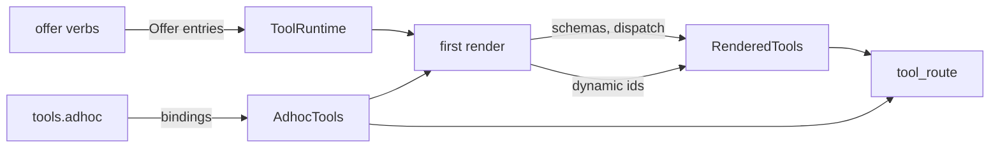

# One offer API on tools

<product-contract>

## Product Requirements

Prompt authors give a section's model its tools from Lua. This plan collapses that surface to one offer verb on the `tools` table, removes the `packs` global, and turns prompt-written Lua tools into real tools with ids and tool objects. Rendering stays once per section, at the first loop round, but follows the order the offers were made. A dynamic-offer verb is added as an unconnected scaffold.

- Problem and users: prompt authors (section Lua) and the Engine. Today offering is split across `tools.offer`, `packs.offer` (`runvil/crates/runvil-internal/lua/src/packs.rs`), and `tools.offer_local` (`runvil/crates/runvil-internal/lua/src/tools.rs`). The `packs` global costs a reserved name (`runvil/crates/runvil-internal/lua/src/globals.rs`). `tools.required()`/`tools.extras()` (`lua/src/tools/objects.rs`) list tool objects, which cannot represent model-shaped Packs (Packs such as the core file tools and `subagents`, whose tools take a different form for each model family). Local tools have no id or tool object, and the render groups tools by verb instead of by line order (`lua/src/vm/state.rs`).
- Goals:
  - as few globals and verbs as possible: `tools.offer`, `tools.offer_dynamic`, `tools.adhoc`;
  - one name form in Lua: tool ids and objects for tools, Pack ids and objects for Packs;
  - adhoc tools that behave like catalog tools (id, tool object, `parameters`, `pack`);
  - a deterministic rendered list in call order that never changes after the first render;
  - tool events that say which vendor's Pack answered, so a client can tell `runvil/user-input/ask` from any look-alike.
- Non-goals: filters, connecting dynamic offers to discovery tools, shaped Packs, Pack-chosen wire names for catalog tools, and structured output from adhoc tools (all under Deferred).
- Success criteria:
  - a section's `tools` table holds exactly `adhoc`, `call`, `get`, `offer`, `offer_dynamic`, and `packs`, with `calls` appearing at the section's first tool call;
  - every form in the Functional Specification behaves as written;
  - the Testing Plan's exit criteria hold: the survey's gates pass and its greps come back empty.
- Constraints:
  - **No history.** Removed forms are deleted outright. No shim, migration path, compatibility code, hint, or note recognizes or explains an old form. No test checks an old form, including that an old name is gone. No comment or doc says what changed or what something used to be. Tests and docs that used an old form are rewritten to the new form or deleted.
  - Offers hold ids, never wire names.
  - Nothing is hash-ordered.
  - Any offer after the section's first loop round still raises, as it does now.
  - **Metadata is never wrapped.** What Lua reads about tools and Packs (`tool.id`, `tool.description`, `tool.parameters`, `tool.pack`, and a Pack's `name`, `required`, and `tools`) is the text and schema as the Pack or the `tools.adhoc` attrs declared them, never in the untrusted envelope, whatever the Pack's output trust. The envelope is for tool results only, and a script's call to a tool that lists tools, such as `mcp/get_dynamic_tools`, receives its listing unwrapped as well (see Tool listings).
- Open questions: None.

## Functional Specification

A section defines adhoc tools, offers tools and Packs, reads Packs and tools, and calls tools, all through the `tools` table. Each offer is checked when made and only remembered. The section's first loop round renders the remembered static offers in call order and computes the dynamic list, which nothing reads yet. Adhoc tools live in the always-present adhoc Pack and are called and counted by id.

- Actors and workflows:
  - The prompt author defines adhoc tools with `tools.adhoc`, offers with `tools.offer` or `tools.offer_dynamic` before the first loop round, and reads Packs and tools at any time, the H1 pass included.
  - The Engine renders once, at the section's first loop round. In `prepare_chat` the model is resolved first (`runvil/crates/runvil-internal/engine/src/execute/scheduler/chat.rs`, lines 116-123), then the list is built (lines 129-137).
  - The model calls rendered tools by wire name. Lua calls any tool by id or object, offered or not.
- Inputs and outputs: every form of the `tools` table.

```lua
-- DEFINE. tools.adhoc(attrs, f) creates a Lua tool and returns its tool object. It does not offer it.
local grab = tools.adhoc({
  name = 'grab',                                       -- the wire name; the id is adhoc/grab
  description = 'Grab a value',
  parameters = { value = 'string' },                   -- optional; a type name or { type, description } per parameter, or a JSON Schema object
}, function(args)
  return 'got ' .. args.value
end)
local find = tools.adhoc({ name = 'find', description = 'Find notes', parameters = { query = 'string', limit = { 'integer', 'maximum hits' } } }, function(args)
  return 'found ' .. args.query
end)
local none = tools.adhoc({ name = 'none', description = 'No parameters' }, function() end)
local shout = tools.adhoc({ name = 'Shout', description = 'Uppercase text', parameters = { text = 'string' } }, function(args) -- id adhoc/shout, wire name Shout
  return args.text:upper()
end)
local t = tools.get('web/search')                      -- attrs are plain data, so a catalog tool can be wrapped; t.parameters is a JSON Schema object
local search = tools.adhoc({ name = 'search', description = t.description, parameters = t.parameters }, function(args)
  return tools.call(t, args)
end)

-- OFFER. Checked when made, remembered, rendered in call order at the first loop round.
tools.offer('web/search')                              -- a tool by id: a string with a slash
tools.offer('web')                                     -- a Pack by id: a string without a slash
tools.offer(grab)                                      -- a tool object
tools.offer(tools.packs.get('web'))                    -- a Pack object
tools.offer(tools.get('web/search').pack)              -- the Pack a tool belongs to
tools.offer({ 'web/search', grab, 'subagents', tools.packs.get('user-input') }) -- an array mixing every form
tools.offer(tools.packs.get('web').tools)              -- a Pack's tools, one by one
tools.offer(tools.packs.get('adhoc'))                  -- the adhoc Pack: every adhoc tool defined by the render
tools.offer(tools.packs.extras())                      -- the opt-in extras: every Pack not declared under uses:, never adhoc
tools.offer(tools.packs)                               -- every Pack the section knows, adhoc included
tools.offer()                                          -- no argument, offers nothing
tools.offer({})                                        -- empty array, offers nothing

-- OFFER DYNAMIC. The same forms and checks; recorded into the dynamic list at render, which nothing reads yet.
tools.offer_dynamic('user-input')
tools.offer_dynamic(tools.packs.extras())
tools.offer_dynamic({ 'web', grab })

-- READ
for _, pack in ipairs(tools.packs) do end              -- every Pack, in name order, adhoc included
#tools.packs                                           -- how many Packs
local web = tools.packs.get('web')                     -- a Pack object, or nil when the run has no such Pack
local extras = tools.packs.extras()                    -- a fresh array of the extra Pack objects, in name order
web.name                                               -- 'web'
web.required                                           -- true when declared under uses:, always false for adhoc
web.tools                                              -- a fresh array of the Pack's tool objects, in id order
#web.tools > 0                                         -- "does this Pack have tools"
local tool = tools.get('web/search')                   -- a tool object, or nil; tools.get('adhoc/grab') == grab
tool.id                                                -- 'web/search', or 'adhoc/grab'
tool.description                                       -- the catalog text, or the attrs description
tool.parameters                                        -- a fresh table holding the parameter schema
tool.pack                                              -- tools.packs.get('web'), or the adhoc Pack

-- CALL AND COUNT
tools.call('web/search', { query = 'lua' })            -- by id
tools.call(grab, { value = 'hi' })                     -- by tool object, offered or not
tools.call('adhoc/grab', { value = 'hi' })
tools.calls['adhoc/grab']                              -- calls so far, by id; tools.calls appears at the section's first tool call

-- REFUSED. Each raises.
tools.offer('wbe')                                     -- no Pack named wbe
tools.offer('web_search')                              -- no Pack named web_search; suggests 'web/search'
tools.offer('web/serch')                               -- not a tool in this run
tools.offer('mcp')                                     -- a Pack that cannot serve: the Host's reason
tools.offer('web/search', 'web/fetch')                 -- one argument only
tools.offer(42)                                        -- not a tool, a Pack, or an array of them
tools.offer(nil)                                       -- nil is not a tool or a Pack; a lookup that may miss is guarded with if
tools.offer(tools.get('web/serch'))                    -- the same: tools.get returned nil
tools.offer({ 'web', nil, 'mcp' })                     -- an array has no gaps
tools.offer({ name = 'web' })                          -- an array has only the keys 1 to #t
tools.offer({ { 'web' } })                             -- arrays do not nest
tools.packs.get({ 'web', 'subagents' })                -- get takes one Pack id
tools.packs.get = nil                                  -- tools.packs is read-only
tools.adhoc('grab', function() end)                    -- attrs must be a table
tools.adhoc({ name = 'x', description = 'y' })         -- the second argument must be a function
tools.adhoc({ name = 'x', description = 'y' }, function() end, 'z') -- two arguments only
tools.adhoc({ name = 'grab', description = 'again' }, function() end) -- the name grab is taken
tools.adhoc({ name = 'GRAB', description = 'again' }, function() end) -- its id, adhoc/grab, is taken
tools.adhoc({ name = 'x', description = 'y', run = 1 }, function() end) -- unknown key run
tools.adhoc({ description = 'y' }, function() end)     -- name is required
tools.adhoc({ name = 'x', description = 'y', parameters = 'string' }, function() end) -- parameters must be a table
tools.call('grab', { value = 'hi' })                   -- a string without a slash is not a tool id
-- any tools.offer or tools.offer_dynamic after the section's first models.loop round: the tool list is fixed
```

- States and validation:
  - **Offer verbs.** `tools.offer` and `tools.offer_dynamic` take one argument: a string with a slash (a tool id), a string without one (a Pack id, since Pack ids are one segment and tool ids two or more, `runvil/crates/runvil-internal/types/src/names.rs`), a tool object, a Pack object, or an array mixing them. The render refusal comes before every other check. Every entry is checked before any is recorded. A tool id must name a catalog tool in the offering (the run's offerable catalog tools, `ToolSet::offered` in `runvil/crates/runvil-internal/lua/src/handles.rs`) or a defined adhoc tool. A Pack id must name a Pack with an object. An entry identical to one already recorded (same target and mode) is skipped. No argument offers nothing; an explicit `nil` is a wrong type, so a lookup that may miss (`tools.packs.get`, `tools.get`) is guarded with `if`. A table is an array of `#t` entries (honoring `__len`), each read through `__index`; it raises when an entry in that range is nil or a table (arrays do not nest), or when it holds a raw key outside `1..#t`.
  - **Static render, at the first loop round.** Walk the static entries in order and append to a list, skipping tools already in it. A tool entry adds that tool. A Pack entry adds its tools in id order, expanded at render, so `tools.offer(tools.packs.get('adhoc'))` includes adhoc tools defined before the render while `tools.offer(tools.packs.get('adhoc').tools)` takes only those defined at the call. Example: `tools.offer('web')` then `tools.offer('web/search')` renders `web_fetch`, `web_search`; reversed, `web_search`, `web_fetch`; `tools.offer(grab)` then `tools.offer('web')` renders `grab`, `web_fetch`, `web_search`.
  - **Shadowing.** When an offered adhoc tool and an offered catalog tool share a wire name, the adhoc tool is rendered and the catalog tool is dropped wherever it was offered. A defined but unoffered adhoc tool shadows nothing.
  - **Dynamic list (scaffold).** The same render walks the dynamic entries the same way and keeps every named tool not in the static list, deduped, in offer order. A tool whose id or wire name is in the static list is skipped, so a catalog tool that shadowing dropped never sits in the dynamic list beside the adhoc tool that holds its wire name. Static therefore wins in either order: `tools.offer('web/search')` with `tools.offer_dynamic('web')` gives static `web_search` and dynamic `web/fetch`. Dynamic entries never change the static list. The list is stored with the rendered list and nothing reads it: no discovery tools, no routing, no change the model can see.
  - **`tools.packs`.** A frozen proxy. Integer keys, `#`, `ipairs`, and `pairs` walk the Pack objects in name order, the adhoc Pack included, and `pairs` yields only Packs. Its only members are `get(name)`, which returns a Pack object or nil and is the "offer it only if the run has it" guard, and `extras()`, a fresh array of the usable Packs not declared under `uses:`, in name order, never the adhoc Pack. Any other key reads nil. Writes raise, and the metatable is protected the way `sys` and `var` protect theirs.
  - **Extras** are a per-section opt-in through `tools.offer(tools.packs.extras())` or its dynamic twin, off by default. A Pack the Host reports unable to serve has no object, so it is never an extra.
  - **Pack objects** have exactly `name`, `tools` (a fresh array of tool objects, id order), and `required` (declared under `uses:`). **Tool objects** have exactly `id`, `description`, `parameters`, and `pack`. Packs are reached only through `tools.packs.get`, integer indexes, `tool.pack`, or Pack id strings, and tools only by id string, a Pack's `tools`, or the object `tools.adhoc` returns, so no author-chosen name (a Pack `get`, a tool `tools`) ever meets a field.
  - **`tool.parameters`** returns a fresh Lua table on every read, converted the way `json.decode` converts (lists marked, so `json.encode` gives back `[]`; nulls read `json.null`). Like `tool.description`, it is never in the untrusted envelope: every string in it is the schema's text as declared.
  - **Adhoc tools.** `tools.adhoc(attrs, f)` takes exactly two arguments. `attrs` is plain data with exactly the keys `name` (required, alias grammar `[A-Za-z][A-Za-z0-9_-]{0,63}`, `runvil/crates/runvil-internal/lua/src/alias.rs`), `description` (required), and `parameters` (optional, a table in one of two forms told apart by its `type` key: `'object'` means a JSON Schema object, converted by the same function `json.encode` uses and used as the tool's schema as written; anything else is the existing short format, one type name or `{type, description}` per parameter. The rule is unambiguous because `object` is never a short-form type, so `{ type = 'string' }` is a short-form parameter named `type`). With no `parameters`, the schema is `{"type":"object","properties":{},"required":[]}`. `f` must be a function. The name and schema are checked when the tool is defined, so a bad one raises on the `tools.adhoc` line. The tool gets a `ToolInfo` with id `adhoc/<name lowercased>` and plain-text output, and `name` as written is its wire name. It is registered, not offered, and its tool object is returned. Defining works after the render; only offers are refused there. Its results are trusted output, unless its own function fetched a tool listing during the call (see Tool listings). A result the function got from `tools.call` of any other untrusted tool is already nonce-wrapped with the run's shared nonce when the script receives it (`lua/src/dispatch.rs`, `prepare_dispatch`), so it reaches the model byte for byte as the direct call's would; the result event's `trusted` flag still reads true, because the author's function produced the text.
  - **The adhoc Pack** exists in every section VM from the start, the H1 pass included, with `required` false and an empty `tools` until the first `tools.adhoc`; then `tools` lists every adhoc tool defined, offered or not, in id order. It is not part of the run's catalog or roster.
  - **Calls and counts.** `tools.call` takes a tool id or a tool object. `tools.calls` keys every tool by id. Counts are seeded at 0 for every tool in the section's rendered list, offered adhoc tools included; any other tool, such as a defined but unoffered adhoc tool, gains its count at its first call, and reading its key before then raises the existing `tools.calls: ... has no seeded count` error, with the adhoc hint given under Errors and recovery for a defined adhoc tool's id. Adhoc tool-call and tool-result events carry the tool's id.
  - **Vendors in events.** Every tool-call and tool-result event for a catalog tool records `vendor`, the vendor of the Pack that answered, as the Harness picked it: `runvil` for a bare `uses:` entry and for an undeclared Pack, `acme` for an `acme/kit` entry. `vendor` and `tool` together give the vendor-qualified name, such as `runvil/user-input/ask`; a vendor is one segment and always comes first, so a name joined from a present `vendor` and a `tool` is never ambiguous. A reader joins them only when `vendor` is present. A tool id can have three segments, so a bare `tool` such as `runvil/user-input/ask`, offered by a Pack whose id is `runvil`, is never read as a vendor-qualified name. Adhoc tools and names outside the round's scope record no vendor, and neither does a run given no roster. Lua never sees vendors, and tool ids are unchanged.
  - **Tool listings.** A catalog tool whose `ToolInfo` sets `describes_tools`, today only the `mcp` Pack's `get_dynamic_tools`, returns its listing to a script's `tools.call` as plain text, while a model's call to it still receives the untrusted envelope. The script call's result event keeps `trusted` false, since the text comes from the servers, and holds the text the script received. An adhoc call whose own function fetched such a listing with `tools.call` while that call was open returns untrusted: its result is wrapped with the run's nonce and its event has `trusted` false. So, for a call the listing tool answers successfully, a wrapper of `get_dynamic_tools` gives the model the same envelope, byte for byte, as a direct model call. That is the whole guarantee. A listing a script keeps (in a variable or the store), or gets back from a called section or a task, and later returns from an adhoc tool or puts in a message, reaches the model as the author wrote it: unwrapped, and with `trusted` true when an adhoc tool returns it. That is the author's responsibility, as all script-authored text is.
- Errors and recovery: messages are part of the contract (tests and docs use them). `<verb>` is `tools.offer` or `tools.offer_dynamic`.
  - after the render: `<verb>: the section's tool list is fixed at its first models.loop round; make every offer before the first loop, or offer in another section`;
  - unknown Pack: `<verb>: no Pack named "<x>" in this run; declare it under uses: to require it, or offer it only when tools.packs.get("<x>") returns it`, plus ` (did you mean '<id>'?)` when a tool in the offering or a defined adhoc tool has the wire name `<x>`;
  - unknown tool: `<verb>: "<id>" is not a tool in this run`;
  - an offer string that is not a valid id, such as `'Web'`, `'Shout'`, or `'web//x'`, takes the message of an unknown one of its shape: the unknown-Pack message without a slash, the unknown-tool message with one;
  - Pack that cannot serve: `<verb>: the <name> Pack is unavailable in this run: <reason>`;
  - wrong type: `<verb> takes tool ids, Pack ids, tool objects, Pack objects, or an array of them, got <type>`;
  - extra argument: `<verb> takes one tool or Pack, or an array of them, got extra <type>`;
  - array entry: `<verb> takes tool ids, Pack ids, tool objects, or Pack objects in an array, got <type> at index <i>` (a nil gap or a nested table);
  - array key: `<verb> takes an array, got a table with the key <key>`;
  - `tools.packs.get takes one Pack id, got <type>`; `tools.packs is read-only`; a metatable change raises Lua's `cannot change a protected metatable`;
  - `tools.adhoc takes an attrs table first, got <type>`; `tools.adhoc takes the tool's function second, got <type>`; `tools.adhoc takes two arguments, got extra <type>`; `tools.adhoc: unknown key "<k>"; accepted keys are name, description, parameters`; `tools.adhoc: "<k>" is required`; `tools.adhoc: "<k>" must be a string, got <type>` for `name` and `description`; `tools.adhoc: invalid name "<name>": expected [A-Za-z][A-Za-z0-9_-]{0,63}`; `tools.adhoc: parameters must be a table, got <type>`; `tools.adhoc: parameters schema cannot be encoded as JSON: <reason>`; `tools.adhoc name "<name>" is already registered`; `tools.adhoc name "<name>" has the id adhoc/<lower>, which "<other>" already holds`; the existing parameter-type errors under the `tools.adhoc` prefix;
  - `tools.call takes a tool id or a tool object, got <type>`; `tools.call: "<name>" is not a tool id`;
  - the `tools.calls` hint for a defined adhoc tool's id: ` (an adhoc tool that was neither offered in this section nor called with tools.call)`, beside the existing catalog hint;
  - a `jump` inside an adhoc tool's function: `jump is unavailable inside an adhoc tool handler: return a value from the handler and call jump from the block after the tool call returns`;
  - a Pack whose id is `adhoc` from any vendor is refused by the Pack registry with ``Pack `<fqn>` cannot take the Pack id adhoc, which holds a section's own tools``, and a `uses:` entry for `adhoc` or `<vendor>/adhoc` fails to parse with `invalid frontmatter: adhoc holds a section's own tools and is never declared under uses`;
  - a run whose tool catalog holds a tool under the Pack id `adhoc`, or whose roster (usable or unavailable) holds the Pack `adhoc`, is refused when it is prepared: the refusal notice holds the line `- the run's tool catalog or Pack roster names the Pack id adhoc, which holds a section's own tools`.
- Security and privacy behavior: adhoc tools never reach the Harness. Lua never reads wire names, so prompts name tools only by id. Pack and tool objects stay frozen, and `tools.packs` cannot be modified or stripped of its metatable. The Pack id `adhoc` has one meaning in every run, because the Pack registry, the parser, and the run's preparation each refuse it from anywhere else.
- Acceptance criteria:
  - every line of the forms listing behaves as its comment says;
  - the rendered schemas are byte for byte the same with or without any dynamic offers;
  - a model call to a catalog tool's wire name is never answered by a defined but unoffered adhoc tool of the same name;
  - the three render-order examples above hold;
  - an adhoc tool defined with `description = t.description` and `parameters = t.parameters`, where `t = tools.get('web/search')`, renders the catalog tool's description and schema unchanged; `web` marks its results untrusted, so this also shows that no metadata read arrives in the envelope;
  - a model call to that wrapper, whose function returns `tools.call(t, args)`, gives the model, for a call the tool answers successfully, the same result text, byte for byte, as a model call to the catalog tool itself;
  - a script's call to `mcp/get_dynamic_tools` returns the listing without the envelope, a model's call returns it wrapped, and, for a call the tool answers successfully, a model call to an adhoc wrapper of it returns the same envelope as the direct model call;
  - a listing the section fetched outside any adhoc call and kept in a variable, then returned by an adhoc tool, reaches the model unwrapped, with `trusted` true on the adhoc result event;
  - a run whose catalog or roster names the Pack id `adhoc` is refused when it is prepared, with the notice line under Errors and recovery;
  - in the Workshop, the ask, search, and fetch views appear only for `runvil/user-input/ask`, `runvil/web/search`, and `runvil/web/fetch`: the same id from another vendor's Pack, a call without a vendor whose tool id is `runvil/user-input/ask`, or an adhoc tool named `ask`, shows as an ordinary tool, and a script's call to another vendor's `user-input/ask` does not frame as the operator's message.

</product-contract>
<implementation-contract>

## Technical Design

The Lua crate records offers as ids with a mode and defines adhoc tools as bindings in the section VM. The Engine's first loop round turns those records into the rendered list and the dynamic list through one shared expansion. The scheduler routes model calls through the section's rendered list and script calls by id, so adhoc tools need no separate rendering or routing path. `RunContext::prepare` refuses a caller-supplied `adhoc` Pack id. Outside the Lua and Engine crates, the changes are the `adhoc` reservation in the plugin registry and parser contract, three doc comments and the `vendor` event fields in the types crate, the Harness handing the Engine each Pack's vendor, two lines of the Workshop chat agent, the Workshop server's and UI's vendor-qualified matching and the UI's labels, and the local-to-adhoc rename.

- Architecture:



- Modules and interfaces:
  - `Offer { target, mode }` in `lua/src/scope.rs`, with `pub enum OfferTarget { Tool(ToolId), Pack(PackId) }` and `pub enum OfferMode { Static, Dynamic }`. `ToolRuntime` holds one ordered `offers: Vec<Offer>` with `pub fn add_tool(&mut self, id: ToolId, mode: OfferMode)` and `pub fn add_pack(&mut self, pack: PackId, mode: OfferMode)`, each skipping an `Offer` equal to one already held. No filter field yet.
  - `current_tool_bindings(set, runtime, adhoc)` in `lua/src/vm/state.rs` returns the static bindings. A sibling `current_dynamic_tools(set, runtime, adhoc, static_bindings)` returns the dynamic ids. Both use one shared entry-expansion helper, so the lists cannot disagree about what an entry names. Catalog ids resolve with `ToolSet::offered_binding`, which already accepts ids. `adhoc/*` ids resolve against the VM's adhoc bindings. Shadowing is applied last in the static pass. Today the merge of the section's Lua tools and the rule that they win over catalog tools of the same wire name live in the Engine's `prepare_scoped_tools` (`engine/src/execute/scope.rs`, lines 44-51 and 70-73); they move into this pass, so the Engine receives one finished list. `AdhocTools` is `pub` and re-exported from `runvil-lua` beside `current_tool_bindings`, and `SectionVm::adhoc_tools(&self) -> &AdhocTools` hands it to the Engine. Every caller moves to the new signature: `scheduler/chat.rs` (line 132), `section_call_counts` (`scheduler/tool_call.rs`, lines 175-181), `lua/src/test_vm.rs` (line 122), the test callers in `lua/src/tests/tool_scoping.rs`, `lua/src/tests/section_vm.rs`, `engine/src/execute/tests.rs`, and `engine/src/execute/tests/tool_scoping.rs`; `prepare_scoped_tools`' test callers in `engine/src/execute/tests/offering.rs` (line 345) and `tool_scoping.rs` (lines 50 and 113) drop their second argument.
  - `RenderedTools` (`lua/src/scope.rs`) gains `dynamic: Vec<ToolId>`. Its dispatch map's value is `pub struct Advertised { pub id: ToolId, pub vendor: Option<String> }` in `lua/src/scope.rs`, holding for every advertised name, adhoc included, the tool's id and its Pack's vendor (none for adhoc tools). Step 2 makes the map `dispatch: BTreeMap<String, Option<Advertised>>`, with `None` for an adhoc tool, which has no id until step 3; step 3 makes it `BTreeMap<String, Advertised>`. `Chain.advertised` (`scheduler/chain_record.rs`) holds the same map type in each step and keeps serving the round's scope gate and the `ToolCallEvent` stamping; it never routes.
  - `AdhocTools` (renamed from `LocalTools`, and moved from `lua/src/vm.rs` to the new `lua/src/vm/adhoc.rs`) stores `ToolBinding` entries built with `ToolBinding::from_info(name, &info)`, with lookups by wire name and by id. `tools.adhoc` validates the name and schema through `tool_schema_new` (as `tools.offer_local` does today, `lua/src/tools.rs` line 283) before registering, raising its error under the `tools.adhoc:` prefix. The JSON Schema form of `parameters` converts through a `pub(crate)` function exposed from `lua/src/json/encode.rs` that `json.encode` also uses. Handlers stay in the VM's handler table under the name.
  - `LuaToolHandle` (`lua/src/tools/userdata.rs`) keeps the binding's schema for `parameters`. `LuaPackHandle` (`lua/src/packs.rs`) gains `required`. The adhoc Pack's object reads the VM's adhoc tool objects on each `tools` read.
  - The tool-object registry (`lua/src/tools/objects.rs`) gains an insert for `tools.adhoc`.
  - **Vendors.** The Harness's `HostRunContext::roster` (`harness-internal/runner/src/host-run.rs`, lines 110-130) reports each usable Pack with the vendor from its `PackInfo` FQN, and `prepare_from_snapshot` (`harness-internal/runner/src/prepare.rs`, lines 362-371) passes it to `RunContext::packs`. That call takes a new `UsablePack` in place of a bare `PackId`: `#[non_exhaustive] pub struct UsablePack { pub pack: PackId, pub vendor: String }` with `UsablePack::new(pack, vendor)`, in `engine/src/execute/requirements.rs` beside `UnavailablePack` and exported from the `runvil` facade the same way. The Engine keeps the vendors beside the roster. `ToolBinding` gains `vendor: Option<String>`, set with `#[must_use] pub fn with_vendor(self, vendor: Option<String>) -> Self` and read with `ToolBinding::vendor()`; `from_info` leaves it `None`, so adhoc bindings have none. `context-bound.rs` stamps each catalog `ToolBinding` with its Pack's vendor. `tool_calls` in `scheduler/chat.rs` (lines 347-349) sets the id and vendor from the advertised map on each `ToolCallEvent`, and `prepare_dispatch` and `prepare_model_dispatch` (`lua/src/dispatch.rs`) pass `binding.vendor()` to `Emitter::tool_result`. Engine doc comments on `UsablePack`, `RunContext::packs`, and `ToolBinding::vendor` say the caller reports each Pack's vendor; only Harness and docs text name the Harness.
  - **Tool listings.** `ToolInfo` (`types/src/tools/info.rs`) gains `describes_tools: bool` (`#[serde(default)]`, set with `.describes_tools(true)`, the way `survives_stop` is), set on `get_dynamic_tools` in `plugin-mcp/src/dynamic.rs` (lines 137-153); `runvil/public-api.txt` follows. `ToolBinding` copies the flag. `prepare_dispatch` (`lua/src/dispatch.rs`, lines 132-144) passes the text verbatim when the call is a script's (`script` is `Some`) and the binding describes tools, keeping the trust `Untrusted`; the model path, `prepare_model_dispatch`, is unchanged. `ToolDispatch` gains `pub fn listing(&self) -> bool`, true only when that script rule passed untrusted text verbatim; a `describes_tools` tool that returns trusted output is passed as any trusted output and sets nothing. `accept_tool_call` (`scheduler/apply.rs`, line 189) takes `&mut self`, and for a `CallSite::Script` whose dispatch reports `listing()`, sets `listing = true` on the current frame's innermost open `AdhocCall` (renamed from `LocalCall`, `engine/src/execute/section_context.rs`; `listing` is a new `bool` field). A failed call marks nothing. `dispatch_adhoc_tool_done` (`scheduler/tool_call.rs`, line 395) wraps a marked call's result with the run's nonce and reports it untrusted. A wrapped result handed to an enclosing adhoc function is already enveloped, so only the innermost call needs the mark. The mark is per frame and per open call by design: a listing fetched outside the adhoc call, in a section the adhoc function calls, or in a task marks nothing.
  - `tools.packs` is an empty proxy table with a metatable, following the `tools.calls` pattern in `lua/src/tools.rs`: `__index` (integers, `get`, `extras`), `__len`, ordered `__pairs`, raising `__newindex`, and `__metatable`.
  - `tool_route` (`engine/src/execute/scheduler/tool_call.rs`) takes the call site from both of its callers; today it sees only the name. The single-call path (line 264) passes the one `dispatch_tool_call` built, and the batch path, `dispatch_tool_calls` (line 125), builds its `CallSite::Batch` before routing, so the route sees it. A model call (it has a call id) looks its wire name up in the rendered list of the current frame's section, never in `Chain.advertised`, which another section's rounds overwrite while an adhoc function's `call` runs. `SectionVm` gains `pub fn rendered_target(&self, wire_name: &str) -> Option<Advertised>`, which reads the entry from the rendered list attached to the VM's `messages` without copying the list. The call goes to the adhoc handler when the name maps to an `adhoc/*` id. With no rendered list, a model call routes as a catalog call by wire name, so the test hook `tools.call_as_model` reaches an adhoc tool only after the section renders; tests that call adhoc tools through it render first (one loop round) or call by id. A script call routes by id. The adhoc arm counts and reports under the id.
  - **The `adhoc` reservation in a run.** `RunContext::prepare` (`engine/src/execute/config.rs`, line 326) checks the catalog (each `ToolInfo` id's `ToolId::pack()`) and the roster (usable and unavailable) for the Pack id `adhoc`. `prepare` returns its report rather than an error, so the refusal goes through it: `Requirements` (`engine/src/execute/requirements.rs`) gains `pub reserved_adhoc: bool`, set by that check, merged with `|=`, counted by `is_satisfied`, and written by `notice` as the line given under Errors and recovery. `refusal()` then returns the usual `RequirementsUnmet` run error. `runvil/public-api.txt` follows.
- File and public API changes (paths under `runvil/crates/`):
  - `runvil-internal/lua/src/`:
    - `scope.rs`: `Offer`, `OfferTarget`, `OfferMode`, `ToolRuntime`, `Advertised`, `RenderedTools.dynamic`;
    - `vm/state.rs`: the two render functions; `adhoc_tool_schemas` (line 90) is removed and `has_adhoc_tool` (line 98) takes a wire name or an id;
    - `vm.rs` and the new `vm/adhoc.rs`: `AdhocTools` moves to `vm/adhoc.rs`; `SectionVm` gains `adhoc_tools` and `rendered_target`;
    - `tools.rs`: `tools.adhoc` replaces `install_offer_local`; `resolve_entries` returns ids; `install_tools` installs tool objects, Pack objects, `tools.packs`, both offer verbs, `tools.adhoc`, and `tools.get`;
    - `tools/offer.rs` (new): one offer installer, parameterized by name and mode and installed twice, with its decode: array reads through metamethods and the Pack-id checks moved from `packs.rs`;
    - `tools/decode.rs`: `tool_name` accepts ids and objects only; the short-form `parameters` conversion (`local_params_schema` today) becomes `adhoc_params_schema` under the `tools.adhoc` prefix;
    - `json/encode.rs`: the `pub(crate)` conversion `tools.adhoc` shares with `json.encode`;
    - `tools/objects.rs`: `install_tool_lists` becomes `install_tool_get`;
    - `tools/userdata.rs`: `parameters`;
    - `packs.rs`: Pack objects, `tools.packs`, `get`, `extras`; `packs.offer` and its decode removed, with the Pack-id checks moved to the offer decode;
    - `vm/inject.rs`: no `install_packs` call;
    - `globals.rs`: `packs` removed from `RESERVED_NAMES`, length 63 to 62.
  - `runvil-internal/engine/src/execute/`:
    - `scope.rs`: `prepare_effective_scope` and `prepare_scoped_tools` drop `adhoc_schemas`, and the adhoc merge and shadowing move into the Lua static pass;
    - `scheduler/chat.rs` (lines 129-137): pass the adhoc tools, call `current_dynamic_tools`, store the result;
    - `scheduler/tool_call.rs`: the call site in `tool_route`, the new render signature in `section_call_counts`, counts by id, and the adhoc `ToolResult` emitted with the id (lines 409-417); the adhoc arm (`tool_route`'s adhoc branch and `dispatch_adhoc_tool_done`) moves to the new `scheduler/tool_call-adhoc.rs`;
    - `scheduler/apply.rs`: `accept_tool_call` takes `&mut self` and sets the listing mark;
    - `section_context.rs`: `AdhocCall` gains `listing: bool`;
    - `config.rs` (`RunContext::prepare`) and `requirements.rs` (`Requirements.reserved_adhoc`): the `adhoc` refusal.
  - `runvil-internal/types/src/metrics.rs` (line 31), `types/src/event.rs` (line 405), and `types/src/emitter.rs` (line 355): drop "a Lua-local tool" from what `tool: None` means.
  - `runvil-plugin/src/registry.rs`: `adhoc` is reserved through a new `InstallError` variant with its own message. `reserves` and `ReservedName` cover only built-in Packs, and `ReservedName`'s message names a built-in `runvil/<name>` that does not exist for `adhoc`.
  - `runvil-internal/parser/src/contract.rs`: a new `PackListError` variant, checked beside `check_distinct_packs`, refuses `adhoc` from any vendor with the message under Errors and recovery, and `parser/src/parse.rs` (lines 101-105) gains its match arm, a `Frontmatter` parse error like `Duplicate`'s. `PackRef` itself lives in `types/src/packs.rs`.
  - `workshop/agents/agents/chat.md` (lines 30-31): `tools.offer("web")` and `tools.offer(tools.packs.extras())`.
  - Vendor fields: `types/src/metrics.rs` (`ToolCallEvent`) and `types/src/event.rs` (`Event::ToolResult`) gain `vendor: Option<String>` with `tool`'s serde attributes (`default`, `skip_serializing_if = "Option::is_none"`), `ToolCallEvent` gains `with_vendor`, and `Emitter::tool_result` (`types/src/emitter.rs`) takes the vendor. `engine/src/execute/config.rs` (`RunContext::packs`) and `requirements.rs` (`UsablePack`) change with them, and `runvil/public-api.txt` follows. The Harness side is `host-run.rs` and `prepare.rs`.
  - Workshop server: `workshop/server/src/agents.rs` (lines 145-158) holds the ask as vendor `runvil` plus id `user-input/ask`, `socket.rs` and `socket_frames.rs` hold that pair, and `agents/wire.rs` (line 275) frames a script's result as the operator's message only when both vendor and id match. `render_tool_calls` serializes `ToolCallEvent` as is, so the UI receives `vendor` with no wire change.
  - Workshop UI: `ui/src/parts/agent/transcript/tool-labels.ts` `toolKind` takes the vendor-qualified name (`vendor/tool`) and matches `runvil/user-input/ask`, `runvil/web/search`, and `runvil/web/fetch` exactly, so no tool without the `runvil` vendor is ever special, `adhoc/ask` included. Labels stay `<name> in <Pack id>`, read from `tool`, so adhoc calls read `<name> in adhoc`. `transcript-model.ts` (line 334) passes `vendor === null ? null : vendor + "/" + tool` to `toolKind`, so a call without a vendor is never special, and `ui/src/services/agent-session.ts` (lines 55-61, 174-176) parses and documents `vendor`.
  - Other event readers: `runvil/tests/suite/event.rs` (lines 75-77) prints the vendor-qualified name. `engine/src/test_support/recording/forward.rs` is unchanged: `ToolResultReport` (`engine/src/test_support/recording.rs`, line 100) has no `tool` field, and `forward.rs` destructures the event with `..`.
  - **Naming, local to adhoc, everywhere.** Every identifier, string, comment, and file name that names a local tool becomes adhoc: `LocalTools`, `ToolRoute::Local`, `ToolCallOutcome::Local` (to `ToolCallOutcome::Adhoc`), `LocalToolOutcome` (to `AdhocToolOutcome`), `has_local_tool` and `local_tool_schemas` (to `has_adhoc_tool` and `adhoc_tool_schemas`), `LocalCall` with `push_local_call` and `pop_local_call`, `local_calls` (to `adhoc_calls`), `local_handler_depth`, `enter_local_handler`, and `leave_local_handler` (to `adhoc_handler_depth`, `enter_adhoc_handler`, and `leave_adhoc_handler`), the `local_handler` function in `lua/src/tools.rs` (line 71, to `adhoc_handler`), `prepare_scoped_tools`' and `prepare_effective_scope`'s `local_schemas` (to `adhoc_schemas`), `Request::LocalToolDone`, the `local_tool_done` coroutine op with `parse_local_tool_done`, `dispatch_local_tool_done`, and the shim's `run_local_tool`, the `LOCAL_HANDLERS_REGISTRY` key `runvil.tools.local_handlers`, local-tool test function and helper names, and the user-visible jump refusal (`lua/src/vm/install.rs`, line 208), which becomes the text under Errors and recovery and is asserted in `engine/src/lua/tests/shims.rs` and in `JUMP_REFUSAL` in the renamed `adhoc_tools.rs`. The test files `local_tools.rs` and `tool_call_arm-local-handlers.rs` are renamed `adhoc_tools.rs` and `tool_call_arm-adhoc-handlers.rs`, with their `mod` lines. Lua `local` variable declarations (`local tool =`, `local tools =`, `local tool_ok`, `local tools_list`) are variables, not this concept, and stay. The Lua-visible `tools.offer_local` family is not renamed, because step 3 deletes it: `tools.offer_local`, `install_offer_local`, `local_params_schema`, every error that begins `tools.offer_local`, and the `tools.call` type error that names "a local alias". Files with hits today:
    - `lua/src/`: `vm.rs`, `coro.rs`, `lib.rs`, `scope.rs`, `alias.rs`, `tools.rs`, `__impl_coro.lua`, `__impl_globals.lua`, `vm/inject.rs`, `vm/state.rs`, `vm/install.rs`, `protocol.rs`, `protocol/answer.rs`, `protocol/request.rs`, `protocol/parse.rs`, `protocol/parse/tools.rs`, `protocol/render.rs`, `models_loop.rs`, `models_loop/machine.rs`, and the tests `models_loop/tests.rs`, `models_loop/machine-tests.rs`, `protocol/tests/answer.rs`, `protocol/tests/parse.rs`, `tests/diagnostics.rs`, `tools/tests-offering.rs`, `messages-tests.rs`, `packs-tests.rs`;
    - `engine/src/`: `error.rs`, `lua/tests/shims.rs`, and under `execute/`: `protocol.rs`, `scope.rs`, `section_context.rs`, `section_context-construct.rs`, `tests.rs`, `scheduler/chat.rs`, `scheduler/tool_call.rs`, `scheduler/dispatch.rs`, `scheduler/chain_record.rs`, `run/tests-drops.rs`, and the tests `local_tools.rs`, `tool_call_arm.rs`, `tool_call_arm-local-handlers.rs`, `offering.rs`, `models_loop.rs`, `models_loop_contract-rounds.rs`, `chat_scope.rs`, `debug_and_counts.rs`, `batch_turn.rs`, `parallel_tool_calls.rs`, `scheduler/live_h1/control_flow.rs`;
    - `types/src/`: `emitter.rs`, `metrics.rs`, `event.rs`; `parser/src/contract/models.rs`; `workshop/ui/src/services/agent-session.ts`.
  - Doc comments in every touched file describe only the new API. That includes `lib.rs` (lines 41-45), `tools/decode.rs` (line 60), `test_vm.rs` (line 112), and `plugin-user-input/src/lib.rs` (line 61).
- Data, persistence, failure, security, and privacy constraints:
  - Adhoc tool-call and tool-result events now hold `tool: Some(adhoc/<name>)`. Every reader that treated `None` as a local tool is updated: `engine/src/execute/tests/chat_arm.rs` (line 176), `engine/src/execute/tests/offering.rs` (line 353, which asserts `Some(None)`), the Workshop UI's `tool-labels.ts` and `transcript-model.ts`, and the UI tests `test/transcript-model.mjs` (lines 397, 430-434) and `test/agent-session-service.mjs` (lines 650-663). Nothing is added for records written before this change, so a replay of such a run no longer matches its Chat effects, whose advertised order and event `tool` fields change.
  - Tool-call and tool-result events gain `vendor`. A log written before this change has no `vendor`, which reads as absent the way any missing optional field does; nothing treats such a log as naming a `runvil` tool.
  - `RESERVED_NAMES` loses `packs`. The two-way globals tests in `engine/src/lua/tests/globals.rs` confirm the installed globals match.
  - The rendered list, dynamic list included, is attached to `messages` and lives exactly as long as the section.
  - Every Rust file under `src` or `tests` stays at or under 500 lines: `build-ceiling` (`crates/build-ceiling/src/lib.rs`, line 14) runs from every crate's `build.rs` and fails the build past that. Files this plan grows are close today: `types/src/event.rs` 447, `engine/src/execute/scheduler/tool_call.rs` 432, `lua/src/vm.rs` 424, `engine/src/execute/config.rs` 424, `types/src/emitter.rs` 421, and `lua/src/packs-tests.rs` 373. Planned splits: `AdhocTools` moves to `lua/src/vm/adhoc.rs`; the offer installer and its decode go in `lua/src/tools/offer.rs`; `tools.packs` and the Pack objects stay in `packs.rs`; the adhoc arm of `tool_call.rs` moves to `scheduler/tool_call-adhoc.rs`, wired with `#[path]`; new tests go in new `-tests` siblings rather than growing a file past the limit. A file that still crosses the limit is split in the step that grows it.

</implementation-contract>
<verification-contract>

## Testing Plan

Lua crate tests pin every form, error, and ordering rule. Engine and other crate tests pin rendering, routing, events, and the reservations. Regression checks are a key-set test of the `tools` table and repository greps for removed forms and history wording. No test checks an old form.

- Unit (Lua crate; `lua/src/packs-tests.rs` rewritten, `lua/src/tools/tests-offering.rs` and the local-tool tests updated):
  - **`tools.packs`:**
    - integer indexes, `#`, `ipairs`, and `pairs` in name order with `adhoc`, and `pairs` yields no methods;
    - `get` returns shared objects, or nil for unknown names and tool ids, and raises for non-strings, tables included;
    - any other key reads nil, writes raise, and `setmetatable(tools.packs, nil)` is refused;
    - `extras()` excludes declared Packs, `adhoc`, and Packs that cannot serve;
    - the `==` identity of objects across `get`, integer indexes, and `tool.pack`.
  - **`required`:** true for declared Packs, including one with no tools, and false for undeclared ones and `adhoc`. `#pack.tools > 0` holds for a Pack with tools and fails for one without.
  - **Collisions:** Packs named `get`, `extras`, and `tools`, the last offering `tools/tools`, are reached through `get` and offered by id. Pack and tool objects have no fields beyond the specified ones.
  - **Offer verbs, both of them:**
    - every accepted form, and the string-shape rule;
    - each error message, including the wire-name hint;
    - the render refusal first;
    - a bad array entry records nothing;
    - `tools.offer()` offers nothing, `tools.offer(nil)` raises, and an array with a gap, a stray key, or a nested table raises with the array messages;
    - `tools.offer(tools.packs)` and `tools.offer(tools.packs.extras())` offer what they should.
  - **Order:**
    - the three render-order examples;
    - repeated offers neither duplicate nor move a tool;
    - a tool followed by its Pack keeps the tool's place;
    - Pack expansion at render against `.tools` taken at the call, for the adhoc Pack;
    - rename `the_scope_lists_section_tools_then_each_offered_packs_tools_each_name_once` (in `packs-tests.rs`) to describe call order.
  - **Dynamic list:**
    - static wins in both orders;
    - duplicates are listed once, in offer order;
    - adhoc tools defined later but before the render are included;
    - the rendered schemas are unchanged.
  - **`tool.parameters`:**
    - it matches the catalog schema, or the schema built from `parameters`, or the empty schema;
    - each read is a fresh table;
    - it round-trips through `json.encode` with `[]` intact;
    - assigning it raises.
  - **Tool listings** (`lua/src/dispatch-tests.rs` for the rule, engine tests for the paths, with a test tool that sets `describes_tools` and returns untrusted text):
    - a script's call returns the text without the envelope, and its result event has `trusted` false and that text;
    - a model's call returns the envelope;
    - for a call the tool answers successfully, a model call to an adhoc wrapper of it returns the same envelope byte for byte, with `trusted` false;
    - an adhoc function that calls it and returns its own text returns wrapped and untrusted;
    - a script call outside any adhoc call marks nothing, and a call to a tool without the flag is wrapped for a script as before;
    - the mark's scope: a listing kept from a call made outside the adhoc call and returned by it comes back unwrapped, with `trusted` true on the adhoc result event;
    - a failed listing call marks nothing, and a `describes_tools` tool that returns trusted output sets no mark;
    - `plugin-mcp`: `get_dynamic_tools` sets `describes_tools` and `call_dynamic_tool` does not.
  - **No envelope on metadata:** for a test Pack whose results are untrusted, `tool.description`, every string in `tool.parameters`, and the Pack's `name` equal the `ToolInfo` text exactly and never contain the run's nonce or the envelope's preface; the same holds for an adhoc tool object, whose `description` is the attrs text as given.
  - **Adhoc:**
    - the returned object equals `tools.get('adhoc/grab')`, with correct fields and `pack`;
    - it is not rendered until offered;
    - `tools.call` works without an offer, and after the render;
    - offering after the render raises;
    - `Shout` gets the id `adhoc/shout` and the wire name `Shout`;
    - every `tools.adhoc` refusal in the forms listing;
    - `parameters = tools.get('web/search').parameters` gives a tool whose `parameters` deep-equals the catalog tool's and whose rendered schema is the same text, and `parameters = { type = 'string' }` is a short-form parameter named `type`;
    - for a call the tool answers successfully, a wrapper of an untrusted test tool gives the model the same nonce-wrapped text as a direct model call to that tool;
    - a definition without `parameters` gets the schema `{"type":"object","properties":{},"required":[]}`, and a bad name or schema raises on the `tools.adhoc` line with the `tools.adhoc:` prefix;
    - `tools.call('grab')` raises;
    - `tools.calls['adhoc/grab']` counts, reads 0 for an offered adhoc tool once counts are installed, and raises for an unoffered one until its first call;
    - shadowing only among offered tools;
    - the adhoc Pack exists in H1 and when nothing is defined.
- Integration and end-to-end:
  - `engine/src/execute/tests/offering.rs`:
    - `TOOLS_TABLE_KEYS` (line 176) becomes `adhoc:function,call:function,get:function,offer:function,offer_dynamic:function,packs:table`;
    - lines 144 and 185 use `tools.offer(tools.packs.extras())`;
    - line 214 uses `tools.packs.get('tools').tools[1]`.
  - `engine/src/execute/tests/tool_scoping.rs` builds `ToolRuntime` through `add_tool` with the id `tools/concrete`.
  - `RenderedTools` struct literals in `lua/src/compactors-tests.rs` (line 176), `lua/src/tools/tests-offering.rs` (line 197), and `lua/src/messages-tests.rs` (line 50) take `Advertised` dispatch values (step 2) and gain `dynamic` (step 3).
  - The adhoc-handler tests use these forms. In the engine, under `engine/src/execute/tests/`: `adhoc_tools.rs` and `tool_call_arm-adhoc-handlers.rs` (renamed), `debug_and_counts.rs`, `chat_arm.rs`, `chat_scope.rs`, `batch_turn.rs`, `compaction.rs` (line 260 asserts the `tools.offer_local:` error text), `models_compact.rs`, `models_loop.rs`, `models_loop_contract-rounds.rs`, `section_messages.rs`, and `scheduler/live_h1/control_flow.rs`, plus `engine/src/lua/tests/shims.rs`. In the Lua crate: `tools/tests.rs` (lines 191-197 assert `tools.offer_local` exists), `protocol/tests/answer.rs`, and `tests/diagnostics.rs`. The same goes for every test step 2 added that defines a tool with `tools.offer_local`. The forms:
    - `tools.offer(tools.adhoc({ name = ..., description = ..., parameters = ... }, handler))`;
    - calls and counts by `adhoc/<name>` or by object;
    - call-order expectations;
    - events that carry the id.
  - Lua strings in `rendered_tools.rs`, `offering-packs.rs`, and `parallel_tool_calls.rs` use `tools.offer`. `rendered_tools.rs` expects `lua:tools.offer: ...`, and its after-render case checks that defining still works while offering raises.
  - A model call to an offered catalog `web_search` reaches the catalog tool while an unoffered adhoc `web_search` exists.
  - `harness-internal/runner/tests/it/prepare-ready.rs` (lines 76, 309, 317, 347-348) and `harness-internal/runner/tests/it/prepare.rs` (lines 377, 408), `workshop/server/src/agents/tests.rs` (line 115), and `runvil/tests/suite/packs.rs` (line 10) use `tools.packs.get` and `tools.packs.extras()`.
  - The `adhoc` reservation:
    - a plugin registry test checks that `acme/adhoc` is refused with the new variant's message;
    - a parser test checks that `uses: [adhoc]` and `uses: [acme/adhoc]` fail to parse with kind `Frontmatter` and the message under Errors and recovery;
    - an Engine test (`engine/src/execute/requirements-tests.rs`) prepares a context whose catalog holds `adhoc/grab`, one whose usable roster holds `adhoc`, and one whose unavailable roster holds `adhoc`: each report has `reserved_adhoc` set, `is_satisfied()` false, and a `refusal()` of kind `RequirementsUnmet` whose notice holds the reserved line once; a context naming no `adhoc` has the flag clear, and `merge` keeps a set flag.
  - Vendors:
    - Harness (`harness-internal/runner/src/host-tests.rs`, whose fixtures install both `acme/kit` and `runvil/kit`): a run whose `uses:` names `acme/kit` hands the Engine `acme` for `kit` and `runvil` for every undeclared Pack;
    - Engine: a model call and a script call to a catalog tool record its vendor on `AssistantToolCalls` and `ToolResult`, and an adhoc call records none;
    - Workshop server (`agents/wire-tests.rs`, `agents/tests.rs` line 174): a script's `user-input/ask` result with vendor `runvil` frames as the operator's message, and the same id with vendor `acme`, or with no vendor, stays a tool result.
  - Workshop UI (`workshop/ui/test/`): `runvil/user-input/ask`, `runvil/web/search`, and `runvil/web/fetch` are `ask`, `search`, and `fetch`; `acme/user-input/ask`, `acme/web/search`, and `adhoc/ask` are `other`; a vendorless call whose tool id is `runvil/user-input/ask` is `other`; an adhoc call labels as `<name> in adhoc`, replacing the null-tool cases in `transcript-model.mjs` (lines 397, 430-434); `agent-session-service.mjs` (lines 650-663) reads `vendor` and an adhoc id.
- Regression, security, and performance:
  - delete tests that check an old name is gone, starting with `packs_is_the_engine_global_and_the_old_plugins_global_is_nil` (`packs-tests.rs`, line 190), and delete the `tools.required()`/`tools.extras()` cases (`tests-offering.rs` lines 112-117, `packs-tests.rs` lines 172-180);
  - the two-way globals tests pass with 62 reserved names;
  - the render is deterministic: the same offers give the same list in every process.
- Exit criteria:
  - the survey's full-suite test commands, linter commands with their companion gates (the facade API check for `public-api.txt` included), formatter check, and docs command pass, and the Workshop UI tests pass;
  - these `rg` searches of `runvil/` and `runvil-docs/`, excluding `vibe/` and `target/`, print nothing:
    - `(^|[^.\w])packs\.(get|offer|required|extras)\b` (the bare `packs` global; `tools.packs.get` does not match, and today no Rust variable does);
    - `tools\.(required|extras)\b`, `offer_local`, `offer_pack`, `offer_extras`, `install_packs`, `install_tool_lists`;
    - `--pcre2 'tools\.packs\.(?!get\b|extras\b)'`;
    - `tools\.calls\.\w` and `tools\.call\(['"][^'"/]*['"]`, except where a test or the docs show `tools.call('grab')` raising;
  - `rg -i "allow_tasks|task_cancel|task_status|await_tasks|task built-in" runvil-docs` prints nothing;
  - `rg -i "model[ -]tasks?|task notices?|TaskNotice|Engine built-in|author[ -]tasks?|author-origin|model-origin" runvil-docs` prints nothing, and neither does `rg -i "\borigins?\b"` over `src/language/14-fanout.md`, `15-tasks.md`, and `17-quick-reference.md`;
  - `rg -i "local[ _-]tool|lua-local|local[ _-]handler|LocalTool|LocalCall|local_call|::Local\b|LOCAL_HANDLERS" runvil/crates runvil-docs` prints only Lua `local` variable declarations (such as `local tool =`, `local tools =`, `local tool_ok`, `local tools_list`);
  - a grep of the diff in both repos for "no longer", "used to", "previously", "formerly", "instead of", "migration", "deprecated", "old ", and "was renamed" leaves only text that describes current behavior;
  - the docs anchor check passes, and every error string in the docs matches the code.

</verification-contract>
<decision-record>

## Decision Record

- Decisions:
  - **One verb family on `tools`; the `packs` global goes.** Fewer globals and one place to offer. User: "I think there should only be one api to offer tools: `tools.offer_*(...)`" and "I want to have as few globals as possible."
  - **`tools.offer` takes tools and Packs, telling ids apart by shape; there are no separate Pack verbs.** A slash always means a tool id, and a bare string can only be a Pack id now that local tools have ids. User: "I agree about accepting strings by shape in tools.offer and tools.offer_dynamic".
  - **`tools.packs` has the methods `get` and `extras` and no name indexing; `get` takes no array.** Methods mirror `tools.get` and leave room for more members. An array `get` would have to leave holes, drop names silently, or raise. User: "Yes to packs methods: packs.get: "tools.packs.get('web')" and drop name indexing", "I agree about tools.packs.extras()", and "I agree about no array form for get."
  - **Extras are a per-section opt-in, off by default.** User: "I reject the "extras" switch. Instead, extras should be a per-section setting. Disabled by default, and opt-in".
  - **`tools.required()` and `tools.extras()` are deleted, and Pack objects gain `required`.** The tool lists cannot represent model-shaped Packs, and `required` keeps the one fact they carried. User: "I would like to get rid of required() and extras() if possible" and "I agree with the required boolean."
  - **Offers are checked when made, stored lazily, and rendered in call order by appending and skipping duplicates.** The model may not be known at offer time, and line order decides placement. User: "the tool catalog has to be rendered just before we send the first inference API call", "check each offer when it is made", and ""a list that you append to" makes sense. Keeps the order."
  - **Static wins over dynamic in either order.** User: "the tools that were already offered statically should stay static, and only the tools that were not offered statically should be offered dynamically." Order independence was proposed during planning and approved: "I agree. State this in the plan".
  - **`tools.offer_dynamic` is a scaffold only.** User: "just adding the list, offer_dynamic, and nothing else. Not to connect it" and "Add the scaffold."
  - **Local tools become adhoc tools: `tools.adhoc(attrs, f)` defines without offering, under the Pack `adhoc`, with a `ToolInfo`, in this plan.**
    - Defining apart from offering gives one offer path, Lua-only helper tools, and a dynamic path later.
    - The two-argument form keeps data apart from code and formats neatly.
    - User: "remove offer_local. And instead have a function ... which creates the adhoc tool but does not offer it", "Yes, let's do adhoc to replace local", "yes update to the 2 arg form", and "NOT a new plan, put it in the SAME PLAN."
  - **The adhoc Pack always exists.** `#tools.packs`, `ipairs`, and `get('adhoc')` stay stable all section long, matching usable Packs with no tools. User's question: "create the local pack when the first local tool is offered, or always have the pack (and just make it empty)?" "Always present" was proposed during planning and approved with the plan.
  - **Every tool object has `parameters`.** User: "I think we need tool.parameters".
  - **Tool and Pack metadata never arrives in the untrusted envelope.** The envelope marks tool results; a description or schema is declared metadata, and wrapping it would also break wrapping a catalog tool exactly. User: "when Lua asks for tool descriptions and such, it should never arrive in the untrusted envelope".
  - **A script receives tool listings unwrapped, and a model's call to the same tool stays wrapped.** The user chose this in review for `mcp/get_dynamic_tools`, carrying the rule above to the MCP listing; the listing tool declares itself with `describes_tools`.
  - **Only an adhoc call whose own function fetched a listing during that call returns untrusted.** It keeps an adhoc wrapper of `get_dynamic_tools` byte-identical to a direct model call, which is all the mark promises. A listing a script keeps (in a variable or the store), or gets back from a called section or a task, and later returns from an adhoc tool or puts in a message, reaches the model as the author wrote it, and that is the author's responsibility. The mark was proposed in review; the operator then chose this narrow claim over a run-wide mark, after review showed that caching, section calls, and tasks pass a listing around the mark.
  - **Each tool has a Lua-facing id and a separate model-facing wire name, and offers store ids.** Built here for adhoc tools; catalog tools are deferred. User: "every tool should have the lua-facing name and the wire name (model-facing name)".
  - **No author-chosen name ever meets a field.** User: ""tools.packs.web.tools" conflicts if web provides a "tools" tool" and "yeah add that".
  - **A shaped Pack's `tools` never raises** (rule recorded for the deferred shaped Packs). User: "a shaped pack's `tools` field cannot raise, or else Lua cannot conveniently check if the pack has any tools."
  - **No history.** User: "I want no migration, no supporting of the old way, dont ask me about it just silently drop support for it. do not leave tests which test the old behavior, do not leave comments which describe how it used to be."
  - **`tools.adhoc` `parameters` takes the short form or a JSON Schema object, told apart by `type = 'object'`.** It lets a catalog tool be wrapped with `parameters = t.parameters` and keeps attrs at three keys. Chosen by the user in review, over a separate `schema` key and over dropping the wrap example.
  - **The local-tool concept is renamed adhoc everywhere in the code**, internal protocol names and test file names included. Chosen by the user in review, over renaming only user-visible text.
  - **Explicit `nil` and malformed arrays raise.** `tools.offer(nil)` raises today, and keeping that catches a mistyped `tools.get` id; gaps, stray keys, and nesting raise so no entry is silently lost. Proposed in review.
  - **Events record each catalog tool's vendor, and the Workshop names its special tools by vendor-qualified name** (`runvil/user-input/ask`, `runvil/web/search`, `runvil/web/fetch`). A bare id can be taken by another vendor's Pack, and today's last-segment match would also catch an adhoc `ask`. The vendor comes from the Harness, which picked and called the Pack. User: "Workshop UI should always refer to the special tools (like user input) using the pack name and even the vendor name ("runvil/input/ask") since that can't be spoofed", then chose recording the vendor in events over a Workshop-only path.
  - **`adhoc` has its own registry error**, because `ReservedName`'s message names a built-in Pack that does not exist. Proposed in review.
  - **A caller-supplied `adhoc` Pack id is refused when the run is prepared, with its own notice line.** `RunContext` is public, so the registry and parser checks do not cover an embedder or a test that builds a catalog or roster by hand, and two meanings for `adhoc/*` would make `tools.get`, `tools.packs.get`, and the render ambiguous. `prepare` reports through `Requirements` because it returns a report, not a `Result`. Chosen by the operator in review, over dropping such entries silently or leaving the behavior undefined.
  - **The docs commit removes `tools.allow_tasks` and the task built-ins it offered.** The code has neither, the plan rewrites the same headings, and the six-key `tools` table would contradict a members row for it. Chosen by the operator in review, over leaving those passages for a later edit.
  - **The docs commit also removes task origin and corrects every other place where `runvil-docs` disagrees with the code.** The code has no task origin: a status table holds exactly `target`, `state`, `ok`, `section`, `blocked`, `turns`, `tasks`, `depth`, and `note`, `tasks.pending` takes no arguments, `TaskStarted` records no origin, and the `tasks_live` message reads `chain ended with tasks still live`. The guide also describes model tasks in passages the plan did not name, and the guide's build plan describes an older surface. Operator: "I want runvil-docs completely updated too, if it is not already in the plan. Fully updated, and committed." So step 4 removes or corrects all of it inside its one `runvil-docs` commit, over leaving the task-origin passages for a later edit.
  - **Four commits: the rename, the green groundwork, the offer API with adhoc tools, and the docs.** The operator asked for few steps. The rename alone is mechanical, the groundwork (parameters, vendors, listings, reservations) works against today's code, and the offer API cannot split without a failing commit, so four is the smallest split that keeps each commit tested and reviewable. Chosen by the operator in review, over three steps with the rename folded in.
- Rejected alternatives:
  - **A `schema` attrs key beside `parameters`:** one more name to learn, and the `type = 'object'` rule is already unambiguous.
  - **Reading arrays until the first nil:** entries after a gap would be dropped without a word.
  - **A Harness API only the Workshop reads, or a Workshop server that prefixes `runvil/`:** the first leaves run logs without the vendor, and the second breaks once the Workshop loads another vendor's Packs.
  - **A new `OutputTrust` variant chosen per result for listings:** a Pack could vary it per call; the `describes_tools` declaration in `ToolInfo` is fixed and visible in the catalog.
  - **No mark on adhoc calls that fetched a listing:** a wrapper of the listing tool would then hand the model raw server text marked trusted, unlike the direct call.
  - **A run-wide mark that wraps every adhoc result once any listing has been fetched:** unrelated adhoc tools would change their result bytes mid-run. Revisit: if the listing rule must become a security property.
  - **Dropping a caller-supplied `adhoc` Pack or tool silently, or leaving it undefined:** the first hides a caller's mistake, and the second leaves `adhoc/*` with two meanings.
  - **The Engine deriving vendors from `uses:`** (a bare entry or an undeclared Pack means `runvil`): it would copy the Harness's pick rule, and the copy could drift from the Pack that actually answered.
  - **Grouped render order** (single tools, then Packs, then local tools): a line's position should decide. Revisit: never.
  - **Hash-ordered render:** the order varies per process, which breaks prompt-cache hits, replay, and tests. **Sorted render:** drops the author's control of order. Revisit: if authors stop caring about order.
  - **Separate `tools.offer_pack`, `tools.offer_extras`, and their dynamic twins:** string shape plus objects make one verb enough. Revisit: if Pack ids and tool ids could ever share a shape.
  - **Name indexing (`tools.packs.web`):** collides with methods and with author-chosen Pack names. Revisit: never while `tools.packs` has methods.
  - **An error for unknown `tools.packs` keys:** it only serves old code, which the no-history rule forbids.
  - **A front-matter `extras:` switch:** rejected by the user in favor of the per-section opt-in.
  - **The Pack name `local`:** a Lua keyword, which reads badly as a Pack id in `tools.packs.get('local')`, in `adhoc`'s place in prose, and next to `local` declarations.
  - **Creating the adhoc Pack lazily:** the Pack list would change mid-section.
  - **A single table with `run` for `tools.adhoc`:** the two-argument form won.
  - **`pack.tools` raising for shaped Packs:** Lua could not check emptiness without knowing which Packs are shaped.
  - **Narrowing by looping over hints on tool objects instead of a filter argument:** a shaped Pack's tools cannot be offered by id. Revisit: never for shaped Packs.
  - **Dotted ids (`web.search`):** `.` is legal inside a segment (`gh/issues.list`), it reads like Lua field access, and ids are persisted in records. Revisit: never.
  - **Vendor-qualified tool ids (`runvil/web/search`):** ambiguous with ids of three or more segments. The vendor is already chosen once in `uses:`, and a run holds one Pack per Pack id. Events record the vendor in a field of its own, so ids in Lua stay unqualified. Revisit: if a run could hold two Packs with the same id.
  - **Exposing wire names to Lua:** the Engine may rename them, and prose that names them goes stale.
  - **Connecting dynamic offers now:** low payoff until MCP servers' tools are catalog tools, and the listing format is unmeasured. Moved to Deferred.
- Assumptions, risks, and notes:
  - **Raw array reads.** mlua's `sequence_values` reads arrays raw and skips metamethods, so the offer decode reads `len()` (which honors `__len`) and then `get(1..=n)` (which honors `__index`), and checks raw keys separately for the stray-key rule. Otherwise `tools.offer(tools.packs)` sees an empty list and `tools.offer` silently offers nothing.
  - **`lua.to_value` is `json.decode`.** `json.decode` calls `lua.to_value` with default options, and `json.encode` recognizes its array metatable and `lua.null()`, so `tool.parameters` round-trips `[]` and `json.null`, and a JSON Schema `parameters` converts back the same way.
  - **`__pairs` under the Engine's `pairs`.** The Engine replaces `pairs` (`lua/src/iteration.rs`, lines 117-141), and the replacement returns a `__pairs` metamethod's results; the `pairs` test confirms the order.
  - **`tools.calls` timing.** It is installed at a section's first tool call (`engine/src/execute/section_context.rs`, `install_section_scope`), so it is absent at the top of a section.
  - **The Workshop chat agent's order.** It renders `web` first, then the extras' tools. No Workshop test asserts the order.
  - **Line numbers are hints** from today's tree. The exit-criteria greps are the real check.
  - **Short paths.**
    - `lua/...`, `engine/...`, `types/...`, and `parser/...` are under `runvil/crates/runvil-internal/`.
    - `harness-internal/...`, `workshop/...`, `runvil-plugin/...`, `plugin-*/...`, and `runvil/tests/...` are under `runvil/crates/`.
    - Docs paths such as `src/language/12-tools.md` are under `runvil-docs/`.

### Deferred and Out of Scope

- Deferred:
  - **Filter.** It is a second argument to `tools.offer` on Pack entries, such as `tools.offer('core', { readOnlyHint = true })`, plus a `hints` key in `tools.adhoc` attrs.
    - Keys are combined by AND.
    - Hints are advisory, untrusted when they come from MCP servers, and never a safety boundary.
    - A hint the tool leaves unset never matches, so the filter fails closed.
    - The filter is stored on `Offer` and applied at render.
    - It is required for shaped Packs.
    - Revisit: when `ToolInfo` gains hint annotations.
  - **Two names for catalog tools.** `ToolInfo` gains a Pack-proposed model-facing name.
    - Do not call the field `wire_name`. An old serialized `ToolInfo` carries `"wire_name":"fetch"` (`runvil-internal/types/src/tools/tests.rs`, line 139), and old records would feed that value in.
    - The registry validates the name at load: letters, digits, `_` and `-`, at most 64 characters, unique within the Pack. A tool with no declared name keeps the name derived from its id, capped at 64 characters with an 8-character hash.
    - A cross-Pack wire collision renames the loser with a suffix from a hash of its id, reported in the run record. Today the later tool is silently dropped (`runvil-internal/engine/src/execute/context-bound.rs`).
    - An id collision after normalization, such as MCP `GetPaper` and `getpaper`, is refused naming both.
    - The wire-to-id map is recorded at first render.
    - An offered adhoc tool still shadows rather than being renamed.
    - Revisit: together with the filter annotations, so the plugin and wire path changes once.
  - **Connecting dynamic offers.**
    - Add two Engine-owned discovery tools, shaped like the `mcp` Pack's `get_dynamic_tools` and `call_dynamic_tool` (`runvil/crates/plugin-mcp/src/dynamic.rs`), only when the dynamic list is non-empty.
    - The listing goes in the discovery tool's description, capped.
    - A third route in `tool_route` re-dispatches `call_dynamic_tool` to a catalog effect or an adhoc handler under the model's call id, and stops a batch for an adhoc target.
    - A dynamic call records and counts as its target tool.
    - A static tool requested through discovery is refused, naming it.
    - The discovery wire names are reserved.
    - Revisit: when MCP servers' tools become catalog tools.
  - **Shaped Packs (core file tools, subagents).**
    - They render per model family at the first loop round, after the model is resolved.
    - `pack.tools` returns canonical tool objects.
    - An offer of a shaped tool by id or object raises on its line.
    - `extras()` and dynamic offers never include them, and narrowing is by filter only.
    - Revisit: when the first shaped Pack exists.
  - **Structured output from adhoc tools.** A function returning a table fails. No catalog tool has structured output today, so every catalog tool can be wrapped; a structured one would hand its wrapper a table that the wrapper cannot return. Revisit: when a prompt needs it, or when the first catalog tool with structured output exists.
- Out of scope:
  - the vendored `wg21-paperflow/vendor/runvil` copy;
  - the historical `vibe/` plans, except the one note in the Execution Instructions;
  - the `runvil-design` research reports.

</decision-record>
<project-survey>

## Project Survey

- Status: complete
- Build command: `cargo build --locked -p gateway` (the workspace's only default member, so plain `cargo build` builds just the gateway). The desktop app is opt-in: `cargo build --locked -p workshop`, or `cargo workshop` to build the gateway, stage it as the Tauri sidecar, and build Workshop. Cargo build scripts bundle the UIs, so run `npm ci --prefix crates/workshop` and `npm ci --prefix crates/gateway/config-ui/ui` once first.
- Focused test command pattern: `cargo nextest run --locked -p <package> --all-features <test-name-filter>`, adding `--test suite` or `--test it` to target a crate's integration binary, or `-E 'test(/<regex>/)'` for a filter expression. For `workshop`, `workshop-server`, and `workshop-server-api`, drop `--all-features`. Ignored native tests run with `--run-ignored only`.
- Component test command pattern: `cargo nextest run --locked -p <package> --all-features` (no `--all-features` for `workshop`, `workshop-server`, `workshop-server-api`). For a UI package: `npm test --workspace <ui|look|platform>` from `crates/workshop`, or `npm test` from `crates/gateway/config-ui/ui`. For root Node tools: `node --test tools/<name>.test.mjs`.
- Full-suite test command: `cargo nextest run --locked --workspace --exclude workshop --exclude workshop-server --exclude workshop-server-api --all-features`, then `cargo nextest run --locked -p workshop -p workshop-server -p workshop-server-api`. The workspace run includes `build-xtask`, which holds the product-boundary and structural checks. UI half: `npm test --workspaces --if-present` from `crates/workshop` and `npm test` from `crates/gateway/config-ui/ui`.
- Linter command: `CARGO_BUILD_WARNINGS=deny cargo clippy --workspace --exclude workshop --exclude workshop-server --exclude workshop-server-api --all-targets --all-features`, then `CARGO_BUILD_WARNINGS=deny cargo clippy -p workshop -p workshop-server -p workshop-server-api --all-targets`. Companion gates: `cargo check -p gateway --no-default-features` (the one allowed standalone check), `node --test crates/workshop/ui/test/docs-claims.mjs` (wording scan), `cargo deny check`, `npm run typecheck --workspaces --if-present` from `crates/workshop`, and `cargo +<pinned nightly> xtask api --check` for the facade surface (nightly named in `crates/build-xtask/src/api/toolchain.rs`; run with `CARGO_BUILD_WARNINGS` unset).
- Formatter check command: `cargo fmt --all --check` (rustfmt `style_edition = "2024"`; also the pre-commit hook).
- Docs command: `RUSTDOCFLAGS="-D warnings" cargo doc --workspace --no-deps --all-features --exclude workshop --exclude workshop-server --exclude workshop-server-api`, plus `RUSTDOCFLAGS="-D warnings" cargo doc -p runvil --no-deps` for the facade at default features. CI also builds `cargo doc -p harness --no-deps` and private-item docs for `runvil-engine` and `workshop-server`.
- Test placement and naming conventions:
  - Unit tests sit in `#[cfg(test)]` modules, usually split into a sibling `foo-tests.rs` wired with `#[cfg(test)] #[path = "foo-tests.rs"] mod tests;`. When a module is a directory, its tests go in `foo/tests.rs` or a `src/.../tests/` subdirectory once there are three or more test files (for example `crates/gateway/config/src/config/tests/`).
  - Integration tests are one binary per crate at `tests/suite/main.rs` (`runvil`, `harness`) or `tests/it/main.rs` (`gateway/app`, `harness-internal/runner`, `build-ui`, `gateway-api-discovery`) with one submodule per topic. A few crates use a single `tests/<name>.rs`. There are no custom `[[test]]` targets.
  - Prompt fixtures are kebab-case Markdown under `tests/prompts/valid/`, `tests/prompts/invalid/`, and `tests/prompts/execution/`.
  - Test functions are snake_case behavior sentences, such as `a_policy_refuses_an_undeclared_path_before_the_watcher_sees_it`.
  - Test helpers live in `test_support.rs`, `*-test-support.rs`, or `support.rs` inside a test tree. `build-xtask` checks that test support does not leak into non-test code.
  - Engine tests never sleep, read the wall clock, wait on timeouts, or draw OS entropy. Random input comes from a fixed seed that the failure prints, and temp directory names come from the test name, process id, and a counter.
  - UI tests use Node's built-in runner: `test/**/*.mjs` and `src/**/*.test.mjs`.
- Directory map:
  - `crates/`: every Rust crate plus the TypeScript UI packages. Public and shared crates sit at the top level; each product family keeps its private crates in a manifestless container (`runvil-internal/`, `harness-internal/`, `gateway/`, `workshop/`).
  - `vibe/`: dated plan and design notes, filed by month (`vibe/2026-10/`) with the newest loose at the top.
  - `guide/`: mdBook configs for the gateway, language, and Workshop books, plus page chrome and the landing page for the docs site.
  - `prompts/`: example prompt files.
  - `tools/`: Node scripts for live gateway TTS testing and gateway sidecar staging, each with a `.test.mjs`.
  - `images/`: README banners.
  - `.github/workflows/`: CI (`ci.yml`), nightly, releases, the docs site, STT miri, the whisper library, and installer smoke tests.
  - `.githooks/`: pre-commit (fmt check) and pre-push (wording scan, headless gateway check, clippy, cargo deny).
  - `.cargo/config.toml`: the `cargo workshop` and `cargo xtask` aliases, plus rust-lld and the static CRT on Windows MSVC. `.config/nextest.toml`: nextest profiles and the heavy STT test group.
  - `.cursor/rules/`: Workshop architecture and SPA rules. `AGENTS.md`: definitions, principles, verification gates, structural rules.
  - Root config: `Cargo.toml`, `clippy.toml`, `deny.toml`, `dist-workspace.toml`, `rustfmt.toml`, `rust-toolchain.toml` (stable), `gateway.local.example.toml`.
  - `local/` and `target/` are untracked (local configs, private prompts, build output).
- Component boundaries:
  - Engine: public `runvil` (facade) and `runvil-plugin`; private `runvil-internal/{types,engine,lua,parser,vfs,model-client}`. Depends on no gateway, Workshop, or Harness crate, and never on `tokio`, `tokio-util`, `async-trait`, `reqwest`, `getrandom`, or `fastrand`, even transitively.
  - Harness: public `harness` and `harness-gateway-client`; private `harness-internal/{runner,plugin-loader,test-plugin}`. Outside its family it may name only `runvil` and `runvil-plugin`.
  - Gateway: private `gateway/*` (app, config, config-ui, local, protocol, routing, cloud-providers, logging, progress, web-search) with the nested `gateway/stt/` subsystem, whose public member is `gateway-stt`. Public `gateway-api-types` and `gateway-api-discovery` at the top level. Depends on no Engine, Harness, or Workshop crate.
  - Workshop: `workshop/*`. Reaches the gateway only through `gateway-api-types` and `gateway-api-discovery`. Internally one-way: server, then features, then services, then vocabulary. Same-tier crates meet only through `workshop-protocol` and `workshop-registry` slots, except that `workshop-registry` depends on `workshop-protocol`. The desktop app `workshop` depends only on `workshop-server-api`, which depends only on `workshop-server`.
  - Plugins (`plugin-mcp`, `plugin-user-input`, `plugin-web`): depend only on `runvil-plugin`, `shared-*`, and outside libraries. Engine, gateway, and Harness crates never depend on them, except `harness-gateway-client`, which implements `plugin-web`'s `SearchProvider`.
  - Shared (`shared-error-source`, `shared-loopback`; `shared-ui` is a TypeScript package): depend on no product crate.
  - Build (`build-ceiling`, `build-llama-cuda`, `build-ui`, `build-user-guide`, `build-workshop`, `build-xtask`): bound by the same public-crate rule.
  - Across families, crates go only through each family's public crates; containers are private. `cargo test -p build-xtask` enforces all of this.
- Conventions summary:
  - Rust 2024 edition on stable, MSRV 1.95 for the Engine crates, BSL-1.0.
  - Every crate inherits strict workspace lints: clippy `all` and `pedantic` deny, `unwrap_used` and `expect_used` deny, `allow` attributes banned in favor of reasoned `expect`, `missing_docs` and `unreachable_pub` on, and `unsafe_code` denied outside its allowlisted owned boundary.
  - No doctests: doc comments hold no compiled code blocks, only `text`, `json`, or `toml` fences.
  - Source directories stay flat until a group reaches three files. Smaller groups are kebab siblings (`foo-bar.rs`) wired with `#[path]`, and these convert in both directions as groups grow or shrink.
  - `lib.rs` in Workshop crates is a facade only, opening with a `//!` doc that carries an `## Invariants` marker listing allowed and forbidden dependencies. Workshop subsystems self-register into `workshop-registry` slots from the composition root in `crates/workshop/server/src/app/compose.rs`.
  - Engine, Harness, Host, Pack, and Plugin are capitalized defined terms with one meaning each. Engine crates say "the caller" and never mention the Host. The docs-claims scan enforces this.
  - Error and status messages are written for a model reader: concise and self-contained, naming required versus actual.
  - Comments explain only non-obvious constraints. Workarounds cite an upstream issue URL, and `Cargo.toml` comments justify each version pin and feature choice.
  - Behavior changes ship with tests in the same change. Cargo features gate only real constraints such as toolchains or heavy native builds.
  - JSON that reaches a recorder round-trips exactly, with sorted keys and finite numbers (`serde_json` `float_roundtrip`).
  - The design rule is to reuse an existing facility first, then make the smallest improvement to one, and only then add new machinery.
  - Workshop UI CSS uses design tokens only, and every persisted UI value goes through the `ui-storage` adapter to the server.

</project-survey>
<execution-plan>

## Execution Instructions

<step-1>

### Step 1: Rename local tools to adhoc [completed]

- Component: adhoc naming
- Tests: run in PowerShell from `c:\Users\Vinnie\cursor\runvil`, in this order, each line as written; every one must exit 0 except the last, whose `rg` must print only Lua `local` variable declarations (such as `local tool =`, `local tools =`, `local tool_ok`, `local tools_list`):
  - `cargo nextest run --locked -p runvil-lua -p runvil-engine -p runvil-types -p runvil-parser --all-features`
  - `cargo fmt --all --check`
  - `cargo nextest run --locked --workspace --exclude workshop --exclude workshop-server --exclude workshop-server-api --all-features`
  - `cargo nextest run --locked -p workshop -p workshop-server -p workshop-server-api`
  - `Push-Location crates/workshop; npm test --workspaces --if-present; Pop-Location`
  - `Push-Location crates/gateway/config-ui/ui; npm test; Pop-Location`
  - `$env:CARGO_BUILD_WARNINGS='deny'; cargo clippy --workspace --exclude workshop --exclude workshop-server --exclude workshop-server-api --all-targets --all-features`
  - `$env:CARGO_BUILD_WARNINGS='deny'; cargo clippy -p workshop -p workshop-server -p workshop-server-api --all-targets`
  - `$env:RUSTDOCFLAGS='-D warnings'; cargo doc --workspace --no-deps --all-features --exclude workshop --exclude workshop-server --exclude workshop-server-api`
  - `$env:RUSTDOCFLAGS='-D warnings'; cargo doc --locked --no-deps --all-features -p runvil-engine --document-private-items`
  - `Remove-Item Env:CARGO_BUILD_WARNINGS, Env:RUSTDOCFLAGS -ErrorAction SilentlyContinue; rg -n -i 'local[ _-]tool|lua-local|local[ _-]handler|LocalTool|LocalCall|local_call|::Local\b|LOCAL_HANDLERS' crates -g '!crates/gateway/**' -g '!crates/build-xtask/**'`
- Piece: the whole rename, built jointly in one commit, because the renamed names cross crate lines (the Lua crate's protocol types, its coroutine op, and its registry key are read by the Engine and by `__impl_coro.lua`), so a partial rename does not compile.
- Placement: first, because steps 2 and 3 write code against the adhoc names (`AdhocCall`, `adhoc_calls`, `dispatch_adhoc_tool_done`), and a rename with no behavior change stays reviewable only when nothing else rides with it.

Work in `c:\Users\Vinnie\cursor\runvil` on branch `master`, HEAD `890b41faa` when planned. Line numbers are hints from that tree; the rename grep is the real check. Paths are under `crates/runvil-internal/` unless they start with `crates/`. The commit message title is "Rename local tools to adhoc", with the executor's normal trailers. Do not push in this step.

- Rename every identifier, string, comment, and file name that names a local tool to adhoc:
  - types and variants: `LocalTools` to `AdhocTools` (it stays in `lua/src/vm.rs`; step 3 moves it), `ToolRoute::Local` to `ToolRoute::Adhoc`, `ToolCallOutcome::Local` to `ToolCallOutcome::Adhoc`, `LocalToolOutcome` to `AdhocToolOutcome`, `Input::Local` (`lua/src/models_loop/machine.rs` line 115, built in `lua/src/models_loop.rs` line 307) to `Input::Adhoc`, `LocalCall` to `AdhocCall`, and `Request::LocalToolDone` to `Request::AdhocToolDone`;
  - functions, fields, and variables: `has_local_tool` and `local_tool_schemas` to `has_adhoc_tool` and `adhoc_tool_schemas`; `push_local_call`, `pop_local_call`, and `local_calls` to `push_adhoc_call`, `pop_adhoc_call`, and `adhoc_calls`; `local_handler_depth`, `enter_local_handler`, and `leave_local_handler` to `adhoc_handler_depth`, `enter_adhoc_handler`, and `leave_adhoc_handler`; the `local_handler` function in `lua/src/tools.rs` (line 71) to `adhoc_handler`; the `local_schemas` parameter of `prepare_scoped_tools` and `prepare_effective_scope` (`engine/src/execute/scope.rs`) to `adhoc_schemas`; `parse_local_tool_done` to `parse_adhoc_tool_done`; `dispatch_local_tool_done` to `dispatch_adhoc_tool_done`; the shim's `run_local_tool` to `run_adhoc_tool`; and variables such as `local_tools` to `adhoc_tools`;
  - strings: the `local_tool_done` coroutine op to `adhoc_tool_done` on both sides (`lua/src/protocol/` and `lua/src/__impl_coro.lua`), and `LOCAL_HANDLERS_REGISTRY` with its key `runvil.tools.local_handlers` to `ADHOC_HANDLERS_REGISTRY` with `runvil.tools.adhoc_handlers`;
  - test function and helper names that say local tool or local handler;
  - comments and doc comments that say local tool, Lua-local tool, local handler, or local alias for a local tool's alias, such as `types/src/metrics.rs` line 31, `types/src/event.rs` line 405, and `types/src/emitter.rs` line 355 (`None` for an adhoc tool), `lua/src/scope.rs` lines 101 and 106, `lua/src/alias.rs` line 8, `lua/src/coro.rs` line 17, `lua/src/tools.rs` line 168, `lua/src/vm.rs` line 7, `parser/src/contract/models.rs` line 87, and `crates/workshop/ui/src/services/agent-session.ts` line 57 (null for an adhoc tool). "Prompt-local alias" (`lua/src/alias.rs` lines 1 and 6, `lua/src/models-userdata.rs` line 34) names the alias grammar's scope, not a local tool, and stays;
  - files: `git mv` `engine/src/execute/tests/local_tools.rs` to `adhoc_tools.rs` and `engine/src/execute/tests/tool_call_arm-local-handlers.rs` to `tool_call_arm-adhoc-handlers.rs`, and update their `mod` and `#[path]` lines.
- The jump refusal in `lua/src/vm/install.rs` (line 208) becomes exactly `jump is unavailable inside an adhoc tool handler: return a value from the handler and call jump from the block after the tool call returns`. The `find` string in `engine/src/lua/tests/shims.rs` (line 197) and `JUMP_REFUSAL` in the renamed `adhoc_tools.rs` (line 194) become `jump is unavailable inside an adhoc tool handler`. The library-load refusal just below it is unchanged.
- Files with hits today:
  - `lua/src/`: `vm.rs`, `coro.rs`, `lib.rs`, `scope.rs`, `alias.rs`, `tools.rs`, `__impl_coro.lua`, `__impl_globals.lua`, `vm/inject.rs`, `vm/state.rs`, `vm/install.rs`, `protocol.rs`, `protocol/answer.rs`, `protocol/request.rs`, `protocol/parse.rs`, `protocol/parse/tools.rs`, `protocol/render.rs`, `models_loop.rs`, `models_loop/machine.rs`, and the tests `models_loop/tests.rs`, `models_loop/machine-tests.rs`, `protocol/tests/answer.rs`, `protocol/tests/parse.rs`, `tests/diagnostics.rs`, `tools/tests-offering.rs`, `messages-tests.rs`, `packs-tests.rs`;
  - `engine/src/`: `error.rs`, `lua/tests/shims.rs`, and under `execute/`: `protocol.rs`, `scope.rs`, `section_context.rs`, `section_context-construct.rs`, `tests.rs`, `scheduler/chat.rs`, `scheduler/tool_call.rs`, `scheduler/dispatch.rs`, `scheduler/chain_record.rs`, `run/tests-drops.rs`, and the tests `local_tools.rs`, `tool_call_arm.rs`, `tool_call_arm-local-handlers.rs`, `offering.rs`, `models_loop.rs`, `models_loop_contract-rounds.rs`, `chat_scope.rs`, `debug_and_counts.rs`, `batch_turn.rs`, `parallel_tool_calls.rs`, `scheduler/live_h1/control_flow.rs`;
  - `types/src/`: `emitter.rs`, `metrics.rs`, `event.rs`; `parser/src/contract/models.rs`; `crates/workshop/ui/src/services/agent-session.ts`.
- Keep, because step 3 deletes them: `tools.offer_local`, `install_offer_local`, `local_params_schema`, every error that begins `tools.offer_local` (`lua/src/tools.rs` lines 269 and 278, `lua/src/tools/decode.rs` lines 106 and 112), the `tools.call` type error `tools.call takes a tool id, a local alias, or a tool object, got <type>` (`decode.rs` line 28), and every Lua script in a test that calls `tools.offer_local`. A test name keeps its `offer_local` part and renames the rest: `offer_local_registers_a_local_tool_and_names_itself_in_its_errors` becomes `offer_local_registers_an_adhoc_tool_and_names_itself_in_its_errors`. Lua `local` declarations are variables, not this concept, and stay.
- The rename grep leaves out `crates/gateway` and `crates/build-xtask`. Over all of `crates`, its case-insensitive `::Local\b` also matches the gateway's `crate::local::` module paths and `DominionKind::Local`, and the `runvil::Local` fixture type in `crates/build-xtask/src/api/listing/compact-tests.rs`; none of them names a local tool, and this plan touches none of them. `crates/harness-internal/runner/tests/it/harness-stop.rs` line 40 is a Lua declaration and stays.
- Nothing else changes: no behavior, no Lua-visible name, no event shape, and no error text other than the jump refusal. Doc comments describe the code as it is, and no comment or test says that a name changed. Every `.rs`, `.md`, `.lua`, `.toml`, and `.txt` line under `crates/runvil` and `crates/runvil-internal`, comments and test strings included, passes the docs-claims scan: no "host", "workshop", or "papergate" in any case, no lowercase "harness" (except "harness = false" and "test harness"), no "Harness-", and no "RunHarness". No Rust file passes 500 lines.
- Acceptance: the rename grep prints only Lua `local` declarations; the jump refusal reads as above and both of its assertions pass; every existing test passes with only names changed; every Tests command passes.

</step-1>

<step-2>

### Step 2: Parameters, vendors in events, tool listings, and the adhoc reservation [completed]

- Component: tool metadata and provenance
- Tests: run in PowerShell from `c:\Users\Vinnie\cursor\runvil`, in this order, each line as written; every one must exit 0, and `xtask api --check` must report no change:
  - `cargo nextest run --locked -p runvil-lua -p runvil-engine -p runvil-types -p runvil-parser -p runvil-plugin -p plugin-mcp -p harness-runner -p runvil --all-features`
  - `cargo nextest run --locked -p workshop-server`
  - `cargo fmt --all --check`
  - `cargo nextest run --locked --workspace --exclude workshop --exclude workshop-server --exclude workshop-server-api --all-features`
  - `cargo nextest run --locked -p workshop -p workshop-server -p workshop-server-api`
  - `Push-Location crates/workshop; npm test --workspaces --if-present; Pop-Location`
  - `Push-Location crates/workshop; npm run typecheck --workspaces --if-present; Pop-Location`
  - `Push-Location crates/gateway/config-ui/ui; npm test; Pop-Location`
  - `node --test crates/workshop/ui/test/docs-claims.mjs`
  - `cargo check -p gateway --no-default-features`
  - `cargo deny check`
  - `$env:CARGO_BUILD_WARNINGS='deny'; cargo clippy --workspace --exclude workshop --exclude workshop-server --exclude workshop-server-api --all-targets --all-features`
  - `$env:CARGO_BUILD_WARNINGS='deny'; cargo clippy -p workshop -p workshop-server -p workshop-server-api --all-targets`
  - `$env:RUSTDOCFLAGS='-D warnings'; cargo doc --workspace --no-deps --all-features --exclude workshop --exclude workshop-server --exclude workshop-server-api`
  - `$env:RUSTDOCFLAGS='-D warnings'; cargo doc -p runvil --no-deps`
  - `$env:RUSTDOCFLAGS='-D warnings'; cargo doc -p harness --no-deps`
  - `$env:RUSTDOCFLAGS='-D warnings'; cargo doc --locked --no-deps --all-features -p runvil-engine --document-private-items`
  - `$env:RUSTDOCFLAGS='-D warnings'; cargo doc --locked --no-deps -p workshop-server --document-private-items`
  - `Remove-Item Env:CARGO_BUILD_WARNINGS, Env:RUSTDOCFLAGS -ErrorAction SilentlyContinue; cargo +1.95 build --locked -p runvil -p runvil-engine -p runvil-lua -p runvil-parser -p runvil-types -p runvil-vfs -p runvil-model-client`
  - `Remove-Item Env:CARGO_BUILD_WARNINGS, Env:RUSTDOCFLAGS -ErrorAction SilentlyContinue; cargo +nightly-2026-09-05 xtask api --check`
- Piece: four pieces, `tool.parameters`, vendors in events, tool listings, and the `adhoc` reservation, built jointly in this one commit because the operator chose four commits for the plan (Decision Record). Inside the step, `tool.parameters` shares no file with the others and can go to its own worker. Vendors come first among the other three. Tool listings follow vendors, because both change `ToolBinding` and `lua/src/dispatch.rs`, and the reservation follows vendors, because both change `engine/src/execute/config.rs` and `requirements.rs`.
- Placement: after step 1, whose names (`AdhocCall`, `adhoc_calls`, `dispatch_adhoc_tool_done`) the listing mark uses, and before step 3, which needs `tool.parameters` for adhoc tool objects, `ToolBinding::with_vendor` and `Advertised` for adhoc bindings that have no vendor, `describes_tools` (adhoc bindings never set it), and the reservations (so the adhoc Pack id has one meaning).

Work in `c:\Users\Vinnie\cursor\runvil` on branch `master`, on top of step 1's commit. Line numbers are hints from `890b41faa`. Paths are under `crates/runvil-internal/` unless they start with `crates/`. The commit message title is "Add tool parameters, event vendors, and listing trust", with the executor's normal trailers. Do not push in this step.

Every piece works against step 1's code: adhoc tools are still defined with `tools.offer_local(alias, description, params, handler)`, have no id, and appear in events with `tool` absent. Tests that need an adhoc tool define it that way; step 3 rewrites them.

- **`tool.parameters`:**
  - `LuaToolHandle` (`lua/src/tools/userdata.rs`) keeps the binding's parameter schema and serves `parameters`. Every read converts the schema with `lua.to_value` under default options, the conversion `json.decode` uses, into a fresh Lua table: lists carry the array marker, so `json.encode` gives back `[]`, and nulls read `json.null`. Like `tool.description`, it is never in the untrusted envelope: every string in it is the schema's text as declared. Assigning it raises the way assigning any tool-object field does. Tool objects have exactly `id`, `description`, `parameters`, and `pack`.
  - Tests, for catalog tools (adhoc cases come in step 3), in a new `lua/src/tools/tests-parameters.rs` wired the way `tests-offering.rs` is: `parameters` deep-equals the catalog tool's schema; each read is a fresh table (mutating one read leaves the next unchanged); it round-trips through `json.encode` with `[]` intact; assigning it raises. No envelope on metadata: for a test Pack whose results are untrusted, `tool.description`, every string in `tool.parameters`, and the Pack's `name` (read through today's `packs.get`) equal the `ToolInfo` text exactly and never contain the run's nonce or the envelope's preface. Put this case in an Engine test if the run's nonce is needed.
- **Vendors in events:**
  - Meaning: every tool-call and tool-result event for a catalog tool records `vendor`, the vendor of the Pack that answered, as the caller picked it: `runvil` for a bare `uses:` entry and for an undeclared Pack, `acme` for an `acme/kit` entry. `vendor` and `tool` together give the vendor-qualified name, such as `runvil/user-input/ask`. A vendor is one segment and always comes first, so a reader joins them only when `vendor` is present. A tool id can have three segments, so a bare `tool` such as `runvil/user-input/ask`, offered by a Pack whose id is `runvil`, is never read as a vendor-qualified name. Adhoc tools and names outside the round's scope record no vendor, and neither does a run given no roster. Lua never sees vendors, and tool ids are unchanged. A log written before this change has no `vendor`, which reads as absent, and nothing treats such a log as naming a `runvil` tool.
  - Types: `ToolCallEvent` (`types/src/metrics.rs`) and `Event::ToolResult` (`types/src/event.rs`) gain `vendor: Option<String>` with `tool`'s serde attributes (`default`, `skip_serializing_if = "Option::is_none"`); `ToolCallEvent` gains `with_vendor`; `Emitter::tool_result` (`types/src/emitter.rs`) takes the vendor.
  - Engine: `#[non_exhaustive] pub struct UsablePack { pub pack: PackId, pub vendor: String }` with `UsablePack::new(pack, vendor)` in `engine/src/execute/requirements.rs` beside `UnavailablePack`, exported from the `runvil` facade the same way. `RunContext::packs` (`engine/src/execute/config.rs`) takes `UsablePack` in place of a bare `PackId`, and the Engine keeps the vendors beside the roster. `ToolBinding` gains `vendor: Option<String>`, set with `#[must_use] pub fn with_vendor(self, vendor: Option<String>) -> Self` and read with `ToolBinding::vendor()`; `ToolBinding::from_info` leaves it `None`, so adhoc bindings have none. `engine/src/execute/context-bound.rs` stamps each catalog binding with its Pack's vendor. Doc comments on `UsablePack`, `RunContext::packs`, and `ToolBinding::vendor` say the caller reports each Pack's vendor; Engine crates never name the Harness or the Host.
  - Advertised map: `pub struct Advertised { pub id: ToolId, pub vendor: Option<String> }` in `lua/src/scope.rs`. `RenderedTools.dispatch` changes from `BTreeMap<String, Option<ToolId>>` to `BTreeMap<String, Option<Advertised>>`, still `None` for an adhoc tool, and `Chain.advertised` (`engine/src/execute/scheduler/chain_record.rs` line 275) and the `advertised` parameter in `scheduler/chat.rs` (line 341) hold the same map type. It keeps serving the round's scope gate and the `ToolCallEvent` stamping and never routes. The `RenderedTools` struct literals in `lua/src/compactors-tests.rs` (line 176), `lua/src/tools/tests-offering.rs` (line 197), and `lua/src/messages-tests.rs` (line 50) take `Advertised` dispatch values.
  - Emission: `tool_calls` in `scheduler/chat.rs` (lines 347-349) sets the id and vendor from the advertised map on each `ToolCallEvent`; `prepare_dispatch` and `prepare_model_dispatch` (`lua/src/dispatch.rs`) pass `binding.vendor()` to `Emitter::tool_result`.
  - Harness: `HostRunContext::roster` (`crates/harness-internal/runner/src/host-run.rs`, lines 110-130) reports each usable Pack with the vendor from its `PackInfo` FQN, and `prepare_from_snapshot` (`crates/harness-internal/runner/src/prepare.rs`, lines 362-371) passes it to `RunContext::packs`.
  - Workshop server: `crates/workshop/server/src/agents.rs` (lines 145-158) holds the ask as vendor `runvil` plus id `user-input/ask`; `socket.rs` and `socket_frames.rs` hold that pair; `agents/wire.rs` (line 275) frames a script's result as the operator's message only when both vendor and id match. `render_tool_calls` serializes `ToolCallEvent` as is, so the UI receives `vendor` with no wire change.
  - Workshop UI: `toolKind` in `crates/workshop/ui/src/parts/agent/transcript/tool-labels.ts` takes the vendor-qualified name (`vendor/tool`) and matches `runvil/user-input/ask`, `runvil/web/search`, and `runvil/web/fetch` exactly, so no tool without the `runvil` vendor is ever special. Labels stay `<name> in <Pack id>`, read from `tool`. `transcript-model.ts` (line 334) passes `vendor === null ? null : vendor + "/" + tool` to `toolKind`, so a call without a vendor is never special. `crates/workshop/ui/src/services/agent-session.ts` (lines 55-61, 174-176) parses and documents `vendor`.
  - Other readers: `crates/runvil/tests/suite/event.rs` (lines 75-77) prints the vendor-qualified name. `engine/src/test_support/recording/forward.rs` is unchanged.
  - Tests:
    - Harness (`crates/harness-internal/runner/src/host-tests.rs`, whose fixtures install both `acme/kit` and `runvil/kit`): a run whose `uses:` names `acme/kit` hands the Engine `acme` for `kit` and `runvil` for every undeclared Pack.
    - Engine: a model call and a script call to a catalog tool record its vendor on `AssistantToolCalls` and `ToolResult`, and an adhoc call records none.
    - Workshop server (`agents/wire-tests.rs`, `agents/tests.rs` line 174): a script's `user-input/ask` result with vendor `runvil` frames as the operator's message; the same id with vendor `acme`, or with no vendor, stays a tool result.
    - Workshop UI (`crates/workshop/ui/test/`): `runvil/user-input/ask`, `runvil/web/search`, and `runvil/web/fetch` are `ask`, `search`, and `fetch`; `acme/user-input/ask`, `acme/web/search`, and `adhoc/ask` are `other`; a vendorless call whose tool id is `runvil/user-input/ask` is `other`. The `toolKind` inputs on `test/transcript-model.mjs` line 397 become vendor-qualified names; step 3 replaces the null-tool label cases (lines 430-434). `test/agent-session-service.mjs` (lines 650-663) reads `vendor`.
- **Tool listings:**
  - Meaning: a catalog tool whose `ToolInfo` sets `describes_tools`, today only the `mcp` Pack's `get_dynamic_tools`, returns its listing to a script's `tools.call` as plain text, while a model's call to it still receives the untrusted envelope. The script call's result event keeps `trusted` false, since the text comes from the servers, and holds the text the script received. An adhoc call whose own function fetched such a listing with `tools.call` while that call was open returns untrusted: its result is wrapped with the run's nonce and its event has `trusted` false. So, for a call the listing tool answers successfully, an adhoc wrapper of `get_dynamic_tools` gives the model the same envelope, byte for byte, as a direct model call, and that is the whole guarantee. A listing a script keeps (in a variable or the store), or gets back from a called section or a task, and later returns from an adhoc tool or puts in a message, reaches the model as the author wrote it: unwrapped, and with `trusted` true when an adhoc tool returns it.
  - `ToolInfo` (`types/src/tools/info.rs`) gains `describes_tools: bool` (`#[serde(default)]`, set with `.describes_tools(true)` the way `survives_stop` is), set on `get_dynamic_tools` in `crates/plugin-mcp/src/dynamic.rs` (lines 137-153). `ToolBinding` copies the flag.
  - `prepare_dispatch` (`lua/src/dispatch.rs`, lines 132-144) passes the text verbatim when the call is a script's (`script` is `Some`) and the binding describes tools, keeping the trust `Untrusted`; `prepare_model_dispatch` is unchanged. `ToolDispatch` gains `pub fn listing(&self) -> bool`, true only when that rule passed untrusted text verbatim; a `describes_tools` tool that returns trusted output is passed as any trusted output and sets nothing.
  - `accept_tool_call` (`engine/src/execute/scheduler/apply.rs`, line 189) takes `&mut self`, and for a `CallSite::Script` whose dispatch reports `listing()`, sets `listing = true` on the current frame's innermost open `AdhocCall` (`engine/src/execute/section_context.rs`; `listing` is a new `bool` field). A failed call marks nothing. `dispatch_adhoc_tool_done` (`scheduler/tool_call.rs`, line 395) wraps a marked call's result with the run's nonce and reports it untrusted. A wrapped result handed to an enclosing adhoc function is already enveloped, so only the innermost call needs the mark. The mark is per frame and per open call by design: a listing fetched outside the adhoc call, in a section the adhoc function calls, or in a task marks nothing.
  - Tests, with a test tool that sets `describes_tools` and returns untrusted text (`lua/src/dispatch-tests.rs` for the rule, Engine tests for the paths; a model call to an adhoc tool needs a rendered section, so drive it through a scripted model round):
    - a script's call returns the text without the envelope, and its result event has `trusted` false and that text;
    - a model's call returns the envelope;
    - for a call the tool answers successfully, a model call to an adhoc wrapper of it returns the same envelope byte for byte, with `trusted` false;
    - an adhoc function that calls it and returns its own text returns wrapped and untrusted;
    - a script call outside any adhoc call marks nothing, and a call to a tool without the flag is wrapped for a script;
    - the mark's scope: a listing kept from a call made outside the adhoc call and returned by it comes back unwrapped, with `trusted` true on the adhoc result event;
    - a failed listing call marks nothing, and a `describes_tools` tool that returns trusted output sets no mark;
    - `plugin-mcp`: `get_dynamic_tools` sets `describes_tools` and `call_dynamic_tool` does not.
- **The `adhoc` reservation:**
  - `crates/runvil-plugin/src/registry.rs`: a new variant `InstallError::AdhocPackId { fqn: &'static str }`, documented and shaped like `InvalidFqn` and `DuplicatePack`, refuses a Pack whose id is `adhoc` from any vendor with ``Pack `<fqn>` cannot take the Pack id adhoc, which holds a section's own tools``. `reserves` and `ReservedName` cover only built-in Packs and stay as they are, because `ReservedName`'s message names a built-in `runvil/<name>` that does not exist for `adhoc`.
  - `parser/src/contract.rs`: a new variant `PackListError::Adhoc`, whose `#[error]` text is `invalid frontmatter: adhoc holds a section's own tools and is never declared under uses` (the prefix lives in the text, as in `Duplicate`'s), checked beside `check_distinct_packs`, refuses a `uses:` entry for `adhoc` or `<vendor>/adhoc`; `parser/src/parse.rs` (lines 101-105) gains its match arm, a `Frontmatter` parse error built like `Duplicate`'s. `PackRef` lives in `types/src/packs.rs`.
  - `RunContext::prepare` (`engine/src/execute/config.rs`, line 326) checks the catalog (each `ToolInfo` id's `ToolId::pack()`) and the roster (usable and unavailable) for the Pack id `adhoc`. `prepare` returns a report, not a `Result`, so the refusal goes through it: `Requirements` (`engine/src/execute/requirements.rs`) gains `pub reserved_adhoc: bool`, set by that check, merged with `|=`, counted by `is_satisfied`, and written by `notice` as the line `- the run's tool catalog or Pack roster names the Pack id adhoc, which holds a section's own tools`. `refusal()` then returns the usual `RequirementsUnmet` run error.
  - Tests: a plugin registry test refuses `acme/adhoc` with the new variant's message; a parser test checks that `uses: [adhoc]` and `uses: [acme/adhoc]` fail to parse with kind `Frontmatter` and the message above; an Engine test in a new `engine/src/execute/requirements-tests.rs` prepares a context whose catalog holds `adhoc/grab`, one whose usable roster holds `adhoc`, and one whose unavailable roster holds `adhoc`: each report has `reserved_adhoc` set, `is_satisfied()` false, and a `refusal()` of kind `RequirementsUnmet` whose notice holds the reserved line once; a context naming no `adhoc` has the flag clear, and `merge` keeps a set flag.
- Facade: `crates/runvil/public-api.txt` follows `UsablePack`, `RunContext::packs`, `ToolInfo::describes_tools`, and `Requirements.reserved_adhoc`. Regenerate it with `cargo +nightly-2026-09-05 xtask api --bless`, run with `CARGO_BUILD_WARNINGS` and `RUSTDOCFLAGS` unset, and read the diff before committing.
- Rules:
  - No history: no shim, compatibility code, hint, or note about an old form; no test checks that an old form is gone; no comment or doc says what changed or what something used to be.
  - Every `.rs`, `.md`, `.lua`, `.toml`, and `.txt` line under `crates/runvil` and `crates/runvil-internal`, comments and test strings included, passes the docs-claims scan: no "host", "workshop", or "papergate" in any case, no lowercase "harness" (except "harness = false" and "test harness"), no "Harness-", and no "RunHarness".
  - Every Rust file under `src` or `tests` stays at or under 500 lines, or `build-ceiling` fails the build. Close today: `types/src/event.rs` 447, `engine/src/execute/scheduler/tool_call.rs` 432, `engine/src/execute/config.rs` 424, `types/src/emitter.rs` 421. New tests go in new `-tests` siblings, and a file this step pushes past the limit is split in this step.
  - Doc comments are updated in each file as it is touched.
- Acceptance: catalog tool objects expose `parameters` as specified; tool-call and tool-result events carry the answering Pack's vendor for catalog tools and none for adhoc tools; in the Workshop, the ask, search, and fetch views appear only for `runvil/user-input/ask`, `runvil/web/search`, and `runvil/web/fetch`, while the same id from another vendor's Pack, a call without a vendor whose tool id is `runvil/user-input/ask`, or an adhoc tool named `ask` shows as an ordinary tool, and a script's call to another vendor's `user-input/ask` does not frame as the operator's message; a script's call to `mcp/get_dynamic_tools` returns the listing without the envelope, a model's call returns it wrapped, and, for a call the tool answers successfully, a model call to an adhoc wrapper of it returns the same envelope as the direct model call; a listing the section fetched outside any adhoc call and kept in a variable, then returned by an adhoc tool, reaches the model unwrapped, with `trusted` true on the adhoc result event; a Pack id `adhoc` is refused by the registry, the parser, and run preparation with the messages above; every Tests command passes.

</step-2>

<step-3>

### Step 3: One offer API and adhoc tools [completed]

- Component: offer API
- Tests: run in PowerShell from `c:\Users\Vinnie\cursor\runvil`, in this order, each line as written. Every `cargo`, `npm`, and `node` line must exit 0, and `xtask api --check` must report no change. The first three `rg` lines must print nothing (`rg` then exits 1). The fourth `rg` line may print only lines where a test shows `tools.call` with a string that has no slash raising. The fifth `rg` line must print only Lua `local` variable declarations (such as `local tool =`, `local tools =`, `local tool_ok`, `local tools_list`). The two `git diff` lines print added lines to read: each must describe current behavior, with no word about an old form, a rename, or a migration.
  - `cargo nextest run --locked -p runvil-lua -p runvil-engine -p runvil-types --all-features`
  - `cargo nextest run --locked -p runvil-engine --all-features -E 'test(/a_section_tools_table_holds_only_its_api|every_global_section_setup_leaves_in_g_is_a_reserved_name|every_reserved_global_is_present_after_section_setup/)'`
  - `cargo fmt --all --check`
  - `cargo nextest run --locked --workspace --exclude workshop --exclude workshop-server --exclude workshop-server-api --all-features`
  - `cargo nextest run --locked -p workshop -p workshop-server -p workshop-server-api`
  - `Push-Location crates/workshop; npm test --workspaces --if-present; Pop-Location`
  - `Push-Location crates/workshop; npm run typecheck --workspaces --if-present; Pop-Location`
  - `Push-Location crates/gateway/config-ui/ui; npm test; Pop-Location`
  - `node --test crates/workshop/ui/test/docs-claims.mjs`
  - `cargo check -p gateway --no-default-features`
  - `cargo deny check`
  - `$env:CARGO_BUILD_WARNINGS='deny'; cargo clippy --workspace --exclude workshop --exclude workshop-server --exclude workshop-server-api --all-targets --all-features`
  - `$env:CARGO_BUILD_WARNINGS='deny'; cargo clippy -p workshop -p workshop-server -p workshop-server-api --all-targets`
  - `$env:RUSTDOCFLAGS='-D warnings'; cargo doc --workspace --no-deps --all-features --exclude workshop --exclude workshop-server --exclude workshop-server-api`
  - `$env:RUSTDOCFLAGS='-D warnings'; cargo doc -p runvil --no-deps`
  - `$env:RUSTDOCFLAGS='-D warnings'; cargo doc -p harness --no-deps`
  - `$env:RUSTDOCFLAGS='-D warnings'; cargo doc --locked --no-deps --all-features -p runvil-engine --document-private-items`
  - `$env:RUSTDOCFLAGS='-D warnings'; cargo doc --locked --no-deps -p workshop-server --document-private-items`
  - `Remove-Item Env:CARGO_BUILD_WARNINGS, Env:RUSTDOCFLAGS -ErrorAction SilentlyContinue; cargo +1.95 build --locked -p runvil -p runvil-engine -p runvil-lua -p runvil-parser -p runvil-types -p runvil-vfs -p runvil-model-client`
  - `Remove-Item Env:CARGO_BUILD_WARNINGS, Env:RUSTDOCFLAGS -ErrorAction SilentlyContinue; cargo +nightly-2026-09-05 xtask api --check`
  - `rg -n '(^|[^.\w])packs\.(get|offer|required|extras)\b' -g '!vibe/**' -g '!target/**'`
  - `rg -n 'tools\.(required|extras)\b|offer_local|offer_pack|offer_extras|install_packs|install_tool_lists' -g '!vibe/**' -g '!target/**'`
  - `rg -n --pcre2 'tools\.packs\.(?!get\b|extras\b)' -g '!vibe/**' -g '!target/**'`
  - `rg -n 'tools\.calls\.\w|tools\.call\(\\?[\x22\x27][^\x22\x27/\\]*\\?[\x22\x27]' -g '!vibe/**' -g '!target/**'`
  - `rg -n -i 'local[ _-]tool|lua-local|local[ _-]handler|LocalTool|LocalCall|local_call|::Local\b|LOCAL_HANDLERS' crates -g '!crates/gateway/**' -g '!crates/build-xtask/**'`
  - `git diff 890b41faa -U0 -- . ':(exclude)vibe' | Select-String -Pattern '^\+(?!\+\+).*(no longer|used to|previously|formerly|instead of|migration|deprecated|\bold |was renamed)'`
  - `git diff 890b41faa -U0 -- vibe/2026-10-20-1-library-plugin-loading.md | Select-String -Pattern '^\+(?!\+\+).*(no longer|used to|previously|formerly|instead of|migration|deprecated|\bold |was renamed)'`
- Piece: six parts (adhoc storage, ordered offers and the render, offer verbs and the Packs surface, adhoc tools, tests, and `chat.md` with the vibe note), built jointly in one commit, because the `ToolRuntime`, `RenderedTools`, and `AdhocTools` changes break the Engine until routing is done, and its tests until every test is moved. Parts 1 to 4 run in order: the render resolves `adhoc/*` ids against part 1's storage, the offer decode checks ids against what part 2's render can resolve, the adhoc Pack reads part 1's objects, and part 4's routing needs the offers and the Pack objects. Part 5 follows part 4; its Lua crate tests and its other crates' tests touch different crates and can go to two workers. Part 6 can run at any point in the step.
- Placement: after step 2, whose `tool.parameters`, `ToolBinding::with_vendor`, `Advertised`, `describes_tools`, and `adhoc` reservations it builds on, and before step 4, whose docs are checked against this step's code.

Work in `c:\Users\Vinnie\cursor\runvil` on branch `master`, on top of step 2's commit. Line numbers are hints from `890b41faa`; the Tests greps are the real check. Paths are under `crates/runvil-internal/` unless they start with `crates/` or `vibe/`. The commit message title is "Collapse tool offering into tools.offer with adhoc tools", with the executor's normal trailers. Do not push in this step.

Rules for every part:

- **No history.** Removed forms are deleted outright. No shim, migration path, compatibility code, hint, or note recognizes or explains an old form. No test checks an old form, including that an old name is gone. No comment or doc says what changed or what something used to be. Tests and docs that used an old form are rewritten to the new form or deleted.
- Offers hold ids, never wire names. Nothing is hash-ordered: the same offers give the same rendered list in every process. Any offer after the section's first loop round raises.
- **Metadata is never wrapped.** What Lua reads about tools and Packs (`tool.id`, `tool.description`, `tool.parameters`, `tool.pack`, and a Pack's `name`, `required`, and `tools`) is the text and schema as the Pack or the `tools.adhoc` attrs declared them, never in the untrusted envelope, whatever the Pack's output trust.
- Lua never reads wire names, so prompts name tools only by id. Adhoc tools never reach the caller's catalog effects. Pack and tool objects stay frozen, and `tools.packs` cannot be modified or stripped of its metatable. Lua never sees vendors.
- Every `.rs`, `.md`, `.lua`, `.toml`, and `.txt` line under `crates/runvil` and `crates/runvil-internal`, comments and test strings included, passes the docs-claims scan: no "host", "workshop", or "papergate" in any case, no lowercase "harness" (except "harness = false" and "test harness"), no "Harness-", and no "RunHarness".
- Every Rust file under `src` or `tests` stays at or under 500 lines (`build-ceiling`). Close today: `engine/src/execute/scheduler/tool_call.rs` 432, `lua/src/vm.rs` 424, `lua/src/packs-tests.rs` 373. Planned splits: `AdhocTools` moves to `lua/src/vm/adhoc.rs`; the offer installer and its decode go in `lua/src/tools/offer.rs`; `tools.packs` and the Pack objects stay in `packs.rs`; the adhoc arm of `tool_call.rs` moves to `scheduler/tool_call-adhoc.rs`, wired with `#[path]`; new tests go in new `-tests` siblings. A file that still crosses the limit is split in this step.
- Doc comments in every touched file describe only the new API, updated as each file is touched, including `lua/src/lib.rs` (lines 41-45), `lua/src/tools/decode.rs` (line 60), `lua/src/test_vm.rs` (line 112), and `crates/plugin-user-input/src/lib.rs` (lines 59-63, which name `packs.offer('user-input')`).

The surface this step builds. A section defines adhoc tools, offers tools and Packs, reads Packs and tools, and calls tools, all through the `tools` table, which holds exactly `adhoc`, `call`, `get`, `offer`, `offer_dynamic`, and `packs`, with `calls` appearing at the section's first tool call (`install_section_scope`, `engine/src/execute/section_context.rs`). Each offer is checked when made and only remembered. The section's first loop round renders the remembered static offers in call order and computes the dynamic list, which nothing reads yet. In `prepare_chat` the model is resolved first (`engine/src/execute/scheduler/chat.rs`, lines 116-123), then the list is built (lines 129-137). The model calls rendered tools by wire name; Lua calls any tool by id or object, offered or not. Every line of this listing behaves as its comment says:

````lua
-- DEFINE. tools.adhoc(attrs, f) creates a Lua tool and returns its tool object. It does not offer it.
local grab = tools.adhoc({
  name = 'grab',                                       -- the wire name; the id is adhoc/grab
  description = 'Grab a value',
  parameters = { value = 'string' },                   -- optional; a type name or { type, description } per parameter, or a JSON Schema object
}, function(args)
  return 'got ' .. args.value
end)
local find = tools.adhoc({ name = 'find', description = 'Find notes', parameters = { query = 'string', limit = { 'integer', 'maximum hits' } } }, function(args)
  return 'found ' .. args.query
end)
local none = tools.adhoc({ name = 'none', description = 'No parameters' }, function() end)
local shout = tools.adhoc({ name = 'Shout', description = 'Uppercase text', parameters = { text = 'string' } }, function(args) -- id adhoc/shout, wire name Shout
  return args.text:upper()
end)
local t = tools.get('web/search')                      -- attrs are plain data, so a catalog tool can be wrapped; t.parameters is a JSON Schema object
local search = tools.adhoc({ name = 'search', description = t.description, parameters = t.parameters }, function(args)
  return tools.call(t, args)
end)

-- OFFER. Checked when made, remembered, rendered in call order at the first loop round.
tools.offer('web/search')                              -- a tool by id: a string with a slash
tools.offer('web')                                     -- a Pack by id: a string without a slash
tools.offer(grab)                                      -- a tool object
tools.offer(tools.packs.get('web'))                    -- a Pack object
tools.offer(tools.get('web/search').pack)              -- the Pack a tool belongs to
tools.offer({ 'web/search', grab, 'subagents', tools.packs.get('user-input') }) -- an array mixing every form
tools.offer(tools.packs.get('web').tools)              -- a Pack's tools, one by one
tools.offer(tools.packs.get('adhoc'))                  -- the adhoc Pack: every adhoc tool defined by the render
tools.offer(tools.packs.extras())                      -- the opt-in extras: every Pack not declared under uses:, never adhoc
tools.offer(tools.packs)                               -- every Pack the section knows, adhoc included
tools.offer()                                          -- no argument, offers nothing
tools.offer({})                                        -- empty array, offers nothing

-- OFFER DYNAMIC. The same forms and checks; recorded into the dynamic list at render, which nothing reads yet.
tools.offer_dynamic('user-input')
tools.offer_dynamic(tools.packs.extras())
tools.offer_dynamic({ 'web', grab })

-- READ
for _, pack in ipairs(tools.packs) do end              -- every Pack, in name order, adhoc included
#tools.packs                                           -- how many Packs
local web = tools.packs.get('web')                     -- a Pack object, or nil when the run has no such Pack
local extras = tools.packs.extras()                    -- a fresh array of the extra Pack objects, in name order
web.name                                               -- 'web'
web.required                                           -- true when declared under uses:, always false for adhoc
web.tools                                              -- a fresh array of the Pack's tool objects, in id order
#web.tools > 0                                         -- "does this Pack have tools"
local tool = tools.get('web/search')                   -- a tool object, or nil; tools.get('adhoc/grab') == grab
tool.id                                                -- 'web/search', or 'adhoc/grab'
tool.description                                       -- the catalog text, or the attrs description
tool.parameters                                        -- a fresh table holding the parameter schema
tool.pack                                              -- tools.packs.get('web'), or the adhoc Pack

-- CALL AND COUNT
tools.call('web/search', { query = 'lua' })            -- by id
tools.call(grab, { value = 'hi' })                     -- by tool object, offered or not
tools.call('adhoc/grab', { value = 'hi' })
tools.calls['adhoc/grab']                              -- calls so far, by id; tools.calls appears at the section's first tool call

-- REFUSED. Each raises.
tools.offer('wbe')                                     -- no Pack named wbe
tools.offer('web_search')                              -- no Pack named web_search; suggests 'web/search'
tools.offer('web/serch')                               -- not a tool in this run
tools.offer('mcp')                                     -- a Pack that cannot serve: the Host's reason
tools.offer('web/search', 'web/fetch')                 -- one argument only
tools.offer(42)                                        -- not a tool, a Pack, or an array of them
tools.offer(nil)                                       -- nil is not a tool or a Pack; a lookup that may miss is guarded with if
tools.offer(tools.get('web/serch'))                    -- the same: tools.get returned nil
tools.offer({ 'web', nil, 'mcp' })                     -- an array has no gaps
tools.offer({ name = 'web' })                          -- an array has only the keys 1 to #t
tools.offer({ { 'web' } })                             -- arrays do not nest
tools.packs.get({ 'web', 'subagents' })                -- get takes one Pack id
tools.packs.get = nil                                  -- tools.packs is read-only
tools.adhoc('grab', function() end)                    -- attrs must be a table
tools.adhoc({ name = 'x', description = 'y' })         -- the second argument must be a function
tools.adhoc({ name = 'x', description = 'y' }, function() end, 'z') -- two arguments only
tools.adhoc({ name = 'grab', description = 'again' }, function() end) -- the name grab is taken
tools.adhoc({ name = 'GRAB', description = 'again' }, function() end) -- its id, adhoc/grab, is taken
tools.adhoc({ name = 'x', description = 'y', run = 1 }, function() end) -- unknown key run
tools.adhoc({ description = 'y' }, function() end)     -- name is required
tools.adhoc({ name = 'x', description = 'y', parameters = 'string' }, function() end) -- parameters must be a table
tools.call('grab', { value = 'hi' })                   -- a string without a slash is not a tool id
-- any tools.offer or tools.offer_dynamic after the section's first models.loop round: the tool list is fixed
````

Behavior rules:

- **Offer verbs.** `tools.offer` and `tools.offer_dynamic` take one argument: a string with a slash (a tool id), a string without one (a Pack id, since Pack ids are one segment and tool ids two or more, `types/src/names.rs`), a tool object, a Pack object, or an array mixing them. The render refusal comes before every other check. Every entry is checked before any is recorded, so a bad array entry records nothing. A tool id must name a catalog tool in the offering (`ToolSet::offered`, `lua/src/handles.rs`) or a defined adhoc tool. A Pack id must name a Pack with an object. An entry identical to one already recorded (same target and mode) is skipped. No argument offers nothing; an explicit `nil` is a wrong type. A table is an array of `#t` entries (honoring `__len`), each read through `__index`; it raises when an entry in that range is nil or a table (arrays do not nest), or when it holds a raw key outside `1..#t`. mlua's `sequence_values` reads raw and skips metamethods, so the decode reads `len()` and then `get(1..=n)`, and checks raw keys separately; otherwise `tools.offer(tools.packs)` would see an empty list.
- **Static render, at the first loop round.** Walk the static entries in order and append to a list, skipping tools already in it. A tool entry adds that tool. A Pack entry adds its tools in id order, expanded at render, so `tools.offer(tools.packs.get('adhoc'))` includes adhoc tools defined before the render while `tools.offer(tools.packs.get('adhoc').tools)` takes only those defined at the call. Examples: `tools.offer('web')` then `tools.offer('web/search')` renders `web_fetch`, `web_search`; reversed, `web_search`, `web_fetch`; `tools.offer(grab)` then `tools.offer('web')` renders `grab`, `web_fetch`, `web_search`. Repeated offers neither duplicate nor move a tool, and a tool followed by its Pack keeps the tool's place.
- **Shadowing.** When an offered adhoc tool and an offered catalog tool share a wire name, the adhoc tool is rendered and the catalog tool is dropped wherever it was offered. A defined but unoffered adhoc tool shadows nothing, and a model call to a catalog tool's wire name is never answered by it.
- **Dynamic list (scaffold).** The same render walks the dynamic entries the same way and keeps every named tool not in the static list, deduped, in offer order. A tool whose id or wire name is in the static list is skipped, so static wins in either order: `tools.offer('web/search')` with `tools.offer_dynamic('web')` gives static `web_search` and dynamic `web/fetch`. Dynamic entries never change the static list, and the rendered schemas are byte for byte the same with or without them. The list is stored with the rendered list (`RenderedTools.dynamic`) and nothing reads it: no discovery tools, no routing, no change the model can see.
- **`tools.packs`.** A frozen proxy. Integer keys, `#`, `ipairs`, and `pairs` walk the Pack objects in name order, the adhoc Pack included, and `pairs` yields only Packs. Its only members are `get(name)`, which returns a Pack object or nil (nil for unknown names and for tool ids), and `extras()`, a fresh array of the usable Packs not declared under `uses:`, in name order, never the adhoc Pack. Any other key reads nil. Writes raise, and the metatable is protected the way `sys` and `var` protect theirs. The Engine's replacement `pairs` (`lua/src/iteration.rs`, lines 117-141) returns a `__pairs` metamethod's results.
- **Extras** are a per-section opt-in through `tools.offer(tools.packs.extras())` or its dynamic twin, off by default. A Pack the Host reports unable to serve has no object, so it is never an extra.
- **Pack objects** have exactly `name`, `tools` (a fresh array of tool objects, id order), and `required` (declared under `uses:`). **Tool objects** have exactly `id`, `description`, `parameters`, and `pack`. Packs are reached only through `tools.packs.get`, integer indexes, `tool.pack`, or Pack id strings, and tools only by id string, a Pack's `tools`, or the object `tools.adhoc` returns, so no author-chosen name (a Pack `get`, a tool `tools`) ever meets a field. Objects keep `==` identity across `get`, integer indexes, and `tool.pack`.
- **`tool.parameters`** (built in step 2) returns a fresh Lua table on every read, converted the way `json.decode` converts; for an adhoc tool it is the schema built from `parameters`, or the empty schema.
- **Adhoc tools.** `tools.adhoc(attrs, f)` takes exactly two arguments. `attrs` is plain data with exactly the keys `name` (required, alias grammar `[A-Za-z][A-Za-z0-9_-]{0,63}`, `lua/src/alias.rs`), `description` (required), and `parameters` (optional). `parameters` is a table in one of two forms told apart by its `type` key: `'object'` means a JSON Schema object, converted by the same function `json.encode` uses and used as the tool's schema as written; anything else is the short format, one type name or `{type, description}` per parameter. `object` is never a short-form type, so `{ type = 'string' }` is a short-form parameter named `type`. With no `parameters`, the schema is `{"type":"object","properties":{},"required":[]}`. `f` must be a function. The name and schema are checked when the tool is defined, so a bad one raises on the `tools.adhoc` line. The tool gets a `ToolInfo` with id `adhoc/<name lowercased>` and plain-text output, and `name` as written is its wire name. It is registered, not offered, and its tool object is returned. Defining works after the render; only offers are refused there. Its results are trusted output, unless its own function fetched a tool listing during the call (step 2's mark). A result the function got from `tools.call` of another untrusted tool is already nonce-wrapped with the run's shared nonce (`lua/src/dispatch.rs`, `prepare_dispatch`), so it reaches the model byte for byte as the direct call's would; the result event's `trusted` flag still reads true, because the author's function produced the text.
- **The adhoc Pack** exists in every section VM from the start, the H1 pass included, with `required` false and an empty `tools` until the first `tools.adhoc`; then `tools` lists every adhoc tool defined, offered or not, in id order. It is not part of the run's catalog or roster.
- **Calls and counts.** `tools.call` takes a tool id or a tool object. `tools.calls` keys every tool by id. Counts are seeded at 0 for every tool in the section's rendered list, offered adhoc tools included; any other tool, such as a defined but unoffered adhoc tool, gains its count at its first call, and reading its key before then raises the existing `tools.calls: ... has no seeded count` error, with the adhoc hint below for a defined adhoc tool's id. Adhoc tool-call and tool-result events carry `tool: Some(adhoc/<name>)` and no `vendor`.

Errors, exact (`<verb>` is `tools.offer` or `tools.offer_dynamic`):

- after the render: `<verb>: the section's tool list is fixed at its first models.loop round; make every offer before the first loop, or offer in another section`;
- unknown Pack: `<verb>: no Pack named "<x>" in this run; declare it under uses: to require it, or offer it only when tools.packs.get("<x>") returns it`, plus ` (did you mean '<id>'?)` when a tool in the offering or a defined adhoc tool has the wire name `<x>`;
- unknown tool: `<verb>: "<id>" is not a tool in this run`;
- an offer string that is not a valid id, such as `'Web'`, `'Shout'`, or `'web//x'`, takes the message of an unknown one of its shape: the unknown-Pack message without a slash, the unknown-tool message with one;
- Pack that cannot serve: `<verb>: the <name> Pack is unavailable in this run: <reason>`;
- wrong type: `<verb> takes tool ids, Pack ids, tool objects, Pack objects, or an array of them, got <type>`;
- extra argument: `<verb> takes one tool or Pack, or an array of them, got extra <type>`;
- array entry: `<verb> takes tool ids, Pack ids, tool objects, or Pack objects in an array, got <type> at index <i>` (a nil gap or a nested table);
- array key: `<verb> takes an array, got a table with the key <key>`;
- `tools.packs.get takes one Pack id, got <type>`; `tools.packs is read-only`; a metatable change raises Lua's `cannot change a protected metatable`;
- `tools.adhoc takes an attrs table first, got <type>`; `tools.adhoc takes the tool's function second, got <type>`; `tools.adhoc takes two arguments, got extra <type>`; `tools.adhoc: unknown key "<k>"; accepted keys are name, description, parameters`; `tools.adhoc: "<k>" is required`; `tools.adhoc: "<k>" must be a string, got <type>` for `name` and `description`; `tools.adhoc: invalid name "<name>": expected [A-Za-z][A-Za-z0-9_-]{0,63}`; `tools.adhoc: parameters must be a table, got <type>`; `tools.adhoc: parameters schema cannot be encoded as JSON: <reason>`; `tools.adhoc name "<name>" is already registered`; `tools.adhoc name "<name>" has the id adhoc/<lower>, which "<other>" already holds`; the existing short-form parameter-type errors under the `tools.adhoc` prefix;
- `tools.call takes a tool id or a tool object, got <type>`; `tools.call: "<name>" is not a tool id`;
- the `tools.calls` hint for a defined adhoc tool's id: ` (an adhoc tool that was neither offered in this section nor called with tools.call)`, beside the existing catalog hint;
- the jump refusal inside an adhoc tool's function stays as step 1 wrote it.

Work through the parts in order:

- **Part 1, adhoc storage:**
  - `AdhocTools` moves from `lua/src/vm.rs` to the new `lua/src/vm/adhoc.rs`, is `pub`, and is re-exported from `runvil-lua` beside `current_tool_bindings`. It holds, per adhoc tool, a `ToolBinding` built with `ToolBinding::from_info(name, &info)` (so its vendor is `None` and it never describes tools) and its `ToolInfo`, with lookups by wire name and by id. `SectionVm::adhoc_tools(&self) -> &AdhocTools` hands it to the Engine. Handlers stay in the VM's handler table under the name.
  - The tool-object registry (`lua/src/tools/objects.rs`) gains an insert for `tools.adhoc`.
- **Part 2, ordered offers and the render:**
  - `lua/src/scope.rs`: `Offer { target, mode }`, `pub enum OfferTarget { Tool(ToolId), Pack(PackId) }`, and `pub enum OfferMode { Static, Dynamic }`. `ToolRuntime` holds one ordered `offers: Vec<Offer>` with `pub fn add_tool(&mut self, id: ToolId, mode: OfferMode)` and `pub fn add_pack(&mut self, pack: PackId, mode: OfferMode)`, each skipping an `Offer` equal to one already held, and no filter field. `RenderedTools` gains `dynamic: Vec<ToolId>`, and its `dispatch` becomes `BTreeMap<String, Advertised>`, since every advertised name, adhoc included, now has an id (adhoc entries have vendor `None`); `Chain.advertised` (`engine/src/execute/scheduler/chain_record.rs`) and the `advertised` parameter in `scheduler/chat.rs` follow.
  - `lua/src/vm/state.rs`: `current_tool_bindings(set, runtime, adhoc)` returns the static bindings, and `current_dynamic_tools(set, runtime, adhoc, static_bindings)` returns the dynamic ids. Both use one shared entry-expansion helper, so the lists cannot disagree about what an entry names. Catalog ids resolve with `ToolSet::offered_binding`; `adhoc/*` ids resolve against `AdhocTools`. Shadowing is applied last in the static pass. `adhoc_tool_schemas` (line 90) is removed, and `has_adhoc_tool` (line 98) takes a wire name or an id.
  - `engine/src/execute/scope.rs`: `prepare_effective_scope` and `prepare_scoped_tools` drop `adhoc_schemas`; the merge of the section's adhoc tools (lines 44-51) and their shadowing of catalog tools (lines 70-73) move into the static pass, so the Engine receives one finished list.
  - Callers move to the new signatures: `scheduler/chat.rs` (lines 129-137: pass the adhoc tools, call `current_dynamic_tools`, store the result), `section_call_counts` (`scheduler/tool_call.rs`, lines 175-181), `lua/src/test_vm.rs` (line 122), and the test callers in `lua/src/tests/tool_scoping.rs`, `lua/src/tests/section_vm.rs`, `engine/src/execute/tests.rs`, and `engine/src/execute/tests/tool_scoping.rs`; `prepare_scoped_tools`' test callers in `engine/src/execute/tests/offering.rs` (line 345) and `tool_scoping.rs` (lines 50 and 113) drop their second argument. The `RenderedTools` literals in `lua/src/compactors-tests.rs` (line 176), `lua/src/tools/tests-offering.rs` (line 197), and `lua/src/messages-tests.rs` (line 50) gain `dynamic` and take plain `Advertised` values.
  - The rendered list, dynamic list included, is attached to `messages` and lives exactly as long as the section.
- **Part 3, offer verbs and the Packs surface,** together because both rewrite `packs.rs` and the offer decode:
  - `lua/src/tools/offer.rs` (new): one installer, parameterized by name and mode and installed twice, as `tools.offer` (`OfferMode::Static`) and `tools.offer_dynamic` (`OfferMode::Dynamic`), with its decode (the string-shape rule, tool and Pack objects, strict arrays read through `len()` and `get(1..=n)` with a separate raw-key check, the render refusal first, every entry checked before any is recorded) and the Pack-id checks moved out of `packs.rs`. `resolve_entries` (`lua/src/tools.rs`) returns ids.
  - `lua/src/packs.rs`: Pack objects (`LuaPackHandle` gains `required`), the adhoc Pack object, whose `tools` reads the VM's adhoc tool objects on each read, and `tools.packs` with `get` and `extras`. `tools.packs` is an empty proxy table with a metatable, following the `tools.calls` pattern in `lua/src/tools.rs`: `__index` (integers, `get`, `extras`), `__len`, ordered `__pairs`, raising `__newindex`, and `__metatable`. `packs.offer` and its decode are deleted.
  - `lua/src/tools/objects.rs`: `install_tool_lists` becomes `install_tool_get`, which installs only `tools.get`; `tools.required` and `tools.extras` are deleted. `install_tools` (`lua/src/tools.rs`) installs tool objects, Pack objects, `tools.packs`, both offer verbs, `tools.adhoc`, and `tools.get`. `lua/src/vm/inject.rs` drops the `install_packs` call, and `install_packs` is deleted.
  - `lua/src/globals.rs`: `packs` leaves `RESERVED_NAMES`, whose length goes from 63 to 62; the two-way globals tests in `engine/src/lua/tests/globals.rs` confirm the installed globals match.
- **Part 4, adhoc tools:**
  - `lua/src/tools.rs`: `tools.adhoc` replaces `install_offer_local`. It checks arity and attrs, validates the name and schema through `tool_schema_new` (as `tools.offer_local` does today, line 283) under the `tools.adhoc:` prefix before registering, registers the tool in `AdhocTools`, the handler table, and the tool-object registry, and returns the tool object. `tools.offer_local`, `install_offer_local`, and their error texts are deleted.
  - `lua/src/tools/decode.rs`: `tool_name` accepts ids and objects only, with the `tools.call` errors above; `local_params_schema` becomes `adhoc_params_schema` under the `tools.adhoc` prefix. `lua/src/json/encode.rs` exposes the `pub(crate)` conversion that `json.encode` and the JSON Schema form of `parameters` share.
  - Routing: `tool_route` (`engine/src/execute/scheduler/tool_call.rs`) takes the call site from both of its callers: the single-call path (line 264) passes the one `dispatch_tool_call` built, and the batch path, `dispatch_tool_calls` (line 125), builds its `CallSite::Batch` before routing. A model call (it has a call id) looks its wire name up in the rendered list of the current frame's section through the new `SectionVm::rendered_target(&self, wire_name: &str) -> Option<Advertised>`, which reads the entry from the rendered list attached to the VM's `messages` without copying the list, and never in `Chain.advertised`, which another section's rounds overwrite while an adhoc function's `call` runs. The call goes to the adhoc handler when the name maps to an `adhoc/*` id. With no rendered list, a model call routes as a catalog call by wire name, so the test hook `tools.call_as_model` reaches an adhoc tool only after the section renders; tests that call adhoc tools through it render first (one loop round) or call by id. A script call routes by id. The adhoc arm counts and reports under the id and emits its `ToolResult` (lines 409-417) with the id and no vendor. The adhoc arm (`tool_route`'s adhoc branch and `dispatch_adhoc_tool_done`) moves to the new `scheduler/tool_call-adhoc.rs`.
  - Events: the doc comments in `types/src/metrics.rs` (line 31), `types/src/event.rs` (line 405), and `types/src/emitter.rs` (line 355) drop the adhoc tool from what `tool: None` means. Every reader that treated `None` as an adhoc tool reads the id: `engine/src/execute/tests/chat_arm.rs` (line 176), `engine/src/execute/tests/offering.rs` (line 353, which asserts `Some(None)`), and the Workshop UI's `tool-labels.ts`, `transcript-model.ts`, and `agent-session.ts` (line 57), where an adhoc call labels as `<name> in adhoc`, read from `tool`, and `toolKind` never matches `adhoc/ask`. Nothing is added for records written before this change, so a replay of such a run does not match its Chat effects, whose advertised order and event `tool` fields change.
- **Part 5, tests:**
  - Lua crate (`lua-tests`): rewrite `lua/src/packs-tests.rs`, update `lua/src/tools/tests-offering.rs` and the adhoc tests, and put new tests in new `-tests` siblings:
    - `tools.packs`: integer indexes, `#`, `ipairs`, and `pairs` in name order with `adhoc`, and `pairs` yields no methods; `get` returns shared objects, or nil for unknown names and tool ids, and raises for non-strings, tables included; any other key reads nil, writes raise, and `setmetatable(tools.packs, nil)` is refused; `extras()` excludes declared Packs, `adhoc`, and Packs that cannot serve; objects keep `==` identity across `get`, integer indexes, and `tool.pack`.
    - `required`: true for declared Packs, including one with no tools, and false for undeclared ones and `adhoc`; `#pack.tools > 0` holds for a Pack with tools and fails for one without.
    - Collisions: Packs named `get`, `extras`, and `tools`, the last offering `tools/tools`, are reached through `get` and offered by id; Pack and tool objects have no fields beyond the specified ones.
    - Offer verbs, both of them: every accepted form and the string-shape rule; each error message, including the wire-name hint; the render refusal first; a bad array entry records nothing; `tools.offer()` offers nothing, `tools.offer(nil)` raises, and an array with a gap, a stray key, or a nested table raises with the array messages; `tools.offer(tools.packs)` and `tools.offer(tools.packs.extras())` offer what they should.
    - Order: the three render-order examples; repeated offers neither duplicate nor move a tool; a tool followed by its Pack keeps the tool's place; Pack expansion at render against `.tools` taken at the call, for the adhoc Pack; rename `the_scope_lists_section_tools_then_each_offered_packs_tools_each_name_once` (in `packs-tests.rs`) to describe call order.
    - Dynamic list: static wins in both orders; duplicates are listed once, in offer order; adhoc tools defined later but before the render are included; the rendered schemas are unchanged.
    - `tool.parameters`: it matches the catalog schema, the schema built from `parameters`, or the empty schema; each read is a fresh table; it round-trips through `json.encode` with `[]` intact; assigning it raises. An adhoc tool object's `description` is the attrs text as given and never holds the run's nonce or the envelope's preface.
    - Adhoc: the returned object equals `tools.get('adhoc/grab')`, with correct fields and `pack`; it is not rendered until offered; `tools.call` works without an offer, and after the render; offering after the render raises; `Shout` gets the id `adhoc/shout` and the wire name `Shout`; every `tools.adhoc` refusal in the listing; `parameters = tools.get('web/search').parameters` gives a tool whose `parameters` deep-equals the catalog tool's and whose rendered schema is the same text, and `parameters = { type = 'string' }` is a short-form parameter named `type`; for a call the tool answers successfully, a wrapper of an untrusted test tool gives the model the same nonce-wrapped text as a direct model call to that tool; a definition without `parameters` gets the schema `{"type":"object","properties":{},"required":[]}`, and a bad name or schema raises on the `tools.adhoc` line with the `tools.adhoc:` prefix; `tools.call('grab')` raises; `tools.calls['adhoc/grab']` counts, reads 0 for an offered adhoc tool once counts are installed, and raises for an unoffered one until its first call; shadowing only among offered tools; the adhoc Pack exists in H1 and when nothing is defined.
    - `lua/src/tools/tests.rs` (lines 191-197 assert that `tools.offer_local` exists), `lua/src/protocol/tests/answer.rs`, and `lua/src/tests/diagnostics.rs` use the new forms.
    - Delete `packs_is_the_engine_global_and_the_old_plugins_global_is_nil` (`packs-tests.rs`, line 190) and the `tools.required()`/`tools.extras()` cases (`tests-offering.rs` lines 112-117, `packs-tests.rs` lines 172-180).
  - Other crates (`engine-harness-tests`):
    - `engine/src/execute/tests/offering.rs`: `TOOLS_TABLE_KEYS` (line 176) becomes `adhoc:function,call:function,get:function,offer:function,offer_dynamic:function,packs:table`; lines 144 and 185 use `tools.offer(tools.packs.extras())`; line 214 uses `tools.packs.get('tools').tools[1]`.
    - `engine/src/execute/tests/tool_scoping.rs` builds `ToolRuntime` through `add_tool` with the id `tools/concrete`.
    - The adhoc-handler tests under `engine/src/execute/tests/` (`adhoc_tools.rs`, `tool_call_arm-adhoc-handlers.rs`, `debug_and_counts.rs`, `chat_arm.rs`, `chat_scope.rs`, `batch_turn.rs`, `compaction.rs`, whose line 260 asserts the `tools.offer_local:` error text, `models_compact.rs`, `models_loop.rs`, `models_loop_contract-rounds.rs`, `section_messages.rs`, and `scheduler/live_h1/control_flow.rs`), `engine/src/lua/tests/shims.rs`, and every test step 2 wrote with `tools.offer_local` use `tools.offer(tools.adhoc({ name = ..., description = ..., parameters = ... }, handler))`, calls and counts by `adhoc/<name>` or by object, call-order expectations, and events that carry the id.
    - Lua strings in `rendered_tools.rs`, `offering-packs.rs`, and `parallel_tool_calls.rs` use `tools.offer`. `rendered_tools.rs` expects `lua:tools.offer: ...`, and its after-render case checks that defining still works while offering raises.
    - `engine/src/execute/tests/scheduler/failures-script-tools.rs` (line 53) calls `tools.call('missing', {})`, which now raises `tools.call: "missing" is not a tool id` before resolution; make it call an unknown id such as `tools/missing`, so it still pins `Error::UnboundToolCall` with the offered ids.
    - A model call to an offered catalog `web_search` reaches the catalog tool while an unoffered adhoc `web_search` exists.
    - `crates/harness-internal/runner/tests/it/prepare-ready.rs` (lines 76, 309, 317, 347-348), `crates/harness-internal/runner/tests/it/prepare.rs` (lines 377, 408), `crates/workshop/server/src/agents/tests.rs` (line 115), and `crates/runvil/tests/suite/packs.rs` (line 10) use `tools.packs.get` and `tools.packs.extras()`.
    - Workshop UI (`crates/workshop/ui/test/`): an adhoc call labels as `<name> in adhoc`, replacing the null-tool cases in `transcript-model.mjs` (lines 430-434); `agent-session-service.mjs` (lines 650-663) reads an adhoc id; `adhoc/ask` stays `other`.
    - The two-way globals tests pass with 62 reserved names, and the same offers give the same list in every process.
- **Part 6, `chat.md` and the vibe note:**
  - `crates/workshop/agents/agents/chat.md` (lines 30-31): `tools.offer("web")` and `tools.offer(tools.packs.extras())`. It renders `web` first, then the extras' tools; no Workshop test asserts the order.
  - `vibe/2026-10-20-1-library-plugin-loading.md` (lines 984-988): replace the deferred "Offering only Packs" item, from its bold line through its "Revisit as its own plan." line, with exactly these three lines, so only the filter and annotations remain:

````markdown
  - **Filtered Pack offers.**
    - Add filtered views of a Pack's tools by hints such as `readOnlyHint`, which needs annotations on `ToolInfo`.
    - Revisit as its own plan.
````

- Acceptance: the section's `tools` table holds exactly `adhoc`, `call`, `get`, `offer`, `offer_dynamic`, and `packs`, with `calls` appearing at the first tool call; every line of the listing behaves as its comment says; the rendered schemas are byte for byte the same with or without any dynamic offers; a model call to a catalog tool's wire name is never answered by a defined but unoffered adhoc tool of the same name; the three render-order examples hold; an adhoc tool defined with `description = t.description` and `parameters = t.parameters`, where `t = tools.get('web/search')`, renders the catalog tool's description and schema unchanged, and since `web` marks its results untrusted, this shows that no metadata read arrives in the envelope; a model call to that wrapper, whose function returns `tools.call(t, args)`, gives the model, for a call the tool answers successfully, the same result text, byte for byte, as a model call to the catalog tool itself; step 2's listing and vendor tests still pass with their adhoc tools defined through `tools.adhoc`; every Tests command passes.

</step-3>

<step-4>

### Step 4: Docs [completed]

- Component: language guide
- Tests: run in PowerShell, in this order, each line as written. The first eleven lines must print nothing (`rg` and `git grep` exit 1 when nothing matches, which passes). The twelfth compares every documented error string with step 3's product code and must print nothing, except a fragment that is a value the code fills in at run time, such as a Host's reason or a JSON encoder's reason, which the step's report then names. The thirteenth may print only lines that show `tools.call` with a string that has no slash raising. The fourteenth must print only Lua `local` variable declarations (such as `local tool =`, `local tools =`, `local tool_ok`, `local tools_list`). The fifteenth prints added lines to read: each must describe current behavior, with no word about an old form, a rename, or a migration. The sixteenth, the site build that stages `runvil-docs` through `RUNVIL_DOCS`, must exit 0. The last four check the commit and run once it exists, as the provisional `[WIP] Step 4:` commit or in its final form: the seventeenth must print exactly one line, the eighteenth must print nothing, the nineteenth must print `master`, and the twentieth must print nothing, because no remote branch holds the commit.
  - `Get-ChildItem c:\Users\Vinnie\cursor\runvil-docs\src, c:\Users\Vinnie\cursor\runvil-docs\plans -Recurse -Filter *.md | Select-String -Pattern ('[' + [char]0x2014 + [char]0x2013 + ']')`
  - `rg -n '(^|[^.\w])packs\.(get|offer|required|extras)\b' c:\Users\Vinnie\cursor\runvil-docs`
  - `rg -n 'tools\.(required|extras)\b|offer_local|offer_pack|offer_extras|install_packs|install_tool_lists' c:\Users\Vinnie\cursor\runvil-docs`
  - `rg -n --pcre2 'tools\.packs\.(?!get\b|extras\b)' c:\Users\Vinnie\cursor\runvil-docs`
  - `rg -n -i 'allow_tasks|task_cancel|task_status|await_tasks|task built-in' c:\Users\Vinnie\cursor\runvil-docs`
  - `rg -n -i 'model[ -]tasks?|task notices?|TaskNotice|Engine built-in|author[ -]tasks?|author-origin|model-origin' c:\Users\Vinnie\cursor\runvil-docs`
  - `rg -n -i '\borigins?\b' c:\Users\Vinnie\cursor\runvil-docs\src\language\14-fanout.md c:\Users\Vinnie\cursor\runvil-docs\src\language\15-tasks.md c:\Users\Vinnie\cursor\runvil-docs\src\language\17-quick-reference.md`
  - `rg -n -e '\x60packs\x60 global' -e '\x60packs\x60, a read-only' -e '\x60models\x60, \x60packs\x60, \x60prompt\x60' -e '\x60packs\x60 in \[' -e '21 Engine globals' -e 'beyond these 21' -e '63 names' c:\Users\Vinnie\cursor\runvil-docs`
  - `rg -n -e 'messages\.new' -e 'tool slots?' -e 'Plugin (activation|ids|tools)' -e '\x60plugins:\x60' -e '\x60runvil/web\x60 Plugin' -e '\): \x60fanout\x60, ' c:\Users\Vinnie\cursor\runvil-docs`
  - `git -C c:\Users\Vinnie\cursor\runvil-docs grep -n -F -e '#the-name-grammar-for-role-labels-arg-names-and-local-tool-aliases' -e '#the-local-tool-handler-refusal' -e '#calling-from-tasks-and-local-tool-handlers' -e '#task-notices-and-task-tools-in-the-list' -e '#tool-scope-and-the-task-built-ins' -e '#reserved-task-built-in-names' -e '#toolsallow_tasks-errors' -e '#listing-tools-with-toolsrequired-and-toolsextras' -e '#pack-objects-and-the-packs-global' -e '#finding-a-pack-with-packsget' -e '#listing-packs-with-packsrequired-and-packsextras' -e '#offering-tools-with-toolsoffer-and-packsoffer' -e '#offering-a-whole-pack-with-packsoffer' -e '#errors-from-packsoffer' -e '#defining-local-tools-with-toolsoffer_local' -e '#calling-a-local-tool-from-lua' -e '#a-local-tool-as-a-decision-channel' -e '#local-tool-aliases' -e '#a-local-tool-that-shadows-an-offered-tool' -e '#errors-from-toolsoffer_local' -e '#how-local-tool-handlers-run' -e '#events-from-local-tool-calls' -e '#cancelling-a-model-task' -e '#model-tasks-at-the-owners-end' -e '#giving-the-model-task-tools' -e '#the-four-task-built-ins' -e '#starting-a-model-task-with-task' -e '#how-a-model-task-runs' -e '#collecting-and-cancelling-model-tasks-from-lua' -e '#the-models-task_status-and-task_cancel' -e '#calling-task_status-and-task_cancel-with-an-id' -e '#cancelling-with-task_cancel' -e '#refused-task_status-and-task_cancel-calls' -e '#await_tasks-and-task-notices' -e '#what-a-task-notice-says' -e '#waiting-with-await_tasks' -e '#giving-await_tasks-a-timeout' -e '#every-await_tasks-answer' -e '#what-runs-while-await_tasks-waits' -e '#task-ids-handles-and-origins' -e '#what-target-and-origin-say' -e '#author-and-model-origins' -e '#notice-and-tool-call-events' -- .`
  - `Set-Location c:\Users\Vinnie\cursor\runvil-docs; $slug = { param($h) ($h -replace '^#+\s+', '').Trim().ToLower() -replace '[^\p{L}\p{N}\s_-]', '' -replace '\s', '-' }; $now = Get-ChildItem src -Recurse -Filter *.md | Select-String '^#{1,6}\s' | ForEach-Object { & $slug $_.Line }; Get-ChildItem src -Recurse -Filter *.md | Select-String '\]\([^)#\s]*#([^)\s]+)\)' -AllMatches | ForEach-Object { foreach ($m in $_.Matches) { $f = $m.Groups[1].Value; if ($f -notin $now) { "$($_.Path):$($_.LineNumber): #$f" } } }; git diff e1a469c -U0 -- . | Select-String '^-#{1,6}\s' | ForEach-Object { & $slug $_.Line.Substring(1) } | Where-Object { $_ -notin $now } | ForEach-Object { git grep -n -E ('#' + $_ + '([^a-z0-9_-]|$)') -- . }`
  - `Set-Location c:\Users\Vinnie\cursor\runvil; $code = ((Get-ChildItem crates\runvil-internal, crates\runvil-plugin\src -Recurse -File | Where-Object { $_.Extension -in '.rs', '.lua' -and $_.FullName -notmatch '\\tests?\\|[-_]tests?\.rs$|\\tests\.rs$' } | ForEach-Object { [IO.File]::ReadAllText($_.FullName) }) -join [char]10) -replace '\\\r?\n\s*', '' -replace '\\"', '"'; Get-ChildItem c:\Users\Vinnie\cursor\runvil-docs\src -Recurse -Filter *.md | Select-String -Pattern '(tools\.(offer_dynamic|offer|adhoc|packs|calls|call)\b[^\x60|]*|\((an adhoc|a catalog) tool that[^\x60|]*|tasks\.pending takes[^\x60|]*|chain ended with[^\x60|]*|jump is unavailable[^\x60|]*|invalid frontmatter: adhoc[^\x60|]*|- the run.s tool catalog[^\x60|]*|Pack \x60[^\x60]*\x60 cannot take[^\x60|]*)' -AllMatches | ForEach-Object { foreach ($m in $_.Matches) { $s = $m.Value.Trim(); if ($s -notmatch ' ' -or $s -match '\(\{| = |function\(|^\S+\(' -or $s -notmatch '\b(takes|got|must|is not|no Pack|unavailable|fixed at|read-only|already|unknown|required|invalid|cannot|neither|holds|still live|seeded)\b') { continue }; $t = $s -replace '\bgot\b.*$', '' -replace 'the \S+ Pack is unavailable in this run: .*$', ' Pack is unavailable in this run: '; $miss = @($t -split '<[^>]*>|\{[^}]*\}|\[|\]|"[^"\s]*"|''[^''\s]*''|\x60[^\x60]*\x60|\badhoc/\w+|\btools\.(offer_dynamic|offer|adhoc|packs\.get|packs|calls|call)\b|\d+' | ForEach-Object { $_.Trim(' :;,.()'.ToCharArray()) } | Where-Object { $_.Length -ge 8 -and -not $code.Contains($_) }); if ($miss.Count) { "$($_.Path):$($_.LineNumber): $($miss -join ' | ')" } } }`
  - `rg -n 'tools\.calls\.\w|tools\.call\(\\?[\x22\x27][^\x22\x27/\\]*\\?[\x22\x27]' c:\Users\Vinnie\cursor\runvil-docs`
  - `rg -n -i 'local[ _-]tool|lua-local|local[ _-]handler|LocalTool|LocalCall|local_call|::Local\b|LOCAL_HANDLERS' c:\Users\Vinnie\cursor\runvil-docs`
  - `git -C c:\Users\Vinnie\cursor\runvil-docs diff e1a469c -U0 | Select-String -Pattern '^\+(?!\+\+).*(no longer|used to|previously|formerly|instead of|migration|deprecated|\bold |was renamed)'`
  - `Set-Location c:\Users\Vinnie\cursor\runvil; Remove-Item Env:CARGO_BUILD_WARNINGS, Env:RUSTDOCFLAGS -ErrorAction SilentlyContinue; $env:RUNVIL_DOCS='c:\Users\Vinnie\cursor\runvil-docs'; cargo xtask site --books-only`
  - `git -C c:\Users\Vinnie\cursor\runvil-docs log --format=%s e1a469c..HEAD`
  - `git -C c:\Users\Vinnie\cursor\runvil-docs status --porcelain`
  - `git -C c:\Users\Vinnie\cursor\runvil-docs branch --show-current`
  - `git -C c:\Users\Vinnie\cursor\runvil-docs branch -r --contains HEAD`
- Piece: four parts in one commit: this plan's surface (part A), the removal of `tools.allow_tasks`, the task built-ins, and model tasks (part B), the removal of task origin (part C), and the guide's build plan (part D). They are built jointly because renamed and deleted headings are linked across chapters, one anchor check covers them all, and the operator asked for one docs commit. Work splits by file, never by part: several files take edits from more than one part (`12-tools.md` and `05-lua-environment.md` from A and B, `15-tasks.md` from B and C, `17-quick-reference.md` from all three), so one worker owns each file and applies every part's edits to it.
- Placement: last, because its error strings and examples are checked against step 3's code, and it lives in a separate repository.

Run mechanics, because this step's commit lives in a second repository:

- The code, review, fix, and commit-message dispatches name `c:\Users\Vinnie\cursor\runvil-docs` as the repository and the `runvil` vibe copy as the plan file. The provisional `[WIP] Step 4:` commit and its final message live in `runvil-docs`.
- The review's component base is the `runvil-docs` parent of this step's commit.
- Verify runs with `c:\Users\Vinnie\cursor\runvil` as the repository, at scope `FULL` with diff base `none`; the Tests commands above name `runvil-docs` explicitly.
- This step has no `runvil` commit to amend, so the ` [completed]` marker on this heading lands with the run's close in `runvil`. On resume, a `runvil-docs` HEAD subject starting with `[WIP] Step 4:` is this step's provisional commit, and a finalized step 4 commit in `runvil-docs` under an unmarked heading means only the mark and the close remain.

Work in `c:\Users\Vinnie\cursor\runvil-docs` on its current branch, `master`, clean at `e1a469c` when planned and one commit ahead of `origin/master` (`git status --short --branch` printed `## master...origin/master [ahead 1]`), with chapters in `src/language/` and the guide's build plan in `plans/`; line numbers below are approximate at that HEAD, so find each passage by its content. Start only after step 3 is committed. The step ends with exactly one commit in `runvil-docs`, on `master`, whose title is "Document the one offer API and bring the guide up to date", with the executor's normal trailers. It makes no commit in `runvil`. Commit locally and push neither repository. The repository has no CI of its own: `runvil`'s `cargo xtask site --books-only` stages it from the directory named by `RUNVIL_DOCS` and builds it with mdBook, and the site build only checks that a linked file exists, so only the anchor checks above catch a broken anchor.

House rules: a single dash, never an em dash or a double dash, in prose; four-backtick code fences; one line per paragraph. Write only the new API. No passage mentions an old form, says what changed, or explains a migration ("no longer", "used to", "previously", "formerly", "instead of", "deprecated", "was renamed"). Every documented error string and example matches step 3's code exactly: copy each error from the code (`crates/runvil-internal/lua/src/tools/offer.rs`, `lua/src/tools.rs`, `lua/src/tools/decode.rs`, `lua/src/packs.rs`, `lua/src/vm/install.rs`, `lua/src/__impl_tasks.lua`, `crates/runvil-plugin/src/registry.rs`, `parser/src/contract.rs`, `parser/src/parse.rs`, `engine/src/error.rs`, and `engine/src/execute/requirements.rs`) and use the lists below as a cross-check.

The surface to document:

- A section's `tools` table holds exactly `adhoc`, `call`, `get`, `offer`, `offer_dynamic`, and `packs`, and `calls` appears at the section's first tool call. There is no `packs` global; the Engine has 20 globals, and 62 names are reserved.
- The forms, each behaving as its comment says (this is also the reference listing the chapter shows):

````lua
-- DEFINE. tools.adhoc(attrs, f) creates a Lua tool and returns its tool object. It does not offer it.
local grab = tools.adhoc({
  name = 'grab',                                       -- the wire name; the id is adhoc/grab
  description = 'Grab a value',
  parameters = { value = 'string' },                   -- optional; a type name or { type, description } per parameter, or a JSON Schema object
}, function(args)
  return 'got ' .. args.value
end)
local find = tools.adhoc({ name = 'find', description = 'Find notes', parameters = { query = 'string', limit = { 'integer', 'maximum hits' } } }, function(args)
  return 'found ' .. args.query
end)
local none = tools.adhoc({ name = 'none', description = 'No parameters' }, function() end)
local shout = tools.adhoc({ name = 'Shout', description = 'Uppercase text', parameters = { text = 'string' } }, function(args) -- id adhoc/shout, wire name Shout
  return args.text:upper()
end)
local t = tools.get('web/search')                      -- attrs are plain data, so a catalog tool can be wrapped; t.parameters is a JSON Schema object
local search = tools.adhoc({ name = 'search', description = t.description, parameters = t.parameters }, function(args)
  return tools.call(t, args)
end)

-- OFFER. Checked when made, remembered, rendered in call order at the first loop round.
tools.offer('web/search')                              -- a tool by id: a string with a slash
tools.offer('web')                                     -- a Pack by id: a string without a slash
tools.offer(grab)                                      -- a tool object
tools.offer(tools.packs.get('web'))                    -- a Pack object
tools.offer(tools.get('web/search').pack)              -- the Pack a tool belongs to
tools.offer({ 'web/search', grab, 'subagents', tools.packs.get('user-input') }) -- an array mixing every form
tools.offer(tools.packs.get('web').tools)              -- a Pack's tools, one by one
tools.offer(tools.packs.get('adhoc'))                  -- the adhoc Pack: every adhoc tool defined by the render
tools.offer(tools.packs.extras())                      -- the opt-in extras: every Pack not declared under uses:, never adhoc
tools.offer(tools.packs)                               -- every Pack the section knows, adhoc included
tools.offer()                                          -- no argument, offers nothing
tools.offer({})                                        -- empty array, offers nothing

-- OFFER DYNAMIC. The same forms and checks; recorded into the dynamic list at render, which nothing reads yet.
tools.offer_dynamic('user-input')
tools.offer_dynamic(tools.packs.extras())
tools.offer_dynamic({ 'web', grab })

-- READ
for _, pack in ipairs(tools.packs) do end              -- every Pack, in name order, adhoc included
#tools.packs                                           -- how many Packs
local web = tools.packs.get('web')                     -- a Pack object, or nil when the run has no such Pack
local extras = tools.packs.extras()                    -- a fresh array of the extra Pack objects, in name order
web.name                                               -- 'web'
web.required                                           -- true when declared under uses:, always false for adhoc
web.tools                                              -- a fresh array of the Pack's tool objects, in id order
#web.tools > 0                                         -- "does this Pack have tools"
local tool = tools.get('web/search')                   -- a tool object, or nil; tools.get('adhoc/grab') == grab
tool.id                                                -- 'web/search', or 'adhoc/grab'
tool.description                                       -- the catalog text, or the attrs description
tool.parameters                                        -- a fresh table holding the parameter schema
tool.pack                                              -- tools.packs.get('web'), or the adhoc Pack

-- CALL AND COUNT
tools.call('web/search', { query = 'lua' })            -- by id
tools.call(grab, { value = 'hi' })                     -- by tool object, offered or not
tools.call('adhoc/grab', { value = 'hi' })
tools.calls['adhoc/grab']                              -- calls so far, by id; tools.calls appears at the section's first tool call

-- REFUSED. Each raises.
tools.offer('wbe')                                     -- no Pack named wbe
tools.offer('web_search')                              -- no Pack named web_search; suggests 'web/search'
tools.offer('web/serch')                               -- not a tool in this run
tools.offer('mcp')                                     -- a Pack that cannot serve: the Host's reason
tools.offer('web/search', 'web/fetch')                 -- one argument only
tools.offer(42)                                        -- not a tool, a Pack, or an array of them
tools.offer(nil)                                       -- nil is not a tool or a Pack; a lookup that may miss is guarded with if
tools.offer(tools.get('web/serch'))                    -- the same: tools.get returned nil
tools.offer({ 'web', nil, 'mcp' })                     -- an array has no gaps
tools.offer({ name = 'web' })                          -- an array has only the keys 1 to #t
tools.offer({ { 'web' } })                             -- arrays do not nest
tools.packs.get({ 'web', 'subagents' })                -- get takes one Pack id
tools.packs.get = nil                                  -- tools.packs is read-only
tools.adhoc('grab', function() end)                    -- attrs must be a table
tools.adhoc({ name = 'x', description = 'y' })         -- the second argument must be a function
tools.adhoc({ name = 'x', description = 'y' }, function() end, 'z') -- two arguments only
tools.adhoc({ name = 'grab', description = 'again' }, function() end) -- the name grab is taken
tools.adhoc({ name = 'GRAB', description = 'again' }, function() end) -- its id, adhoc/grab, is taken
tools.adhoc({ name = 'x', description = 'y', run = 1 }, function() end) -- unknown key run
tools.adhoc({ description = 'y' }, function() end)     -- name is required
tools.adhoc({ name = 'x', description = 'y', parameters = 'string' }, function() end) -- parameters must be a table
tools.call('grab', { value = 'hi' })                   -- a string without a slash is not a tool id
-- any tools.offer or tools.offer_dynamic after the section's first models.loop round: the tool list is fixed
````

- Offers: one argument, told apart by shape (a slash means a tool id, since Pack ids are one segment and tool ids two or more); checked when made and only remembered; the render refusal comes first; every entry is checked before any is recorded; an identical entry is skipped; no argument offers nothing, while an explicit `nil` raises, so a lookup that may miss (`tools.packs.get`, `tools.get`) is guarded with `if`; an array is `#t` entries with no gaps, no nesting, and no keys outside `1..#t`.
- Ordering, with this worked example: the first loop round walks the static offers in order, appends each tool, and skips tools already in the list; a Pack adds its tools in id order, expanded at render, so `tools.offer(tools.packs.get('adhoc'))` includes adhoc tools defined before the render while `tools.offer(tools.packs.get('adhoc').tools)` takes only those defined at the call. `tools.offer('web')` then `tools.offer('web/search')` renders `web_fetch`, `web_search`; reversed, `web_search`, `web_fetch`; `tools.offer(grab)` then `tools.offer('web')` renders `grab`, `web_fetch`, `web_search`. The list never changes after the first render.
- Shadowing: an offered adhoc tool and an offered catalog tool with the same wire name render the adhoc tool, and the catalog tool is dropped wherever it was offered; a defined but unoffered adhoc tool shadows nothing.
- `tools.offer_dynamic`: the same forms and checks, kept in a dynamic list that the model cannot reach yet; static wins in either order (`tools.offer('web/search')` with `tools.offer_dynamic('web')` gives static `web_search` and dynamic `web/fetch`), and dynamic offers never change what the model sees.
- `tools.packs`: integer walking, `#`, `ipairs`, and `pairs` in name order, the adhoc Pack included; `get(name)` returns a Pack object or nil; `extras()` returns a fresh array of usable Packs not declared under `uses:`, in name order, never the adhoc Pack; extras are a per-section opt-in, off by default, and a Pack that cannot serve is never an extra; any other key reads nil, writes raise, and the metatable is protected. Pack objects have exactly `name`, `tools`, and `required`; tool objects have exactly `id`, `description`, `parameters`, and `pack`, so no author-chosen name ever meets a field.
- `tool.parameters`: a fresh table on every read, converted the way `json.decode` converts, never wrapped.
- Adhoc tools: `tools.adhoc(attrs, f)` with exactly `name` (required, `[A-Za-z][A-Za-z0-9_-]{0,63}`), `description` (required), and `parameters` (optional: `type = 'object'` means a JSON Schema object used as written, anything else is the short form, so `{ type = 'string' }` is a parameter named `type`; none gives `{"type":"object","properties":{},"required":[]}`); checked on the `tools.adhoc` line; id `adhoc/<name lowercased>`, wire name `name` as written; registered, not offered; definable after the render; trusted output unless its own function fetched a tool listing during the call; a result its function got from another untrusted tool is already wrapped and reaches the model byte for byte as the direct call's would. The adhoc Pack exists in every section from the start, the H1 pass included, with `required` false. `tools.call` takes an id or a tool object; `tools.calls` counts by id, seeded at 0 for every rendered tool, and a defined but unoffered adhoc tool gains its count at its first call. The jump refusal inside an adhoc tool's function reads `jump is unavailable inside an adhoc tool handler: return a value from the handler and call jump from the block after the tool call returns`.
- Errors (`<verb>` is `tools.offer` or `tools.offer_dynamic`): `<verb>: the section's tool list is fixed at its first models.loop round; make every offer before the first loop, or offer in another section`; `<verb>: no Pack named "<x>" in this run; declare it under uses: to require it, or offer it only when tools.packs.get("<x>") returns it`, plus ` (did you mean '<id>'?)` when a tool in the offering or a defined adhoc tool has the wire name `<x>`; `<verb>: "<id>" is not a tool in this run`; an offer string that is not a valid id takes the message of an unknown one of its shape; `<verb>: the <name> Pack is unavailable in this run: <reason>`; `<verb> takes tool ids, Pack ids, tool objects, Pack objects, or an array of them, got <type>`; `<verb> takes one tool or Pack, or an array of them, got extra <type>`; `<verb> takes tool ids, Pack ids, tool objects, or Pack objects in an array, got <type> at index <i>`; `<verb> takes an array, got a table with the key <key>`; `tools.packs.get takes one Pack id, got <type>`; `tools.packs is read-only`; Lua's `cannot change a protected metatable`; `tools.adhoc takes an attrs table first, got <type>`; `tools.adhoc takes the tool's function second, got <type>`; `tools.adhoc takes two arguments, got extra <type>`; `tools.adhoc: unknown key "<k>"; accepted keys are name, description, parameters`; `tools.adhoc: "<k>" is required`; `tools.adhoc: "<k>" must be a string, got <type>`; `tools.adhoc: invalid name "<name>": expected [A-Za-z][A-Za-z0-9_-]{0,63}`; `tools.adhoc: parameters must be a table, got <type>`; `tools.adhoc: parameters schema cannot be encoded as JSON: <reason>`; `tools.adhoc name "<name>" is already registered`; `tools.adhoc name "<name>" has the id adhoc/<lower>, which "<other>" already holds`; the short-form parameter-type errors under the `tools.adhoc` prefix; `tools.call takes a tool id or a tool object, got <type>`; `tools.call: "<name>" is not a tool id`; the `tools.calls` hint ` (an adhoc tool that was neither offered in this section nor called with tools.call)`; ``Pack `<fqn>` cannot take the Pack id adhoc, which holds a section's own tools`` from the Pack registry; `invalid frontmatter: adhoc holds a section's own tools and is never declared under uses` for a `uses:` entry `adhoc` or `<vendor>/adhoc`; and the refusal notice line `- the run's tool catalog or Pack roster names the Pack id adhoc, which holds a section's own tools`.
- Vendors: tool-call and tool-result events for a catalog tool carry `vendor`, the vendor of the Pack that answered (`runvil` for a bare `uses:` entry and for an undeclared Pack, `acme` for an `acme/kit` entry); `vendor` plus `tool` gives the vendor-qualified name, joined only when `vendor` is present; adhoc tools record no vendor and carry their id in `tool`; Lua never sees vendors.
- Tool listings: tool and Pack metadata is never wrapped; a script receives a tool listing such as `mcp/get_dynamic_tools` unwrapped while a model's call stays wrapped; an adhoc tool whose own function fetched a listing during its call returns untrusted, so a wrapper of the listing tool gives the model the same envelope as a direct call; a listing a script keeps (in a variable or the store), or gets back from a called section or a task, and later returns from an adhoc tool or puts in a message, reaches the model as the author wrote it, which is the author's responsibility.

Edits come in four labeled parts. Line hints are approximate at `e1a469c`, so find each passage by its content.

**Part A, this plan's surface (steps 1 to 3).**

- `src/language/12-tools.md`:
  - the `tools` members table and its prose (about lines 620-631) list exactly `adhoc`, `call`, `get`, `offer`, `offer_dynamic`, and `packs`, plus `calls` from the section's first tool call;
  - one `tools.packs` section (`get`, `extras()`, integer walking, the adhoc Pack, Pack fields with `required`);
  - a `parameters` row in the Tool object table;
  - one "Offering tools and Packs with `tools.offer`" section with the string-shape rule and every error;
  - a short `tools.offer_dynamic` section saying the model cannot reach dynamic tools yet;
  - the ordering rules and the worked example;
  - the adhoc chapter, replacing the local tools chapter (about lines 1418-1992, plus the passages near lines 561 and 1154), with both `parameters` forms;
  - the forms listing as a reference;
  - delete the `tools.required`/`tools.extras` section and the `packs` global sections;
  - where wire names are explained, say the Engine chooses them, and tell authors not to name tools in prose by wire name;
  - in "Events from the model's tool calls" (about lines 2190-2196), the `vendor` field on tool calls and tool results, with `runvil` for the `web_search` example, and no vendor for adhoc tools, whose calls and results carry `tool` as `adhoc/<name>` where line 2192 says a local call names no tool id;
  - in "What a tool returns" (about line 1283), the tool-listing rules above, and in "Tool objects" and "The untrusted envelope" (lines 537 and 1363), the rule that `tool.id`, `tool.description`, `tool.parameters`, `tool.pack`, and a Pack's `name`, `required`, and `tools` are never wrapped, whatever the Pack's output trust;
  - in "Tools, Packs, and the `uses:` key": line 56 links the members section, and line 125's `packs.extras()` and `tools.extras()` sentence becomes `tools.packs.extras()`, whose Pack objects list their tools in `tools`;
  - "Pack ids" (line 218) says the Pack id `adhoc` holds a section's own tools, so no Pack of any vendor takes it and the Pack registry refuses one with ``Pack `<fqn>` cannot take the Pack id adhoc, which holds a section's own tools``; "Errors in the `uses:` key" (lines 131-165) adds, beside the repeated-entry message, that a `uses:` entry `adhoc` or `<vendor>/adhoc` fails to parse with `invalid frontmatter: adhoc holds a section's own tools and is never declared under uses`;
  - the "Owner check" example (lines 255-262) walks `for _, pack in ipairs(tools.packs) do for _, tool in ipairs(pack.tools) do ... end end` in place of `tools.required()` and `tools.extras()`;
  - line 290: a string without a slash is a Pack id, so `tools.offer('web_search')` raises the unknown-Pack message with its ` (did you mean 'web/search'?)` hint, and a malformed id takes the message of an unknown one of its shape;
  - "Name errors and their reasons" (lines 292-318): delete line 317's `packs.offer` message; no offer message carries an id reason, so drop the Pack-id row of the reasons table (line 306) and the sentences about it (lines 302 and 312), unless step 3's `lua/src/tools/offer.rs` or `lua/src/packs.rs` still reports that reason to a prompt;
  - the kept parts of "Tool scope" (lines 356-374): line 356 names only `tools.offer`; line 360 drops "no task allowlist", `packs.offer`, and `tools.allow_tasks`; "What the scope holds" (lines 362-368) becomes one ordered list of offers, each a tool or a Pack with its mode, in call order; line 370 says `tools.offer` and `tools.offer_dynamic` raise after the render while `tools.adhoc` still defines; line 372 says a section that makes no static offer sends its rounds with no tool list, since a defined but unoffered adhoc tool adds nothing;
  - the rest of "Tool objects and Pack objects" (lines 508-785): the "Look up" example (line 526) and line 535 use `tools.packs.get`; line 539's "exactly three fields" becomes four, and the table covers adhoc tools too; line 547 says an adhoc tool's `pack` is the adhoc Pack; lines 553-561 say `tools.get` also finds a defined adhoc tool by `adhoc/<name lowercased>`, replace line 558's example (a tool left out because its wire name is a task built-in's name) with a tool whose parameter schema no model round can advertise or whose wire name an earlier tool in id order already holds (`offer_refusal` in `engine/src/execute/context-bound.rs`), and turn line 561 into `tools.get('grab')` reading nil while `tools.get('adhoc/grab')` returns the adhoc tool's object; line 584's error block reads `tools.call takes a tool id or a tool object, got {type}`; line 606 names `tools.adhoc`, `tools.offer_dynamic`, and `tools.packs.get` beside `tools.get` and `tools.offer`; line 610 compares `tools.packs.get('web').tools[1] == tools.get('web/fetch')`; "Which Packs have objects" (lines 741-752) uses `tools.packs.extras()`, `pack.required`, and `tools.packs.get`, quotes line 748's error as `tools.offer: the web Pack is unavailable in this run: web needs runvil/search-provider, and this host provides none`, and adds the always-present adhoc Pack, which is not part of the run's roster; "Reading tools and Packs in the H1 pass" (lines 754-785) and its example use `tools.packs`, as in `assert(tools.packs.get('web').required)` and `assert(tools.get('web/fetch').pack == tools.packs.get('web'))`;
  - "Calling tools from Lua and counting calls" (lines 1100-1282): line 1132 says `tools.call` reaches a catalog tool or an adhoc tool; "Naming the tool to call" (lines 1151-1157) has two forms, a tool id string (a catalog id or `adhoc/<name>`) and a tool object, with no alias form, and line 1157 lists the four fields; line 1163 takes the same left-out example as line 558; line 1165 says an id that names neither a defined adhoc tool nor a catalog tool fails as `unbound_tool`, while a string without a slash, a wire name such as `web_fetch` or a bare name such as `fetch` included, raises `tools.call: "web_fetch" is not a tool id` at the call, and line 2344 says the same; line 1175 quotes `tools.call takes a tool id or a tool object, got {type}`; "How tool calls are recorded" (lines 1189-1196) adds that a script call's `tool_result` event for a catalog tool carries `vendor` too; lines 1199, 1203, and 1244 count adhoc tools by id, as `tools.calls['adhoc/grab']`; lines 1235 and 1241 say counts are seeded at 0 for every tool the section's offers render to, offered adhoc tools and the tools of a Pack offered with `tools.offer('web')` included, and a defined adhoc tool that was not offered gets its count at its first call; lines 1277-1281 add the ending ` (an adhoc tool that was neither offered in this section nor called with tools.call)` for a defined adhoc tool's id;
  - "Trust levels" (line 1361): an adhoc tool's result is trusted unless its own function fetched a tool listing during the call, and the example uses `tools.adhoc`;
  - "How the model's tool calls run" (lines 1993-2203): delete line 2044, since no wire name is reserved for a task built-in; rewrite line 2048 so prose names tools by id and never by wire name; lines 2052-2056 describe the render in call order with shadowing, replacing "bound tools first, in scope order, followed by every local tool"; line 2119 says a model call resolves through the section's rendered list, an advertised name mapped to an `adhoc/*` id running the adhoc function and any other running its catalog tool; "Calls that run alone" (lines 2139-2188) says a batch stops at the first call to an adhoc tool, and its `Mixed batch` example defines `grab` with `tools.offer(tools.adhoc(...))` and drops `tools.allow_tasks()` and the `task_status` call;
  - "Tool errors" (lines 2204-2422): the table rows at lines 2244-2246 split a string without a slash (the `tools.call: "<name>" is not a tool id` Lua error) from an id that names no tool (`unbound_tool`) and say adhoc; line 2294 says adhoc; lines 2331-2335 drop the four task built-in names and say `unbound_tool` comes from an id that is neither a defined adhoc tool nor a tool in the run's catalog; the `scope-check` example (line 2371) defines `echo` with `tools.offer(tools.adhoc(...))`; line 2391 drops its `task` sentence; line 2400 calls `echo` an adhoc tool;
  - "Global names a prelude cannot take" (line 2634) lists the 20 Engine global names, without `packs`.
- `src/language/17-quick-reference.md`: rows 133-137 and 217 and the `tools.required`/`tools.extras` rows, plus rows for `tools.adhoc`, `tools.offer_dynamic`, `tools.packs`, `tools.packs.get`, `tools.packs.extras`, `tool.parameters`, and `pack.required`; the link text and targets on rows 22 and 27 (the renamed name-grammar heading) and rows 131-132 and 208-210 (the renamed Tool object heading); row 101 (`unbound_tool`) reads "A script `tools.call` names an id that is neither a defined adhoc tool nor a catalog tool"; row 213 (`tools.call`) says it takes a tool id or a tool object; row 214 (`tools.calls`) says "keyed by tool id".
- `src/language/05-lua-environment.md`: lines 172, 2439, 2496-2503, and 2633 (and the same link's three other uses); line 174's count of Engine globals, 21 to 20; line 176 drops "`packs` in [Tool objects and Pack objects](12-tools.md#tool-objects-and-pack-objects)" and links `tools` to the section that lists its members; line 178's "no global beyond these 21", 21 to 20; and line 199's reserved-name count, 63 names to 62 and 21 Engine globals to 20.
- `src/language/04-how-a-prompt-runs.md`: line 359 uses `tools.packs.get(id).required` and `tools.packs.extras()` in place of `tools.required()` and `tools.extras()`; lines 361, 397, and 1225 use `tools.offer`, line 397 quoting `tools.offer: the {name} Pack is unavailable in this run: {reason}`; the notice table (lines 545-552) gains the row `- the run's tool catalog or Pack roster names the Pack id adhoc, which holds a section's own tools`, produced by a catalog tool or a roster Pack under the Pack id `adhoc`, and "Pack lines in the notice" (line 554) says so.
- `src/language/02-file-structure.md` (lines 685-819): the heading and lines 687-732 say adhoc tool names follow the grammar (a name has no slash, unlike the tool's id `adhoc/<name lowercased>`), with `tools.adhoc`, for its `name`, in the list at line 732; lines 799-811 keep `invalid alias "{alias}": ...` for a role label and give a bad adhoc name's error as `tools.adhoc: invalid name "{name}": expected [A-Za-z][A-Za-z0-9_-]{0,63}`, with the example `pcall(tools.adhoc, { name = 'web/search', description = 'x' }, function() end)`; lines 813-819 become `tools.adhoc name "{name}" is already registered` and add `tools.adhoc name "{name}" has the id adhoc/{lower}, which "{other}" already holds`.
- `src/language/13-web-fetch-and-search.md` (lines 126-135): `tools.offer('web')` and `tools.offer: the web Pack is unavailable in this run: web needs runvil/search-provider, and this host provides none`.
- `src/language/08-jump-and-call.md` (lines 767-778): the refusal reads `jump is unavailable inside an adhoc tool handler: return a value from the handler and call jump from the block after the tool call returns`, and line 778's quoted start reads `jump is unavailable inside an adhoc tool handler`.
- `src/language/01-what-a-prompt-is.md`: the `shout` examples (lines 311-314 and 406-409) become `local shout = tools.adhoc({ name = 'shout', description = 'Returns the text in capital letters.', parameters = { text = 'string' } }, function(args) return string.upper(args.text) end)` and `return tools.call(shout, { text = reply })`, with no offer, since only Lua calls the tool; line 611 says adhoc; line 636 links the new offer section.
- `src/language/16-limits-and-errors.md` line 833: "a `tools.call` names an id that is neither a defined adhoc tool nor a tool in the run's catalog".
- `src/language/06-arguments.md` (line 152 links to the renamed name-grammar heading), `11-conversations.md`, `13-web-fetch-and-search.md`, `04-how-a-prompt-runs.md`, `01-what-a-prompt-is.md`, `02-file-structure.md`, `08-jump-and-call.md`, `09-the-store.md`, `10-models.md`, `15-tasks.md`, `16-limits-and-errors.md`, and `plans/build-language-guide.md`: "local tool" prose becomes adhoc throughout, headings included (`02-file-structure.md` line 685, `08-jump-and-call.md` lines 767 and 1732, and the `12-tools.md` subheadings between lines 648 and 1981).

**Part B, `tools.allow_tasks`, the task built-ins, and model tasks.**

- Remove `tools.allow_tasks` and the task built-ins it offers the model (`task`, `task_cancel`, `task_status`, and `await_tasks`), with model tasks and their task notices; the code has none of them:
  - `src/language/12-tools.md`: the `tools.allow_tasks` and task built-in passages of "Tool scope and the task built-ins" (line 319), whose heading drops the task built-ins; "Reserved task built-in names" (line 462); "`tools.allow_tasks` errors" (line 480); the members-table row and its prose (lines 625 and 631); line 1055; and the example at line 2160;
  - `src/language/15-tasks.md`: line 3; "Cancelling a model task" (line 790); "Model tasks at the owner's end" (line 1117); "Giving the model task tools" (line 2052) through the `await_tasks` sections that end near line 2600; and the model-task sentences elsewhere in the chapter that point at them;
  - `src/language/17-quick-reference.md`: lines 212 and 250;
  - `plans/build-language-guide.md`: line 181, as part D rewrites it;
  - `05-lua-environment.md` (line 1937), `11-conversations.md` (lines 796, 803, 1209, 1215, 1385, 1557, 1567, 1575, 1577, and 2038, and the heading "Task notices and task tools in the list" at line 1573, whose whole section describes model-task notices and task tools), and `16-limits-and-errors.md` (line 833): each such sentence loses the removed part and keeps the rest.
  - `11-conversations.md` line 1551 as well: drop "any delivered task notices" and the task tool's answer at `messages[5].content`, and give the message roles without the notice's `user` record;
  - `12-tools.md`, beyond the passages above: lines 558 and 1163 (part A's replacement example), line 2044 (deleted in part A), the batch passage at lines 2141-2176 (part A), line 2331, and line 2391;
  - `15-tasks.md`, the model-task sentences outside the ranges above: line 93 drops its last sentence, about the model's task built-ins; delete line 552; lines 1089 and 1105 drop the model's notices, and line 1105 says the reason's phrase is what the `TaskAbandoned` trace line renders (`AbandonReason::why` in `types/src/ids.rs`); the `tool_loop_exhausted` row (line 1111) reads "while the task was live", and line 1115 says it is kept apart from `owner_failed` so a report can name the round cap as the cause; line 1333 drops its `await_tasks` sentence; delete lines 1840-1841, and line 1844 drops its model task id sentence; delete line 1996; in "Task events and task errors", lines 2665, 2671-2672, 2684, 2686, and 2690 lose their model-task parts, and "Notice and tool call events" (lines 2692-2700) is deleted, since the code has no `TaskNotice` event and no task built-ins;
  - `17-quick-reference.md`: delete the four `Engine built-in` rows (lines 254-257), and row 101 reads as part A gives it;
  - the vendored `wg21-paperflow/vendor/runvil` copy and the `runvil-design` reports are out of scope.

**Part C, task origin.** The code has no task origin, so every passage that gives a task an origin, or counts only author tasks, is removed or corrected. Facts from the code, which this part documents: `tasks.pending()` takes no arguments, and any non-nil argument raises `tasks.pending takes no arguments, got {type}` (`tasks_pending` in `lua/src/__impl_tasks.lua`); a status table holds exactly `target`, `state`, `ok`, `section`, `blocked`, `turns`, `tasks`, `depth`, and `note` (`TaskStatus` in `lua/src/protocol/answer.rs`); `TaskStarted` records `task`, `target`, `input`, `item`, `index`, and `var` (`types/src/event.rs`); and every live task a chain spawned counts toward `tasks_live`, whose message is `chain ended with tasks still live: {ids}; wait on or cancel every task a chain spawns before it ends` (`engine/src/error.rs`, line 218).

- `src/language/15-tasks.md`:
  - line 75: the call form `tasks.pending()`, with no `filter?`;
  - "Listing live tasks with `tasks.pending`" (lines 794-815): `tasks.pending()` in line 796, and the filter paragraph, list, and table (lines 802-815) give way to the one error, `tasks.pending takes no arguments, got {type}`;
  - lines 904, 1030, 1068, and 1076: `chain ended with tasks still live: ...`;
  - line 997 reads "while a task it spawned is still live" and "A leaked task"; delete line 1079 ("Only author-origin tasks count"); line 1081 drops "author" twice;
  - "The status table" (lines 1208-1279): delete the `origin` row (line 1215), drop `s.origin` from the example (line 1251), print `Child running nil Child chat 0 0 1 working | Child done true nil nil 1 0 1 working` (line 1275), and drop "`origin` `author`" from line 1278;
  - "What `target` and `origin` say" (line 1280) becomes "What `target` says", and line 1282 keeps only its `target` sentences;
  - "Task ids, handles, and origins" (line 1744) becomes "Task ids and handles", its opening sentence (line 1746) drops the clause about telling your tasks from the model's, and its links (lines 97, 1171, and 2647) use `#task-ids-and-handles`;
  - delete "Author and model origins" (lines 1907-1916);
  - in "Task events and task errors", lines 2640, 2652, and 2654 drop the origin;
  - line 2714: `tasks.pending` takes no arguments and raises `tasks.pending takes no arguments, got {type}` for any argument.
- `src/language/14-fanout.md` line 1342: delete the sentence, since an arm has no origin.
- `src/language/17-quick-reference.md`: delete rows 164 (`status.origin`) and 200 (`tasks.pending (origin)`); row 98 (`tasks_live`) reads "A chain ends normally while a task it spawned is live"; row 199 (`tasks.pending`) adds that it takes no arguments.

**Part D, the guide's build plan (drift outside this plan's surface).** `plans/build-language-guide.md` describes the language surface in its `chapter-buckets` block and checklist instructions, and these lines name forms the code does not have. Correct them and leave the rest of the file, since line 137's grep list and line 160's design note name old forms as things to check for, not as the surface:

- line 171: "the name grammar for role labels, arg names, and adhoc tool names";
- line 173: "prepare and requirements (Packs at prepare, filling model roles, the requirements notice)";
- line 180: "the `messages` global and its builder methods", since `messages.new` does not exist and `messages['new']` reads nil;
- line 181: "`uses:` declarations and Pack ids, tool ids and wire names, Tool objects and Pack objects, `tools.packs`, `tools.get`, `tools.offer` and `tools.offer_dynamic` with offer order and shadowing, `tools.call`, `tools.calls`, adhoc tools with `tools.adhoc`, tool dispatch inside the loop, tool errors, trusted versus untrusted tool output and tool listings, and Pack preludes";
- line 182: "the `runvil/web` Pack and its `web/fetch` and `web/search` tools";
- line 183: "`tasks.fanout`, collections and their order", with the rest of the line kept;
- line 184: drop "the task tools a model can be given, notices delivered to the model";
- lines 242 and 250: "Pack tools" in place of "Plugin tools"; the four source paths on line 250 exist.

**All parts.**

- Inbound links: fix every link to a renamed or deleted heading. Today about 70 links point at five renamed ones: `#defining-local-tools-with-toolsoffer_local` (16), `#offering-tools-with-toolsoffer-and-packsoffer` (20), `#tool-objects-and-pack-objects` (23), `#how-local-tool-handlers-run` (4), and `#the-name-grammar-for-role-labels-arg-names-and-local-tool-aliases` (7). The removed task headings add `#tool-scope-and-the-task-built-ins` (14), `#giving-the-model-task-tools` (7), and `#await_tasks-and-task-notices` (9), and the task-origin headings add `#task-ids-handles-and-origins` (6, all in `15-tasks.md`), `#author-and-model-origins` (1), `#notice-and-tool-call-events` (1), and `#what-target-and-origin-say` (0). Every other renamed or deleted heading's slug is checked the same way: the explicit `git grep` in Tests lists the headings that name removed forms, and the generic check after it finds every heading removed since `e1a469c` and fails on any remaining link to it, and on any link in `src` whose fragment names no heading.
- Commit: the step ends with exactly one commit in `c:\Users\Vinnie\cursor\runvil-docs`, on its current branch `master` (HEAD `e1a469c` when planned, one commit ahead of `origin/master`), titled "Document the one offer API and bring the guide up to date", with the executor's normal trailers. Every change from parts A to D is in that commit, and nothing is left uncommitted. Do not push `runvil-docs` or `runvil`.
- Acceptance: the guide documents exactly the surface above, with every error string and example matching step 3's code; no passage names a removed form, `tools.allow_tasks`, a task built-in, a model task, a task notice, or a task origin; a status table lists exactly `target`, `state`, `ok`, `section`, `blocked`, `turns`, `tasks`, `depth`, and `note`; the counts read 20 Engine globals and 62 reserved names; `plans/build-language-guide.md` names only the current surface; `runvil-docs` holds exactly one new commit on `master`, unpushed; every Tests command passes.

</step-4>

</execution-plan>
