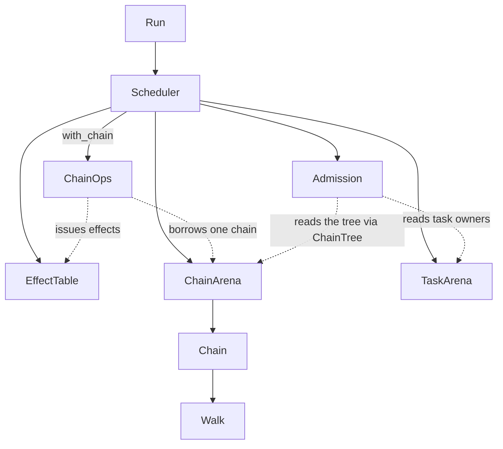

# Engine: response limits, typed sys, walk positions, and the scheduler split

<product-contract>

## Product Requirements

A review of the runvil engine's source found three faults, each a piece of state the Engine duplicates or doesn't need, and a `Scheduler` that holds every piece of run state. This plan fixes the three faults and splits `Scheduler` into four sub-objects that each own their state and enforce their own rules, plus a per-chain view that runs every request touching only one chain. Nothing the caller sees changes, except that `RunLimits` loses two fields the Engine never read.

- Problem and users:
  - The users are the engine's maintainers, and the Harness's gateway client, which is the only code that reads the two response limits.
  - Response limits: `RunLimits` carries `max_response_bytes` and `receive_timeout`, but the Engine never reads them. Their only reader is `GatewayBroker::new` (`crates/harness-gateway-client/src/broker.rs:70-79`), which builds `RunLimits::default()` just to pass both values on. `GatewayChat` already holds both limits with identical defaults (`crates/harness-gateway-client/src/transport.rs:39-48`), and the Harness never calls `with_limits`, so setting them on a `RunContext` has no effect.
  - Untyped `sys`: each section's `sys` is built as JSON (`crates/runvil-internal/engine/src/execute/context.rs:384-398`), stored, and parsed back, so `entry_id()` returns a `Result`. The first-call install reads the VM's copy back to add `model`, though that copy only ever holds values the Engine supplied.
  - Scattered walk position: a chain's position is three `Chain` fields, `slice`, `index`, and `positions` (`crates/runvil-internal/engine/src/execute/scheduler/chain_record.rs:281-298`), and a jump target is two different types.
  - God object: `Scheduler` has 13 fields plus a test-only one (`crates/runvil-internal/engine/src/execute/scheduler.rs:191-254`) and about 100 methods, and the rules for effects, chains, tasks, and admission are spread across all of them.
- Goals:
  - The response limits belong to the gateway client alone.
  - `sys` is a typed value, and reading a section's entry id can't fail.
  - One section-position type, and one walk stack per chain.
  - `Scheduler` becomes a protocol orchestrator over four sub-objects: `EffectTable`, `ChainArena`, `TaskArena`, and `Admission`. Every bookkeeping rule lives in exactly one type.
  - Every request that touches only its own chain runs in a `ChainOps` view that can't reach anything else, so `Scheduler` keeps only the methods that coordinate more than one owner.
- Non-goals:
  - Any change in behavior.
  - Modeling H1 as the document's root section.
  - Extracting anything beyond the four sub-objects and the `ChainOps` view. The Decision Record lists the candidates and why each was rejected.
- Success criteria:
  - Every existing suite passes after every step, plus the new tests each step adds.
  - The public API listing loses exactly the two `RunLimits` field lines.
  - With Step 6 landed, `Scheduler` holds 8 fields: `ctx`, `phase`, `scope`, `ready`, `effects`, `chains`, `tasks`, and `admission`.
  - About 58 of today's 100 methods stay on `Scheduler`. Each either runs the run's lifecycle or coordinates two or more of: other chains, the task arena, the effect table, admission state, and the `ready` queue. They group as the run's lifecycle and driving (11), stepping and routing (6), chain lifecycle across chains (9), calls and spawns (4), tasks and timers (12), waits and task requests (11), and applying admission (5).
  - If Step 6 is dropped, about 65 methods stay, and the admission state stays on `Scheduler` and `ChainKind` as it is today.
- Constraints:
  - Paths starting with `crates/` or `vibe/` are relative to the runvil repository root, `c:\Users\Vinnie\cursor\runvil`. Paths starting with `runvil-docs/` name files in the guide repository, `c:\Users\Vinnie\cursor\runvil-docs`, which is its own git repository. Every other path is relative to `crates/runvil-internal/engine/src/`, the engine crate's source root.
  - Line numbers cite runvil commit `af367e08b`, which was HEAD with a clean tree when this plan was consolidated on 2026-10-26. They shift as steps land, so find each site by name and treat the number as a hint.
  - Run every command from the runvil repository root, in PowerShell.
  - No behavior change in any step.
  - One commit per step, holding its code and its tests. Commit without asking, and write each message from the staged diff.
  - Step 1's guide edits are committed in the guide repository after the runvil commit, with a subject that names that commit's short hash.
  - Engine crates' docs, comments, tests, and strings say "the caller", never the Host, and name the Harness only to assign it a responsibility. The gateway client is a Harness crate, so it may say Host.
  - Comments state non-obvious constraints only. They never narrate history ("after the refactor", "used to").
  - Source directories stay flat.
  - Unit tests go in the module's kebab-case test sibling, wired with `#[cfg(test)] #[path = "foo-tests.rs"] mod tests;`. Test names are snake_case sentences that state the behavior.
  - Engine tests never sleep, read the clock, or draw entropy. `unwrap` and `expect` appear only in tests.
  - Rename files with `git mv`, and never remove a file with the Delete tool.
  - Prose and comments use a plain dash, never an em dash or a double dash.
- Open questions: None.

## Functional Specification

The caller drives a run exactly as before: every step, effect, event, and error stays the same, in the same order. The one change the caller can notice is that `RunLimits` has four limits instead of six. The `sys` object that prompts see keeps its keys and value types.

- Actors and workflows:
  - The caller drives a run by answering the effects it issues. That workflow doesn't change.
  - The Harness's gateway client applies its own request limits to every model request: 120 seconds per receive and 16 MiB per reply, the same defaults as today. `GatewayChat::with_request_limits` stays the only way to set them, and nothing sets them today.
- Inputs and outputs:
  - `RunLimits` keeps its other four limits and their defaults.
  - The `sys` object handed to Lua and to substitution keeps today's keys and value types, with `taskid` as a string. `index` and `model` are absent when unset, not null, because Lua raises on an absent field and reads null as nil.
  - Entry ids stay `String` at the public boundary (`Effect::Render.entry`, `ToolCallOrigin.entry`).
  - The dotted text of a library key stays byte-identical, because Lua `require`'s cache and cycle check use it as their key.
- States and validation: Effect, chain, task, and admission state follow the same rules as today. Technical Design assigns each rule to the one type that enforces it.
- Errors and recovery: Every error stays as it is, with one exception on a path no correct run reaches. When a spawn's worker index is past its slice, `prepare_spawn` returns an internal error, where today it indexes out of range and panics.
- Security and privacy behavior: No change.
- Acceptance criteria:
  - The existing suites pass at every step. The only test edits are the shape updates and additions listed in the Testing Plan.
  - The guide says there are four run limits, and that the response cap and the receive timeout are request limits the gateway client applies to each model request.

</product-contract>
<implementation-contract>

## Technical Design

Step 1 moves the two response limits into the gateway client alone and replaces each section's JSON `sys` with a typed `SectionSys`. Step 2 gives the engine one section-position type, one walk stack per chain, and one jump-target type. Steps 3 to 6 split `Scheduler` into four owned sub-objects, each enforcing its own rules, and a per-chain view for the requests that touch only one chain. `Scheduler` keeps every method that coordinates more than one owner, and keeps the order of those writes.

- Architecture:
  - Two kinds of piece earn a place. An owner holds some state and enforces a rule on it. A view owns nothing: it borrows a fixed set of owners, and its rule is what it can't reach, which the compiler enforces.
  - The owners are `EffectTable`, `ChainArena`, `TaskArena`, and `Admission`. The views are `ChainTree`, read-only, for `Admission`, and `ChainOps`, for the requests of one chain.
  - No cross-writes: an owner never writes another one. The one cross-read is `Admission` reading the chain tree, through `ChainTree`.
  - `Scheduler` keeps anything that coordinates two owners, the run's lifecycle (`ctx`, `phase`, `scope`), and the `ready` queue.
  - Sub-objects are plain owned fields, with no traits and no `Rc` or `RefCell`, so they cost nothing at run time. A method can borrow one sub-object while it mutates another. Where a method does both at once, it reaches the sub-objects as fields, not through `&self` helpers. The case today is `dispatch_note`, which writes a task entry keyed by the chain's task.



- Modules and interfaces:
  - `SectionSys`, beside `SectionContext` in `execute/section_context.rs`:
    - Fields: `when: Arc<str>`, `id: String`, `taskid: TaskId`, `section_name: String`, `execution: Arc<str>`, `section_count: usize`, `index: Option<u64>`, and `model: Option<String>`.
    - `to_json()` builds exactly the object `RunState::sys_json` builds today, inserting `index` and `model` only when they're set.
    - `RunState::section_sys(..) -> SectionSys` replaces `sys_json`. `SectionContext` stores `sys: SectionSys`, which also replaces its duplicate `name` field, and `entry_id()` returns `&str`.
    - The first-call install sets `model` to `binding.id().name()` on a clone of the sys, re-seals the VM's `sys` from `to_json()`, and keeps the new value only after the re-seal succeeds. It reads nothing back from the VM.
    - The JSON boundary into runvil-lua and substitution doesn't change.
  - `SectionPos { slice: SlicePath, index: SectionIndex }`, in `heading_address.rs`, deriving `Clone`, `Debug`, `PartialEq`, and `Eq`:
    - `top(index)`: the top-level section at `index`.
    - `next()`: the next sibling.
    - `child(index)`: this section's child at `index`, whose slice is `self.slice.child(self.index)`.
    - `siblings(prompt)`: the resolved slice.
    - `section(prompt) -> Option<&Section>`.
    - `name(prompt)`: the section's name, or the prompt's title when the index is past the slice. This is today's `SlicePath::name_at`.
  - `Walk`, in `execute/scheduler/chain_record.rs`: a stack that is never empty, with the current position on top.
    - It replaces `Chain.slice`, `Chain.index`, and `Chain.positions`. `entered_name` stays a `Chain` field.
    - `current()`.
    - `advance()`: the fall-through to the next sibling.
    - `jump(target)`: a descent pushes, and a sibling jump replaces the top.
    - `pop()`: drops an exhausted child level and moves the parent past the jumper. It returns false at the root level.
    - The H1 chain's walk is `Walk::new(SectionPos::top(SectionIndex::FIRST))` and goes unused, as its position does today.
  - `JumpTarget { pos: SectionPos, descends: bool }`, in `execute/walk_target.rs`, replaces both today's `JumpTarget` enum and `ChainTarget`.
    - `resolve_jump_target(heading, prompt, jumper: &SectionPos) -> Result<JumpTarget>`.
    - `resolve_chain_target` returns a `JumpTarget`. For the H1 pass it returns `JumpTarget { pos: SectionPos::top(i), descends: false }`.
  - Types that take a `SectionPos` in place of a slice and an index: `ChainStart.start`, `SectionContext::new`, `Reached { section, pos }`, `Reachable { root, from: Option<&SectionPos> }` (where `None` means the H1 pass), `RequireOrigin::Section(SectionPos)`, which `from_key` builds, and `library_key(&SectionPos)`.
  - `EffectTable`, in `execute/scheduler/effects.rs`, holding the table and its entry types:
    - State: `outstanding`, `issued`, `withdrawn`, `next_effect`, and `next_round`.
    - Rules: every issued effect is answered exactly once. An answer to an orphaned effect is discarded. An answer for an unknown id, or a second answer, is reported to the scheduler. `withdrawn` lists the tool calls orphaned since the last step, in id order. An effect issued in a step still goes out with that step, even if the run's end orphaned it in the same step, because the caller still owes it an answer.
    - `issue(chain, provenance, effect, resume)`. In Step 3, `Scheduler::issue` stays as a two-line wrapper that stamps the provenance from the chain's emitter. Step 4 moves that wrapper to `ChainOps::issue`.
    - `number_round(origin)`.
    - `arrive(id) -> Arrival`, where `Arrival` is `Awaited(Pending)`, `Orphaned`, or `Unknown`. Today's `Outstanding::Parked` becomes `Awaited`: a timer's entry sits under an owner that isn't suspended, so "parked" never meant the chain was suspended.
    - `orphan(id) -> Option<(ChainIndex, ExecId)>`: records the withdrawal and returns the tool-call identity.
    - `orphan_all()`, for teardown: orphans silently, recording no withdrawals and returning no identities, because those end when the run's scope closes. That's how teardown differs from `orphan` today, and folding the two together would change what the caller sees.
    - Queries: `awaited_by(chain)`, in issue order; `has_awaited()`, the stall check; and `all_answered()`, which gates `Done`.
    - `reassign(from, to)`, for the H1 hand-off.
    - Step bookkeeping: `take_step()` and `clear_withdrawn()`.
  - `ChainArena`, in `execute/scheduler/chain_record.rs` beside `Chain`:
    - `ChainIndex` moves here from `execute/scheduler.rs`, and only `push` creates one.
    - Rule: every index the arena hands out names a chain. The arena holds at most `u32::MAX` chains and never shrinks.
    - `push(Chain) -> Result<ChainIndex>`, which checks the bound first; `Index<ChainIndex>` and `IndexMut<ChainIndex>`; `iter()`; `len()`; and `call_children(parent)`.
    - The test-only `max_chains` bound moves into the arena.
    - The id counters move onto `Chain` as `next_child_id()` and `next_entry_id()`.
  - `ChainOps<'a>`, in `execute/scheduler/chain_ops.rs`, built in Step 4: a view that borrows one chain mutably, the effect table mutably, and `ctx` shared, and nothing else.
    - Rule: a request that runs in the view can change only its own chain and the effect table. It can't reach another chain, the task arena, admission, or the `ready` queue.
    - It takes the 29 methods that, followed through every `Scheduler` method they call, touch nothing beyond their own chain, the effect table through `issue` and `number_round`, the `ready` queue through `answer_inline`, and reads of `ctx`:
      - chat and render: `dispatch_chat`, `prepare_chat`, `accept_render`, `merge_render`, and `accept_chat` (`execute/scheduler/chat.rs`)
      - infer and VFS: `dispatch_infer`, `prepare_infer`, and `dispatch_vfs` (`execute/scheduler/dispatch.rs:116-186`), and `accept_infer` and `accept_vfs` (`execute/scheduler/apply.rs`)
      - tool calls: `dispatch_tool_call`, `dispatch_tool_calls`, `tool_route`, `call_turn`, `section_call_counts`, `fill_batch_slot`, `answer_full_batch`, `prepare_tool_call`, and `prepare_catalog_call` (`execute/scheduler/tool_call.rs`); `prepare_adhoc_call` and `dispatch_adhoc_tool_done` (`execute/scheduler/tool_call-adhoc.rs`); `prepare_discovery_call` and `prepare_reached` (`execute/scheduler/tool_call-discovery.rs`); and `accept_tool_call` (`execute/scheduler/apply.rs`)
      - the walk within one chain: `enter_section`, `end_section`, `pop_position`, `apply_jump`, and `resolve_chain_target` (`execute/scheduler/walk.rs`)
    - `issue` stamps the provenance from its own chain's emitter and calls `EffectTable::issue`. `prompt` reads the borrowed `ctx`.
    - `answer(value)` replaces `answer_inline` inside the view. It delivers the answer to the chain and records the requeue, because the view can't touch `ready`.
    - `Scheduler::with_chain(id, f)` is the only way into the view. It builds the view from the `chains`, `effects`, and `ctx` fields, runs `f`, and then pushes the chain onto `ready` once for each answer the view recorded.
    - `Scheduler::issue` and `Scheduler::number_round` go. `Scheduler::answer_inline` stays for the cross-chain paths, such as `finish` answering a parent.
  - `TaskArena`, in `execute/scheduler/tasks.rs`, owning the `BTreeMap<TaskId, TaskEntry>`:
    - Rules: entries are never removed. A task moves only from Running to Done, Cancelled, or Abandoned, and from Done to Delivered. The arena checks ownership, and a chain's view of the task it runs inside. It lists tasks in spawn order and never lists internal timers.
    - `insert`, `owned`, `visible(caller, caller_task, task)`, `live_of`, `first_terminal`, `complete`, `take_delivery`, `live_owners`, `reassign`, `set_note`, `execs_owned_by`, `exec_of`, and `owner_of`.
    - `stop(task, Stop) -> Option<(TaskBacking, String)>`, where `enum Stop { Cancelled, Abandoned }`. It returns the backing and target when the task was live.
    - `Continuation::Timer(TaskId)`: firing or dropping a timer looks its entry up by id instead of scanning every entry for the timer's effect.
    - `SlotState` is renamed `EntryState`.
  - `Scheduler::end_backing`, the one shared path for cancelling and abandoning a task:
    - For a timer, it aborts the effect and reports nothing.
    - For a chain, it captures whether the task was admitted and its emitter, aborts the subtree, and emits the terminal event if the task was admitted.
    - It returns whether the backing was a chain, so `abandon_owned_tasks` keeps timers off the leaked list.
  - `Admission`, in `execute/scheduler/admission.rs`, built in Step 6:
    - It owns the resume and spawn queues, the spawn records of queued tasks (`SpawnRecord` moves here from `execute/scheduler.rs`), which task chains hold slots right now, and which call chain gave back whose slots.
    - Rules: a task holds a slot at its owner and at every ancestor. A task wait gives those slots back, and a call chain gives them back through its nearest ancestor that holds slots. Resumed chains are admitted before fresh spawns. Slot counts are computed from the holders, never stored.
    - `ChainTree<'a> { chains: &ChainArena, tasks: &TaskArena }` provides `enclosing`, `ancestors`, `call_parent` (because a wait's give-back walks call parents only), and each chain's kind and `limit`. It's built inline from those two fields, so `admission` can be mutated while they're borrowed. It reads each task's owner from `TaskEntry`, so nothing mirrors the owner.
    - `enqueue_spawn(id, record)`.
    - `plan(tree) -> Result<Vec<Admit>>`, where `Admit` is `Resumed(id)` or `Started(id, SpawnRecord)`. It updates its own slot state and keeps today's counting: one count per pass, with each admission adding its own. It returns an internal error where `admit` does today.
    - `park(id, tree, waits_on_tasks)`. The scheduler computes the bool, so `Admission` never reads task backings.
    - `wake(id, tree) -> bool`, true when the chain was requeued to take its slots back.
    - `release(id)` at chain end, `forget(id)` at an abort, and `clear()` at teardown.
    - `is_queued(id)`. "Admitted" means a task chain that isn't queued.
    - `ChainKind` becomes purely structural: `Root | H1 | Call { parent } | Task`. Today's `Admission` enum goes, along with `admitted()`, `holding()`, and `stop_holding()`.
- File and public API changes:
  - Public API: `RunLimits` loses `max_response_bytes` and `receive_timeout`, and `crates/runvil/public-api.txt` loses their two lines (:834, :836). Nothing else in the public API changes.
  - Gateway client: `GatewayBroker::new` stops building a `RunLimits` and stops calling `with_request_limits`. In `GatewayChat` (`crates/harness-gateway-client/src/transport.rs`), the field `request_timeout` becomes `receive_timeout`, `DEFAULT_REQUEST_TIMEOUT` becomes `DEFAULT_RECEIVE_TIMEOUT`, and the `with_request_limits` parameter is renamed to match. `receive_timeout` is the guide's name for the setting.
  - runvil-lua (`crates/runvil-internal/lua/src/`): `enrich_sys_model`, its helper `enrich_sys_field`, its re-export, and `current_sys` are deleted.
  - Guide (`runvil-docs/src/language/16-limits-and-errors.md` and `runvil-docs/src/language/17-quick-reference.md`): four run limits, plus two request limits that the gateway client applies to each model request, with unchanged defaults.
  - `execute/scheduler/pending.rs` is renamed to `execute/scheduler/effects.rs`.
  - `execute/scheduler/chain_ops.rs` is new. The 29 view methods stay in their current files, under `impl ChainOps<'_>` blocks.
- Data, persistence, failure, security, and privacy constraints:
  - The coupling in the scheduler's state is the order of writes, not overlapping borrows: no method today holds two mutable borrows of different fields at once.
  - The writes whose order matters stay on `Scheduler` in their exact order: `finish`, the mutually recursive `abort_subtree` and `abandon_owned_tasks`, `cancel_task`, and both settle paths. A subtree's events come before its owner's terminal event, and slots are released before the owner wakes.
  - Some of those writes go through shared handles that the borrow checker won't flag: the event buffer, `stamp_effect`, `end_access`, the section's message list, the turn counters, and the tool-call counts.
  - `deliver` keeps today's order: join first, then change the state.
  - The ready order doesn't change. `with_chain` pushes the chain after the view's call returns, where `answer_inline` pushed it mid-call. But the view can push nothing else, so no other chain can enter the queue in between.
  - Unwinding stays one pop per step: `advance_entry` pops one level, requeues, and lets the next step try the restored position.
  - `fire_timer` still errors when the timer's entry isn't live, and `drop_timer` still returns quietly.

</implementation-contract>
<verification-contract>

## Testing Plan

The existing suites guard against any change in behavior, and every step must leave them passing. Each step that adds an owner or the walk stack adds unit tests for it. Step 2 adds tests for three walk cases nothing covers today, and Step 4's view is guarded by the compiler and the request suites. The full command set runs after every step, and Step 1 also runs the workshop and API-listing checks.

- Unit:
  - Step 1: `SectionSys::to_json` keeps today's keys and value types, and leaves out `index` and `model` when they're unset.
  - Step 1: `run_limits_pins_all_six_defaults` in `execute/config-limits.rs` is renamed to say four, and drops its two asserts for the removed fields (:77, :80).
  - Step 1: the `current_sys` test (`crates/runvil-internal/lua/src/tests/section_vm.rs:149-175`) is deleted along with the function.
  - Step 2: unit tests for `Walk`, in `execute/scheduler/chain_record-tests.rs`.
  - Step 3: `EffectTable` tests on the table alone:
    - exactly one answer per effect
    - an orphan's answer is discarded
    - unknown ids and second answers are reported
    - orphaning an id that isn't outstanding records nothing
    - only tool calls are withdrawn, in id order. Where a tool-call continuation is awkward to build in a unit test, `execute/tests/parallel_tool_calls-withdrawn.rs` covers this case instead.
  - Step 5: `TaskArena` tests for its state-change rules.
- Integration and end-to-end:
  - Step 2 closes three gaps that no test covers today:
    - A child level that runs out inside a `call` chain, and inside a task chain, resumes after the jumper.
    - A child level whose jumper was the last section of its slice ends cleanly, through a second pop or the chain's end.
    - The chain reports the right section name after a pop.
  - Step 2 updates the tests that build the old shapes: `execute/tests/exec_flow.rs:132-136`, `heading_address-tests.rs` (`from_self`, `self_home`), and `execute/walk_target-tests.rs` (`path`, `self_origin`).
  - Tests that pass raw JSON as `sys`, such as an empty `sys` or a numeric `id`, need no change, because the JSON boundary is unchanged.
- Regression, security, and performance:
  - Suites to watch, by step:
    - Step 1: `crates/harness-gateway-client/src/transport/tests/limits.rs`, `subst-tests.rs`, and `crates/runvil-internal/lua/src/tests/sys_and_var.rs`.
    - Step 2: `execute/tests/scheduler/walk/`, `execute/tests/scheduler/h1.rs`, `execute/tests/suite/exec_flow/h1_control.rs`, `execute/tests/suite/require.rs`, `execute/tests/exec_flow.rs`, `execute/tests/suite/exec_flow.rs`, `heading_address-tests.rs`, and `execute/walk_target-tests.rs`.
    - Step 3: `execute/run/tests-drops.rs`, `execute/tests/parallel_tool_calls-withdrawn.rs`, and `execute/tests/scheduler/failures.rs`.
    - Step 4, all in `execute/tests/`: `chat_arm.rs`, `chat_scope.rs`, `chat_record_rebuild.rs`, `render_effect.rs`, `rendered_tools.rs`, `live_infer.rs`, `debug_and_counts-infer-rounds.rs`, `suite/vfs.rs`, `tool_call_arm.rs`, `tool_call_arm-adhoc-handlers.rs`, `tool_call_access.rs`, `tool_call_origins.rs`, `parallel_tool_calls.rs`, `parallel_tool_calls-withdrawn.rs`, `discovery.rs`, `discovery-refusals.rs`, `adhoc_tools.rs`, `adhoc_tools-wrappers.rs`, and `scheduler/walk/`.
    - Step 5: `execute/tests/waits.rs`, `execute/tests/timeouts.rs`, `execute/tests/tasks.rs`, `execute/tests/tasks-chain-end.rs`, and `execute/tests/happens_before.rs`.
    - Step 6: `execute/tests/scheduler/concurrency.rs`, `execute/tests/scheduler/concurrency-stepped.rs`, `execute/tests/scheduler/fanout/scheduling.rs`, and `execute/tests/happens_before-concurrency.rs`.
  - `crates/workshop/ui/test/docs-claims.mjs` checks that the engine crates say "the caller" rather than the Host.
  - Security and performance: no change expected, since the sub-objects are plain fields with no runtime indirection.
- Exit criteria:
  - After every step, all of these pass, run from the runvil root in PowerShell:

    ```powershell
    cargo nextest run --locked --workspace --exclude workshop --exclude workshop-server --exclude workshop-server-api --all-features
    $env:CARGO_BUILD_WARNINGS='deny'; cargo clippy --workspace --exclude workshop --exclude workshop-server --exclude workshop-server-api --all-targets --all-features
    cargo fmt --all --check
    $env:RUSTDOCFLAGS='-D warnings'; cargo doc --workspace --no-deps --all-features --exclude workshop --exclude workshop-server --exclude workshop-server-api
    $env:RUSTDOCFLAGS='-D warnings'; cargo doc -p runvil --no-deps
    $env:RUSTDOCFLAGS='-D warnings'; cargo doc --locked --no-deps --all-features -p runvil-engine --document-private-items
    cargo test -p build-xtask
    node --test crates/workshop/ui/test/docs-claims.mjs
    ```

  - Step 1 also runs these. The nightly is the one pinned in `crates/build-xtask/src/api/toolchain.rs:19`.

    ```powershell
    cargo nextest run --locked -p workshop -p workshop-server -p workshop-server-api
    $env:CARGO_BUILD_WARNINGS='deny'; cargo clippy -p workshop -p workshop-server -p workshop-server-api --all-targets
    Remove-Item Env:CARGO_BUILD_WARNINGS -ErrorAction SilentlyContinue; cargo +nightly-2026-09-05 xtask api --bless; cargo +nightly-2026-09-05 xtask api --check
    ```

</verification-contract>
<decision-record>

## Decision Record

- Decisions:
  - Do the three fixes: move the response limits out of `RunLimits`, type `sys`, and use one position type with one walk stack. Each removes duplicated state the Engine doesn't need. The user's words, answering a numbered list of four suggested fixes: "1. yes / 2. yes / 3. yes".
  - Split `Scheduler` into `EffectTable`, `ChainArena`, `TaskArena`, and `Admission`. Each owns some state and a rule it can enforce alone, and the methods that write more than one of them stay on `Scheduler`. The user's words: "think deeply on how to decompose the god-object scheduler into "just right" subobjects or whatever you think best". The user left the choice of the four to the planner.
  - The per-chain requests move into the `ChainOps` view. A pass over every `impl Scheduler` method found 29 that, followed through every `Scheduler` call they make, touch only their own chain, the effect table, the `ready` queue (8 of them, through `answer_inline`), and reads of `ctx`. The earlier claim that the request handlers work across all four owners was wrong for these 29, and leaving them on `Scheduler` kept it at about 85 methods. The user's words: "why 85 scheduler members? that's a lot, you can't figure out how to decompose it?"
  - `with_chain` is the only way into the view and does the requeue, so the view never touches `ready` and its reach stays exactly one chain plus the effect table. This was the planner's call under the decomposition decision.
  - The Admission step, now Step 6, is conditional. It's the largest reshape, held at medium confidence, and Steps 1 to 5 don't depend on it. The user chose: "Do it, but drop it if it can't pass the suites without changing admission order; revert it, finish at Step 4, and record it as deferred". The answer came before the view step was added, when "Step 4" was the TaskArena step, which is now Step 5.
  - `EffectTable` is extracted first. Six methods write it today (`issue`, `resume`, `step`, `end`, `teardown`, `abort_effect`), plus `reassign_tasks` reaching into its entries. It needs only a provenance stamp and a chain index from the chain arena, and the docs already call it "the effect table". This was the planner's call under the decomposition decision.
  - `Admission` owns the slot state as well as the queues, so the type can enforce its own slot rules. This was the planner's call under the decomposition decision.
- Rejected alternatives:
  - Modeling H1 as the document's root section. The user declined it: "4. no". Revisit only if the user reopens it.
  - A broker setter for the request limits. Nothing tunes them today, and `GatewayChat::with_request_limits` stays the setting. Revisit when something needs to tune them per broker.
  - A typed entry id. It's a public API change, and it isn't needed to make `entry_id()` infallible. Revisit when a public API change is planned anyway.
  - Merging `Effect::Chat`'s `after` and `keep` into one field. It would change a closed public enum and the log format. The two-field shape is a constraint the user recorded when the fields were added: "No new public type. The public API changes only by the `after` and `keep` fields on the two Chat variants." (`vibe/2026-10/2026-10-09-2-messages-userdata-refactor.md:61`). Revisit only if the user reopens the `Chat` effect's shape.
  - Extracting the ready queue. It's a first-in, first-out queue with no rule of its own. Revisit if it gains one.
  - Extracting `phase` and `scope`. Only `execute/scheduler/drive.rs` touches them. Revisit if another module starts writing them.
  - Moving the cross-owner handlers into views too: calls, spawns, joins, cancels, concurrency, notes, and timers. Each coordinates two or more owners, so its view would need `&mut` to all of them, which is `Scheduler` again. Revisit if one of them comes to touch only its own chain.
  - Letting `ChainOps` read the task arena, so the four task-query handlers (`dispatch_ready`, `dispatch_status`, `task_status`, `dispatch_pending`) move too. That widens the view's rule for four thin methods. Revisit if more read-only task handlers appear.
  - Making the 29 methods `Chain` methods that take the effect table and the run context as parameters. It's the same split, but every method gains two parameters, and the requeue has to come back through every return value instead of one place. Revisit if `with_chain` needs to do more than build the view and requeue.
  - A generic helper for the six `dispatch_*` and `prepare_*` pairs. Each pair does something different on success. Revisit if their success paths converge.
  - An `Admission` that owns only the two queues and takes the chain arena as a parameter. It's less churn, but the slot state would stay in `ChainKind`, so the type couldn't enforce its own rule. If Step 6 is dropped, this is the first shape to reconsider.
- Assumptions, risks, and notes:
  - Origin: a review of the engine's outline, then of its source, found these faults. The smaller findings already landed in the engine slop cleanup (`vibe/2026-10-26-1-engine-slop-cleanup.md`, all 28 items), which deferred the `Scheduler` split to this plan.
  - Risk: the write-order constraints in Technical Design are the likeliest place for a silent behavior change, because several of those writes go through shared handles the borrow checker won't flag. The suites listed for Steps 3 to 6 are the guard.
  - The pass that found the 29 view methods followed `Scheduler` calls only, not the `Chain` methods and free functions they call. Those can't index the chain arena, so they can only reach beyond the chain through shared handles, which the write-order risk above already covers. The compiler enforces the view's reach, so a method that needs more fails to build and stays on `Scheduler`.

### Deferred and Out of Scope

- Deferred:
  - Remaining review findings, to revisit in a later engine review pass:
    - `prepare` and `Run::new` each take the prompt, and nothing ties the two together.
    - `RunResult` is `#[non_exhaustive]`, while `Step` and `Effect` are closed on purpose.
    - `SourceLocation` uses a `"<prompt>"` placeholder string and mixes prompt and Rust positions.
    - `EffectRecord::Timer` stores float seconds.
    - `perform_vfs_op` is a one-line wrapper over `run_store_op`.
    - `TaskSeed` and `VmSeed` overlap.
    - Public types are re-exported four times on the way to the crate root.
    - `set_of` and `set_mut` should be methods on `PackToolSets`.
    - `cancel.rs` gives a stale reason for its alias.
    - The Lua error is still copied variant by variant, under comments that narrate history ("unchanged by the extraction").
- Out of scope:
  - The guide says the Harness can change every run limit, but the Harness never calls `with_limits`, so every run uses the defaults.
  - A discovery tool call also runs the first-call install that sets `sys.model`, which the guide doesn't mention.

</decision-record>
<project-survey>

## Project Survey

- Status: complete
- Build command: `cargo build --locked -p gateway` (CI's build step; plain `cargo build` builds only the default member `crates/gateway/app`). The desktop app is `cargo build --locked -p workshop`, and `cargo workshop` (alias for `run -p build-workshop --`) runs the full Workshop build orchestrator. Engine and Harness crates have no separate build step; the clippy gate compiles them, and AGENTS.md forbids a standalone `cargo check --workspace` beside it.
- Focused test command pattern: `cargo nextest run --locked -p <crate> --all-features <test-name-substring>`, for example `cargo nextest run --locked -p runvil-engine --all-features chain_record`. For `workshop`, `workshop-server`, and `workshop-server-api`, drop `--all-features`. Tool: cargo-nextest 0.9.128 is installed; profiles live in `.config/nextest.toml`.
- Component test command pattern: `cargo nextest run --locked -p <crate> --all-features` (for this plan: `-p runvil-engine`, plus `-p runvil -p harness-gateway-client` for Step 1). Add `cargo test -p build-xtask` when files move or module layout changes, and `node --test crates/workshop/ui/test/docs-claims.mjs` when docs, comments, or rulebooks change.
- Full-suite test command: `cargo nextest run --locked --workspace --exclude workshop --exclude workshop-server --exclude workshop-server-api --all-features`, then `cargo nextest run --locked -p workshop -p workshop-server -p workshop-server-api`. Structural checks: `cargo test -p build-xtask` and `node --test crates/workshop/ui/test/docs-claims.mjs`.
- Linter command: `$env:CARGO_BUILD_WARNINGS='deny'; cargo clippy --workspace --exclude workshop --exclude workshop-server --exclude workshop-server-api --all-targets --all-features`, then `cargo clippy -p workshop -p workshop-server -p workshop-server-api --all-targets`, plus the headless feature gate `cargo check -p gateway --no-default-features`. Unset with `Remove-Item Env:CARGO_BUILD_WARNINGS` before the facade surface check.
- Formatter check command: `cargo fmt --all --check` (`rustfmt.toml` sets `style_edition = "2024"`; the pre-commit hook runs it).
- Docs command: `$env:RUSTDOCFLAGS='-D warnings'; cargo doc --workspace --no-deps --all-features --exclude workshop --exclude workshop-server --exclude workshop-server-api`, then `cargo doc -p runvil --no-deps` (facade, default features). When the public surface changes: `cargo +<pinned nightly> xtask api --check`, with the nightly named in `crates/build-xtask/src/api/toolchain.rs`, checked against `crates/runvil/public-api.txt`. CI also runs `cargo doc --locked --no-deps --all-features -p runvil-engine --document-private-items`.
- Test placement and naming conventions:
  - Unit tests live in a kebab-case sibling `foo-tests.rs`, wired as `#[cfg(test)] #[path = "foo-tests.rs"] mod tests;` (about 200 such files, for example `src/execute/scheduler/chain_record-tests.rs`).
  - Larger in-crate suites live in a `tests/` module directory inside `src`; the engine's is `src/execute/tests/` (wired by `#[cfg(test)] mod tests;` in `execute.rs`) with `scheduler/`, `scheduler/walk/`, `scheduler/h1/`, `scheduler/fanout/`, `suite/`, `suite/exec_flow/`, and `suite/require/` subtrees, plus `src/lua/tests/`.
  - Integration tests compile as one binary per crate at `tests/suite/main.rs` with sibling modules (`crates/runvil/tests/suite/`, `crates/harness/tests/suite/`). Prompt fixtures are `.md` files under `tests/prompts/valid/`, `invalid/`, and `execution/`.
  - Benches: `crates/runvil-internal/engine/benches/` (`models_loop`, requires the `test-support` feature) and `crates/runvil-internal/lua/benches/`.
  - Test names are snake_case sentences stating the behavior, such as `a_round_that_reported_usage_becomes_the_measurement`. `unwrap` and `expect` are allowed only in tests (`clippy.toml`). Engine tests never sleep, read the clock, or draw OS entropy; pseudo-random input uses a printed fixed seed; temp directory names come from the test name, process id, and a counter.
- Directory map:
  - `crates/`: every Rust crate plus the TypeScript packages. `runvil-internal/`, `harness-internal/`, `gateway/`, and `workshop/` are manifestless containers for each family's private crates (`gateway/stt/` nests one level deeper). `shared-ui/` is a TypeScript and CSS package, not a Rust crate. `workshop/` is also an npm workspace root (`ui`, `look`, `platform`, and others). The `build-*` crates are tooling: `build-xtask` (structural checks and the API surface check), `build-workshop`, `build-ui`, `build-user-guide`, `build-llama-cuda`, `build-ceiling`.
  - `guide/`: mdBook configs and site chrome for the gateway, language, and workshop books; the book content is not tracked in this repository.
  - `prompts/`: example prompt files.
  - `tools/`: Node scripts for gateway sidecar staging and a live TTS check, each with a `.test.mjs`.
  - `vibe/`: dated plan and run logs named `YYYY-MM-DD-N-slug.md`, older ones grouped in month folders; `vibe/scratch` is ignored.
  - `images/`: README banners.
  - `.github/workflows/`: CI (`ci.yml`), releases, nightly, site, Miri, and installer smoke tests. `.githooks/`: pre-commit runs fmt; pre-push runs docs-claims, the headless gateway check, clippy, and `cargo deny`.
  - `.cargo/config.toml`: `rust-lld` and static CRT on Windows, the `xtask` and `workshop` aliases. `.config/nextest.toml`: nextest profiles and test groups.
  - Root files: workspace `Cargo.toml` (resolver 3, edition 2024, version 0.3.0, Engine MSRV 1.95), `clippy.toml`, `deny.toml`, `rustfmt.toml`, `rust-toolchain.toml` (stable), `dist-workspace.toml` (cargo-dist), and the `AGENTS.md` rulebook.
  - `local/` and `target/` are gitignored (machine-local configs, build output).
- Component boundaries (an arrow means "depends on"):
  - Engine: `runvil` facade -> `runvil-engine`, `runvil-lua`, `runvil-parser`, `runvil-model-client`, `runvil-types`, `runvil-vfs`. Inside: engine -> lua, parser, model-client, types, vfs; parser -> lua, types; lua -> model-client, types, vfs; model-client -> types; `runvil-types` and `runvil-vfs` are leaves. Engine crates must never pull in `tokio`, `tokio-util`, `async-trait`, `reqwest`, `getrandom`, or `fastrand`, even transitively.
  - `runvil-plugin` (the Plugin and Pack API) -> types, vfs. `plugin-mcp`, `plugin-web`, and `plugin-user-input` -> `runvil-plugin` only.
  - Harness: `harness` -> `harness-runner`, `harness-plugin-loader`, `runvil`, `runvil-plugin`; runner -> `runvil`, `runvil-plugin`; plugin-loader -> `runvil-plugin`; `harness-gateway-client` -> `harness`, `plugin-web`, `runvil`.
  - Gateway: `gateway` (`crates/gateway/app`) -> every `gateway-*` family crate plus `shared-loopback`. Inside: api-types is the leaf; config -> api-types; protocol -> api-types, config; routing -> config, protocol; local -> config, progress, protocol, routing; stt -> stt-engine, backend-whisper -> whisper-ffi. The gateway depends on neither the Engine nor the Harness.
  - Workshop (a Host): `workshop` (desktop) -> `workshop-server-api` -> `workshop-server` -> `harness`, `harness-gateway-client`, `runvil`, the three plugins, and the `workshop-*` family (agents, gateway, menu, protocol, registry, run-log, status, support, user-state, workspace). `workshop-protocol` and `workshop-support` are leaves.
  - Shared leaves: `shared-error-source`, `shared-loopback`. The `build-*` crates have no workspace dependencies.
  - `build-xtask` enforces the product and container boundaries, the Workshop tier graph, the `## Invariants` crate-doc marker, and lint inheritance.
- Conventions summary:
  - Workspace lints apply everywhere (`[lints] workspace = true`): clippy `all` and `pedantic` deny, `unwrap_used` and `expect_used` deny, `allow_attributes` deny (suppress with `#[expect(..., reason = "...")]`), `unsafe_code` deny, `missing_docs` and `unreachable_pub` warn, rustdoc broken and private intra-doc links deny.
  - Dependencies are declared once in root `[workspace.dependencies]`, each with a comment justifying its version and features; members write `foo.workspace = true`.
  - Seven capitalized defined terms (Engine, Harness, Host, Pack, Plugin, Static Set, Dynamic Set). Engine crates say "the caller" and never mention the Host; `docs-claims.mjs` enforces this.
  - Source directories are flat: one or two files in a group sit beside the parent as `foo-bar.rs` with `#[path = "foo-bar.rs"] mod bar;`, and three or more become a `foo/` subdirectory.
  - Comments state only non-obvious constraints, and every workaround cites its upstream issue URL. Error and status messages are written for model consumption: concise, naming required versus actual.
  - JSON that reaches a recorder round-trips exactly (`serde_json` with `float_roundtrip`, sorted keys, finite numbers).
  - Process-global installers (panic hook, global logger or subscriber, default crypto provider) are disallowed outside binary entry points via `clippy.toml`.
  - Cargo features gate only real constraints such as toolchains or heavy native builds. Behavior changes ship with tests in the same commit.
  - Work runs as plans logged in `vibe/`, one commit per step, closed with a `Close plan: <slug>` commit (HEAD is `af367e08b Close plan: engine-slop-cleanup`, clean tree).

</project-survey>
<execution-plan>

## Execution Instructions

Six steps in three components, run in order. Each step is one commit holding its code and its tests, made after its Tests pass. Step 1 also makes one commit in the guide repository after its runvil commit, because the guide is its own git repository. Step 6 is conditional: if it can't pass its Tests without changing admission order, the plan finishes at Step 5.

Components, in dependency order:

1. engine fixes (steps 1 and 2): the three approved fixes. The response limits leave `RunLimits`, each section's `sys` becomes a typed `SectionSys`, and the engine gets one `SectionPos` type with one `Walk` stack per chain. It ships alone, because each fix removes state the Engine duplicates or doesn't need. Placed first because the split's index rewrite and the `ChainOps` walk methods run over the `Chain` fields that `Walk` leaves. Three pieces. The response limits and the typed `sys` are built jointly as Step 1, because they touch different files, neither reads the other's result, and the plan lands them as one runvil commit. The walk positions follow sequentially as Step 2, because they and the typed `sys` both edit `execute/section_context-construct.rs` and `SectionContext::new`.
2. effect and chain owners (steps 3 and 4): `EffectTable`, `ChainArena`, and the `ChainOps` view. It ships alone, because it gives effects and chains one owner each and takes the 29 one-chain requests off `Scheduler`. Placed second because `TaskArena` and `end_backing` use `EffectTable`'s entry types and `orphan`. Three pieces, built sequentially. `EffectTable` comes first, because it needs only a provenance stamp and a chain index from the chains. `ChainArena` follows in the same commit, because its index rewrite and counter move reshape the same scheduler core the same suites guard. `ChainOps` is Step 4, because the view borrows the `EffectTable` and indexes through `ChainArena`.
3. task and admission owners (steps 5 and 6): `TaskArena` with the shared `end_backing`, then `Admission` with its `ChainTree` view. It ships alone, because each type enforces its own lifecycle and slot rules. Placed last because `Admission` reads task owners through `TaskArena::owner_of`, and nothing depends on Step 6, which may be dropped. Two pieces, built sequentially for that reason.

<step-1>

### Step 1: Move the response limits to the gateway client and type each section's sys [completed]

- Component: engine fixes
- Tests: run each from the runvil root in PowerShell, as written:
  - `cargo nextest run --locked --workspace --exclude workshop --exclude workshop-server --exclude workshop-server-api --all-features`
  - `$env:CARGO_BUILD_WARNINGS='deny'; cargo clippy --workspace --exclude workshop --exclude workshop-server --exclude workshop-server-api --all-targets --all-features`
  - `cargo fmt --all --check`
  - `$env:RUSTDOCFLAGS='-D warnings'; cargo doc --workspace --no-deps --all-features --exclude workshop --exclude workshop-server --exclude workshop-server-api`
  - `$env:RUSTDOCFLAGS='-D warnings'; cargo doc -p runvil --no-deps`
  - `$env:RUSTDOCFLAGS='-D warnings'; cargo doc --locked --no-deps --all-features -p runvil-engine --document-private-items`
  - `cargo test -p build-xtask`
  - `node --test crates/workshop/ui/test/docs-claims.mjs`
  - `cargo nextest run --locked -p workshop -p workshop-server -p workshop-server-api`
  - `$env:CARGO_BUILD_WARNINGS='deny'; cargo clippy -p workshop -p workshop-server -p workshop-server-api --all-targets`
  - `Remove-Item Env:CARGO_BUILD_WARNINGS -ErrorAction SilentlyContinue; cargo +nightly-2026-09-05 xtask api --check`
  - `$d = @(git diff -U0 af367e08b -- crates/runvil/public-api.txt | Where-Object { $_ -match '^[-+](?![-+])' }); if ($d.Count -ne 2 -or $d[0] -ne '-pub runvil::RunLimits::max_response_bytes: core::num::nonzero::NonZeroU64' -or $d[1] -ne '-pub runvil::RunLimits::receive_timeout: core::time::Duration') { throw "public-api.txt must lose exactly the two RunLimits field lines, found: $d" }`
  - `if (Select-String -Path ../runvil-docs/src/language/16-limits-and-errors.md -Pattern 'six (run )?limits|six defaults' -Quiet) { throw 'the guide still counts six run limits' }`
- Commit: one runvil commit holding both halves, their tests, and the regenerated `crates/runvil/public-api.txt`. Then one commit in `c:\Users\Vinnie\cursor\runvil-docs` holding the two guide pages, with a subject that names the runvil commit's short hash in that repository's style ("Match the guide to runvil <hash>'s ..."). Commit without asking, and write each message from its staged diff.

Two independent halves land together. The two response limits leave the Engine for the gateway client, which already holds both, and each section's `sys` becomes a typed value whose entry id can't fail. The halves touch different files and can be built in parallel.

Rules for this step:

- Paths starting with `crates/` or `vibe/` are relative to the runvil root, `c:\Users\Vinnie\cursor\runvil`. Paths starting with `runvil-docs/` name files in the guide repository, `c:\Users\Vinnie\cursor\runvil-docs`, its own git repository. Every other path is relative to `crates/runvil-internal/engine/src/`. Line numbers cite runvil `af367e08b`, so find each site by name and treat the number as a hint. Run every command from the runvil root in PowerShell.
- No behavior change: the caller sees the same steps, effects, events, and errors in the same order. The only public API change is the two removed `RunLimits` fields.
- Engine crates' docs, comments, tests, and strings say "the caller", never the Host, and name the Harness only to assign it a responsibility. The gateway client is a Harness crate, so it may say Host. Comments state non-obvious constraints only and never narrate history ("after the refactor", "used to"). Prose and comments use a plain dash, never an em dash or a double dash.
- Unit tests go in the module's kebab-case sibling, wired with `#[cfg(test)] #[path = "foo-tests.rs"] mod tests;`, and are named as snake_case sentences that state the behavior. Engine tests never sleep, read the clock, or draw entropy. `unwrap` and `expect` appear only in tests.
- Source directories stay flat. Rename files with `git mv`, and never remove a file with the Delete tool.

Response limits:

- `execute/config-limits.rs`: delete `max_response_bytes` (:36) and `receive_timeout` (:48), their docs, and their defaults (:60, :63). The struct doc (:8-11) and the `Default` doc (:52-55, which names the "16 MiB model response cap" at :54) list the four remaining limits, `max_tool_iterations`, `max_concurrency`, `lua_memory_bytes`, and `lua_log_events`, whose defaults don't change.
- `crates/harness-gateway-client/src/broker.rs`: `GatewayBroker::new` (:70-79) keeps `GatewayChat::new(endpoint.clone(), key.clone())` and drops `let limits = RunLimits::default();`, the `.with_request_limits(..)` call, and `use runvil::RunLimits` (:16). Its doc (:36-38), which names `RunLimits::default`, says the client's own request limits apply: 120 seconds per receive and 16 MiB per reply.
- `crates/harness-gateway-client/src/transport.rs`: rename the field `request_timeout` to `receive_timeout` (:39, beside `max_response_bytes` at :41) and the constant `DEFAULT_REQUEST_TIMEOUT` to `DEFAULT_RECEIVE_TIMEOUT` (:46, beside `DEFAULT_MAX_RESPONSE_BYTES` at :48). The renames reach the three constructor initializers (:99, :122, :139), the `with_request_limits` parameter and its doc (:151-170), and the reads (:276, :285). `receive_timeout` is the guide's name for the setting. The constants' doc (:44-47) stops saying they match the executor's run limits, and the method doc at :151 says "the client's request limits" where it says "the run's HTTP limits". `with_request_limits` keeps its name and stays the only way to set the limits, and nothing outside tests calls it.
- `crates/harness-gateway-client/src/transport/tests/limits.rs`: `DEFAULT_REQUEST_TIMEOUT` (:81, :106) becomes `DEFAULT_RECEIVE_TIMEOUT`.
- `crates/harness-gateway-client/src/lib.rs` (:6, "under the Engine's default run limits") and `crates/harness-gateway-client/Cargo.toml` (:16-19, "the run limits the broker applies to every round"): say the client applies its own request limits, and drop the run limits from the `runvil` dependency's comment.
- Leave `crates/workshop/gateway/src/client.rs` alone: its `request_timeout` belongs to a different client.
- Regenerate the listing with `Remove-Item Env:CARGO_BUILD_WARNINGS -ErrorAction SilentlyContinue; cargo +nightly-2026-09-05 xtask api --bless`, the nightly pinned in `crates/build-xtask/src/api/toolchain.rs:19`. `crates/runvil/public-api.txt` loses exactly :834 (`max_response_bytes`) and :836 (`receive_timeout`), and nothing else in the public API changes.

Typed sys:

- `SectionSys`, beside `SectionContext` in `execute/section_context.rs`, with fields `when: Arc<str>`, `id: String`, `taskid: TaskId`, `section_name: String`, `execution: Arc<str>`, `section_count: usize`, `index: Option<u64>`, and `model: Option<String>`. `to_json()` builds exactly the object `RunState::sys_json` (`execute/context.rs:384-398`) builds today, inserting `index` and `model` only when they're set.
- `RunState::section_sys(..) -> SectionSys` replaces `sys_json`.
- `SectionContext` (`execute/section_context.rs:74`): `sys: SectionSys` replaces `sys: Value` (:86-88) and the duplicate `name: String` (:81), and `Drop` reads `sys.section_name`. `entry_id()` (:156-161) returns `&str` instead of a `Result`, and its callers at `execute/scheduler/chat.rs:128` and `execute/scheduler/tool_call.rs:380` drop the `?`.
- `install_first_call_state` (`execute/section_context.rs:280-295`) takes `&mut SectionSys`. It sets `model` to `binding.id().name()` on a clone of the sys, re-seals the VM's `sys` with `vm.re_seal_sys(&sys.to_json())`, and keeps the new value only after the re-seal succeeds. It reads nothing back from the VM, so its `current_sys` read goes.
- `execute/section_context-construct.rs`: `new` (:83-89) sets `sys.index` from `seed.index`, and both constructors pass `&sys.to_json()` to `vm_setup`. `new_h1` (:167-171) takes the entering chain's task, which `enter_section` passes as `&chain.task`, instead of hard-coding the root task; the two are the same value.
- runvil-lua: delete `enrich_sys_model` and its helper `enrich_sys_field` (`crates/runvil-internal/lua/src/sys.rs:145-161`), their re-export (`crates/runvil-internal/lua/src/lib.rs:146`), the engine's import (`lua.rs:12`), and `current_sys` (`crates/runvil-internal/lua/src/vm/install.rs:313-319`). The `sys_live` doc (`crates/runvil-internal/lua/src/vm.rs:145`) says it mirrors the sealed `sys` for prose snapshots.
- The JSON boundary into runvil-lua and substitution doesn't change, and entry ids stay `String` at the public boundary (`Effect::Render.entry`, `ToolCallOrigin.entry`).

Guide, in `c:\Users\Vinnie\cursor\runvil-docs`:

- `runvil-docs/src/language/16-limits-and-errors.md`: at :31, :35-42, :111-130, :140, and :146, say there are four run limits, and that the response cap and the receive timeout are request limits the gateway client applies to each model request, with unchanged defaults (16 MiB per reply, 120 seconds per receive). The heading "The six run limits" (:111) and the counts at :113, :124, and :146 say four. No page links to that heading's anchor, so renaming it breaks nothing. Keep the heading "Run limits and their defaults" (:69), which :35 and the quick reference link to. The section at :1085-1121 describes the two limits' behavior and stays true.
- `runvil-docs/src/language/17-quick-reference.md`: rows :274 and :277 keep their names, which now name the client's settings, and "Set by" stays Harness.
- Leave two known gaps alone, both out of scope: the guide says the Harness can change every run limit, though the Harness never calls `with_limits`; and a discovery tool call also runs the first-call install that sets `sys.model`, which the guide doesn't mention.

Tests to add or change:

- New `execute/section_context-tests.rs`, wired from `execute/section_context.rs` with `#[cfg(test)] #[path = "section_context-tests.rs"] mod tests;`: `SectionSys::to_json` keeps today's keys and value types (`when`, `id`, `taskid` as a string, `section_name`, `execution`, `section_count`, and, when set, `index` and `model`), and leaves `index` and `model` out entirely, not null, when they're unset.
- `run_limits_pins_all_six_defaults` (`execute/config-limits.rs:73`) is renamed to say four and drops its two asserts for the removed fields (:77, :80).
- Delete the `current_sys` test (`crates/runvil-internal/lua/src/tests/section_vm.rs:149-175`) along with the function.
- Tests that pass raw JSON as `sys`, such as an empty `sys` or a numeric `id`, need no change, because the JSON boundary is unchanged.

Acceptance:

- `RunLimits` keeps its other four limits and their defaults.
- The gateway client applies 120 seconds per receive and 16 MiB per reply to every model request, the same defaults as today.
- `index` and `model` are absent from `sys` when unset, not null, because Lua raises on an absent field and reads null as nil.
- Don't add a broker setter for the request limits, and don't type the entry id: the plan rejected both.
- Suites to watch: `crates/harness-gateway-client/src/transport/tests/limits.rs`, `subst-tests.rs`, and `crates/runvil-internal/lua/src/tests/sys_and_var.rs`. Focused runs while coding: `cargo nextest run --locked -p harness-gateway-client --all-features`, `cargo nextest run --locked -p runvil-lua --all-features`, and `cargo nextest run --locked -p runvil-engine --all-features section_context`.

</step-1>

<step-2>

### Step 2: Give the engine one section position and one walk stack per chain [completed]

- Component: engine fixes
- Tests: run each from the runvil root in PowerShell, as written:
  - `cargo nextest run --locked --workspace --exclude workshop --exclude workshop-server --exclude workshop-server-api --all-features`
  - `$env:CARGO_BUILD_WARNINGS='deny'; cargo clippy --workspace --exclude workshop --exclude workshop-server --exclude workshop-server-api --all-targets --all-features`
  - `cargo fmt --all --check`
  - `$env:RUSTDOCFLAGS='-D warnings'; cargo doc --workspace --no-deps --all-features --exclude workshop --exclude workshop-server --exclude workshop-server-api`
  - `$env:RUSTDOCFLAGS='-D warnings'; cargo doc -p runvil --no-deps`
  - `$env:RUSTDOCFLAGS='-D warnings'; cargo doc --locked --no-deps --all-features -p runvil-engine --document-private-items`
  - `cargo test -p build-xtask`
  - `node --test crates/workshop/ui/test/docs-claims.mjs`
- Commit: one commit holding the step's code and tests. Commit without asking, and write the message from the staged diff.

A chain's walk position is three `Chain` fields today (`slice`, `index`, and `positions`), and a jump target is two different types. This step adds one section-position type, `SectionPos`, a never-empty `Walk` stack per chain, and one `JumpTarget` struct, and it adds tests for three walk cases nothing covers today.

Rules for this step:

- Paths starting with `crates/` or `vibe/` are relative to the runvil root, `c:\Users\Vinnie\cursor\runvil`, and every other path is relative to `crates/runvil-internal/engine/src/`. Line numbers cite runvil `af367e08b` and shift as steps land, so find each site by name and treat the number as a hint. Run every command from the runvil root in PowerShell.
- No behavior change, with one exception on a path no correct run reaches: when a spawn's worker index is past its slice, `prepare_spawn` returns an internal error, where today it indexes out of range and panics. Otherwise the caller sees the same steps, effects, events, and errors in the same order, and `crates/runvil/public-api.txt` doesn't change.
- Engine crates' docs, comments, tests, and strings say "the caller", never the Host, and name the Harness only to assign it a responsibility. Comments state non-obvious constraints only and never narrate history ("after the refactor", "used to"). Prose and comments use a plain dash, never an em dash or a double dash.
- Unit tests go in the module's kebab-case sibling, wired with `#[cfg(test)] #[path = "foo-tests.rs"] mod tests;`, and are named as snake_case sentences that state the behavior. Engine tests never sleep, read the clock, or draw entropy. `unwrap` and `expect` appear only in tests.
- Source directories stay flat. Rename files with `git mv`, and never remove a file with the Delete tool.

Work items:

- `SectionPos { slice: SlicePath, index: SectionIndex }`, in `heading_address.rs`, deriving `Clone`, `Debug`, `PartialEq`, and `Eq`:
  - `top(index)`: the top-level section at `index`.
  - `next()`: the next sibling.
  - `child(index)`: this section's child at `index`, whose slice is `self.slice.child(self.index)`.
  - `siblings(prompt)`: the resolved slice.
  - `section(prompt) -> Option<&Section>`.
  - `name(prompt)`: the section's name, or the prompt's title when the index is past the slice. It replaces `SlicePath::name_at` (`heading_address.rs:71`).
- The `TOP` static (`heading_address.rs:35-36`) goes, and `Reachable`'s `None` replaces it.
- `Walk`, in `execute/scheduler/chain_record.rs`: a stack that is never empty, with the current position on top. It replaces `Chain.slice`, `Chain.index`, and `Chain.positions` (`execute/scheduler/chain_record.rs:281-298`), and `entered_name` stays a `Chain` field. Update `Chain`'s `Debug` impl.
  - `current()`.
  - `advance()`: the fall-through to the next sibling, today's `chain.index = chain.index.next()` in `end_section` (`execute/scheduler/walk.rs:201-211`).
  - `jump(target)`: a descent pushes, and a sibling jump replaces the top. It takes over the position move in `apply_jump` (`execute/scheduler/walk.rs:227-246`).
  - `pop()`: drops an exhausted child level and moves the parent past the jumper. It returns false at the root level and leaves the position unchanged. It takes over `pop_position` (`execute/scheduler/walk.rs:181-189`).
  - The H1 chain's walk is `Walk::new(SectionPos::top(SectionIndex::FIRST))` and goes unused, as its position does today.
- `JumpTarget { pos: SectionPos, descends: bool }`, in `execute/walk_target.rs`, replaces both today's `JumpTarget` enum (`execute/walk_target.rs:58-65`) and `ChainTarget` (`execute/scheduler/walk.rs:31-46`).
  - `resolve_jump_target(heading, prompt, jumper: &SectionPos) -> Result<JumpTarget>`.
  - `resolve_chain_target` returns a `JumpTarget`. For the H1 pass it returns `JumpTarget { pos: SectionPos::top(i), descends: false }`.
  - `end_h1_at_jump` (`execute/scheduler/h1.rs:138-146`) reuses the H1 branch of `resolve_chain_target`.
- These take a `SectionPos` in place of a slice and an index:
  - `ChainStart.start` (`execute/scheduler/chain.rs:50-53`), at its seven construction sites: `start_root_walk`, `start_h1`, `end_h1`, `prepare_call`, `prepare_spawn`, and two test hooks.
  - `SectionContext::new` (`execute/section_context-construct.rs:63-76`), which also drops its `#[expect(clippy::too_many_arguments)]`, unfulfilled at 7 parameters.
  - `Reached { section, pos }` (`heading_address.rs:164`) and `Reachable { root, from: Option<&SectionPos> }` (`heading_address.rs:155`), where `None` means the H1 pass.
  - `RequireOrigin::Section(SectionPos)` (`execute/walk_target.rs:105`), which `from_key` builds.
  - `library_key(&SectionPos)` (`execute/walk_target.rs:150-159`). The dotted text of a library key stays byte-identical, because Lua `require`'s cache and cycle check use it as their key.
- `prepare_spawn` (`execute/scheduler/tasks.rs:234`) reads the worker through `target.pos.section(&prompt)` and returns an internal error when that is `None`.
- Update `walk.rs`, `h1.rs`, `chain.rs`, `dispatch.rs`, `tasks.rs`, and `test_hooks.rs` in `execute/scheduler/` to the new shapes, with their docs.
- Unwinding stays one pop per step: `advance_entry` pops one level, requeues, and lets the next step try the restored position.

Tests to add or change:

- `Walk` unit tests in `execute/scheduler/chain_record-tests.rs`, one rule each: a new walk's current position is its start; `advance` moves to the next sibling at the same level; a descending `jump` makes the target current, and a `pop` then returns true with the jumper's next sibling current; a sibling `jump` replaces the top without adding a level; `pop` at the root level returns false and leaves the position unchanged; nested descents unwind one level per `pop`.
- Three gaps no test covers today, in `execute/tests/scheduler/walk/child_levels.rs`:
  - A child level that runs out inside a `call` chain, and one inside a task chain, resumes after the jumper.
  - A child level whose jumper was the last section of its slice ends cleanly, through a second pop or the chain's end.
  - The chain reports the right section name after a pop.
- Update the tests that build the old shapes: `execute/tests/exec_flow.rs:132-136`, `heading_address-tests.rs` (`from_self`, `self_home`), and `execute/walk_target-tests.rs` (`path`, `self_origin`).

Suites to watch: `execute/tests/scheduler/walk/`, `execute/tests/scheduler/h1.rs`, `execute/tests/suite/exec_flow/h1_control.rs`, `execute/tests/suite/require.rs`, `execute/tests/exec_flow.rs`, `execute/tests/suite/exec_flow.rs`, `heading_address-tests.rs`, and `execute/walk_target-tests.rs`. Focused run while coding: `cargo nextest run --locked -p runvil-engine --all-features walk`.

</step-2>

<step-3>

### Step 3: Extract the effect table and the chain arena [completed]

- Component: effect and chain owners
- Tests: run each from the runvil root in PowerShell, as written:
  - `cargo nextest run --locked --workspace --exclude workshop --exclude workshop-server --exclude workshop-server-api --all-features`
  - `$env:CARGO_BUILD_WARNINGS='deny'; cargo clippy --workspace --exclude workshop --exclude workshop-server --exclude workshop-server-api --all-targets --all-features`
  - `cargo fmt --all --check`
  - `$env:RUSTDOCFLAGS='-D warnings'; cargo doc --workspace --no-deps --all-features --exclude workshop --exclude workshop-server --exclude workshop-server-api`
  - `$env:RUSTDOCFLAGS='-D warnings'; cargo doc -p runvil --no-deps`
  - `$env:RUSTDOCFLAGS='-D warnings'; cargo doc --locked --no-deps --all-features -p runvil-engine --document-private-items`
  - `cargo test -p build-xtask`
  - `node --test crates/workshop/ui/test/docs-claims.mjs`
- Commit: one commit holding the step's code and tests. Commit without asking, and write the message from the staged diff.

`Scheduler` holds every piece of run state, and the rules for effects and chains are spread across its methods. This step moves the effect bookkeeping into `EffectTable` and the chain storage into `ChainArena`, two owners that each hold their state and enforce their own rules. Build `EffectTable` first: it needs only a provenance stamp and a chain index from the chains.

Rules for this step:

- Paths starting with `crates/` or `vibe/` are relative to the runvil root, `c:\Users\Vinnie\cursor\runvil`, and every other path is relative to `crates/runvil-internal/engine/src/`. Line numbers cite runvil `af367e08b` and shift as steps land, so find each site by name and treat the number as a hint. Run every command from the runvil root in PowerShell.
- No behavior change: the caller sees the same steps, effects, events, and errors in the same order, and `crates/runvil/public-api.txt` doesn't change.
- Engine crates' docs, comments, tests, and strings say "the caller", never the Host, and name the Harness only to assign it a responsibility. Comments state non-obvious constraints only and never narrate history ("after the refactor", "used to"). Prose and comments use a plain dash, never an em dash or a double dash.
- Unit tests go in the module's kebab-case sibling, wired with `#[cfg(test)] #[path = "foo-tests.rs"] mod tests;`, and are named as snake_case sentences that state the behavior. Engine tests never sleep, read the clock, or draw entropy. `unwrap` and `expect` appear only in tests.
- Source directories stay flat. Rename files with `git mv`, and never remove a file with the Delete tool.
- Sub-objects are plain owned fields of `Scheduler`, with no traits and no `Rc` or `RefCell`. An owner never writes another owner. Where a method borrows one sub-object while it mutates another, it reaches them as fields, not through `&self` helpers.
- Keep the order of writes. The coupling in the scheduler's state is the order of writes, not overlapping borrows. `finish`, the mutually recursive `abort_subtree` and `abandon_owned_tasks`, `cancel_task`, and both settle paths keep their writes in today's order: a subtree's events come before its owner's terminal event, and slots are released before the owner wakes. Some of those writes go through shared handles the borrow checker won't flag: the event buffer, `stamp_effect`, `end_access`, the section's message list, the turn counters, and the tool-call counts.

`EffectTable`:

- `git mv execute/scheduler/pending.rs execute/scheduler/effects.rs`, and update its `mod` line. `effects.rs` holds `EffectTable` and its entry types, which are today's `pending.rs` types, `Continuation` and `Outstanding` among them.
- Its state, moved off `Scheduler`: `outstanding`, `issued`, `withdrawn`, `next_effect`, and `next_round`.
- Its rules: every issued effect is answered exactly once. An answer to an orphaned effect is discarded. An answer for an unknown id, or a second answer, is reported to the scheduler. `withdrawn` lists the tool calls orphaned since the last step, in id order. An effect issued in a step still goes out with that step, even if the run's end orphaned it in the same step, because the caller still owes it an answer.
- Its methods, with the call sites each replaces:
  - `issue(chain, provenance, effect, resume)`. `Scheduler::issue` (`execute/scheduler.rs:327-339`) stays in this step as a two-line wrapper that stamps the provenance from the chain's emitter. Step 4 moves that wrapper to `ChainOps::issue`.
  - `number_round(origin)`, which `prepare_infer` and `prepare_chat` reach. `Scheduler::number_round` (`execute/scheduler.rs:343`) delegates to it until Step 4 removes it.
  - `arrive(id) -> Arrival`, where `Arrival` is `Awaited(Pending)`, `Orphaned`, or `Unknown`, called by `resume` (`execute/scheduler/drive.rs:103-125`). Today's `Outstanding::Parked` becomes `Awaited`: a timer's entry sits under an owner that isn't suspended, so "parked" never meant the chain was suspended.
  - `orphan(id) -> Option<(ChainIndex, ExecId)>`: records the withdrawal and returns the tool-call identity. `abort_effect` (`execute/scheduler/chain.rs:306-318`) calls it and keeps calling `end_tool_call` with the returned identity.
  - `orphan_all()`, called by `teardown` (`execute/scheduler/drive.rs:220-240`): orphans silently, recording no withdrawals and returning no identities, because those end when the run's scope closes. That's how teardown differs from `orphan` today, and folding the two together would change what the caller sees.
  - Queries: `awaited_by(chain)`, in issue order, called by `abort_subtree`; `has_awaited()`, the stall check, and `all_answered()`, which gates `Done`, both at `execute/scheduler/drive.rs:49-66`.
  - `reassign(from, to)`, called by `reassign_tasks` (`execute/scheduler/task_end.rs:220`) at the H1 hand-off.
  - Step bookkeeping: `take_step()`, called by `step`, and `clear_withdrawn()`, called by `end`.
  - The test hook `orphaned_for_test` (`execute/scheduler/test_hooks.rs:87`) reads the table.

`ChainArena`:

- `ChainArena`, in `execute/scheduler/chain_record.rs` beside `Chain`. `ChainIndex` moves here from `execute/scheduler.rs:137`, and only `push` creates one.
- Its rule: every index the arena hands out names a chain. The arena holds at most `u32::MAX` chains and never shrinks.
- `push(Chain) -> Result<ChainIndex>`, which checks the bound first; `Index<ChainIndex>` and `IndexMut<ChainIndex>`; `iter()`; `len()`; and `call_children(parent)`.
- The test-only `max_chains` bound (`execute/scheduler.rs:243`, checked at `execute/scheduler/chain.rs:98-101`) moves into the arena, and `set_max_chains_for_test` (`execute/scheduler/test_hooks.rs:28`) sets it there.
- The id counters move onto `Chain` as `next_child_id()` and `next_entry_id()`. They replace `Scheduler::allocate_child_id` (`execute/scheduler/chain.rs:76`) and the associated function `Scheduler::next_entry_id(chain)` (`execute/scheduler/walk.rs:99`).
- About 73 `self.chains[id.index()]` sites become `self.chains[id]`.
- The hand-written `(0..).map(ChainIndex).zip(..)` loops in `teardown`, `slots_in_use`, and `abort_subtree` become `iter()`, and `wedge_admission_for_test` (`execute/scheduler/test_hooks.rs:35`) gets its index from the arena.
- Each module's docs move with its code. Update the scheduler module doc that lists the core's fields (`execute/scheduler.rs:37-59`).

Tests to add:

- New `execute/scheduler/effects-tests.rs`, wired from `effects.rs`, testing `EffectTable` alone:
  - each issued effect takes exactly one answer
  - an orphan's answer is discarded
  - unknown ids and second answers are reported
  - orphaning an id that isn't outstanding records nothing
  - only tool calls are withdrawn, in id order. Where a tool-call continuation is awkward to build in a unit test, leave this case to `execute/tests/parallel_tool_calls-withdrawn.rs`, which covers it.
- `ChainArena` tests in `execute/scheduler/chain_record-tests.rs`, if a `Chain` is cheap to build there: `push` hands out indices that name the pushed chains, `push` at the bound fails without adding a chain, and `call_children` lists only the parent's call children. If a `Chain` can't be built without a run, leave these rules to the scheduler suites, which drive the bound through `set_max_chains_for_test` (`execute/tests/scheduler/failures.rs:329`), and return that choice as a Decision.

Suites to watch: `execute/run/tests-drops.rs`, `execute/tests/parallel_tool_calls-withdrawn.rs`, and `execute/tests/scheduler/failures.rs`. Focused run while coding: `cargo nextest run --locked -p runvil-engine --all-features scheduler`.

</step-3>

<step-4>

### Step 4: Run the one-chain requests in a ChainOps view

- Component: effect and chain owners
- Tests: run each from the runvil root in PowerShell, as written:
  - `cargo nextest run --locked --workspace --exclude workshop --exclude workshop-server --exclude workshop-server-api --all-features`
  - `$env:CARGO_BUILD_WARNINGS='deny'; cargo clippy --workspace --exclude workshop --exclude workshop-server --exclude workshop-server-api --all-targets --all-features`
  - `cargo fmt --all --check`
  - `$env:RUSTDOCFLAGS='-D warnings'; cargo doc --workspace --no-deps --all-features --exclude workshop --exclude workshop-server --exclude workshop-server-api`
  - `$env:RUSTDOCFLAGS='-D warnings'; cargo doc -p runvil --no-deps`
  - `$env:RUSTDOCFLAGS='-D warnings'; cargo doc --locked --no-deps --all-features -p runvil-engine --document-private-items`
  - `cargo test -p build-xtask`
  - `node --test crates/workshop/ui/test/docs-claims.mjs`
- Commit: one commit holding the step's code. Commit without asking, and write the message from the staged diff.

29 `Scheduler` methods, followed through every `Scheduler` method they call, touch nothing beyond their own chain, the effect table (through `issue` and `number_round`), the `ready` queue (8 of them, through `answer_inline`), and reads of `ctx`. This step moves them into `ChainOps`, a view that borrows one chain and the effect table and owns nothing, so the compiler enforces what it can't reach. `Scheduler` keeps the methods that coordinate more than one owner.

Rules for this step:

- Paths starting with `crates/` or `vibe/` are relative to the runvil root, `c:\Users\Vinnie\cursor\runvil`, and every other path is relative to `crates/runvil-internal/engine/src/`. Line numbers cite runvil `af367e08b` and shift as steps land, so find each site by name and treat the number as a hint. Run every command from the runvil root in PowerShell.
- No behavior change: the caller sees the same steps, effects, events, and errors in the same order, and `crates/runvil/public-api.txt` doesn't change.
- Engine crates' docs, comments, tests, and strings say "the caller", never the Host, and name the Harness only to assign it a responsibility. Comments state non-obvious constraints only and never narrate history ("after the refactor", "used to"). Prose and comments use a plain dash, never an em dash or a double dash.
- Engine tests never sleep, read the clock, or draw entropy. `unwrap` and `expect` appear only in tests.
- Source directories stay flat. Rename files with `git mv`, and never remove a file with the Delete tool.
- Sub-objects are plain owned fields of `Scheduler`, with no traits and no `Rc` or `RefCell`. A view owns nothing: it borrows a fixed set of owners, and its rule is what it can't reach.
- Keep the order of writes. The coupling in the scheduler's state is the order of writes, not overlapping borrows. `finish`, the mutually recursive `abort_subtree` and `abandon_owned_tasks`, `cancel_task`, and both settle paths keep their writes in today's order: a subtree's events come before its owner's terminal event, and slots are released before the owner wakes. Some of those writes go through shared handles the borrow checker won't flag: the event buffer, `stamp_effect`, `end_access`, the section's message list, the turn counters, and the tool-call counts.

Work items:

- New `execute/scheduler/chain_ops.rs` with `ChainOps<'a>`, which borrows one `Chain` mutably, the `EffectTable` mutably, and `ctx` shared, and nothing else. Its rule: a request that runs in the view can change only its own chain and the effect table. It can't reach another chain, the task arena, admission, or the `ready` queue.
  - `issue` stamps the provenance from its own chain's emitter and calls `EffectTable::issue`.
  - `prompt` reads the borrowed `ctx`.
  - `answer(value)` replaces `answer_inline` inside the view. It delivers the answer to the chain and records the requeue, because the view can't touch `ready`.
- `Scheduler::with_chain(id, f)`, also in `chain_ops.rs`, is the only way into the view. It builds the view from the `chains`, `effects`, and `ctx` fields, runs `f`, and then pushes the chain onto `ready` once for each answer the view recorded.
- Move these 29 methods from `impl Scheduler` into an `impl ChainOps<'_>` block in the file where each sits today. Inside them, `self.chains[id]` becomes `self.chain`.
  - `execute/scheduler/chat.rs`: `dispatch_chat`, `prepare_chat`, `accept_render`, `merge_render`, and `accept_chat`.
  - `execute/scheduler/dispatch.rs` (:116-186): `dispatch_infer`, `prepare_infer`, and `dispatch_vfs`.
  - `execute/scheduler/apply.rs`: `accept_infer`, `accept_tool_call`, and `accept_vfs`.
  - `execute/scheduler/tool_call.rs`: `dispatch_tool_call`, `dispatch_tool_calls`, `tool_route`, `call_turn`, `section_call_counts`, `fill_batch_slot`, `answer_full_batch`, `prepare_tool_call`, and `prepare_catalog_call` (:349).
  - `execute/scheduler/tool_call-adhoc.rs`: `prepare_adhoc_call` and `dispatch_adhoc_tool_done`.
  - `execute/scheduler/tool_call-discovery.rs`: `prepare_discovery_call` and `prepare_reached`.
  - `execute/scheduler/walk.rs`: `enter_section`, `end_section`, `pop_position`, `apply_jump`, and `resolve_chain_target`.
- The direct `answer_inline` calls in `dispatch_chat`, `accept_render`, `dispatch_infer`, `dispatch_tool_call`, `answer_full_batch`, and `dispatch_adhoc_tool_done` become `self.answer`.
- Callers left on `Scheduler` reach the moved methods through `with_chain`. They include the `dispatch` router, `apply_answer`, `step_chain`, and `advance_entry`, and `prepare_call`, `prepare_spawn`, and `end_h1`, which call `resolve_chain_target`.
- `Scheduler::issue` (`execute/scheduler.rs:327-339`) and `Scheduler::number_round` (`execute/scheduler.rs:343`) go. `prepare_timer` (`execute/scheduler/timer.rs:47`), and any other caller still on `Scheduler`, issues through `with_chain`.
- `Scheduler::answer_inline` (`execute/scheduler.rs:316`) stays for the cross-chain paths, such as `finish` answering a parent. `end_tool_call` (`execute/scheduler/apply.rs:227`) stays on `Scheduler`, because it reads `scope` and `abort_effect` calls it.
- If a moved method fails to build because it needs more than its chain, the effect table, and `ctx`, leave it on `Scheduler` and return it as a Decision with the reason, so the run records it in the Decision Record.
- Each module's docs move with its code, including the scheduler module doc that lists the core's fields and where requests run (`execute/scheduler.rs:37-59`).
- Keep these on `Scheduler`, as the plan decided: the four task-query handlers (`dispatch_ready`, `dispatch_status`, `task_status`, `dispatch_pending`), because moving them would let the view read the task arena; and the cross-owner handlers (calls, spawns, joins, cancels, concurrency, notes, and timers), because each coordinates two or more owners. Don't turn the 29 into `Chain` methods that take the effect table and run context as parameters, and don't add a generic helper for the six `dispatch_*` and `prepare_*` pairs.

Acceptance:

- The ready order doesn't change. `with_chain` pushes the chain after the view's call returns, where `answer_inline` pushed it mid-call, but the view can push nothing else, so no other chain enters the queue in between.
- No new tests: the compiler guards the view's reach, and the request suites guard behavior.
- Suites to watch, all in `execute/tests/`: `chat_arm.rs`, `chat_scope.rs`, `chat_record_rebuild.rs`, `render_effect.rs`, `rendered_tools.rs`, `live_infer.rs`, `debug_and_counts-infer-rounds.rs`, `suite/vfs.rs`, `tool_call_arm.rs`, `tool_call_arm-adhoc-handlers.rs`, `tool_call_access.rs`, `tool_call_origins.rs`, `parallel_tool_calls.rs`, `parallel_tool_calls-withdrawn.rs`, `discovery.rs`, `discovery-refusals.rs`, `adhoc_tools.rs`, `adhoc_tools-wrappers.rs`, and `scheduler/walk/`.

</step-4>

<step-5>

### Step 5: Give tasks one owner in TaskArena

- Component: task and admission owners
- Tests: run each from the runvil root in PowerShell, as written:
  - `cargo nextest run --locked --workspace --exclude workshop --exclude workshop-server --exclude workshop-server-api --all-features`
  - `$env:CARGO_BUILD_WARNINGS='deny'; cargo clippy --workspace --exclude workshop --exclude workshop-server --exclude workshop-server-api --all-targets --all-features`
  - `cargo fmt --all --check`
  - `$env:RUSTDOCFLAGS='-D warnings'; cargo doc --workspace --no-deps --all-features --exclude workshop --exclude workshop-server --exclude workshop-server-api`
  - `$env:RUSTDOCFLAGS='-D warnings'; cargo doc -p runvil --no-deps`
  - `$env:RUSTDOCFLAGS='-D warnings'; cargo doc --locked --no-deps --all-features -p runvil-engine --document-private-items`
  - `cargo test -p build-xtask`
  - `node --test crates/workshop/ui/test/docs-claims.mjs`
- Commit: one commit holding the step's code and tests. Commit without asking, and write the message from the staged diff.

The task map sits on `Scheduler` today, its rules are spread across the methods that read it, and cancelling and abandoning a task each carry their own copy of the abort-then-report path. This step moves the map into `TaskArena`, which enforces the task lifecycle, and gives cancel and abandon one shared `end_backing`.

Rules for this step:

- Paths starting with `crates/` or `vibe/` are relative to the runvil root, `c:\Users\Vinnie\cursor\runvil`, and every other path is relative to `crates/runvil-internal/engine/src/`. Line numbers cite runvil `af367e08b` and shift as steps land, so find each site by name and treat the number as a hint. Run every command from the runvil root in PowerShell.
- No behavior change: the caller sees the same steps, effects, events, and errors in the same order, and `crates/runvil/public-api.txt` doesn't change.
- Engine crates' docs, comments, tests, and strings say "the caller", never the Host, and name the Harness only to assign it a responsibility. Comments state non-obvious constraints only and never narrate history ("after the refactor", "used to"). Prose and comments use a plain dash, never an em dash or a double dash.
- Unit tests go in the module's kebab-case sibling, wired with `#[cfg(test)] #[path = "foo-tests.rs"] mod tests;`, and are named as snake_case sentences that state the behavior. Engine tests never sleep, read the clock, or draw entropy. `unwrap` and `expect` appear only in tests.
- Source directories stay flat. Rename files with `git mv`, and never remove a file with the Delete tool.
- Sub-objects are plain owned fields of `Scheduler`, with no traits and no `Rc` or `RefCell`. An owner never writes another owner. Where a method borrows one sub-object while it mutates another, it reaches them as fields, not through `&self` helpers.
- Keep the order of writes. The coupling in the scheduler's state is the order of writes, not overlapping borrows. `finish`, the mutually recursive `abort_subtree` and `abandon_owned_tasks`, `cancel_task`, and both settle paths keep their writes in today's order: a subtree's events come before its owner's terminal event, and slots are released before the owner wakes. Some of those writes go through shared handles the borrow checker won't flag: the event buffer, `stamp_effect`, `end_access`, the section's message list, the turn counters, and the tool-call counts.

Work items:

- `TaskArena`, in `execute/scheduler/tasks.rs`, owning the `BTreeMap<TaskId, TaskEntry>` that `Scheduler`'s `tasks` field holds today.
  - Its rules: entries are never removed. A task moves only from Running to Done, Cancelled, or Abandoned, and from Done to Delivered. The arena checks ownership, and a chain's view of the task it runs inside. It lists tasks in spawn order and never lists internal timers.
  - Its methods: `insert`, `owned`, `visible(caller, caller_task, task)`, `live_of`, `first_terminal`, `complete`, `take_delivery`, `live_owners`, `reassign`, `set_note`, `execs_owned_by`, `exec_of`, and `owner_of`. `owned` and `visible` take over today's `owned_entry` and `visible_entry` (`execute/scheduler/waits.rs:60-76`), and `live_of` takes over `live_tasks_of` (`execute/scheduler/waits.rs:80`).
  - `stop(task, Stop) -> Option<(TaskBacking, String)>`, where `enum Stop { Cancelled, Abandoned }`. It returns the backing and target when the task was live.
- `SlotState` (`execute/scheduler/tasks.rs:55`) is renamed `EntryState`. The earlier slot-to-entry rename missed it.
- `Continuation::Timer(TaskId)`, in `execute/scheduler/effects.rs`: firing or dropping a timer looks its entry up by id instead of scanning every entry for the timer's effect. It replaces the scans in `fire_timer` (`execute/scheduler/timer.rs:74-85`) and `drop_timer` (`execute/scheduler/apply.rs:355-369`). `fire_timer` still errors when the timer's entry isn't live, and `drop_timer` still returns quietly.
- `Scheduler::end_backing`, the one shared path for cancelling and abandoning a task. It replaces the duplicated abort-then-report blocks in `cancel_task` (`execute/scheduler/waits.rs:298-336`) and `abandon_owned_tasks` (`execute/scheduler/task_end.rs:136-185`).
  - For a timer, it aborts the effect and reports nothing.
  - For a chain, it captures whether the task was admitted and its emitter, aborts the subtree, and emits the terminal event if the task was admitted.
  - It returns whether the backing was a chain, so `abandon_owned_tasks` keeps timers off the leaked list.
- `dispatch_note` (`execute/scheduler/waits.rs:278`) writes a task entry keyed by the chain's task, so it reaches the task arena and the chain as fields.
- `reassign_tasks` (`execute/scheduler/task_end.rs:220`) calls `TaskArena::reassign` beside `EffectTable::reassign` at the H1 hand-off.
- `deliver` (`execute/scheduler/waits.rs:144`) keeps today's order: join first, then change the state.
- The admission state (the resume and spawn queues, the spawn records, and `ChainKind`'s slot state) stays where it is. Step 6 moves it.
- Each module's docs move with its code. Update the scheduler module doc that lists the core's fields (`execute/scheduler.rs:37-59`).

Tests to add:

- New `execute/scheduler/tasks-tests.rs`, wired from `tasks.rs`, testing `TaskArena`'s state-change rules, one rule per test:
  - `stop` on a Running task moves it to Cancelled or Abandoned and returns its backing and target; on a task that isn't live it returns `None` and changes nothing.
  - `complete` moves a Running task to Done, and `take_delivery` takes a Done task's outcome once, leaving it Delivered.
  - Entries are never removed: an ended or delivered task still answers `owner_of`.
  - `owned` admits only the task's owner and refuses another chain or an unknown id with `Error::TaskNotOwned`.
  - `visible` also admits a caller running inside the task (its `sys.taskid`, which a `call` child of the task chain shares), and refuses everyone else with `Error::TaskNotOwned`.
  - `live_of` lists an owner's live tasks in spawn order and never lists an internal timer.

Suites to watch: `execute/tests/waits.rs`, `execute/tests/timeouts.rs`, `execute/tests/tasks.rs`, `execute/tests/tasks-chain-end.rs`, and `execute/tests/happens_before.rs`. Focused run while coding: `cargo nextest run --locked -p runvil-engine --all-features tasks`.

</step-5>

<step-6>

### Step 6: Give admission one owner (conditional)

- Component: task and admission owners
- Tests: run each from the runvil root in PowerShell, as written:
  - `cargo nextest run --locked --workspace --exclude workshop --exclude workshop-server --exclude workshop-server-api --all-features`
  - `$env:CARGO_BUILD_WARNINGS='deny'; cargo clippy --workspace --exclude workshop --exclude workshop-server --exclude workshop-server-api --all-targets --all-features`
  - `cargo fmt --all --check`
  - `$env:RUSTDOCFLAGS='-D warnings'; cargo doc --workspace --no-deps --all-features --exclude workshop --exclude workshop-server --exclude workshop-server-api`
  - `$env:RUSTDOCFLAGS='-D warnings'; cargo doc -p runvil --no-deps`
  - `$env:RUSTDOCFLAGS='-D warnings'; cargo doc --locked --no-deps --all-features -p runvil-engine --document-private-items`
  - `cargo test -p build-xtask`
  - `node --test crates/workshop/ui/test/docs-claims.mjs`
- Commit: one commit holding the step's code and tests, or none if the step is dropped. Commit without asking, and write the message from the staged diff.

The admission state is split today between `Scheduler`, which holds the resume and spawn queues and the spawn records, and `ChainKind`, which records which chains hold slots. This step moves all of it into `Admission`, which enforces its own slot rules and reads the chain tree only through a read-only `ChainTree` view. The step is conditional: if its Tests can't pass without changing admission order, it is dropped and the plan finishes at Step 5.

Rules for this step:

- Paths starting with `crates/` or `vibe/` are relative to the runvil root, `c:\Users\Vinnie\cursor\runvil`, and every other path is relative to `crates/runvil-internal/engine/src/`. Line numbers cite runvil `af367e08b` and shift as steps land, so find each site by name and treat the number as a hint. Run every command from the runvil root in PowerShell.
- No behavior change: the caller sees the same steps, effects, events, and errors in the same order, admission order included, and `crates/runvil/public-api.txt` doesn't change.
- Engine crates' docs, comments, tests, and strings say "the caller", never the Host, and name the Harness only to assign it a responsibility. Comments state non-obvious constraints only and never narrate history ("after the refactor", "used to"). Prose and comments use a plain dash, never an em dash or a double dash.
- Unit tests go in the module's kebab-case sibling, wired with `#[cfg(test)] #[path = "foo-tests.rs"] mod tests;`, and are named as snake_case sentences that state the behavior. Engine tests never sleep, read the clock, or draw entropy. `unwrap` and `expect` appear only in tests.
- Source directories stay flat. Rename files with `git mv`, and never remove a file with the Delete tool.
- Sub-objects are plain owned fields of `Scheduler`, with no traits and no `Rc` or `RefCell`. An owner never writes another owner, and `Admission` reading the chain tree through `ChainTree` is the one cross-read.
- Keep the order of writes. The coupling in the scheduler's state is the order of writes, not overlapping borrows. `finish`, the mutually recursive `abort_subtree` and `abandon_owned_tasks`, `cancel_task`, and both settle paths keep their writes in today's order: a subtree's events come before its owner's terminal event, and slots are released before the owner wakes. Some of those writes go through shared handles the borrow checker won't flag: the event buffer, `stamp_effect`, `end_access`, the section's message list, the turn counters, and the tool-call counts.

Work items:

- `Admission`, in `execute/scheduler/admission.rs`. It owns the resume and spawn queues, the spawn records of queued tasks (`SpawnRecord` moves here from `execute/scheduler.rs:152`), which task chains hold slots right now, and which call chain gave back whose slots.
  - Its rules: a task holds a slot at its owner and at every ancestor. A task wait gives those slots back, and a call chain gives them back through its nearest ancestor that holds slots. Resumed chains are admitted before fresh spawns. Slot counts are computed from the holders, never stored.
  - `enqueue_spawn(id, record)`.
  - `plan(tree) -> Result<Vec<Admit>>`, where `Admit` is `Resumed(id)` or `Started(id, SpawnRecord)`. It updates its own slot state and keeps today's counting: one count per pass, with each admission adding its own. It returns an internal error where `admit` (`execute/scheduler/admission.rs:93`) does today.
  - `park(id, tree, waits_on_tasks)`. The scheduler computes the bool, so `Admission` never reads task backings.
  - `wake(id, tree) -> bool`, true when the chain was requeued to take its slots back.
  - `release(id)` at chain end, `forget(id)` at an abort, and `clear()` at teardown.
  - `is_queued(id)`. "Admitted" means a task chain that isn't queued.
- `ChainTree<'a> { chains: &ChainArena, tasks: &TaskArena }` provides `enclosing`, `ancestors`, `call_parent` (because a wait's give-back walks call parents only), and each chain's kind and `limit`. Build it inline from those two fields, so `admission` can be mutated while they're borrowed. It reads each task's owner from `TaskEntry` through `TaskArena::owner_of`, so nothing mirrors the owner.
- `ChainKind` (`execute/scheduler/chain_record-kind.rs:27`) becomes purely structural: `Root | H1 | Call { parent } | Task`. Today's `Admission` enum (`execute/scheduler/chain_record-kind.rs:9`) goes, along with `admitted()`, `holding()`, and `stop_holding()`.
- `Scheduler` call sites:
  - `dispatch_spawn` (`execute/scheduler/tasks.rs:164`) calls `enqueue_spawn` where it pushes onto `spawned` today, after answering the spawner, and `prepare_spawn` returns the record.
  - After `plan`, the scheduler applies the rest: `parked`, `ready`, and the `TaskStarted` event. When `wake` returns true, the scheduler marks the chain `Parked::Queued`.
  - `dispatch_join_any` (`execute/scheduler/waits.rs:94`) computes `waits_on_tasks` for `park`.
  - `Scheduler::enclosing` (`execute/scheduler/admission.rs:30`) goes, and `dispatch_concurrency` (`execute/scheduler/waits.rs:254`) uses the `ChainTree` view.
  - `cancel_task` and `abandon_owned_tasks` check `is_queued` before the abort, as today.
  - The wedge test hook `wedge_admission_for_test` (`execute/scheduler/test_hooks.rs:35`) marks its chains as holding through a `#[cfg(test)]` helper.
- `Scheduler` ends with 8 fields, `ctx`, `phase`, `scope`, `ready`, `effects`, `chains`, `tasks`, and `admission`, and about 58 of the original 100 methods. Each module's docs move with its code. Update the scheduler module doc that lists the core's fields (`execute/scheduler.rs:37-59`).
- If the Tests can't pass without changing admission order, drop the step. Revert every change it made, so the tree matches the Step 5 commit, make no commit, and move Step 6 into the plan's Deferred list with that reason. The plan then finishes at Step 5, with about 65 methods on `Scheduler` and the admission state on `Scheduler` and `ChainKind` as it is today. The first shape to reconsider later is an `Admission` that owns only the two queues and takes the chain arena as a parameter.

Tests to add:

- `Admission` unit tests in a new `execute/scheduler/admission-tests.rs`, wired from `admission.rs`, if a `ChainTree` can be built there from a small `ChainArena` and `TaskArena`: resumed chains are admitted before fresh spawns; a task holds a slot at its owner and every ancestor; a task wait gives those slots back; a call chain gives them back through its nearest holding ancestor. If the tree can't be built without a run, leave these rules to the concurrency suites below and return that choice as a Decision.

Suites to watch: `execute/tests/scheduler/concurrency.rs`, `execute/tests/scheduler/concurrency-stepped.rs`, `execute/tests/scheduler/fanout/scheduling.rs`, and `execute/tests/happens_before-concurrency.rs`. Focused run while coding: `cargo nextest run --locked -p runvil-engine --all-features concurrency`.

</step-6>

</execution-plan>
